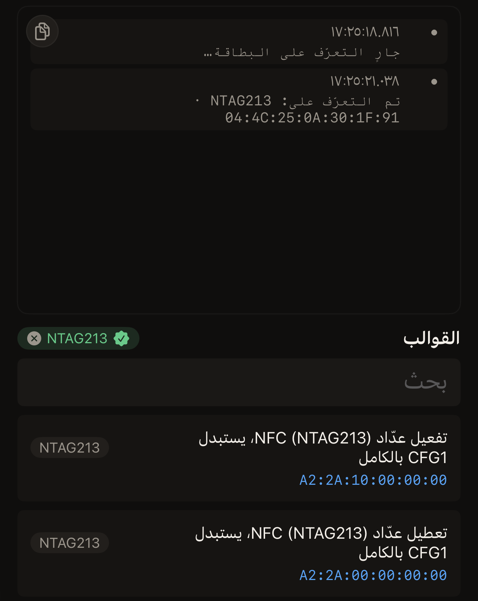

ترسل وحدة التحكم المتقدمة في Hex NFC البايتات من iPhone إلى البطاقة مباشرةً. وتطبع الأمر
الذي خرج والإجابة التي وصلت، ووقت كلٍّ منهما. افتحها عندما تريد الإطارات نفسها لا ملخصًا
لها.

قبل أن تبدأ، اجعل البطاقة في متناول يدك، وافتح ورقة البيانات الخاصة بشريحتها. ورقة البيانات
هي الوثيقة التي تصدرها الشركة المصنّعة للشريحة عن تلك الشريحة، وهي منشورة على موقع الشركة
تحت اسم الشريحة، وخطوة التعرّف أدناه تعطيك هذا الاسم. لا تعيد أي صفحة في هذا الدليل نشر
ورقة بيانات، وترسل وحدة التحكم ما تكتبه سواء قرأتها أم لم تقرأها.

تشغل وحدة التحكم شاشة واحدة، وكل عنصر تحكم تذكره هذه الصفحة موجود عليها. في الأعلى يوجد
مؤشر الحالة وبجانبه **تعرّف**، ثم زر التبديل **تخطّي التعرّف**. يليها حقل **أمر** وبجانبه
زر **تشغيل**، ثم أداة الاختيار بين **هذا التنفيذ** و**كل حركة بيانات NFC**. بعدها تأتي
منطقة المخرجات، وفي أسفل الشاشة **القوالب**، وفوق صفوف القوالب حقل **بحث**.

## التعرّف على الشريحة

:::::steps
::::step[افتح Hex NFC]
افتح Hex NFC. تظهر الشاشة الرئيسية في Hex NFC.
::::

::::step[افتح وحدة التحكم]
في الشاشة الرئيسية في Hex NFC، اضغط على **متقدّم**، آخر المربعات الأربعة. يعرض السطر الثاني في هذا
المربع «وحدة الأوامر الخام». تُفتح وحدة التحكم، وتعرض منطقة المخرجات الفارغة
«وحدة التحكم خاملة. المس قالبًا على اليسار، أو اكتب تسلسلًا ثم شغّله.» تقع قائمة القوالب
أسفل الشاشة، وليست على اليسار.

:::figure[تُفتح وحدة التحكم ومؤشر الحالة يعرض «خامل»، ومنطقة المخرجات فارغة، و**القوالب** أسفل الشاشة.]

:::
::::

::::step[ابدأ مسح التعرّف]
اضغط على **تعرّف**، الزر الذي على يسار مؤشر الحالة. تضيف منطقة المخرجات
«جارٍ التعرّف على البطاقة…»، وتظهر لوحة المسح في iOS وعليها «قرّب البطاقة للتعرّف عليها.»
::::

::::step[قرّب البطاقة من iPhone]
ضع أعلى iPhone مسطّحًا على البطاقة وأبقِه ثابتًا. تذكر منطقة المخرجات اسم الشريحة وUID
البطاقة، ويظهر اسم الشريحة بجانب **القوالب**. ويكون نص السطر
«تم التعرّف على: NTAG213 · 04:4C:25:0A:30:1F:91».

:::figure[بعد مسح التعرّف، تذكر منطقة المخرجات الشريحة وUID الخاص بها، ويظهر اسم الشريحة بجانب **القوالب** وقوالب تلك الشريحة في أعلى القائمة.]

:::
::::
:::::

عند التعرّف على شريحة يُعاد ترتيب قائمة القوالب، فتتصدّرها القوالب المكتوبة لتلك الشريحة.
وتحتها القوالب التي لا تزال تنطبق عليها:

- القوالب المكتوبة لنوع الشريحة كله
- قوالب شريحة شقيقة من العائلة نفسها، مثل قالب لـ NTAG215 على NTAG216

لا يظهر أيٌّ من النوعين باهتًا. لكن بايتات الشريحة الشقيقة قد تخاطب صفحة خاطئة على
شريحتك، لذا اقرأها في **أمر** أولًا. لا يبهت القالب إلا إذا كان لعائلة شرائح مختلفة، أو
لنوع مختلف من البطاقات تمامًا. ومع ذلك يُحمَّل القالب الباهت في **أمر** عندما تضغط عليه.
لكي تنسى وحدة التحكم الشريحة، اضغط على اسمها بجانب **القوالب**، فتعود القائمة إلى ترتيبها
المعتاد.

عندما لا يستطيع التطبيق تسمية الشريحة، تعرض وحدة التحكم
«تم الاتصال بالبطاقة لكن الشريحة غير معروفة · 04:BA:4A:92:1B:21:90». ثم تطبع ما قالته
البطاقة عن نفسها. يكون السطر الأول شبيهًا بـ
«المُبلَّغ عنه: NXP · NTAG · 128-256 bytes · v1.0». ويحمل هذا السطر الشركة المصنّعة
للشريحة، وعائلة المنتج، وحجم الذاكرة الذي تعلنه الشريحة، وإصدار المنتج.
أما السطر الثاني فهو البايتات الخام التي قُرئ منها السطر الأول، مثل
«GET_VERSION: 00:04:04:02:01:00:0F:03». اضغط على أي سطر لنسخه. تظهر شارة «تم النسخ» لمدة
ثانية تقريبًا، وتصبح البايتات في الحافظة جاهزة لتقرير خطأ.

## محتوى القوالب

القالب الموجود تحت **القوالب** تسلسل أوامر محفوظ يأتي مع التطبيق. يحمل كل صف ثلاثة أشياء
لا غير: اسم القالب، وشارة تسمّي عائلة الشرائح التي كُتب لها، والبايتات نفسها. بعض القوالب
يقرأ البطاقة، وبعضها يكتب عليها، بما في ذلك صفحات لا تقبل الشريحة الكتابة عليها إلا مرة
واحدة.

لا يوجد وصف خلف أي صف، لذا فالبايتات هي الدليل الوحيد على ما يفعله القالب. اقرأها في
**أمر** وقارنها بورقة البيانات الخاصة بشريحتك قبل أن تشغّل أي شيء. على شرائح Type-2
الموجودة في معظم الملصقات والبطاقات البلاستيكية، الأمر الذي يبدأ بـ `30` أو `3A` يقرأ،
والذي يبدأ بـ `A2` يكتب. لترى وحدة التحكم تعمل دون تغيير أي بطاقة، ابدأ بالصف المسمّى
**قراءة 16 بايت**، وبايتاته `30:00`.

## تشغيل أمر

:::::steps
::::step[حمّل قالبًا]
اضغط على قالب في القائمة تحت **القوالب**. تنتقل بايتاته إلى **أمر**، وتسجّل وحدة التحكم
اسم القالب الذي حمّلته. لم يُرسَل أي شيء بعد.
::::

::::step[تحقّق مما سيُرسَل]
اقرأ التسلسل في **أمر** وعدّله إذا احتجت. كل خانتين ست عشريتين تمثلان بايتًا واحدًا،
وتفصل النقطتان الرأسيتان بين بايتات الأمر الواحد، وتفصل الفاصلة بين أمر والأمر الذي يليه.
يعرض الحقل الفارغ النموذج «21:60:00, A2:04:E1:10:06:00». هذا النموذج نص توضيحي، وليس
موجودًا في الحقل. لا يُرسَل أي شيء ما دام الحقل فارغًا، ويبقى **تشغيل** باهتًا حتى تحمّل
قالبًا أو تكتب تسلسلًا. وإذا قرأته مثالًا، فهو أمران، الأول من ثلاثة بايتات والثاني من
ستة، والثاني يكتب أربعة بايتات في صفحة.
::::

::::step[أرسله]
اضغط على زر **تشغيل**. يعرض مؤشر الحالة «جارٍ الاستطلاع…»، وتضيف منطقة المخرجات
«جارٍ استطلاع البطاقة…»، وتظهر لوحة المسح في iOS وعليها «قرّب البطاقة لإرسال الأمر.»
::::

::::step[قرّب البطاقة من iPhone]
ضع أعلى iPhone مسطّحًا على البطاقة وأبقِه ثابتًا. تضيف منطقة المخرجات سطر اتصال يحمل UID
البطاقة والشريحة، مثل «متصلة: 04:4C:25:0A:30:1F:91 · ntag213». ثم يعرض مؤشر الحالة
«جارٍ التنفيذ…» أثناء خروج الأوامر.

للتوقف قبل أن يصل أي بايت إلى البطاقة، اضغط على زر الإلغاء في لوحة iOS. ينتهي التنفيذ،
ويعود مؤشر الحالة إلى «خامل»، وتعرض منطقة المخرجات
«أُلغي قبل العثور على بطاقة. لم يُرسَل أي شيء.» وإذا تُركت اللوحة دون بطاقة بالقرب منها،
تُغلق من تلقاء نفسها ويعرض مؤشر الحالة «لم يُعثر على أي بطاقة». أما بعد أن تقرأ وحدة
التحكم بطاقةً، من **تشغيل** أو **تعرّف**، فيُسجَّل الإلغاء أو انتهاء المهلة في أي تنفيذ
لاحق سطرَ خطأ.
::::

::::step[اقرأ الإجابات]
يضيف كل أمر سطر إرسال وسطر استقبال، ويذكر سطر الاستقبال عدد البايتات التي عادت. وبعد آخر
إجابة يعرض مؤشر الحالة «تم» وتنتهي منطقة المخرجات بـ «تم.»

:::figure[بعد تشغيل **قراءة 16 بايت**، تحتوي منطقة المخرجات على سطر إرسال واحد وسطر استقبال واحد من ١٦ بايت، ويعرض مؤشر الحالة «تم».]

:::
::::
:::::

:::warning[لا تتحقق وحدة التحكم من أي شيء قبل الإرسال]
يغيّر أمر الكتابة البطاقة لحظة خروجه. وبعض الصفحات على الشريحة لا تقبل إلا كتابة واحدة
طوال عمر البطاقة. والبايت الخاطئ فيها لا يستطيع أي أمر لاحق أن يعيده كما كان.
:::

للعثور على قالب بين قوالب كثيرة، أدخِل جزءًا من اسمه أو من بايتاته في **بحث**، تحت عنوان
**القوالب**. ويمكنك أيضًا تجاهل قائمة القوالب وكتابة تسلسلك الخاص في **أمر**. الأمر الذي
ترفضه البطاقة ينهي التنفيذ واللمسة معًا، ويبقى كل سطر موجود في منطقة المخرجات في مكانه.

## مراقبة كل الإطارات، لا هذا التنفيذ فقط

فوق منطقة المخرجات، اضغط على **كل حركة بيانات NFC**. تعرض وحدة التحكم عندئذٍ كل إطار
يتبادله التطبيق مع البطاقة. وتظهر إطارات عمليات المسح والكتابة وعمليات البطاقة إلى جانب
إطارات هذه الشاشة. وتصل الإطارات الجديدة لحظة حدوثها. اضغط على **هذا التنفيذ** للعودة إلى
مخرجات وحدة التحكم نفسها.

## الوصول إلى شريحة ترفض الفحص

فعّل **تخطّي التعرّف**، زر التبديل الواقع بين مؤشر الحالة و**أمر**، عندما لا تستجيب
البطاقة لأي شيء بعد اتصالها. يرسل التطبيق عندئذٍ أوامرك دون أن يسأل الشريحة أولًا عن
نوعها. ويُبلغ التنفيذ عن البطاقة بأنها غير معروفة بدلًا من تسمية الشريحة. يبقى زر التبديل
مفعّلًا حتى توقفه؛ فهو لا يعود من تلقاء نفسه عند انتهاء التنفيذ. ويظهر السبب تحت زر
التبديل ما دام مفعّلًا:
«تُرسَل الأوامر مباشرةً إلى الشريحة. لازم للشرائح التي ترفض GET_VERSION: يوقفها الفحص وتفشل كل الأوامر بعده.»

ويبقى فحص واحد يعمل وزر التبديل مفعّل. فعندما قد تكون البطاقة جهازًا صحيًّا يعمل بتقنية NFC،
مثل قلم الإنسولين، يقرأ التطبيق منها ما يكفي لمعرفة ذلك فقط، ولا يرسل إلى الجهاز الصحي أيًّا
من أوامرك.

## إذا أبلغت وحدة التحكم عن خطأ

ينهي سطر الخطأ التنفيذ، ومعه اللمسة. وتُغلق لوحة المسح في iOS معه أيضًا، لذا لإرسال أي
شيء آخر، اضغط على **تشغيل** مرة أخرى وقرّب البطاقة.

- «تعذّر تحليل الأمر.» تعني أن النص في **أمر** ليس تسلسلًا يستطيع التطبيق قراءته، وأنه لم
  يُرسَل أي شيء. راجع القواعد الثلاث. كل بايت خانتان ست عشريتان، والنقطتان الرأسيتان
  تفصلان بين بايتات الأمر الواحد. والفاصلة تفصل بين أمر والأمر الذي يليه.
- «تعذّر التعرّف على البطاقة.» تعني أن مسح التعرّف انتهى دون نتيجة. اضغط على **تعرّف**
  وقرّب البطاقة مرة أخرى.
- «هذا جهاز صحي. لا يكتب Hex NFC أبدًا إلى الأجهزة الصحية ولا يرسل إليها أوامر.» تعني أن
  البطاقة جهاز طبي، مثل قلم الإنسولين. ولم يُرسَل إليه أي من أوامرك.
- «حدث خطأ غير متوقّع.» تعني أن التنفيذ توقف لسبب لا يملك التطبيق كلمات أدق لوصفه. وتحمل
  بقية السطر التفاصيل.
- أي رسالة أخرى في سطر الخطأ هي وصف التطبيق نفسه لما فعلته البطاقة، بالصياغة نفسها التي
  كان المسح أو الكتابة سيعرضها لك.

لمعرفة ما تعنيه هذه الرسائل عادةً في الواقع، راجع
[إذا تعذّرت قراءة البطاقة أو الكتابة عليها](troubleshooting.md).

## انظر أيضًا

- [حفظ نسخة من ذاكرة البطاقة](memory-dump.md)
- [البطاقات التي تعمل مع Hex NFC](tags-that-work.md)
- [مصفوفة دعم الشرائح](../developer/chip-support-matrix.md)
