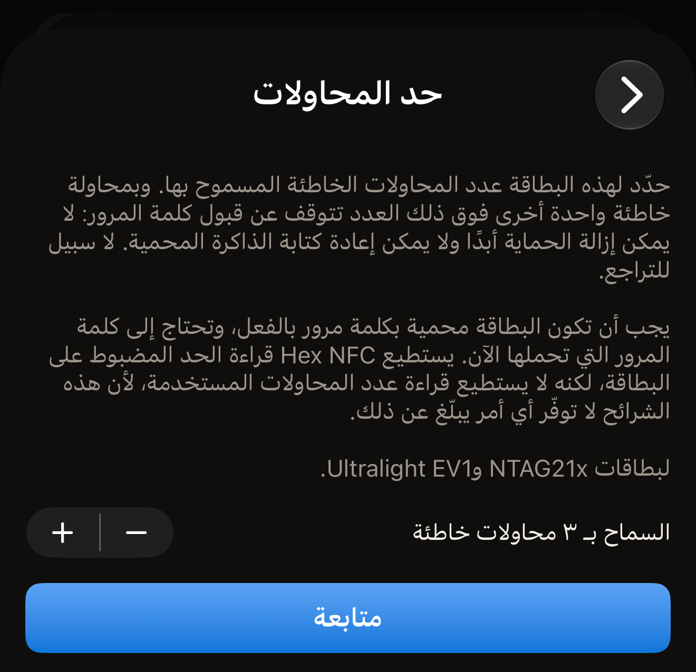
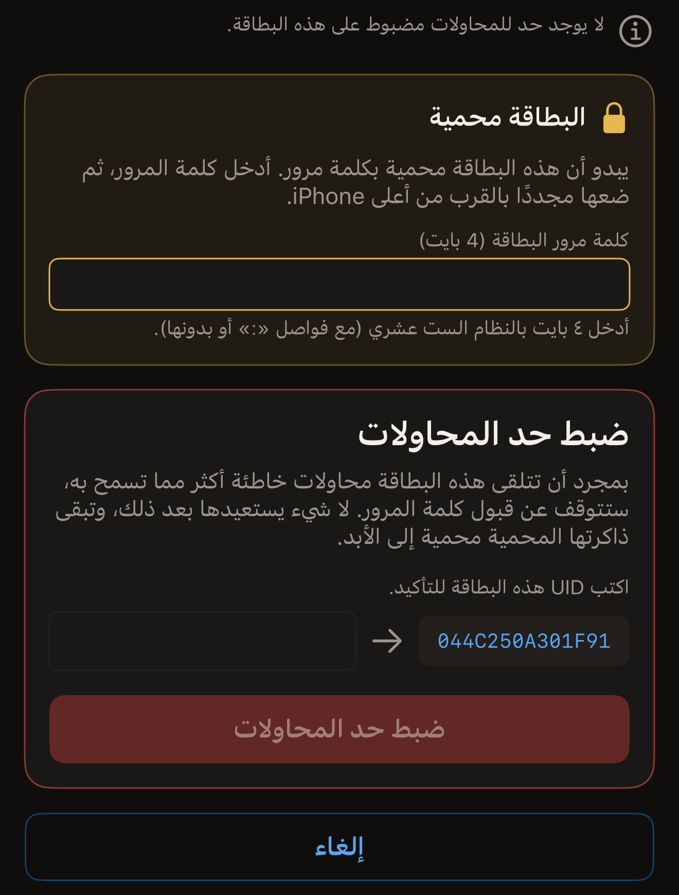

يحدد حد المحاولات للبطاقة المحمية بكلمة مرور عدد كلمات المرور الخاطئة التي
تقبلها، ويكتب Hex NFC هذا العدد على البطاقة من iPhone. اضبطه على ٣، فتقبل
البطاقة ثلاث محاولات خاطئة؛ والمحاولة التي تليها تجعلها تتوقف عن قبول كلمة المرور
نهائيًا. ومنذ ذلك الحين لا يمكن إزالة الحماية أبدًا، ولا يمكن إعادة كتابة الذاكرة
المحمية أبدًا. ولا سبيل للتراجع.

قبل أن تبدأ:

- يجب أن تكون البطاقة محمية بكلمة مرور بالفعل.
- تحتاج إلى كلمة المرور التي تحملها الآن.
- يجب أن تكون الشريحة NTAG21x أو MIFARE Ultralight EV1، فهناك يوجد هذا الحقل.

لمعرفة ما تحمله الشريحة، اقرأ [البطاقات التي تعمل مع Hex NFC](tags-that-work.md)
أو [مصفوفة دعم الشرائح](../developer/chip-support-matrix.md).

لا يُعد الحد جزءًا من قسم **الحماية**. فهو موجود في شاشة «العمليات»، ضمن
**إجراءات خطِرة**، لأنه يُضبط على بطاقة واحدة في كل مرة ولا يمكن التراجع عنه.

::include[two-tap-confirmation]

المسح الذي يفتح البطاقة ليس إحدى هاتين اللمستين. فهنا تقرّب البطاقة ثلاث مرات في
المجموع: مرة لمسحها، ثم لمستا العملية.

:::warning[قد تكلّفك كلمة مرور خاطئة محاولة]
إذا كانت البطاقة مضبوطة بحد بالفعل، فإن كلمة المرور التي تكتبها هنا تُحتسب من هذا
الحد إذا رفضتها البطاقة. يُبلغ Hex NFC عن الحد المضبوط على البطاقة، لكن لا يوجد
أمر في هذه الشرائح يذكر عدد المحاولات التي استُهلكت. ولا توجد كذلك طريقة لاختبار
كلمة مرور دون استهلاك إحدى تلك المحاولات. ولا يعرض لك التطبيق كلمة مرور البطاقة
أبدًا. فلا توجد شريحة تكشف عنها. وكلمة المرور التي يجب أن تكتبها هي التي احتفظت
بها عندما حميت البطاقة.
:::

## ضبط حد المحاولات

:::::steps
::::step[امسح البطاقة]
في الشاشة الرئيسية في Hex NFC، اضغط على **مسح**، ثم ضع البطاقة بالقرب من أعلى
iPhone. يُفتح محتوى البطاقة في شاشة «البطاقة». ويحمل القسم الموجود في الأعلى اسم
الشريحة عنوانًا له. ويقع قسم **الحماية** تحته مباشرة، فوق السجلات.

البطاقة التي تحمي كلمة مرورها الكتابة فقط تُمسح مثل أي بطاقة أخرى. ويعرض قسم
**الحماية** فيها «كلمة مرور · الكتابة فقط».

أما البطاقة التي تحمي كلمة مرورها القراءة أيضًا فتوقف المسح. وتعرض شاشة المسح
«البطاقة محمية» وتطلب كلمة المرور. أدخلها، ثم اضغط على
**فتح القفل وإعادة المسح**. بعد ذلك تُفتح شاشة «البطاقة»، ويعرض قسم **الحماية**
فيها «كلمة مرور · قراءة وكتابة». ويقدّم فتح القفل هذا كلمة المرور إلى البطاقة،
لذا فإن الإدخال الخاطئ يستهلك إحدى المحاولات التي تتناولها هذه الصفحة. وتشرح صفحة
[مسح بطاقة وقراءة محتواها](scan-a-tag.md#unlock-a-protected-tag) فتح القفل
بالتفصيل.
::::

::::step[افتح شاشة حد المحاولات]
في شاشة «البطاقة»، اضغط على زر القائمة أعلى اليسار، بجانب **كتابة**، ثم اضغط على
**العمليات…**. وفي شاشة «العمليات»، اضغط على **حد المحاولات** في قسم
**إجراءات خطِرة**.
::::

::::step[اختر عدد المحاولات الخاطئة المسموح بها]
يعرض الصف **السماح بـ ٣ محاولات خاطئة**، ويتغير الرقم فيه كلما ضغطت على زرّي
الزيادة والنقصان بجانبه. اختر أي رقم من ١ إلى ٧. ويبدأ عند ٣. ولا يوفر زرّا
الزيادة والنقصان خيارًا لعدم السماح بأي محاولة، لذا تستطيع هذه الشاشة تغيير الحد
المضبوط على البطاقة لكنها لا تستطيع إزالته أبدًا. وإزالة كلمة مرور البطاقة تمحو
الحد معها، وهذا يتطلب كلمة مرور لا تزال البطاقة تقبلها.

:::figure[تُفتح شاشة **حد المحاولات** على حد قدره ٣، مع زرّي الزيادة والنقصان بجانب الصف، و**متابعة** تحته.]

:::
::::

::::step[اضغط على «متابعة»]
اضغط على **متابعة**. يتوقف زرّا الزيادة والنقصان عن قبول التغييرات، وتطلب الشاشة
اللمسة الأولى.
::::

::::step[قرّب البطاقة للمسة الأولى في العملية]
اضغط على **ضبط حد المحاولات**، ثم ضع البطاقة بالقرب من أعلى iPhone. تقرأ هذه
اللمسة UID البطاقة والحد المضبوط عليها بالفعل.

إغلاق لوحة المسح في iOS قبل أن تقرّب البطاقة يعيدك إلى زرّي الزيادة والنقصان
و**متابعة**، لتختار حدًا مختلفًا. وإذا أُغلقت اللوحة من تلقاء نفسها دون وجود بطاقة
بالقرب من iPhone، تعرض الشاشة «لم يُعثر على أي بطاقة» مع **حاول مرة أخرى**
و**ابدأ من جديد**.
::::

::::step[أدخل كلمة المرور واكتب UID البطاقة]
يطلب قسم عنوانه «البطاقة محمية» كلمة المرور التي تحملها البطاقة الآن. أدخلها في
**كلمة مرور البطاقة (4 بايت)** بالنظام الست عشري، مع فواصل `:` أو بدونها. ثم
اكتب UID الظاهر على الشاشة في الحقل الذي بجانبه.

:::figure[تُكتب كلمة المرور في قسم «البطاقة محمية»، ويُكتب UID في القسم الذي تحته، فوق **ضبط حد المحاولات**.]

:::
::::

::::step[قرّب البطاقة نفسها للمسة الثانية]
اضغط على **ضبط حد المحاولات**، ثم ضع البطاقة بالقرب من أعلى iPhone مرة أخرى.
يكتب التطبيق الحد الجديد ويقرؤه مجددًا. وتعرض الشاشة
«هذه البطاقة مضبوطة الآن على السماح بـ ٣ محاولات خاطئة.»

وتضيف تحت ذلك
«بمحاولة خاطئة واحدة أخرى فوق ذلك العدد تتوقف عن قبول كلمة المرور إلى الأبد.»
::::
:::::

## ما يُبلغ عنه التطبيق بين اللمستين

تقرأ اللمسة الأولى إعدادات البطاقة نفسها، لذا تذكر الشاشة ما تحمله البطاقة قبل
أن تكتب UID البطاقة. وتُبلغ عن واحد من ثلاثة أمور:

- «لا يوجد حد للمحاولات مضبوط على هذه البطاقة.» لا يوجد عدد من المحاولات الخاطئة
  يمكن أن يجعلها تتوقف عن قبول كلمة المرور.
- «هذه البطاقة مضبوطة بالفعل على السماح بـ ٣ محاولات خاطئة.» الرقم هو الذي تحمله
  البطاقة، ويحل الحد الجديد محله.
- «هذه البطاقة محمية من القراءة، لذا لا يمكن قراءة الحد الحالي إلا بعد تقديم كلمة المرور.»
  لا يوجد ما يُبلغ عنه. فصفحات الإعدادات محمية بكلمة المرور. وتستمر العملية من
  هنا: اكتب UID، فتقدّم اللمسة الثانية كلمة المرور وتكتب الحد الجديد.

أما عدد المحاولات التي استهلكتها البطاقة بالفعل فلا يُبلغ عنه أبدًا، لأنه لا يوجد
أمر في هذه الشرائح يكشف عنه.

## إذا لم تكن على البطاقة كلمة مرور

يحمي حد المحاولات كلمة المرور، لذا يرفض التطبيق العملية على بطاقة لا تحمل كلمة
مرور. ونص الرفض:
«لا توجد كلمة مرور مضبوطة على هذه البطاقة، لذا ليس هناك ما يحميه حد المحاولات.»

يأتي الرفض قبل كتابة أي شيء. وتبقى البطاقة كما كانت تمامًا. اضبط كلمة مرور أولًا
كما تشرح صفحة [حماية بطاقة بكلمة مرور](protect-a-tag.md)، ثم عد إلى هنا.

## إذا تعذّر على التطبيق قراءة الحد مجددًا

البطاقة التي تبتعد في منتصف الكتابة يظهر لها العنوان «تمت كتابة حد المحاولات.»

ونص الشرح:
«أقرّت البطاقة بعملية الكتابة، لكن تعذّرت قراءة البايت مرة أخرى في هذه اللمسة. ابدأ العملية من جديد: تعرض اللمسة الأولى الحد المخزَّن على البطاقة.»
فقد قبلت الشريحة الكتابة. لكن هذه اللمسة لم تستطع إثبات ما كُتب.

تكون العملية قد انتهت عند هذه النقطة، لذا لا تعرض الشاشة إعادة المحاولة. عد إلى
شاشة «العمليات» وافتح **حد المحاولات** مرة أخرى. وأكمل العملية حتى نهايتها: فاللمسة
الأولى في العملية الجديدة تُبلغ عن الحد المخزَّن على البطاقة.

## إذا توقفت كلمة المرور عن العمل لاحقًا

على بطاقة مضبوطة بحد، يُبلغ عن كلمة المرور التي ترفضها البطاقة بالرسالة
«رفضت البطاقة كلمة المرور هذه. هذه البطاقة مضبوطة بحد للمحاولات، لذا ربما تكون قد توقفت عن قبول كلمة المرور حتى لو كانت كلمة المرور صحيحة.»

أما التحقق الذي لم يكتمل فرسالته
«كلمة المرور هذه لم تفتح البطاقة. هذه البطاقة مضبوطة بحد للمحاولات، وكل محاولة خاطئة تُحتسب من هذا الحد. تحقق من كلمة المرور قبل المحاولة مجددًا.»

وتعني الرسالتان الأمر نفسه بالنسبة إلى ما تفعله بعد ذلك: اعثر على كلمة المرور
الصحيحة قبل أن تقرّب البطاقة مرة أخرى. وقد تحل أي من الرسالتين محل نص الطلب في
قسم «البطاقة محمية». ويبدأ حقله فارغًا، لذا لا تُرسل كلمة المرور المرفوضة مرة
ثانية إلا إذا كتبتها. أما العملية التي تنتهي بالفشل فتترك على الشاشة
**ابدأ من جديد**، الذي يعيد إليك النموذج ويطلب كلمة المرور مرة أخرى. وبمجرد أن
تتلقى البطاقة محاولات خاطئة أكثر مما تسمح به، لا يفتحها أي شيء، وتبقى ذاكرتها
المحمية محمية إلى الأبد.

## انظر أيضًا

- [إزالة كلمة مرور البطاقة](remove-password.md)
- [حماية البطاقة](tag-protection.md)
- [إذا تعذّرت قراءة البطاقة أو الكتابة عليها](troubleshooting.md)
