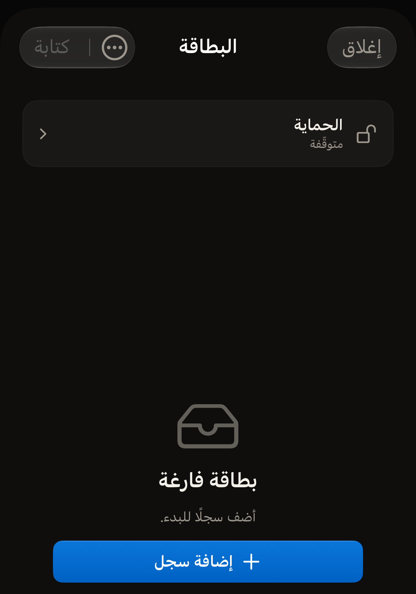
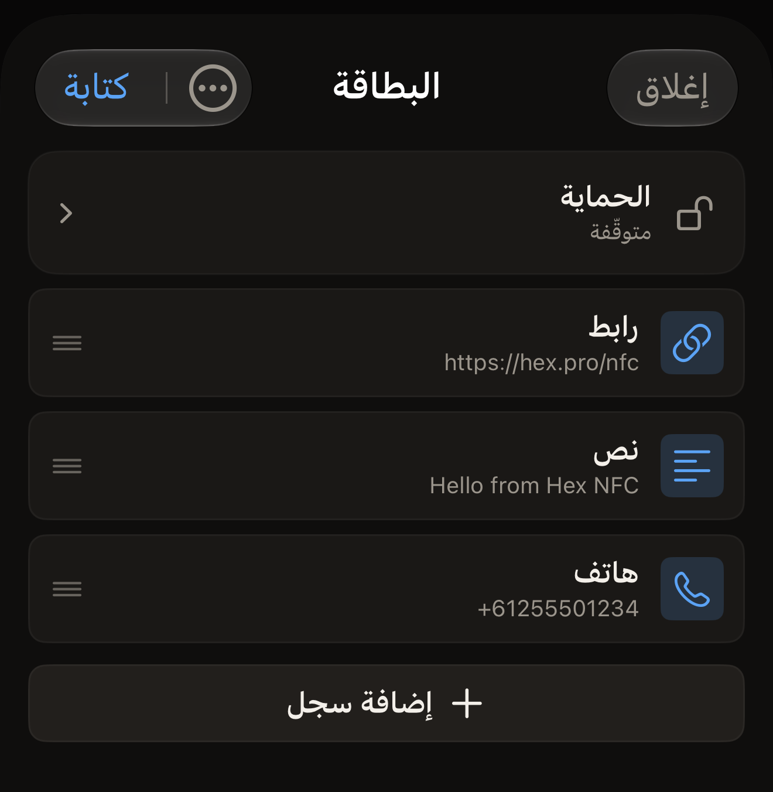

تحمل البطاقة قائمة من السجلات، ويعرض Hex NFC هذه القائمة في شاشة «البطاقة».
أضف سجلًا أو غيّره أو انقله إلى أعلى القائمة أو احذفه، ثم اكتب السجلات على
البطاقة من iPhone حين تصبح القائمة كما تريد.

## فتح قائمة السجلات

افعل أحد الأمرين التاليين:

- للعمل على بطاقة في يدك، امسحها. تظهر سجلاتها في شاشة «البطاقة». راجع
  [مسح بطاقة وقراءة محتواها](scan-a-tag.md).
- لإنشاء مجموعة سجلات دون أن تكون أمامك بطاقة، اضغط على **إنشاء** في الشاشة
  الرئيسية في Hex NFC.

البطاقة أو المجموعة الجديدة التي لا تحمل شيئًا بعد تعرض «بطاقة فارغة»، وتحتها
«أضف سجلًا للبدء.»

:::figure[عند إنشاء مجموعة بلا سجلات تعرض الشاشة «بطاقة فارغة»، ويظهر زر **إضافة سجل** تحت الرسالة.]

:::

## إضافة سجل

::::steps
:::step[افتح أداة اختيار السجل]
في شاشة «البطاقة»، اضغط على **إضافة سجل**. يقع هذا الزر في نهاية قائمة
السجلات، أو تحت «بطاقة فارغة» حين لا تحمل البطاقة شيئًا. تُفتح شاشة
«إضافة سجل» وفيها مربع لكل نوع يمكنك إضافته.
:::

:::step[اختر نوعًا]
اضغط على المربع الذي تريده، مثل **نص** أو **رابط** أو **جهة اتصال** أو
**واي فاي**. يضيف التطبيق سجلًا من هذا النوع ويفتحه لتملأه.
:::

:::step[املأ السجل]
أدخل التفاصيل التي يحتاج إليها السجل، ثم اضغط على **حفظ**. يظهر السجل في
نهاية القائمة في شاشة «البطاقة».
:::
::::

يمكنك الاختيار من بين ١٣ نوعًا. وتشرح صفحة [أنواع السجلات](record-types.md) ما
يحمله كل نوع وما يفعله الهاتف به حين يقرأ البطاقة.

## إضافة سجل من رمز QR

::::steps
:::step[افتح قارئ رموز QR]
في شاشة «إضافة سجل»، اضغط على **مسح QR**. تُفتح شاشة «مسح رمز QR».
:::

:::step[اسمح باستخدام الكاميرا]
في المرة الأولى، تعرض الشاشة «السماح بالكاميرا لمسح رمز QR»
و«تتم معالجة الصورة على الجهاز فقط. لا يتم رفع أي شيء.» اضغط على
**السماح بالكاميرا**، ثم اسمح بالوصول حين يطلب iOS ذلك. وإذا سبق أن رفضت
الوصول إلى الكاميرا، تعرض الشاشة «يحتاج التطبيق إلى الكاميرا» بدلًا من ذلك.
اضغط على **فتح الإعدادات** وفعّل الكاميرا من جديد لتطبيق Hex NFC.
:::

:::step[وجّه الكاميرا نحو الرمز]
اجعل الرمز داخل الإطار. يقرأ التطبيق أول رمز يراه، ويحوّله إلى سجل، ثم يفتحه
لتتحقق منه.
:::
::::

يتوافق النوع الذي يختاره التطبيق مع ما يحمله الرمز: شبكة واي فاي، أو جهة
اتصال، أو بريد إلكتروني، أو رسالة نصية، أو رقم هاتف، أو موقع. ويصبح عنوان
الويب سجل رابط. وأي محتوى آخر يصبح سجل نص.

## تغيير سجل أو نقله أو حذفه

افعل أيًّا مما يلي في شاشة «البطاقة»:

- لتغيير سجل، اضغط على صفه، وعدّل الحقول، ثم اضغط على **حفظ**.
- لنقل سجل، اسحب صفه إلى أعلى أو إلى أسفل. فترتيب القائمة هو الترتيب الذي
  تُكتب به السجلات على البطاقة.
- لحذف سجل، اسحب صفه إلى اليمين ثم اضغط على **حذف**. وإذا سحبت الصف حتى
  الطرف الآخر من الشاشة، يُحذف دون تلك الضغطة الثانية.

:::figure[تظهر السجلات بالترتيب الذي تُكتب به، ويأتي صف **إضافة سجل** في نهاية القائمة.]

:::

السجل الذي تحذفه هنا يختفي من القائمة لا من البطاقة. فالبطاقة تحتفظ بما كانت
تحمله حتى الكتابة التالية، ولذلك لا تخسر شيئًا إذا أفرغت القائمة خطأً. ولمسح
محتوى البطاقة فعلًا، راجع [مسح محتوى البطاقة أو تهيئتها](erase-or-format.md).

## إنهاء التعديل

لا يصل أي شيء في هذه الشاشة إلى البطاقة حتى تكتبه. وحين تصبح القائمة كما
ينبغي، افعل أحد ما يلي:

- لوضع السجلات على البطاقة، اضغط على **كتابة**. راجع
  [كتابة رابط على بطاقة](write-a-link.md).
- للاحتفاظ بالمجموعة إلى وقت لاحق، اضغط على زر القائمة في أعلى شاشة «البطاقة»،
  ثم على **حفظ كقالب…**. راجع [حفظ بطاقة كقالب](presets.md).
- للخروج، اضغط على **إغلاق**. تبقى بطاقتك كما كانت، وتُحذف التعديلات التي لم
  تكتبها ولم تحفظها.

## انظر أيضًا

- [أنواع السجلات](record-types.md)
- [كتابة رابط على بطاقة](write-a-link.md)
- [حفظ بطاقة كقالب](presets.md)
