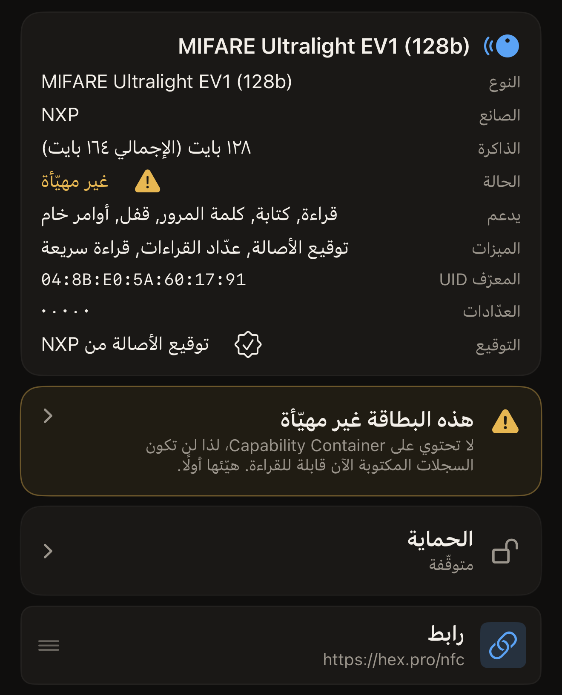
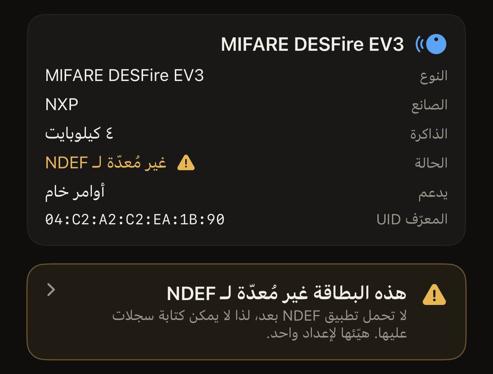
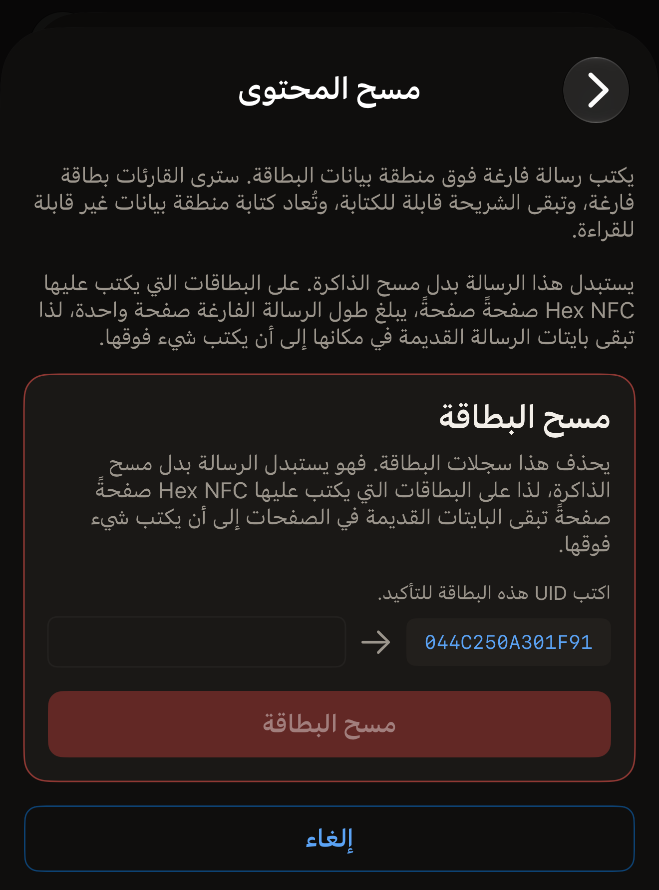
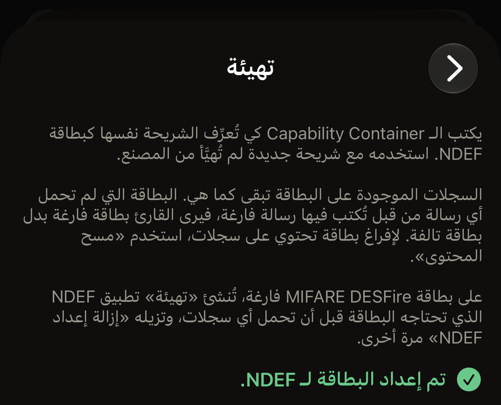
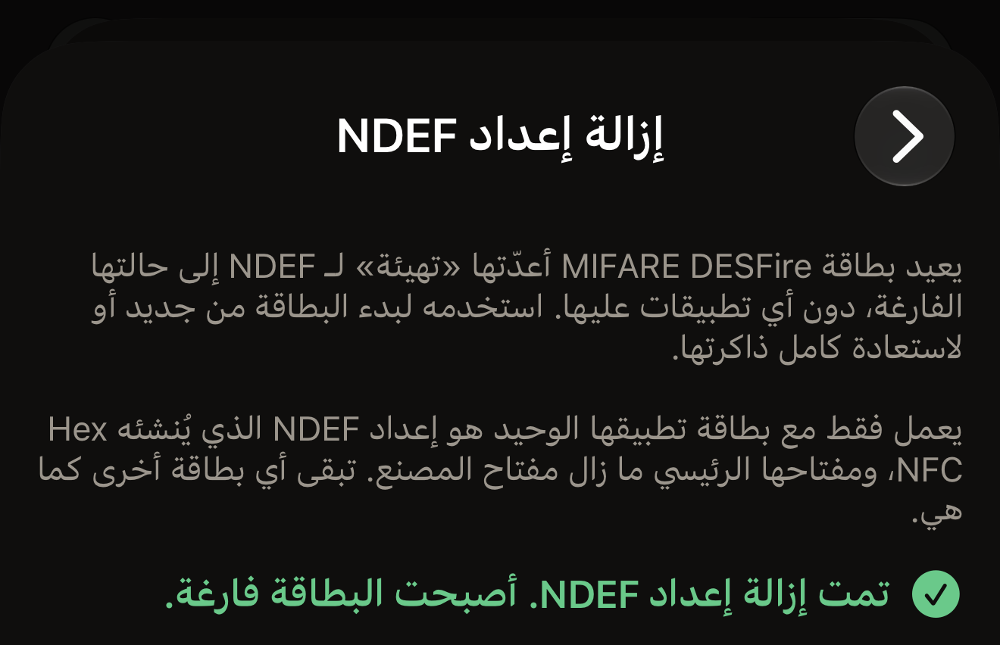

يقدّم Hex NFC إصلاحين للبطاقة التي لا تُقرأ، وكلٌّ منهما يؤدي عكس ما يؤديه الآخر. يكتب
مسح المحتوى رسالة فارغة فوق منطقة بيانات البطاقة، فترى القارئات بطاقة فارغة وتبقى الشريحة
قابلة للكتابة. أما التهيئة فتكتب Capability Container، وهو الترويسة القصيرة التي يبحث عنها
القارئ قبل أن يقرأ أي شيء آخر على البطاقة.

قبل أن تبدأ، امسح البطاقة: في الشاشة الرئيسية في Hex NFC، اضغط على **مسح**، ثم ضع البطاقة
بالقرب من أعلى iPhone. تُفتح شاشة **البطاقة** بعد أن يقرأها التطبيق، وتُفتح كذلك للبطاقة غير
المهيّأة، وللبطاقة التي لا تُقرأ بياناتها، ولبطاقة MIFARE DESFire غير المُعدّة لـ NDEF. وفي
كل هذه الحالات تُفتح الشاشة بعد المسح من تلقاء نفسها، دون أن تضغط على أي شيء. فالتحذير الذي
يظهر على شاشة المسح تشخيص للمشكلة وليس طريقًا مسدودًا. في شاشة **البطاقة**، اضغط على زر
القائمة أعلى اليسار، بجانب **كتابة**، ثم اضغط على **العمليات…**. يقع الإصلاحان كلاهما في
قسم **إجراءات خطِرة** أسفل شاشة **العمليات**. وبجانبهما عملية **إزالة إعداد NDEF**، وهي
تعكس ما تفعله التهيئة على بطاقة MIFARE DESFire. وتتأكد كل عملية هناك من البطاقة قبل أن
تغيّرها:

::include[two-tap-confirmation]

## الإصلاح الذي تحتاجه البطاقة

يسمّي التطبيق العطل على الشاشة التي يظهر لك فيها، ويدلّ كل اسم على الإصلاح الذي تحتاجه البطاقة.

- هيّئ البطاقة عندما تعرض شاشة المسح «هذه البطاقة غير مهيّأة بعد»، أو تعرض شاشة **البطاقة**
  «غير مهيّأة». فالبطاقة لا تحتوي على Capability Container، لذا لا يكون أي شيء تكتبه عليها
  قابلًا للقراءة.
- امسح محتوى البطاقة عندما تعرض شاشة المسح «بيانات هذه البطاقة غير قابلة للقراءة»، أو تعرض
  شاشة **البطاقة** «بيانات غير مقروءة». فـ Capability Container موجود في مكانه بالفعل، ولا
  تجد التهيئة هناك ما تصلحه.
- هيّئ البطاقة عندما تعرض شاشة المسح «هذه البطاقة غير مُعدّة لـ NDEF بعد»، أو تعرض شاشة
  **البطاقة** «غير مُعدّة لـ NDEF». فهذه بطاقة MIFARE DESFire فارغة، أو بطاقة لم تُكمل تهيئةٌ
  سابقة إعدادها، لذا لا يمكن كتابة سجلات عليها بعد. ولا يظهر هذا أبدًا على بطاقة نقل أو
  بطاقة دخول.

وعلى البطاقة التي لا تزال تقبل الكتابة، تعرض شاشة **البطاقة** أيضًا تحذيرًا يمكنك الضغط
عليه، نصّه «هذه البطاقة غير مهيّأة» أو «بيانات هذه البطاقة غير قابلة للقراءة» أو «هذه
البطاقة غير مُعدّة لـ NDEF». ويفتح الضغط عليه **العمليات**. أما البطاقة المقفلة نهائيًا
فتعرض الحالة دون تحذير، لأن كلا الإصلاحين كتابة على البطاقة.

:::figure[البطاقة التي لا تحتوي على Capability Container تعرض «غير مهيّأة» بجانب **الحالة**، ويظهر تحذير «هذه البطاقة غير مهيّأة» أسفل القسم.]

:::

:::figure[بطاقة MIFARE DESFire الفارغة تعرض «غير مُعدّة لـ NDEF» بجانب **الحالة**، ويظهر أسفل القسم تحذير «هذه البطاقة غير مُعدّة لـ NDEF».]

:::

## مسح محتوى بطاقة

يزيل مسح المحتوى سجلات البطاقة ويُبقي الشريحة قابلة للكتابة. ويعيد أيضًا بناء منطقة
البيانات التي لم تعد تُقرأ.

:::::steps
::::step[افتح شاشة مسح المحتوى]
في شاشة **العمليات**، اضغط على **مسح المحتوى**. تشرح الشاشة التي تُفتح ما يكتبه مسح
المحتوى، وتحذّرك قبل أن يصل أي شيء إلى البطاقة.
::::

::::step[ابدأ مسح المحتوى]
اضغط على **مسح محتوى البطاقة**. يطلب منك iPhone تقريب البطاقة.
::::

::::step[قرّب البطاقة من iPhone]
ضع أعلى iPhone على البطاقة. تعرض الشاشة «الخطوة 1 من 2. ضع البطاقة للتعرّف عليها.»، ثم
تعرض UID البطاقة.
::::

::::step[أعِد كتابة UID]
تعرض الشاشة «اكتب UID هذه البطاقة للتأكيد.» وتضع UID بجانب حقل فارغ. أدخل الأحرف نفسها في
الحقل، دون نقطتين رأسيتين بينها، بأحرف كبيرة أو صغيرة، ثم اضغط على **مسح محتوى البطاقة**.
إذا كانت كلمة مرور البطاقة تحمي منطقة بياناتها، يظهر فوق الحقل قسم بعنوان «البطاقة محمية»
يطلب كلمة المرور أو المفتاح الذي تحمله البطاقة الآن. ولا يفعل **مسح محتوى البطاقة** شيئًا
حتى تملأ ذلك.

:::figure[بعد اللمسة الأولى، يظهر UID البطاقة على يمين حقل فارغ، ويبقى **مسح محتوى البطاقة** باهتًا حتى تكتبه.]

:::
::::

::::step[قرّب البطاقة مرة ثانية]
ضع البطاقة بالقرب من أعلى iPhone مرة أخرى. تعرض الشاشة «تم مسح محتوى البطاقة.» بعد أن
يقرأ التطبيق الرسالة الفارغة من البطاقة مجددًا.
::::
:::::

ينتهي مسح المحتوى بإحدى نتيجتين. يعرض «تم مسح محتوى البطاقة.» بعد أن تُقرأ الرسالة
الفارغة مجددًا. وإلا فإنه يعرض خطأً يسمّي العطل، وتحته التفاصيل لتقرير الخطأ. وتشرح صفحة
[إذا تعذّرت قراءة البطاقة أو الكتابة عليها](troubleshooting.md) ما يمكنك تجربته بعد ذلك.

:::note
يستبدل مسح المحتوى رسالة البطاقة ولا يمحو ذاكرتها. على بطاقات NTAG وMIFARE Ultralight،
وهي الشرائح الموجودة في معظم الملصقات والبطاقات البلاستيكية، يبلغ طول الرسالة الفارغة صفحة
واحدة. وتبقى بايتات الرسالة القديمة في مكانها حتى يُكتب فوقها شيء آخر. اكتب رسالة من عندك
على أي بطاقة تنوي أن تعطيها لغيرك.
:::

## تهيئة بطاقة {#format-a-tag}

استخدم التهيئة على شريحة جديدة لم تُشحن مهيّأة مسبقًا. تكتب التهيئة Capability Container
وتُبقي السجلات الموجودة على البطاقة في مكانها. وعلى بطاقات ISO 15693 مثل ICODE SLIX2، تحصل
البطاقة التي لم تحمل أي رسالة من قبل على رسالة فارغة أيضًا، فيرى القارئ بطاقة فارغة لا بطاقة
معطوبة. ولإفراغ بطاقة عليها سجلات، امسح محتواها بدلًا من تهيئتها. أما على بطاقة MIFARE
DESFire فارغة، فتُعدّ التهيئة البطاقة لـ NDEF، كما يشرح الجزء الأخير من هذا القسم.

::::steps
:::step[افتح شاشة التهيئة]
في شاشة **العمليات**، اضغط على **تهيئة**.
:::

:::step[ابدأ التهيئة]
اضغط على **تهيئة البطاقة**. يطلب منك iPhone تقريب البطاقة.
:::

:::step[قرّب البطاقة من iPhone]
ضع أعلى iPhone على البطاقة. تعرض الشاشة «الخطوة 1 من 2. ضع البطاقة للتعرّف عليها.»، ثم
تعرض UID البطاقة.
:::

:::step[أعِد كتابة UID]
تعرض الشاشة «اكتب UID هذه البطاقة للتأكيد.» وتضع UID بجانب حقل فارغ. أدخل الأحرف نفسها في
الحقل، دون نقطتين رأسيتين بينها، بأحرف كبيرة أو صغيرة، ثم اضغط على **تهيئة البطاقة**.
:::

:::step[قرّب البطاقة مرة ثانية]
ضع البطاقة بالقرب من أعلى iPhone مرة أخرى. تعرض الشاشة «تمت تهيئة البطاقة.» بعد أن يقرأ
التطبيق الترويسة مجددًا. وعلى بطاقة MIFARE DESFire تعرض «تم إعداد البطاقة لـ NDEF.» بدلًا
من ذلك.
:::
::::

على بطاقة NTAG أو MIFARE Ultralight، تنتهي التهيئة بإحدى ثلاث نتائج:

- «تمت تهيئة البطاقة.» تعني أن الترويسة كُتبت وقُرئت مجددًا وأصبحت في مكانها، وأن البطاقة
  جاهزة لاستقبال رسالة.
- «مهيّأة مسبقًا: لم تتم أي كتابة.» تعني أن البطاقة كانت تحمل الترويسة الصحيحة، فلم يصل
  إليها شيء. ويوجّهك التطبيق إلى **مسح المحتوى**، لأن البطاقة التي لا تزال لا تُقرأ يكون
  عطلها في منطقة البيانات.
- «تحتوي هذه البطاقة على Capability Container مختلف بالفعل.» تعني أن الترويسة الموجودة على
  البطاقة لا تطابق الشريحة التي تعرّف عليها التطبيق. لم يُكتب أي شيء.

:::figure[إذا وجدت التهيئة الترويسة في مكانها بالفعل، تعرض «مهيّأة مسبقًا: لم تتم أي كتابة.» وتوجّهك إلى مسح المحتوى بدلًا منها.]

:::

تعرض بطاقة ISO 15693 «تمت تهيئة البطاقة.» في كل مرة، لأن كتلة Capability Container فيها
تبقى قابلة لإعادة الكتابة، ويكتبها التطبيق في كل تشغيل.

:::warning
على بطاقات NTAG وMIFARE Ultralight، لا يُكتب Capability Container إلا مرة واحدة طوال عمر
البطاقة، ولا يمكن تصحيحه أبدًا. لذلك يقرأ التطبيق تلك الصفحة أولًا ولا يكتب عليها إلا إذا
كانت فارغة. ويرفض الشريحة التي لم يستطع التعرّف عليها بدلًا من أن يخمّن الترويسة. يظهر اسم
الشريحة الذي قرأه التطبيق أعلى شاشة **البطاقة**، وتوضح صفحة
[البطاقات التي تعمل مع Hex NFC](tags-that-work.md) ما يستطيع التطبيق فعله مع كل شريحة.
:::

### تهيئة بطاقة MIFARE DESFire

لا تحمل بطاقة MIFARE DESFire EV1 أو EV2 أو EV3 الفارغة أي تطبيقات، والتهيئة تمنحها تطبيق
NDEF الذي تحتاجه قبل أن تتمكن من حمل السجلات. والخطوات هي الخطوات السابقة نفسها، باللمستين
نفسيهما وبكتابة UID. ويحدد Hex NFC حجم ملف NDEF على البطاقة بحسب ذاكرتها الحرة، حتى
٤ كيلوبايت على بطاقة 4K. وبعد إعداد البطاقة، يقرؤها iOS ويكتب عليها كأي بطاقة NDEF أخرى.

على بطاقة MIFARE DESFire، تنتهي اللمسة الثانية بإحدى نتيجتين:

- «تم إعداد البطاقة لـ NDEF.» تعني أن تطبيق NDEF أصبح على البطاقة ويُقرأ منها مجددًا، وأن
  البطاقة جاهزة لاستقبال السجلات.
- «مُعدّة لـ NDEF مسبقًا: لم تتم أي كتابة.» تعني أن Hex NFC أعدّ هذه البطاقة من قبل، فلم يصل
  إليها شيء.

:::figure[بعد أن تُعدّ التهيئة بطاقة MIFARE DESFire فارغة، تعرض «تم إعداد البطاقة لـ NDEF.»]

:::

ويرفض Hex NFC بعض البطاقات ولا يكتب عليها شيئًا، فتعرض الشاشة إحدى هذه الرسائل:

- «تحمل هذه البطاقة تطبيقات أخرى، لذا لا يمكن إعدادها لـ NDEF هنا. لم تتم أي كتابة.» وهذه
  هي النتيجة التي تنتهي إليها بطاقة النقل أو بطاقة الدخول.
- «تحتاج هذه البطاقة إلى مفتاحها الرئيسي قبل إضافة أي شيء إليها، لذا لا يمكن إعدادها لـ NDEF
  هنا. لم تتم أي كتابة.»
- «أُعدّت هذه البطاقة لـ NDEF بتطبيق آخر، لذا يتركها Hex NFC كما هي. لم تتم أي كتابة.»

إذا ابتعدت البطاقة عن iPhone أثناء اللمسة الثانية قبل أن يكتب الإعداد أي شيء، تعرض الشاشة
«فُقدت البطاقة أثناء القراءة. أبقِها ملاصقة لأعلى الهاتف وحاول مجددًا.» ولا يكون قد كُتب
شيء. أما إذا ابتعدت بعد أن بدأ الإعداد الكتابة، فتعرض الشاشة إحدى هاتين الرسالتين:

- أُعدّت البطاقة جزئيًا. اضغط «تهيئة» مرة أخرى لإكمال الإعداد.
- ربما أُعدّت البطاقة جزئيًا. امسحها للتحقق، أو اضغط «تهيئة» مرة أخرى.

وتُكمل التهيئة التالية من حيث توقفت السابقة.

وإذا نفدت الذاكرة الحرة على البطاقة، تختلف الرسالة بين المحاولة الأولى وما بعدها:

- في المحاولة الأولى: لا تتوفر على هذه البطاقة ذاكرة حرة كافية لملف NDEF. استخدم
  «إزالة إعداد NDEF» لإزالة ما بدأ إعداده.
- في أي محاولة لاحقة على البطاقة نفسها: لا تتوفر على هذه البطاقة ذاكرة حرة كافية لملف
  NDEF. لم تتم أي كتابة.

وفي الحالتين، تُفرغ **إزالة إعداد NDEF** البطاقة، كما يشرح القسم التالي.

## إزالة إعداد NDEF من بطاقة {#remove-ndef-setup}

تعيد **إزالة إعداد NDEF** بطاقة MIFARE DESFire التي أعدّتها التهيئة إلى حالتها الفارغة. فهي
تحذف تطبيق NDEF على البطاقة وكل السجلات فيه، وتعيد إلى البطاقة ذاكرتها كاملة. ولا تعمل إلا مع
بطاقة مفتاحها الرئيسي ما زال مفتاح المصنع، وتطبيقها الوحيد هو إعداد NDEF الذي يُنشئه Hex NFC،
حتى لو تركته التهيئة ناقصًا. أما أي بطاقة أخرى فتبقى كما هي.

::::steps
:::step[افتح شاشة الإزالة]
في شاشة **العمليات**، ضمن **إجراءات خطِرة**، اضغط على **إزالة إعداد NDEF**.
:::

:::step[ابدأ الإزالة]
اضغط على **إزالة إعداد NDEF**. يطلب منك iPhone تقريب البطاقة.
:::

:::step[قرّب البطاقة من iPhone]
ضع أعلى iPhone على البطاقة. تعرض الشاشة «الخطوة 1 من 2. ضع البطاقة للتعرّف عليها.»، ثم
تعرض UID البطاقة.
:::

:::step[أعِد كتابة UID]
تعرض الشاشة «اكتب UID هذه البطاقة للتأكيد.» وتضع UID بجانب حقل فارغ. أدخل الأحرف نفسها في
الحقل، دون نقطتين رأسيتين بينها، بأحرف كبيرة أو صغيرة، ثم اضغط على **إزالة إعداد NDEF**.
:::

:::step[قرّب البطاقة مرة ثانية]
ضع البطاقة بالقرب من أعلى iPhone مرة أخرى، وأبقِها هناك حتى تظهر النتيجة. تعرض الشاشة
«تمت إزالة إعداد NDEF. أصبحت البطاقة فارغة.» بعد أن يقرأ Hex NFC البطاقة مجددًا ولا يجد
عليها أي تطبيقات.
:::
::::

:::figure[البطاقة التي أُزيل إعداد NDEF منها تعرض «تمت إزالة إعداد NDEF. أصبحت البطاقة فارغة.»]

:::

وإذا كانت البطاقة فارغة أصلًا، تعرض الشاشة «هذه البطاقة فارغة بالفعل: لم يتغير شيء.» ويرفض
Hex NFC بعض البطاقات ولا يغيّر فيها شيئًا، فتعرض الشاشة إحدى هذه الرسائل:

- «تحمل هذه البطاقة تطبيقات أخرى. إزالة الإعداد ستحذفها أيضًا، لذا لم يتغير شيء.»
- «أُعدّ NDEF على هذه البطاقة بتطبيق آخر، لذا لن يزيله Hex NFC. لم يتغير شيء.»
- «المفتاح الرئيسي لهذه البطاقة ليس مفتاح المصنع، لذا لا يمكن للتطبيق إزالة إعدادها. لم
  يتغير شيء.»

إذا ابتعدت البطاقة عن iPhone أثناء اللمسة الثانية قبل أن تغيّر الإزالة أي شيء، تعرض الشاشة
«فُقدت البطاقة أثناء القراءة. أبقِها ملاصقة لأعلى الهاتف وحاول مجددًا.» ولا يكون أي شيء على
البطاقة قد تغيّر. وإذا ابتعدت بعد أن بدأت الإزالة، تعرض الشاشة «ربما أصبحت البطاقة فارغة
بالفعل. امسحها للتحقق.» فإن أظهر المسح أن البطاقة لا تزال مُعدّة لـ NDEF، فنفّذ
**إزالة إعداد NDEF** مرة أخرى: فكل عملية إزالة تقرأ البطاقة أولًا، وإذا وجدتها فارغة بالفعل
عرضت «هذه البطاقة فارغة بالفعل: لم يتغير شيء.»

وبعد إزالة الإعداد، يعرض المسح مرة أخرى «غير مُعدّة لـ NDEF» بجانب **الحالة** في شاشة
**البطاقة**، وتستطيع التهيئة إعداد البطاقة من جديد.

## إفراغ البطاقة من قائمة السجلات

يمكن أيضًا إفراغ البطاقة من شاشة **البطاقة**، دون المرور بشاشة **العمليات**. لا تتضمن
كتابة الإفراغ أي تغيير في الحماية، لذا تحتاج إلى لمسة واحدة للبطاقة ولا تطلب كتابة UID.
أما الكتابة التي تفعّل كلمة مرور أو تزيلها أيضًا فتحتاج إلى لمستين وتطلب UID. وهذا هو
التأكيد نفسه بلمستين الذي تطلبه كل عملية في قسم **إجراءات خطِرة**.

::::steps
:::step[احذف كل السجلات]
في شاشة **البطاقة**، اسحب السجل إلى اليمين واضغط على **حذف**، وكرّر ذلك حتى تعرض الشاشة
«لم تتبقَّ أي سجلات». لم تصل عمليات الحذف إلى البطاقة بعد.
:::

:::step[اكتب النتيجة الفارغة]
تعرض الشاشة الآن «لقد أزلت كل السجلات. اكتب لإفراغ البطاقة، أو أضف سجلًا من جديد.» أسفل
ذلك السطر، وفوق **إضافة سجل**، اضغط على **اكتب لإفراغ البطاقة**. يطلب منك iPhone تقريب
البطاقة.
:::

:::step[قرّب البطاقة من iPhone]
ضع أعلى iPhone على البطاقة وأبقِه هناك حتى تنتهي الكتابة.
:::
::::

## انظر أيضًا

- [مسح بطاقة وقراءة محتواها](scan-a-tag.md)
- [تعديل سجلات بطاقة](edit-records.md)
- [كتابة رابط على بطاقة](write-a-link.md)
- [إذا تعذّرت قراءة البطاقة أو الكتابة عليها](troubleshooting.md)
- [البطاقات التي تعمل مع Hex NFC](tags-that-work.md)
