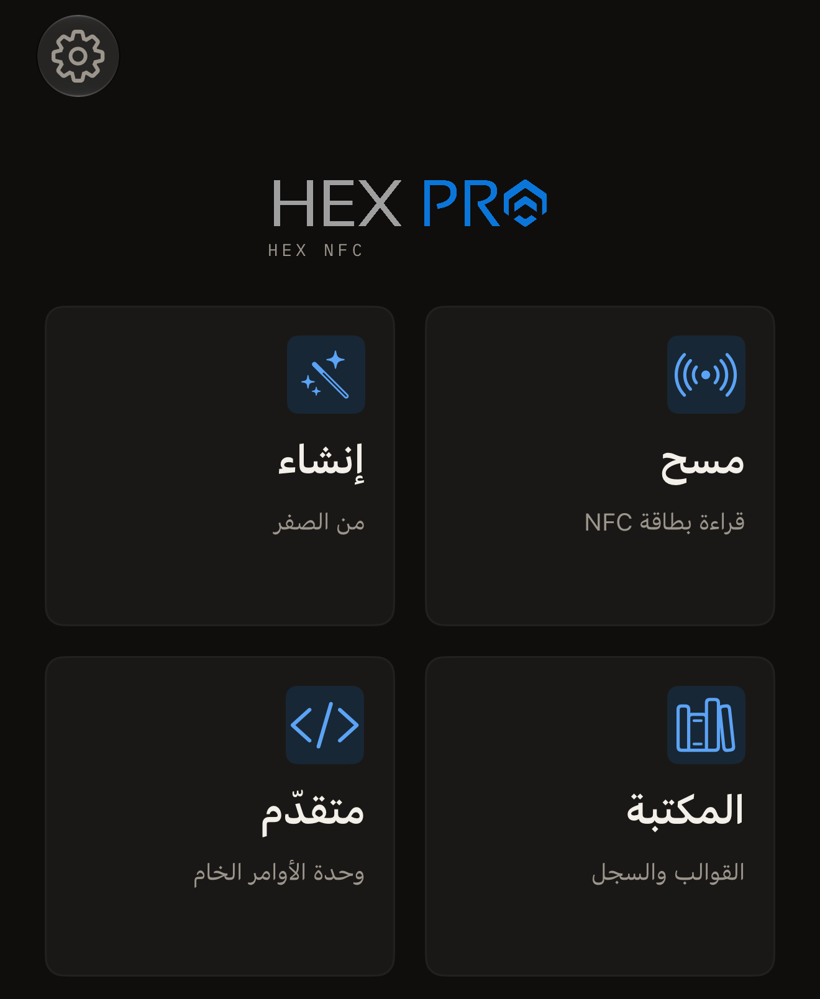

يقرأ Hex NFC بطاقات NFC من حولك ويعرض كل سجل تحمله البطاقة. ويكتب السجلات
على بطاقة فارغة، ويعيّن كلمة المرور على الشرائح التي يمكنها حمل كلمة مرور.
ويقرأ التطبيق أيضًا بطاقة نقل يابانية أو الشريحة الموجودة في جواز سفر
إلكتروني. لا حاجة إلى إنشاء حساب، ولا يتضمن التطبيق أي أدوات تحليلات.

## ما تحتاج إليه

- تطبيق Hex NFC مثبّتًا على iPhone من [App Store](https://apps.apple.com/app/id6801457461).
- جهاز iPhone يعمل بنظام iOS 17 أو أحدث.
- بطاقة NFC. تحمل معظم الملصقات والبطاقات البلاستيكية وميداليات المفاتيح
  الفارغة شريحة يقرؤها التطبيق. تذكر صفحة
  [البطاقات التي تعمل مع Hex NFC](tags-that-work.md) هذه الشرائح، وتوضح
  [مصفوفة دعم الشرائح](../developer/chip-support-matrix.md) ما تستطيع كل
  واحدة منها فعله.

## ما يمكنك فعله

يُفتح Hex NFC على شاشته الرئيسية، وفيها أربعة مربعات.

- اضغط على **مسح** لقراءة بطاقة ومعرفة ما تحمله:
  [مسح بطاقة وقراءة محتواها](scan-a-tag.md). وتُقرأ
  [بطاقة النقل](transit-cards.md) بالطريقة نفسها، أما
  [جواز السفر](passports.md) فيحتاج إلى لمستين.
- اضغط على **إنشاء** لتجميع السجلات من البداية ثم كتابتها:
  [كتابة رابط على بطاقة](write-a-link.md).
- اضغط على **المكتبة** للوصول إلى البطاقات التي مسحتها من قبل:
  [العثور على بطاقة مسحتها من قبل](scan-history.md). وستجد هناك أيضًا
  مجموعات السجلات التي احتفظت بها: [حفظ بطاقة كقالب](presets.md).
- اضغط على **متقدّم** لإرسال أمر خام إلى شريحة تعرف مجموعة أوامرها:
  [إرسال أمر خام إلى بطاقة](advanced-console.md).

:::figure[تُفتح الشاشة الرئيسية في Hex NFC على أربعة مربعات: **مسح** و**إنشاء** و**المكتبة** و**متقدّم**.]

:::

## تغيير ما تحمله البطاقة

بعد فتح بطاقة، يمكنك إعادة بناء سجلاتها كما تشرح صفحة
[تعديل سجلات بطاقة](edit-records.md)، مع الاختيار من الأنواع الواردة في
[أنواع السجلات](record-types.md). وتشرح صفحة
[حماية بطاقة بكلمة مرور](protect-a-tag.md) كيف تعيّن السر الذي تتحقق منه
الشريحة، وتشرح صفحة [إزالة كلمة مرور البطاقة](remove-password.md) كيف
تزيله مجددًا. وتتناول صفحة
[تحديد عدد محاولات كلمة المرور الخاطئة](attempt-limit.md) عدد مرات الرفض
التي تقبلها الشريحة. وتعمل ثلاث أدوات على البطاقة نفسها:
[مسح محتوى البطاقة أو تهيئتها](erase-or-format.md)
و[قفل بطاقة نهائيًا](permanent-lock.md)
و[حفظ نسخة من ذاكرة البطاقة](memory-dump.md).

## البدء

تأخذك صفحة [قراءة بطاقتك الأولى](quick-start.md) من الشاشة الرئيسية في
Hex NFC إلى أول عملية مسح في نحو ٥ دقائق. وتشرح صفحة
[حماية البطاقة](tag-protection.md) ما تحميه كلمة المرور، ولماذا لا يمكن
استعادتها إذا فُقدت. وإذا لم تستجب بطاقة، فانتقل إلى
[إذا تعذّرت قراءة البطاقة أو الكتابة عليها](troubleshooting.md). وتسرد صفحة
[الإعدادات](settings.md) كل زر تبديل في التطبيق، وتوضح صفحة
[الخصوصية وبياناتك](privacy.md) ما يبقى على iPhone، وتجيب صفحة
[أسئلة شائعة](faq.md) عن تكلفة التطبيق.
