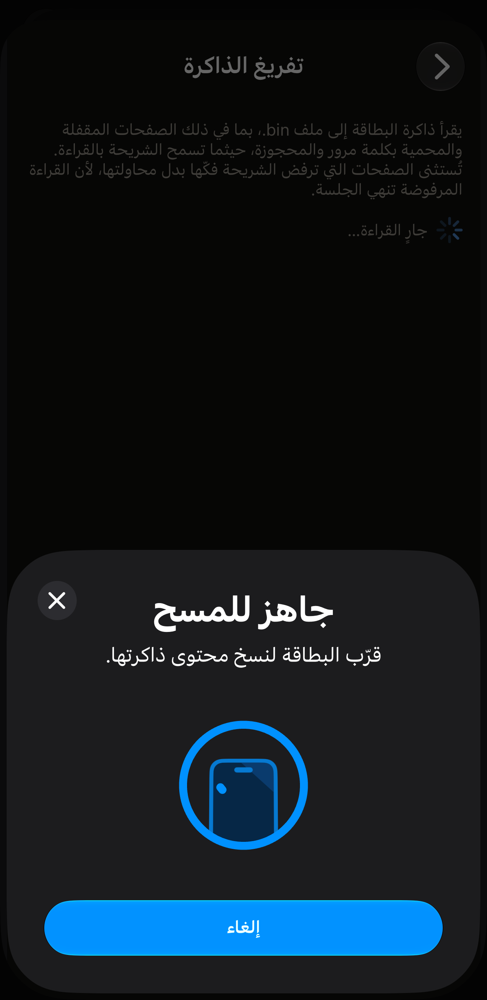
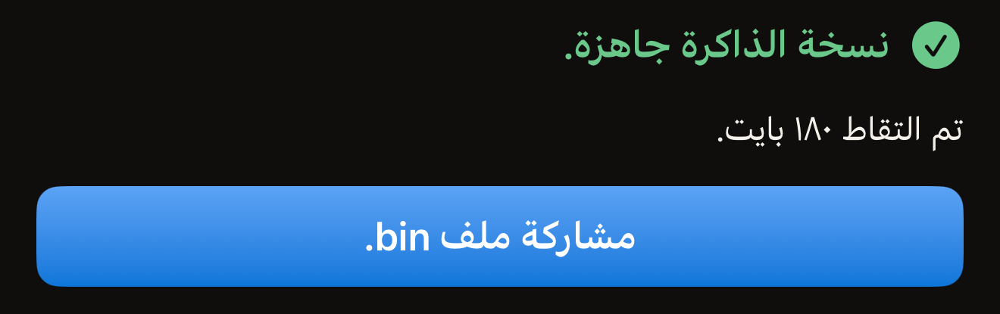
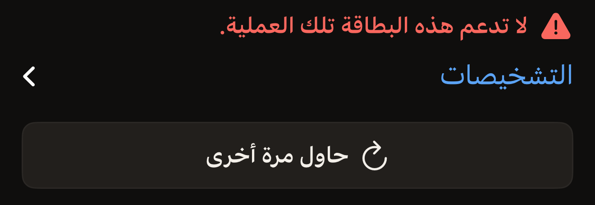

ينسخ تفريغ الذاكرة صفحات البطاقة إلى ملف ‎`.bin` ويسلّم هذا الملف إلى ورقة المشاركة في
iOS. وهو يقرأ فقط، فتبقى البطاقة بعده كما كانت. يحتاج التفريغ إلى لمسة واحدة للبطاقة، أو
لمستين على بطاقة تحمي كلمة مرورها القراءة، ولا يطلب منك أبدًا إعادة كتابة UID البطاقة.

تحتاج إلى iPhone يدعم NFC، وإلى Hex NFC مثبّتًا من App Store، وإلى البطاقة في يدك. إذا لم
تقرأ بطاقة بالتطبيق من قبل، فابدأ بصفحة [قراءة بطاقتك الأولى](quick-start.md). يوجد تفريغ
الذاكرة في شاشة «العمليات»، وتُفتح هذه الشاشة من زر القائمة أعلى يسار شاشة «البطاقة».
وتبدأ الخطوات أدناه بمسح بطاقة للوصول إليها. أما المسح وحده فتشرحه صفحة
[مسح بطاقة وقراءة محتواها](scan-a-tag.md).

يعمل التفريغ على الشرائح التي يتعامل معها Hex NFC صفحةً صفحة، وهي NTAG 210µ، وNTAG213،
وNTAG213 TT، وNTAG215، وNTAG216، وMIFARE Ultralight EV1، وMIFARE Ultralight C، وEM V10،
وEM V11، وEM V16. أما على أي بطاقة أخرى فتعرض الشاشة «لا تدعم هذه البطاقة تلك العملية.»

توضح صفحة [البطاقات التي تعمل مع Hex NFC](tags-that-work.md) كيف تعرف الشريحة التي
تحملها.

## تفريغ ذاكرة البطاقة

:::warning[أرسل الملف قبل مغادرة الشاشة]
لا يحتفظ التطبيق بأي نسخة من التفريغ. إذا أغلقت ورقة المشاركة أو غادرت شاشة «تفريغ
الذاكرة» دون إرسال الملف، يضيع الملف، وعليك قراءة البطاقة من جديد.
:::

:::::steps
::::step[افتح شاشة المسح]
في الشاشة الرئيسية في Hex NFC، اضغط على **مسح**. تُفتح شاشة المسح وتبدأ البحث عن بطاقة.
::::

::::step[قرّب البطاقة من iPhone]
ضع أعلى iPhone مسطّحًا على البطاقة وأبقِه ثابتًا لمدة ثانية تقريبًا. تُفتح شاشة «البطاقة»
وفيها ما تحمله البطاقة.
::::

::::step[افتح العمليات]
في شاشة «البطاقة»، اضغط على زر القائمة أعلى اليسار، وهو الزر الذي على يمين **كتابة**.
تضم القائمة صفّين هما **حفظ كقالب…** و**العمليات…**. اضغط على **العمليات…**.
::::

::::step[ابدأ التفريغ]
اضغط على **تفريغ الذاكرة**. تُفتح الشاشة وتبدأ المسح فورًا، دون أي تأكيد بينهما.
::::

::::step[قرّب البطاقة من iPhone مرة أخرى]
ضع أعلى iPhone على البطاقة مرة أخرى. يعرض سطر الحالة «ضع البطاقة بالقرب من أعلى iPhone.»
أثناء الانتظار، ثم يتغيّر إلى «جارٍ القراءة…» عندما تستجيب البطاقة. وفي النهاية يعرض
«نسخة الذاكرة جاهزة.» وتحتها عدد البايتات التي تم التقاطها.

:::figure[أثناء قراءة البطاقة، تظل لوحة iOS تعرض «قرّب البطاقة لنسخ محتوى ذاكرتها.»، ويعرض سطر الحالة خلفها «جارٍ القراءة…».]

:::

على بطاقة تحمي كلمة مرورها القراءة أيضًا، يتوقف التفريغ قبل أن يقرأ أي شيء. ويطلب قسم
بعنوان «البطاقة محمية» كلمة مرور البطاقة أو مفتاحها. أدخِل كلمة المرور أو المفتاح، واضغط
على **فتح القفل والاستخراج**، ثم قرّب البطاقة من iPhone مرة أخرى.
::::

::::step[شارك الملف]
اضغط على **مشاركة ملف ‎.bin**، ثم اختر وجهة الملف. لا يظهر هذا الزر إلا بعد قراءة
اكتملت.

:::figure[تعرض القراءة المكتملة «نسخة الذاكرة جاهزة.» وتحتها عدد البايتات، ثم **مشاركة ملف ‎.bin** أسفل ذلك.]

:::
::::
:::::

## محتوى الملف

الملف هو ذاكرة الشريحة منسوخة صفحةً صفحة بدءًا من الصفحة الأولى، بواقع ٤ بايت لكل صفحة،
دون ترويسة ودون أي إضافة. وتوجد فيه الصفحات المقفلة والمحمية بكلمة مرور والمحجوزة كلها،
حيثما سمحت الشريحة بقراءتها. أما الصفحات التي ترفض الشريحة فكّها فتُستثنى ولا يُطلب
قراءتها، فقراءة واحدة مرفوضة تنهي الجلسة وتُفقدك بقية التفريغ. وعلى MIFARE Ultralight C
تتوقف النسخة قبل الصفحات الأربع الأخيرة، التي تحمل مفتاح الشريحة ولا تستجيب لأي قراءة على
الإطلاق.

للتفريغ الكامل حجم ثابت لكل شريحة، لذا يخبرك العدد الظاهر تحت «نسخة الذاكرة جاهزة.» هل
حصلت عليه كله. تذكر شاشة «البطاقة» اسم الشريحة أعلى قسم معلومات البطاقة، بالكلمات نفسها
الواردة في العمود الأول أدناه. وتبيّن لك MIFARE Ultralight EV1 هناك أيّ الحجمين هي.

:::table[عدد البايتات في التفريغ الكامل]
| الشريحة | التفريغ الكامل |
| :--- | ---: |
| NTAG 210µ، EM V10، EM V11، EM V16 | ٦٤ بايت |
| NTAG213، NTAG213 TT | ١٨٠ بايت |
| NTAG215 | ٥٤٠ بايت |
| NTAG216 | ٩٢٤ بايت |
| MIFARE Ultralight EV1 (48b) | ٨٠ بايت |
| MIFARE Ultralight EV1 (128b) | ١٦٤ بايت |
| MIFARE Ultralight C | ١٧٦ بايت |
:::

يكتب Hex NFC الملف في مساحة تخزين مؤقتة، باسم يحمل تاريخ القراءة ووقتها. ومشاركته هي ما
يحفظه. لا توجد في التطبيق قائمة بعمليات التفريغ، ولا شيء في شاشة «البطاقة» يعيدك إلى
الملف. أرسله إلى مكان ما قبل أن تغادر الشاشة.

## إذا لم يكتمل التفريغ

يترك التفريغ الفاشل البطاقة كما كانت تمامًا، لذا لا تخسر شيئًا بقراءتها مرة أخرى.

- لقراءة البطاقة نفسها مرة أخرى، اضغط على **حاول مرة أخرى**. تبدأ الشاشة مسحًا جديدًا.
- لمعرفة ما أجابت به البطاقة، افتح **التشخيصات** تحت رسالة الفشل. ويمكن تحديد النص الموجود
  فيها ونسخه إلى تقرير خطأ.

إذا ضغطت على زر الإلغاء في لوحة iOS قبل قراءة أي بطاقة، تعود إلى شاشة «العمليات». وإذا لم
تكن هناك بطاقة بالقرب من iPhone، تُغلق اللوحة من تلقاء نفسها وتعرض الشاشة «لم يُعثر على أي
بطاقة» وتحتها **حاول مرة أخرى**.

تعني «لا تدعم هذه البطاقة تلك العملية.» أن الشريحة ليست من الشرائح المذكورة أعلى هذه
الصفحة. وتستجيب بهذه الطريقة كلٌّ من NTAG424 DNA وICODE SLIX وICODE SLIX2 وشرائح MIFARE
DESFire وFeliCa. وتسرد [مصفوفة دعم الشرائح](../developer/chip-support-matrix.md) ما تستطيع
كل شريحة فعله.

:::figure[على شريحة لا يستطيع التفريغ قراءتها، تعرض الشاشة «لا تدعم هذه البطاقة تلك العملية.» وتحتها **التشخيصات** و**حاول مرة أخرى**.]

:::

إذا انقطعت البطاقة في منتصف القراءة، فراجع
[إذا تعذّرت قراءة البطاقة أو الكتابة عليها](troubleshooting.md). وارجع إليها أيضًا لأي
رسالة لا تتناولها هذه الصفحة.

## انظر أيضًا

- [مسح بطاقة وقراءة محتواها](scan-a-tag.md)
- [البطاقات التي تعمل مع Hex NFC](tags-that-work.md)
- [إرسال أمر خام إلى بطاقة](advanced-console.md)
