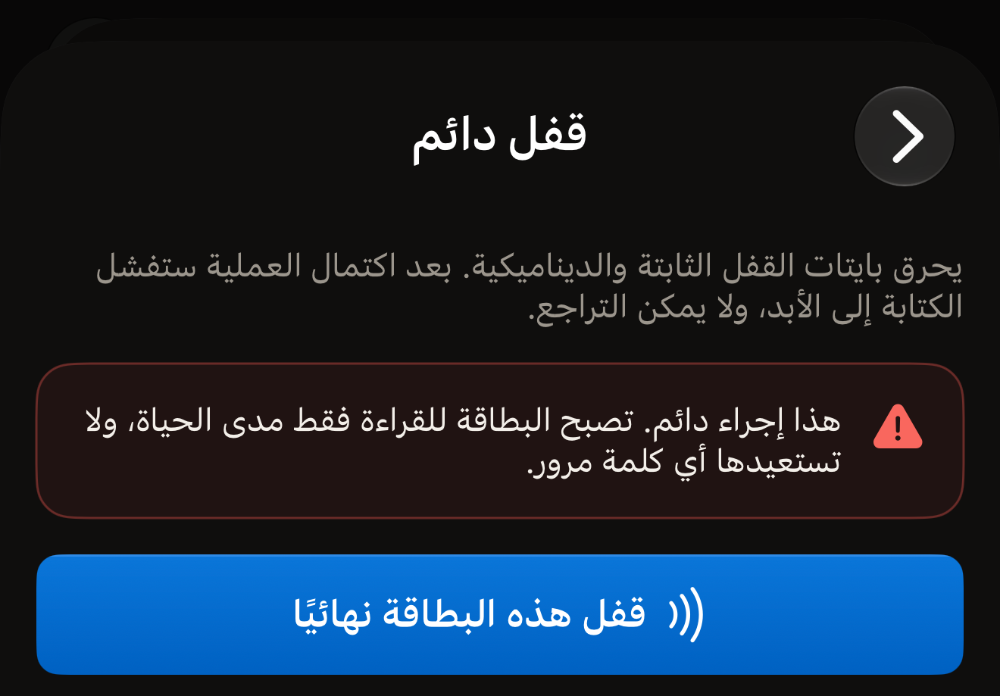
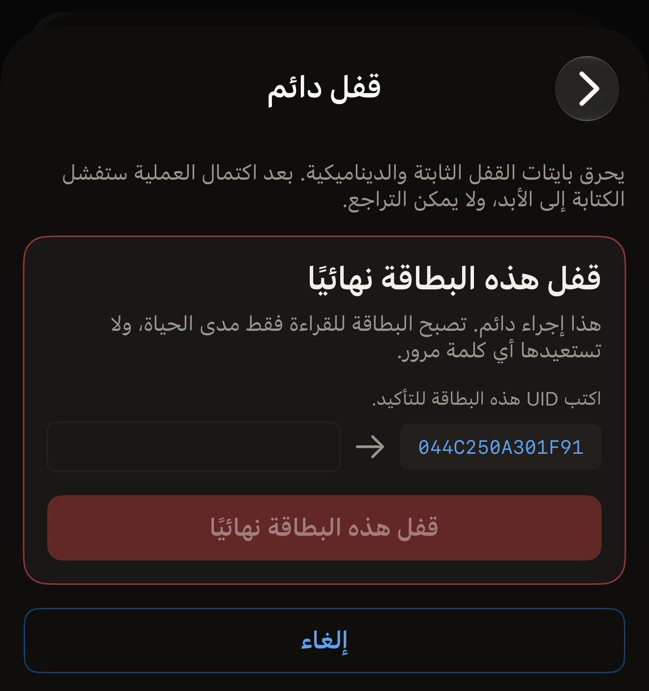
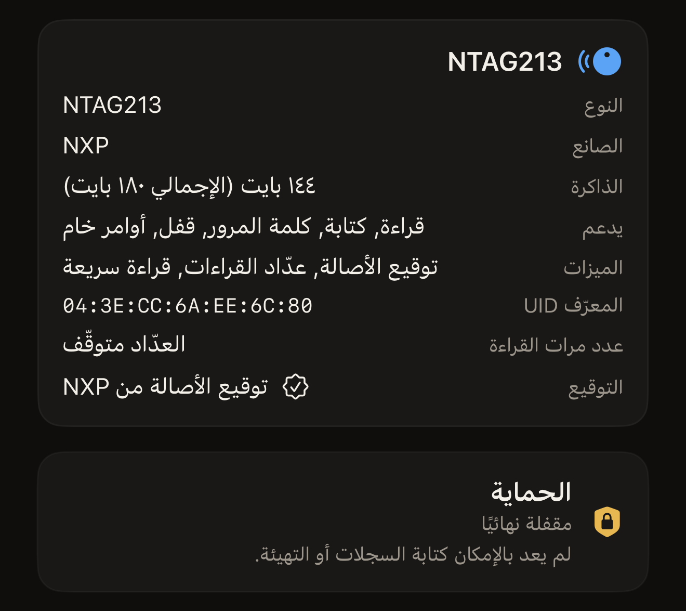

يستطيع Hex NFC قفل البطاقة نهائيًا من iPhone بضبط بتات القفل في الشريحة نفسها.
تحتفظ البطاقة بالسجلات التي تحملها، ولا يمكن بعد ذلك أبدًا كتابة أي سجل أو تهيئة
عليها. ولا تتأثر القراءة، لذا يظل أي هاتف قادرًا على قراءة البطاقة.

أمران يحددان ما إذا كان يمكن قفل البطاقة، ويعرضهما لك المسح كليهما. في شاشة
**البطاقة**، يحمل القسم الموجود في الأعلى اسم الشريحة عنوانًا له. وفيه صف
**يدعم**. ولا تظهر «قفل» في ذلك الصف إلا على شريحة يستطيع هذا التطبيق قفلها.
وتحته يذكر قسم **الحماية** ما يحمي البطاقة الآن. وتعني «متوقّفة» أنه لا يوجد ما
يحميها، وأنه يمكن المضي في القفل. والشريحة التي لا تقبل كلمة مرور ليس لها قسم
**الحماية** أصلًا، ولا يوجد فيها ما يمنع القفل.

والملخص الذي يذكر كلمة مرور أو مفتاحًا، مثل «كلمة مرور · الكتابة فقط»، يعني أن
الحماية مفعّلة. والبطاقة في هذه الحالة لا تُقفل. وتختلف طريقة إخبار التطبيق لك
بذلك باختلاف الشريحة.

على شريحة NTAG أو MIFARE Ultralight EV1، يتحقق Hex NFC قبل أن يكتب أي شيء. ويجيب:
«هذه البطاقة محمية بكلمة مرور، لذا لا يمكن قفلها نهائيًا. أزل كلمة المرور أولاً، ثم اقفلها.»
أما على MIFARE Ultralight C أو ICODE SLIX2، فيبدأ التطبيق القفل. ويذكر الملخص على
هاتين الشريحتين مفتاح 3DES أو كلمة مرور. وترفض حماية البطاقة نفسها الكتابة
الأولى. ويعود هذا الرفض بالرسالة «لم يُقفل أي شيء.» ولا يُحرق أي شيء في الحالتين،
لذا لا تكلّف اللمسة البطاقة شيئًا. أزل كلمة المرور أو المفتاح أولًا: راجع
[إزالة كلمة مرور البطاقة](remove-password.md).

ما يمنع القفل هو تفعيل الحماية، لا كلمة المرور نفسها. فإذا كانت على البطاقة كلمة
مرور مخزّنة لم تعد تحمي أي شيء، يعرض قسم **الحماية** «متوقّفة» عند مسح جديد.
ويمكن قفل البطاقة في هذه الحالة.

:::warning[البطاقة المقفلة لا يمكن فتح قفلها]
لا كلمة مرور، ولا تطبيق آخر، ولا لمسة لاحقة تلغي القفل الدائم. لا تقفل البطاقة إلا
بعد أن يصبح محتواها نهائيًا.
:::

## قفل بطاقة نهائيًا

::include[two-tap-confirmation]

:::::steps
::::step[امسح البطاقة التي تريد قفلها]
في الشاشة الرئيسية في Hex NFC، اضغط على **مسح**، ثم ضع البطاقة بالقرب من أعلى
iPhone. تُفتح شاشة **البطاقة** وتعرض ما تحمله البطاقة. راجع
[مسح بطاقة وقراءة محتواها](scan-a-tag.md).
::::

::::step[تحقق من إمكانية قفل البطاقة]
في شاشة «البطاقة»، ابحث عن «قفل» في صف **يدعم** في قسم معلومات البطاقة، وعن قسم
**الحماية** وفيه «متوقّفة». والشريحة التي لا تقبل كلمة مرور لا يظهر لها قسم
**الحماية**، ولا بأس في ذلك أيضًا.
::::

::::step[افتح شاشة «العمليات»]
في شاشة «البطاقة»، اضغط على زر القائمة أعلى اليسار، بجانب **كتابة**، ثم اضغط على
**العمليات…**.
::::

::::step[اختر «قفل دائم»]
مرّر إلى **إجراءات خطِرة**، ثم اضغط على **قفل دائم**. وتذكر الشاشة التي تُفتح ثمن
القفل وأنه لا يمكن التراجع عنه. ويظهر هذا المربع لكل بطاقة، بما في ذلك الشرائح التي
لا تملك بتات قفل. ويتحقق التطبيق من الشريحة في اللمسة الأولى. وعلى شريحة لا يمكن
قفلها، يجيب بعد تلك اللمسة «لا تدعم هذه البطاقة تلك العملية.» قبل أن تكتب UID.
ولا يُكتب أي شيء.

:::figure[تُفتح شاشة **قفل دائم** مع تحذيرها، ولا يصل أي شيء إلى البطاقة حتى تضغط على **قفل هذه البطاقة نهائيًا**.]

:::
::::

::::step[قرّب البطاقة للمسة الأولى]
اقرأ التحذير، ثم اضغط على **قفل هذه البطاقة نهائيًا**. تعرض الشاشة
«الخطوة 1 من 2. ضع البطاقة للتعرّف عليها.»، فضع البطاقة بالقرب من أعلى iPhone
حتى تُغلق اللوحة.
::::

::::step[اكتب UID البطاقة]
يظهر UID البطاقة بجانب حقل فارغ، تحت «اكتب UID هذه البطاقة للتأكيد.» ويُعرض
بأحرف كبيرة دون نقطتين رأسيتين أو مسافات، ويجب كتابته كله. فإذا عرض قسم معلومات
البطاقة UID بالشكل `04:BA:4A:92:1B:21:90`، فإنه يظهر هنا بالشكل
`04BA4A921B2190`. وتتطابق الأحرف الكبيرة والصغيرة على السواء، وتُتجاهل المسافة
قبل ما تكتبه أو بعده. ويبقى الزر باهتًا حتى يتطابق ما تكتبه.

:::figure[بين اللمستين، يظهر UID البطاقة على يمين حقل فارغ، ويبقى **قفل هذه البطاقة نهائيًا** باهتًا حتى تكتبه.]

:::
::::

::::step[قرّب البطاقة للمسة الثانية]
اضغط على **قفل هذه البطاقة نهائيًا** مرة أخرى، ثم ضع البطاقة بالقرب من أعلى
iPhone. تعرض الشاشة «الخطوة 2 من 2. ضع البطاقة نفسها مرة أخرى.» أثناء الانتظار،
ثم تعرض النتيجة عندما تبتعد البطاقة.
::::
:::::

## ما يقوله التطبيق عند اكتمال القفل

«تم قفل البطاقة نهائيًا.» هي النتيجة التي تريدها. فقد طلب التطبيق من البطاقة قبول
كتابة أخرى بعد ضبط البتات، فرفضت البطاقة، وهذا الرفض هو الدليل.

وتعني «تمت كتابة القفل.» أن البتات كُتبت لكن هذه اللمسة لم تستطع التحقق منها.
فبعض الشرائح لا تطبّق بتات القفل إلا في المرة التالية التي تنشط فيها البطاقة.
ويضيف التطبيق:
«لا تسري بتات القفل في هذه الشريحة إلا عند اللمسة التالية، لذا لا يمكن التحقق منها في هذه الجلسة. امسح البطاقة مرة أخرى للتأكد من أنها ترفض الكتابة الآن.»
امسح البطاقة مرة أخرى واقرأ النتيجة في قسم **الحماية**.

في شاشة **البطاقة**، يعرض قسم **الحماية** «مقفلة نهائيًا» للبطاقة التي قرأها
التطبيق مجددًا ووجدها مقفلة. وتحت ذلك يظهر
«لم يعد بالإمكان كتابة السجلات أو التهيئة.» وإلى أن يتم مسح التأكيد هذا، يعرض
بدلًا من ذلك «تمت كتابة القفل · امسح البطاقة مرة أخرى للتأكيد». ويكون زر
**كتابة** غير متاح على بطاقة أظهرت القراءة مجددًا أنها مقفلة.

:::figure[بعد مسح التأكيد، يعرض قسم **الحماية** «مقفلة نهائيًا» وتحتها «لم يعد بالإمكان كتابة السجلات أو التهيئة.»]

:::

تبقى كلمة المرور المخزّنة على البطاقة بعد القفل، وعندئذ يعرض القسم
«مقفلة نهائيًا · لا تزال كلمة المرور مضبوطة». ويذكر السطر الذي تحته ما إذا كان لا
يزال بالإمكان إزالة كلمة المرور تلك. أما الشرائح التي يمكن قفلها أصلًا فتتناولها صفحة
[البطاقات التي تعمل مع Hex NFC](tags-that-work.md).

## إذا لم يكتمل القفل

يجري القفل على مراحل. والعملية التي تتوقف في منتصفها تترك البطاقة في حالة يسمّيها
التطبيق بدلًا من أن يعدّها فشلًا.

- «لم يُقفل أي شيء.» رفضت الشريحة كل مرحلة وأبلغت بذلك. لم يُحرق أي شيء، والبطاقة
  كما كانت تمامًا، لذا لا تكلّفها عملية ثانية شيئًا. امسح البطاقة مرة أخرى وتحقق
  من الأمرين اللذين يتطلبهما القفل. يعرض قسم **الحماية** «متوقّفة»، أو لا يظهر
  قسم **الحماية** أصلًا لشريحة لا تقبل كلمة مرور. وتظهر «قفل» في صف **يدعم** في
  قسم معلومات البطاقة. وعلى MIFARE Ultralight C أو ICODE SLIX2، هذه الرسالة هي ما
  تبدو عليه الحماية. أزل المفتاح أو كلمة المرور، ثم أعد تشغيل القفل.
- «هذه البطاقة مقفلة جزئيًا الآن، ولا يمكن التراجع عن ذلك. جزء من ذاكرتها صار للقراءة فقط بشكل دائم، أما الباقي فقد رُفض ولا يزال قابلاً للكتابة.»
  استُهلك جزء من الشريحة. ولا تُكمل عملية ثانية الباقي. وعند العودة إلى شاشة
  «البطاقة»، يعرض قسم **الحماية**
  «مقفلة جزئيًا · جزء من هذه البطاقة صار للقراءة فقط بشكل دائم». أما البطاقة التي
  لا تزال تحمل كلمة مرور فيظهر لها بدلًا من ذلك
  «مقفلة جزئيًا · لا تزال كلمة المرور مضبوطة». وعلى NTAG21x أو MIFARE Ultralight،
  يعرض المسح الجديد الشيء نفسه مرة أخرى، لأن التطبيق يقرأ بايتات القفل تلك
  مجددًا. لكنه لا يعيد قراءة أقفال الكتل الفردية في ICODE SLIX2 عند المسح، لذا لا
  يذكر المسح الجديد لهذه الشريحة شيئًا عن القفل الجزئي. وعلى هذه الشريحة، تكون
  النتيجة في نهاية العملية هي المعلومة الوحيدة المتاحة لك.
- «توقفت البطاقة عن الاستجابة أثناء قفل لا يمكن التراجع عنه، لذا لا يستطيع هذا التطبيق تحديد ما إذا كان أي جزء من ذاكرتها قد صار للقراءة فقط. تعامل مع هذه البطاقة على أنها ربما تكون مقفلة.»
  ابتعدت البطاقة في منتصف الكتابة. امسحها مرة أخرى واقرأ قسم **الحماية** قبل أن
  تستخدم البطاقة في أي شيء.
- «صار جزء من هذه البطاقة للقراءة فقط بشكل دائم، ولا يمكن التراجع عن ذلك. توقفت البطاقة عن الاستجابة قبل تأكيد الباقي، لذا قد يكون الباقي مقفلاً أيضًا.»
  تأكدت مرحلة واحدة. والأخرى غير معروفة. امسح البطاقة مرة أخرى، وتعامل معها على
  أنها مقفلة.

## انظر أيضًا

- [حماية البطاقة](tag-protection.md)
- [مسح محتوى البطاقة أو تهيئتها](erase-or-format.md)
- [إذا تعذّرت قراءة البطاقة أو الكتابة عليها](troubleshooting.md)
