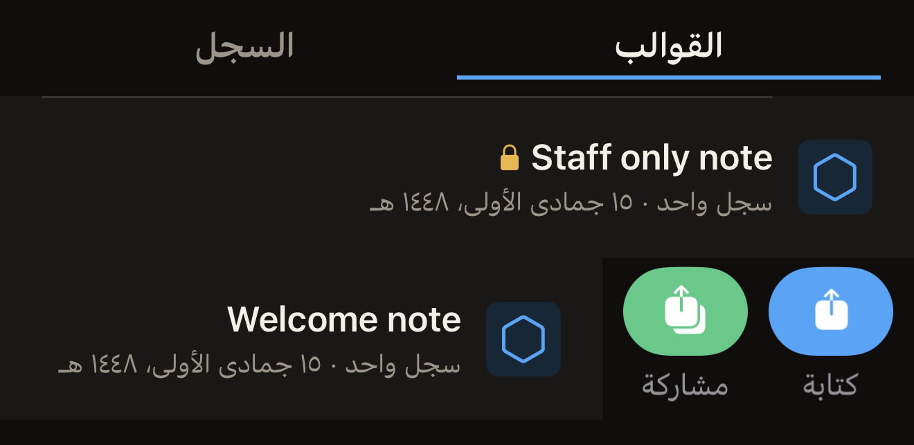
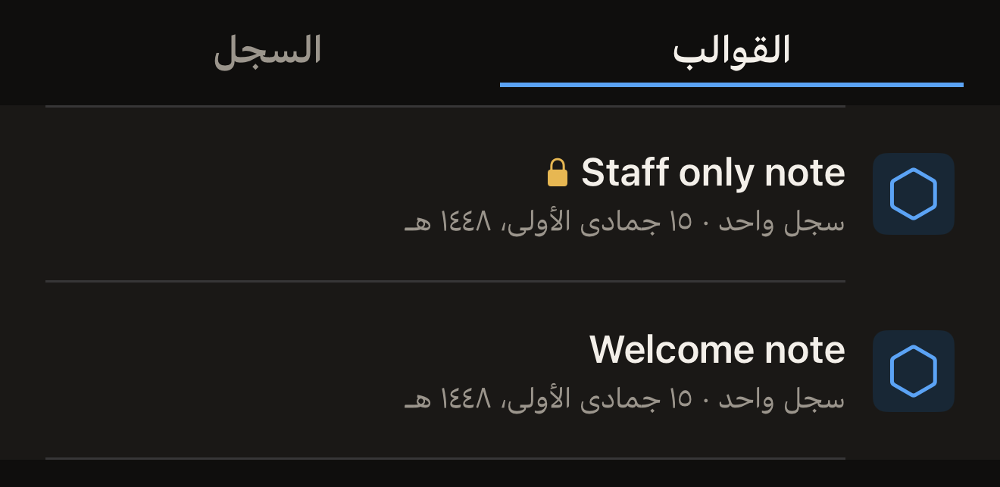

القالب مجموعة مسمّاة من السجلات محفوظة على iPhone. احفظ قالبًا من البطاقة
التي تعدّلها، ثم اكتب تلك السجلات نفسها على أي عدد تشاء من البطاقات دون أن
تنشئها من جديد.

قبل أن تبدأ، ضع مجموعة من السجلات في شاشة «البطاقة» ليكون هناك ما تحفظه. في
الشاشة الرئيسية في Hex NFC، اضغط على **مسح**، ثم قرّب البطاقة التي تريد
نسخها. وللبدء دون بطاقة أمامك، اضغط على **إنشاء**. يفتح كلا الخيارين شاشة
«البطاقة». راجع [مسح بطاقة وقراءة محتواها](scan-a-tag.md)
و[تعديل سجلات بطاقة](edit-records.md).

## حفظ السجلات التي تعدّلها

::::steps
:::step[افتح لوحة الحفظ]
في شاشة «البطاقة»، اضغط على زر القائمة في أعلى اليسار، ثم اضغط على
**حفظ كقالب…**. يبقى هذا الصف في القائمة باهتًا إلى أن تحمل البطاقة سجلًا
واحدًا على الأقل أو أحد إعدادات الحماية.
:::

:::step[سمِّ القالب]
في **الاسم**، أدخل اسمًا تتعرّف عليه لاحقًا، مثل المكان الذي ستذهب إليه
البطاقات. يبقى **حفظ** باهتًا إلى أن تملأ الاسم.
:::

:::step[أضف ملاحظة]
اختياري: في **ملاحظات**، اكتب الغرض من القالب. يتسع الحقل لأربعة أسطر كحد
أقصى.
:::

:::step[اختر أيقونة]
ضمن **الأيقونة**، اضغط على أحد الأجزاء الثلاثة، وهي مسمّاة بكلمات لا مرسومة
على هيئة أشكال: **الإطار الخارجي** أو **سهم لأعلى** أو **سهم لأسفل**. ويحدّد
الجزء الذي تضغط عليه الشارة السداسية التي تظهر بجانب القالب في **المكتبة**.
:::

:::step[تحقّق مما سيحمله القالب]
يعرض قسم **السجلات** عدد السجلات التي ستُحفظ. أما القالب الذي يحمل الحماية
ولا شيء غيرها، فيظهر فيه بدلًا من ذلك «لا توجد سجلات. هذا القالب يطبّق
الحماية فقط.»

وإذا كانت القائمة تضم سجل **الموقع** بلا إحداثيات ولا رابط خريطة، فيظهر في
قسم **السجلات** أيضًا: “أحد سجلات الموقع ليس فيه إحداثيات ولا رابط خريطة، فلن
يمكن كتابة هذا القالب على بطاقة أبدًا. أكمله أو احذفه في شاشة «البطاقة»، ثم
احفظ.” ويبقى **حفظ** باهتًا ما دامت هذه الرسالة ظاهرة. اضغط على **إلغاء**،
ثم أكمل السجل أو احذفه، ثم افتح لوحة الحفظ مرة أخرى. راجع
[أنواع السجلات](record-types.md).
:::

:::step[احفظه]
اضغط على **حفظ**. تُغلق اللوحة ويظهر القالب في أعلى علامة التبويب
**القوالب** في **المكتبة**.
:::
::::

لا يحمل القالب الحماية إلا إذا عيّنت كلمة مرور أو مفتاحًا للبطاقة قبل حفظه.
ويتم ذلك في شاشة «البطاقة»، التي تعرض **الحماية** للبطاقات القابلة للحماية.
اضغط على **الحماية** وفعّل **حماية هذه البطاقة بكلمة مرور**. أدخل السر في
الحقل الذي تعرضه اللوحة، مثل **كلمة المرور (4 بايت)**، ثم اضغط على **تم**.
راجع [حماية بطاقة بكلمة مرور](protect-a-tag.md).

بعد ذلك، تضيف لوحة الحفظ قسم **الحماية** الذي يذكر ما يحمله القالب، مثل
«حماية بكلمة مرور (الكتابة فقط)». ولا يدخل السر في القالب نفسه، ويقول
التطبيق ذلك في القسم نفسه: «يُخزَّن السر على هذا الجهاز فقط (سلسلة المفاتيح).
لا يُزامَن ولا يخرج ضمن أي تصدير.» ولا يفعّل القالب الحماية على البطاقة إلا
ما دام ذلك السر موجودًا على هذا iPhone. أما القالب الذي حفظته دون إدخال سر،
فلا يفعّل أي حماية.

إذا رفض iPhone الحفظ، يظهر سطر باللون الأحمر في أسفل النموذج. يبدأ السطر
بعبارة «تعذّر الحفظ:» ثم السبب الذي ذكره iPhone. تبقى اللوحة مفتوحة وتبقى
سجلاتك في شاشة «البطاقة»، فلا يضيع شيء مما أدخلته. اضغط على **حفظ** مرة
أخرى. وإذا تكرّر السبب نفسه، فاضغط على **إلغاء**. ستجد السجلات ما زالت في
شاشة «البطاقة»، ويمكنك كتابتها على بطاقة مباشرةً بدلًا من الاحتفاظ بها
كقالب.

## كتابة قالب على بطاقة {#write-a-preset-to-a-tag}

يعني رمز القفل بجانب اسم القالب أنه يحمل إعدادات حماية. ولا يقول الصف أكثر
من ذلك، فهو لا يخبرك هل ستفعّل الكتابة الحماية على البطاقة، لأن ذلك يتوقف
على السر المحفوظ مع القالب، والسر لا يظهر. القالب الذي حفظته على هذا iPhone
بعد إدخال كلمة مرور أو مفتاح من اختيارك يحمل ذلك السر ويفعّل الحماية على
البطاقة. أما القالب المحفوظ من بطاقة كانت محمية من قبل، ولم تُدخل كلمة
مرورها قط، فلا يحمل أي سر: يكتب سجلاته ولا يحمي شيئًا. وإذا لم تستطع أن تعرف
أي النوعين أمامك، فتعامل معه على أنه من النوع الذي يفعّل الحماية.

:::::steps
::::step[افتح المكتبة]
في الشاشة الرئيسية في Hex NFC، اضغط على **المكتبة**. تُفتح شاشة «المكتبة» على
**القوالب**، وفي أعلاها القالب الذي غيّرته آخر مرة.
::::

::::step[ابدأ الكتابة]
اسحب القالب مسافة قصيرة من حافته اليمنى، ثم اضغط على **كتابة**. تُغلق
**المكتبة** وتُفتح شاشة الكتابة.

:::figure[يكشف سحب قصير من الحافة اليمنى للقالب عن **كتابة** و**مشاركة**.]

:::
::::

::::step[قرّب البطاقة من iPhone]
ضع البطاقة بالقرب من أعلى iPhone بينما تعرض الشاشة «ضع البطاقة بالقرب من
أعلى الـ iPhone». وتعرض الشاشة «اكتملت الكتابة» بعد أن تصبح السجلات على
البطاقة.
::::
:::::

:::warning[القالب الذي يطبّق الحماية لا يطلب منك تأكيد البطاقة]
القالب الذي يحمل إعدادات حماية وما زال سره محفوظًا على هذا iPhone يعيّن ذلك
السر على أي بطاقة تقرّبها. وهذا هو الموضع الوحيد في التطبيق الذي تُفعَّل فيه
الحماية دون لمسة أولى لقراءة البطاقة، ولا يوجد UID تكتبه للتأكيد. لا تقرّب
إلا البطاقة التي تقصد حمايتها. واحتفظ بالقالب ما دامت تلك البطاقات مستخدمة،
فكتابته مرة أخرى هي طريقك لاستعادة الوصول إلى بطاقة حماها. وحذفه يحذف تلك
النسخة من السر.
:::

## إدارة القوالب

إلى أن تحفظ قالبًا، تعرض علامة التبويب **القوالب** عبارة «لا توجد قوالب
محفوظة». بعد ذلك، يحمل كل صف اسم القالب وأيقونته، ويبيّن سطر تحته عدد
السجلات وتاريخ آخر تغيير للقالب.

يدل رمز القفل بجانب الاسم على قالب يحمل إعدادات حماية، ويقرؤه VoiceOver على
أنه «يطبّق الحماية». أما ما يعد به رمز القفل وما لا يعد به، فتجده أعلاه في
[كتابة قالب على بطاقة](#write-a-preset-to-a-tag).

:::figure[يدل رمز القفل بعد اسم القالب على أنه يحمل إعدادات حماية.]

:::

يكشف سحب القالب من حافته اليمنى عن **كتابة** و**مشاركة**، ويكشف سحبه من
حافته اليسرى عن **حذف** و**تكرار**. اسحب مسافة قصيرة، ثم اضغط على الزر الذي
تريده. وإذا سحبت إلى آخر الصف بدءًا من الحافة اليسرى، يُحذف القالب من تلقاء
نفسه.

لا يمكن تغيير قالب محفوظ. لتعديل ما يحمله قالب لا يظهر بجانبه رمز القفل،
أنشئ السجلات من جديد في شاشة «البطاقة»، واحفظها كقالب جديد، ثم احذف القالب
القديم.

أما القالب الذي يظهر بجانبه رمز القفل فاتركه كما هو. فإعادة إنشائه من شاشة
«البطاقة» تعطيك السجلات دون السر، ما لم تعيّن كلمة المرور أو المفتاح من جديد
أولًا. وحذف القالب القديم يذهب بالنسخة الوحيدة من السر الذي يفتح البطاقات
التي حماها. وللحصول على نسخة ثانية منه، استخدم **تكرار**، فهو ينقل السر
المخزَّن إلى النسخة الجديدة.

من علامة التبويب **القوالب**، يمكنك القيام بأي مما يلي:

- للاحتفاظ بنسخة من قالب خارج التطبيق، اسحبه من حافته اليمنى واضغط على
  **مشاركة**. يكتب التطبيق ملف ‎`.hexnfc` يحمل اسم القالب ويسلّمه إلى ورقة
  المشاركة. تنتقل السجلات وإعدادات الحماية في ذلك الملف، أما كلمة المرور أو
  المفتاح فلا ينتقلان فيه أبدًا. ولا يستطيع Hex NFC فتح ملف ‎`.hexnfc`، فما
  ترسله إلى شخص آخر نسخة من السجلات يحتفظ بها، لا قالب يضيفه إلى تطبيقه.
- لإنشاء نسخة ثانية من قالب، اسحبه من حافته اليسرى واضغط على **تكرار**. تحمل
  النسخة السجلات نفسها وإعدادات الحماية نفسها والسر المخزَّن نفسه.
- لإزالة قالب، اسحبه من حافته اليسرى واضغط على **حذف**. لا يُطلب منك أي
  تأكيد، ويُحذف معه السر المخزَّن للقالب.

## انظر أيضًا

- [تعديل سجلات بطاقة](edit-records.md)
- [كتابة رابط على بطاقة](write-a-link.md)
- [حماية البطاقة](tag-protection.md)
- [العثور على بطاقة مسحتها من قبل](scan-history.md)
