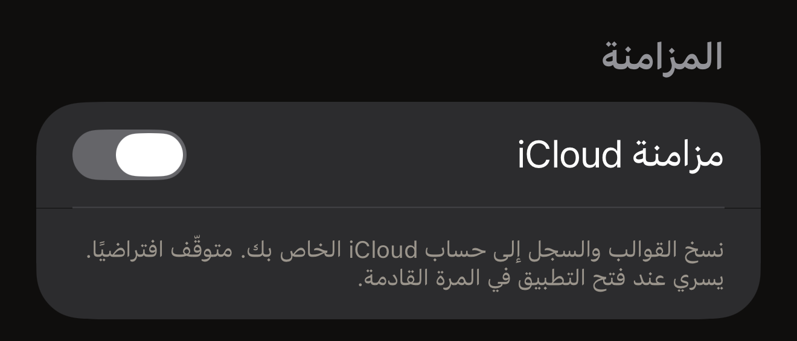

تقرّب بطاقة من iPhone فيظهر محتواها على الشاشة. تجري هذه القراءة على iPhone،
وتبقى النتيجة عليه. لا حسابات في Hex NFC ولا تحليلات. ويرسل التطبيق أربعة
أنواع من الطلبات إلى خوادم Hex Pro نفسها: ثلاثة منها لا تحمل أي شيء عنك،
والرابع، وهو رسالة ملاحظات، لا يحمل إلا ما تختار إرساله. والنص الكامل للسياسة
موجود في التطبيق: في الشاشة الرئيسية في Hex NFC، اضغط على زر الترس في أعلى
اليسار، ثم اضغط على **سياسة الخصوصية** ضمن **الشؤون القانونية**.

## ما يبقى على iPhone

يُحفظ سجل المسح والقوالب المحفوظة في قاعدة بيانات محلية على هذا iPhone،
وتُخزَّن إعداداتك محليًا أيضًا. ويُخزَّن محليًا كذلك كل ما يعتمد عليه القسم
الذي يسأل من حين لآخر **هل يعجبك Hex NFC؟**: هل سبق أن سأل، وبماذا أجبت، وعدد
عمليات الكتابة والقراءة الأخيرة الذي يحدد متى يمكنه أن يسأل مجددًا. وتصف صفحة
[الإعدادات](settings.md#feedback-and-ratings) هذا القسم. وحذف أي عنصر يزيله من
قاعدة البيانات تلك،
وحذف التطبيق يزيل بياناته المحلية معه.

أما كلمات مرور البطاقات فتُحفظ بمعزل عن ذلك كله، في سلسلة المفاتيح في iOS على
iPhone الوحيد الذي عيّنها. لا تُزامَن كلمة المرور أبدًا، ولا تُكتب في أي ملف
تصدّره، ولا تُرسل إلى أي مكان. ويحفظ التطبيق نوعين من العناصر. الأول لبطاقة
فُعّلت حمايتها بعملية كتابة، ويُحفظ مرتبطًا بـ UID تلك البطاقة. وتجري تلك
الكتابة من قسم **الحماية** في شاشة «البطاقة»، أو من قالب يطبّق الحماية.
والثاني لقالب يطبّق الحماية، ويُحفظ مرتبطًا بالقالب. ولا يحمل أي منهما شيئًا
عنك. أما كلمة المرور التي تكتبها في **الحماية بكلمة مرور** ضمن **العمليات…**
فلا تُحفظ في أي منهما، لذا احتفظ بنسخة منها بنفسك. ولا يؤدي حذف التطبيق إلى
حذف كلمات المرور المحفوظة، لأن iOS يُبقي عناصر سلسلة المفاتيح بعد حذف
التطبيق. أما قراءة جواز السفر فلا تُحفظ في أي مكان على الإطلاق: ما تعيده
الشريحة يظهر على الشاشة طوال تلك الجلسة ويختفي عند انتهائها، وتشرح صفحة
[قراءة جواز سفر](passports.md) ذلك بالتفصيل.

أمران يزيلان كلمة المرور المحفوظة. الأول حذف قالب، فهو يحذف كلمة المرور
المحفوظة معه، سواء أكانت البطاقة التي كُتب عليها ما زالت محمية أم لا. وقد
تبقى البطاقة عندئذٍ محمية بكلمة مرور لم يعد التطبيق يحتفظ بها. والثاني إيقاف
الحماية في قسم **الحماية** الخاص بالبطاقة ثم الكتابة على البطاقة، كما تشرح
صفحة [إزالة كلمة مرور البطاقة](remove-password.md). وحتى في هذه الحالة، لا
يحذف التطبيق كلمة المرور إلا بعد أن يقرأ البطاقة مجددًا، ويجب أن تجد هذه
القراءة الأمرين التاليين معًا:

- زالت الحماية.
- عادت كلمة مرور البطاقة إلى كلمة المرور الافتراضية للمصنع في الشريحة.

وإذا أثبتت الإزالة الأمر الأول دون الثاني، تبقى كلمة المرور المحفوظة. فالبطاقة
غير المحمية التي ما زالت تحمل كلمة مرورك لا يمكن حمايتها من جديد بدونها.
والإزالة التي تجري من **العمليات** لا تحذف شيئًا من سلسلة المفاتيح، ويبقى أي
عنصر محفوظ مسبقًا لتلك البطاقة في مكانه.

لا يوجد في Hex NFC ما يعرض البطاقات التي يحتفظ لها بكلمة مرور. والبطاقة التي
لا يمكنك تقريبها مرة أخرى لا يمكن حذف كلمة مرورها المحفوظة من داخل التطبيق،
ويبقى عنصرها في سلسلة المفاتيح على هذا iPhone ما لم تحذفه عملية إزالة لاحقة،
أو تمسح محتوى iPhone.

تكون **مزامنة iCloud** متوقّفة في البداية، ولا يسري تغيير زر التبديل إلا عند فتح
التطبيق في المرة القادمة. وعند تفعيلها، تُنسخ قوالبك وسجل المسح إلى قاعدة بيانات iCloud
الخاصة بك، التي تديرها Apple ويحميها Apple ID الخاص بك. ولا تستطيع Hex Pro
قراءتها. وتبقى كلمات مرور البطاقات خارجها في كل الأحوال. وزر التبديل موجود في
[الإعدادات](settings.md).

:::figure[تبقى **مزامنة iCloud** متوقّفة إلى أن تفعّلها، ويقول السطر الذي تحتها إن التغيير ينتظر المرة القادمة التي تفتح فيها التطبيق.]

:::

ولا يوقف إيقاف المزامنة النسخ إلا بعد أن تغلق Hex NFC وتفتحه مرة أخرى، كما
يشرح قسم [إغلاق التطبيق وإعادة فتحه](settings.md#close-and-reopen-the-app).
فالعودة إلى الشاشة الرئيسية في iPhone تُبقي التطبيق قيد التشغيل، ومعه النسخ.

وإيقاف النسخ ليس كإزالة ما يحتفظ به iCloud بالفعل، وحذف التطبيق لا يزيله
أيضًا. ولإزالة تلك النسخة، افتح تطبيق الإعدادات في iPhone، واضغط على اسمك في
الأعلى، ثم اضغط على صف iCloud. وتصفّح مساحة التخزين التي يعرضها، حيث يمكن
حذف البيانات التي يحتفظ بها كل تطبيق.

:::note[البطاقة ليست مساحة تخزين خاصة]
كل ما تكتبه على بطاقة يوجد على عتاد خارج iPhone، ويستطيع أي شخص لديه قارئ أن
يقرأ البطاقة غير المحمية. لذا تعامل مع محتوى البطاقة على أنه علني ما لم
تحمِها، كما تشرح صفحة [حماية البطاقة](tag-protection.md).
:::

## المرات الأربع التي يتواصل فيها التطبيق مع Hex Pro {#when-the-app-reaches-hex-pro}

لا يجري أي منها في الخلفية. ولا تحمل الثلاث الأولى منها شيئًا يكشف هويتك.

- تجلب الشاشة الرئيسية في Hex NFC رقمًا علنيًا واحدًا عن تكاليف تطوير المشروع
  من api.apps.hex.pro. ولا يتضمن الطلب أي بيانات شخصية.
- يُرسل اقتراح اسم محطة عندما تضغط على **إرسال** لمحطة غير معروفة من بطاقة
  نقل، ويُرسل أيضًا إذا ضغطت على زر الإرسال في لوحة المفاتيح وحقل الاسم مفتوح.
  ويتضمن رموز الخط والمحطة والمنطقة، ورمز نظام البطاقة، والاسم الذي كتبته.
  ولا يتضمن الرقم التسلسلي للبطاقة ولا رصيدها ولا سجل معاملاتها، لذا لا تكتب
  أي تفاصيل شخصية في حقل الاسم.
- يجلب قسم **المزيد من تطبيقات Hex Pro** لافتة لتطبيق آخر من Hex Pro من
  api.p.hex.pro. ويرسل الطلب معرّف الحزمة لهذا التطبيق، والمنصة، واسم الموضع.
  ويحدد الرد صورة أو فيديو، ينزّله التطبيق من عنوان ثانٍ ويحتفظ به على iPhone.
  والجميع يرون اللافتة نفسها، ولا تقف وراءها شبكة إعلانات ولا معرّف تتبع ولا
  تخصيص.
- تُرسل رسالة الملاحظات عندما تضغط على **إرسال** في نموذج **إرسال ملاحظات**.
  وتتضمن رسالتك، وعنوان البريد الإلكتروني الذي كتبته إن أدخلت واحدًا، والتفاصيل
  الأربعة التي يعرضها النموذج تحت **يُرسل مع رسالتك**: إصدار التطبيق، وإصدار
  iOS، وطراز الجهاز، واللغة. وتذهب إلى api.hex.pro ومنه إلى صندوق الوارد
  الخاص بالملاحظات لدى Hex Pro، وتُحفظ مدة أقصاها ٢٤ شهرًا، ولا تُستخدم للتسويق أبدًا. ولا
  تتضمن أي شيء من بطاقاتك أو عمليات المسح أو سجل المسح.

ومزامنة iCloud هي الشيء الآخر الذي يستخدم الشبكة، وهي الاستثناء مما ورد في
الفقرة أعلاه. فعند تفعيلها، تنتقل قوالبك وسجل المسح بين iPhone وApple في
الخلفية، ولا يصل أي من ذلك إلى Hex Pro.

يكشف أي طلب عبر الإنترنت عنوان IP الخاص بك للخادم الذي يجيب عنه. وتحتفظ Hex
Pro بسجلات تشغيل قصيرة الأجل، ولا تستخدم عنوان IP للتعرّف على أي شخص أو
لإنشاء ملف تعريفي عنه. وتُحفظ رسالة الملاحظات مع صيغة مموّهة من عنوان IP
الخاص بك، لا تُستخدم إلا لمنع اتصال واحد من إرسال رسائل أكثر من اللازم،
وتُمحى خلال سبعة أيام.

## الغرض من كل إذن

يطلب Hex NFC منك إذنين. فإذن NFC لا يعمل التطبيق بدونه، ولا يوفّر لك iOS زر
تبديل له. أما الكاميرا فاختيارية، ويطلب iOS الإذن باستخدامها في أول مرة تمسح
فيها رمز QR أو صفحة الصورة في جواز سفر. وما يلتقطه أي منهما يبقى على iPhone.

وتصف سياسة الخصوصية في التطبيق ثلاثة أذونات أخرى، لجهات الاتصال والموقع
والبلوتوث. ولا يطلب أي جزء من التطبيق هذه الأذونات الثلاثة، لذا لا يسألك iOS
عنها أبدًا.

:::table[الأذونات التي يطلبها Hex NFC]
| الإذن | الغرض منه |
| :--- | :--- |
| NFC | قراءة البطاقات والكتابة عليها، فقط ما دامت شاشة المسح أو شاشة الكتابة مفتوحة. |
| الكاميرا | مسح رمز QR تختار تحويله إلى سجل، وقراءة صفحة الصورة في جواز سفر عندما تختار مسحها. ولا تُحفظ لقطات الكاميرا ولا تُرفع أبدًا. |
:::

## ما لا تفعله Hex Pro أبدًا

لا يتضمن Hex NFC أي حزم SDK للتحليلات أو القياس عن بُعد، ولا إعلانات من أطراف
ثالثة، ولا شيء فيه يجمع بصمة رقمية لجهاز iPhone. ولا تبيع Hex Pro المعلومات
الشخصية ولا تؤجرها ولا تشاركها. ولا توجد حسابات، لذا لا يحتفظ أي خادم من خوادم
Hex Pro بملف تعريفي عنك. والملف الذي تصدّره يحمل السجلات والقوالب التي
اخترتها، ولا يحمل أبدًا كلمة مرور بطاقة.

## انظر أيضًا

- [الإعدادات](settings.md)
- [قراءة بطاقة نقل](transit-cards.md)
- [قراءة جواز سفر](passports.md)
- [حماية البطاقة](tag-protection.md)
