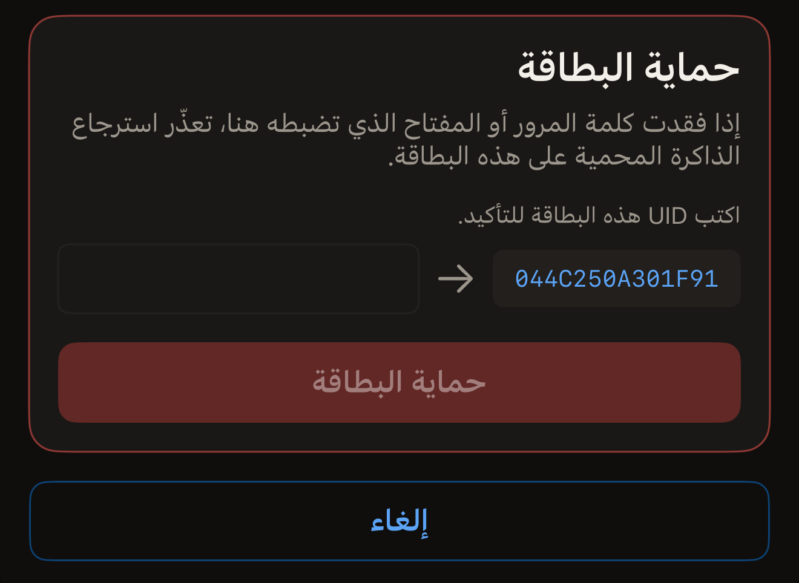
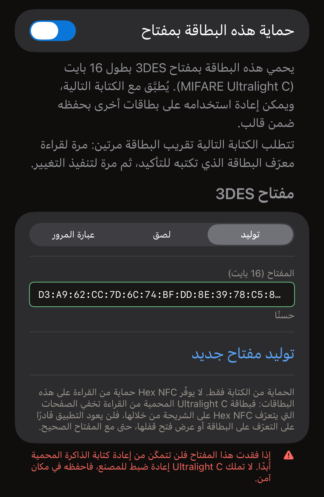
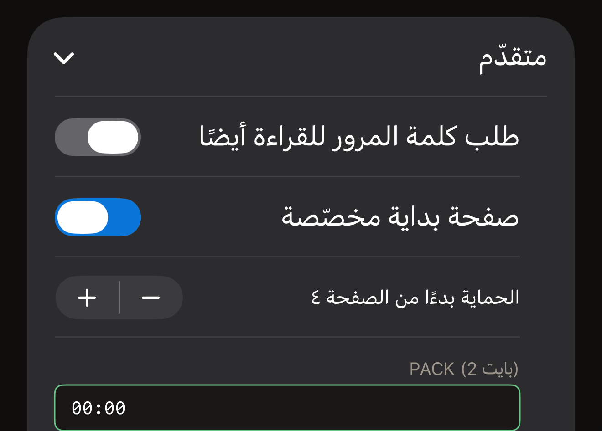

كلمة المرور على البطاقة تحمي الكتابة. وتبقى السجلات قابلة للقراءة لأي شخص، إلا
إذا حميت القراءة أيضًا. وتُرفض أي كتابة إلى أن تُقدَّم كلمة المرور. يضبط
Hex NFC كلمة المرور من iPhone بطريقتين، وكلتاهما تشمل الشرائح نفسها. يحمي خيار
**الحماية بكلمة مرور**، ضمن **العمليات…**، البطاقة في عملية مستقلة. أما قسم
**الحماية** في شاشة «البطاقة» فيضع السر على البطاقة ضمن الكتابة التالية. استخدم
العمليات لحماية بطاقة دون تغيير أي شيء آخر، واستخدم قسم الحماية إذا كنت ستكتب
على البطاقة في كل الأحوال.

قبل أن تبدأ، امسح البطاقة التي تريد حمايتها حتى تكون مفتوحة في شاشة «البطاقة».
راجع [مسح بطاقة وقراءة محتواها](scan-a-tag.md). يذكر القسم الموجود أعلى تلك
الشاشة اسم الشريحة في سطره الأول. ويحدد هذا الاسم نوع السر الذي تقبله البطاقة.

يستطيع التطبيق حماية سبع شرائح: NTAG213 وNTAG215 وNTAG216 وMIFARE Ultralight EV1
وMIFARE Ultralight C وNTAG424 DNA وICODE SLIX2. ولمعرفة ما إذا كانت البطاقة التي
في يدك قابلة للحماية أصلًا، راجع
[مصفوفة دعم الشرائح](../developer/chip-support-matrix.md). وعلى أي شريحة أخرى،
تنتهي **الحماية بكلمة مرور** بالرسالة «لا تدعم هذه البطاقة تلك العملية.» ولا
تعرض شاشة «البطاقة» قسم **الحماية** لهذه الشرائح أيضًا، إلا إذا أبلغت البطاقة
عن قفل.

::include[two-tap-confirmation]

## حماية بطاقة من العمليات

لا يطلب هذا الطريق أي شيء قبل اللمسة الأولى. تقرأ تلك اللمسة نوع شريحة البطاقة،
ثم تطلب الشاشة نوع السر الذي تقبله تلك الشريحة: كلمة مرور من ٤ بايت على NTAG213
أو NTAG215 أو NTAG216 أو MIFARE Ultralight EV1 أو ICODE SLIX2، ومفتاحًا من ١٦
بايت على NTAG424 DNA أو MIFARE Ultralight C. ولمعرفة ما تحمله كل شريحة، راجع
[مصفوفة دعم الشرائح](../developer/chip-support-matrix.md).

:::::steps
::::step[افتح «الحماية بكلمة مرور»]
في شاشة «البطاقة»، اضغط على زر القائمة أعلى اليسار، بجانب **كتابة**، ثم انتقل
إلى **العمليات…** > **الحماية بكلمة مرور**.
::::

::::step[قرّب البطاقة ليتعرّف عليها التطبيق]
اضغط على **حماية البطاقة**. تُفتح لوحة المسح، وتعرض الشاشة
«الخطوة 1 من 2. ضع البطاقة للتعرّف عليها.» ضع البطاقة بالقرب من أعلى iPhone حتى
تُغلق اللوحة.
::::

::::step[أدخل كلمة المرور أو المفتاح الجديد]
تذكر الشاشة اسم الشريحة التي قرأتها بعد «تم التعرف على البطاقة:»، وتعرض الحقول
التي تقبلها تلك الشريحة. أدخل السر بالنظام الست عشري، مع نقطتين رأسيتين بين
البايتات أو بدونهما.

- على NTAG213 أو NTAG215 أو NTAG216 أو MIFARE Ultralight EV1، أدخل كلمة المرور
  في **كلمة المرور (4 بايت)**. وعلى بطاقة تظهر غير محمية، يُفتح الحقل على القيمة
  الافتراضية للمصنع، `FF FF FF FF`. ضع كلمة مرورك مكانها. أما PACK فهو البايتان
  اللذان ترسلهما البطاقة عندما تقبل كلمة المرور. ويتحقق القارئ منه ليتأكد من أنه
  يتواصل مع البطاقة التي يتوقعها. يُفتح **PACK (2 بايت)** على بايتين صفريين،
  وتركه كما هو الخيار الصحيح ما لم يطلب نظام تستخدمه قيمة معينة.
- على NTAG424 DNA، أدخل المفتاح في **المفتاح (16 بايت)**.
- على ICODE SLIX2، أدخل كلمة مرور الكتابة في **كلمة المرور (4 بايت)**. وتبقى
  القراءة متاحة.
- على MIFARE Ultralight C، يوضع المفتاح في **المفتاح (16 بايت)**. وعلى بطاقة تظهر
  غير محمية، يُفتح الحقل على مفتاح مولَّد عشوائيًا. ولا تحصل هذه الشريحة إلا على
  الحماية من الكتابة.

على NTAG21x أو MIFARE Ultralight EV1 أو NTAG424 DNA، يوجد تحت الحقل زر تبديل
يحمي القراءة أيضًا. اسمه **طلب كلمة المرور للقراءة أيضًا**، أو
**طلب المفتاح للقراءة أيضًا** على NTAG424 DNA. اتركه متوقفًا وسيظل أي قارئ قادرًا
على قراءة البطاقة. وإذا فعّلته فلن يخرج أي شيء من البطاقة بدون السر، لذا سيطلبه
منك Hex NFC أولًا عند أي مسح لاحق. ومع ذلك تنتهي العملية نفسها بـ«تم تعيين كلمة المرور.»،
لأن التطبيق يقدّم السر الذي كتبه للتو ليقرأ البطاقة مجددًا ويتحقق منها.
::::

::::step[اكتب UID البطاقة]
تحت الحقول، يطلب منك القسم الذي عنوانه **حماية البطاقة**:
«اكتب UID هذه البطاقة للتأكيد.» ويعرض بجانب حقل فارغ UID الذي قرأه التطبيق في
تلك اللمسة. وإذا كانت البطاقة تحمل كلمة مرور أو مفتاحًا بالفعل، يظهر فوقه قسم
عنوانه «البطاقة محمية» ويطلب السر الذي تحمله البطاقة الآن. اكتب ذلك UID في
الحقل حرفًا بحرف، ثم اضغط على **حماية البطاقة**.

:::figure[يظهر UID الذي تنسخه على يمين قسم **حماية البطاقة**، والحقل الذي تكتبه فيه على اليسار.]

:::
::::

::::step[قرّب البطاقة نفسها مرة أخرى]
تعرض الشاشة «الخطوة 2 من 2. ضع البطاقة نفسها مرة أخرى.» قرّب البطاقة من iPhone
مرة أخرى. وتظهر «تم تعيين كلمة المرور.» عندما يقرأ التطبيق إعدادات البطاقة مجددًا
ويجد الحماية مفعّلة.
::::
:::::

:::warning[احتفظ بكلمة المرور]
لا شيء في التطبيق يقرأ كلمة المرور من البطاقة، لذا فالنسخة التي تحتفظ بها هي
النسخة الوحيدة. ويذكر التحذير على الشاشة السبب:
«إذا فقدت كلمة المرور أو المفتاح الذي تضبطه هنا، تعذّر استرجاع الذاكرة المحمية على هذه البطاقة.»
:::

إذا فشلت العملية، تعرض الشاشة **حاول مرة أخرى**، فتعود الشاشة إلى حالتها الأولى
لتعيد العملية من اللمسة الأولى. وأثناء ظهور قسم UID، يعيد **إلغاء** الشاشة إلى
حالتها الأولى. وتبقى البطاقة كما كانت، وإذا كانت لوحة المسح لا تزال مفتوحة فإنها
تُغلق وعليها «تم الإلغاء.»

وعلى بطاقة محمية بالفعل، يتطلب هذا الطريق سرّين: السر الجديد في الحقول، والسر
الذي تحمله البطاقة الآن في قسم «البطاقة محمية». فالسر الذي تحمله البطاقة يفتحها،
والسر الجديد يحل محله.

## ضبط مفتاح من قسم الحماية {#protection-card}

تقبل NTAG424 DNA وMIFARE Ultralight C مفتاحًا من ١٦ بايت بدلًا من كلمة المرور.
وتقبل ICODE SLIX2 كلمة مرور خاصة بها للكتابة. ويمكن ضبطها كلها من قسم
**الحماية** في شاشة «البطاقة»، ويُكتب السر ضمن الكتابة التالية. وكلمة مرور شرائح
Type-2 موجودة في ذلك القسم أيضًا.

:::::steps
::::step[افتح قسم الحماية]
في شاشة «البطاقة»، اضغط على قسم **الحماية** الموجود تحت القسم الذي يذكر اسم
الشريحة.
::::

::::step[فعّل الحماية]
فعّل زر التبديل أعلى القسم. يحمل اسم **حماية هذه البطاقة بمفتاح** على
NTAG424 DNA أو MIFARE Ultralight C، واسم **حماية هذه البطاقة بكلمة مرور** على
الشرائح التي تقبل كلمة مرور.
::::

::::step[أدخل المفتاح أو كلمة المرور]
املأ الحقل الذي يعرضه القسم لتلك الشريحة.

- على NTAG424 DNA، أدخل ١٦ بايت في **المفتاح (16 بايت)**، أو اضغط على
  **توليد مفتاح عشوائي**. ولحماية القراءة أيضًا، فعّل
  **طلب المفتاح للقراءة أيضًا**.
- على MIFARE Ultralight C، اختر طريقة إنشاء المفتاح من أداة الاختيار تحت
  **مفتاح 3DES**. وعلى بطاقة لا تحمل مفتاحًا بعد، يُفتح القسم على **توليد** وفي
  **المفتاح (16 بايت)** ١٦ بايت عشوائية بالفعل، ويستبدلها
  **توليد مفتاح جديد**. ويتيح لك **لصق** إدخال ١٦ بايت من عندك في
  **المفتاح (16 بايت)**. أما **عبارة المرور** فتنتج المفتاح نفسه في كل مرة
  تستخدمها.
- على ICODE SLIX2 أو NTAG213 أو NTAG215 أو NTAG216 أو MIFARE Ultralight EV1،
  أدخل ٤ بايت في **كلمة المرور (4 بايت)**.

على NTAG213 أو NTAG215 أو NTAG216 أو MIFARE Ultralight EV1، يضم **متقدّم** تحت
الحقل الحماية من القراءة ونطاق الصفحات وPACK. افتحه قبل الخطوة التالية إذا أردت
أيًا منها. راجع
[اختيار الصفحات التي تشملها كلمة مرور Type-2](#pages-a-type-2-password-covers).

بمجرد أن يحتوي الحقل على مفتاح أو كلمة مرور كاملة، توضح الملاحظة تحت زر التبديل
في الأعلى ما ستتطلبه الكتابة التالية. ونصها:
«تتطلب الكتابة التالية تقريب البطاقة مرتين: مرة لقراءة معرّف البطاقة الذي تكتبه للتأكيد، ثم مرة لتنفيذ التغيير.»

:::figure[على MIFARE Ultralight C غير محمية، تبدأ أداة الاختيار تحت **مفتاح 3DES** على **توليد**، لذا يحتوي **المفتاح (16 بايت)** على مفتاح عشوائي بالفعل.]

:::
::::

::::step[احفظ الإعدادات]
اضغط على **تم** أعلى اليسار. لم يصل أي شيء إلى البطاقة بعد.
::::

::::step[ابدأ الكتابة]
اضغط على **كتابة** أعلى يسار شاشة «البطاقة». ضع البطاقة بالقرب من أعلى iPhone
للمسة التي تقرأ UID البطاقة.
::::

::::step[أكّد البطاقة وقرّبها مرة أخرى]
يعرض القسم الذي عنوانه **حماية البطاقة** UID الذي قرأه التطبيق في تلك اللمسة
بجانب حقل فارغ. اكتب ذلك UID في الحقل، واضغط على **حماية البطاقة**، ثم قرّب
البطاقة نفسها مرة أخرى. بعد ذلك يلخص قسم **الحماية** ما يحمي البطاقة.
::::
:::::

يُكتب التحذير في ذلك القسم بحسب الشريحة. فمفتاح NTAG424 DNA يظهر معه
«إذا فقدت هذا المفتاح فلن تتمكّن من إعادة كتابة هذه البطاقة أبدًا. لا توجد إعادة ضبط للمصنع في NTAG424، فاحفظه في مكان آمن.»
ومفتاح MIFARE Ultralight C يظهر معه
«إذا فقدت هذا المفتاح فلن تتمكّن من إعادة كتابة الذاكرة المحمية أبدًا. لا تملك Ultralight C إعادة ضبط للمصنع، فاحفظه في مكان آمن.»
وكلمة المرور يظهر معها
«إذا فقدت كلمة المرور هذه، فلن يمكن استرجاع الذاكرة المحمية على هذه البطاقة.»

البطاقة التي تحمل كلمة مرور بالفعل تُفتح بكلمة المرور الموجودة في القسم. اكتب
كلمة المرور الحالية للبطاقة في القسم، فتفتح اللمسة الأولى البطاقة دون أن يُطلب
منك أي شيء آخر.

وإذا لم يكن في القسم كلمة مرور تفتح البطاقة، تصطدم اللمسة الأولى بالحماية. فتتوقف
الكتابة لتطلب كلمة المرور تلك تحت العنوان «البطاقة محمية». وتوضح الملاحظة فوق
الحقل ما الذي لا يزال مطلوبًا. ونصها:
«يتطلب تغيير الحماية تقريب البطاقة مرتين: الأولى لقراءة معرّف البطاقة لتؤكده، والثانية لتنفيذ التغيير.»

ولا تكلّفك كتابة كلمة المرور هناك أي لمسة إضافية، لأن UID البطاقة صار معروفًا
بالفعل. يحمل الزر اسم **فتح القفل والمتابعة**، ويليه قسم UID.

## اختيار الصفحات التي تشملها كلمة مرور Type-2 {#pages-a-type-2-password-covers}

قبل أن تضغط على **تم** في قسم الحماية، افتح **متقدّم**. على NTAG213 أو NTAG215 أو
NTAG216 أو MIFARE Ultralight EV1، يضم ثلاثة إعدادات أخرى:

- لحماية القراءة إلى جانب الكتابة، فعّل **طلب كلمة المرور للقراءة أيضًا**. ويذكر
  القسم أن
  «البطاقات المحمية ضد القراءة لا يمكن قراءتها مجددًا، بما في ذلك التحقق، بدون كلمة المرور.»
- لحماية جزء من البطاقة بدلًا منها كلها، فعّل **صفحة بداية مخصّصة**، ثم اضبط
  **الحماية بدءًا من الصفحة ٤** على أول صفحة تريد أن تشملها الحماية. والصفحة وحدة
  من ٤ بايت في ذاكرة البطاقة. ويتراوح الإعداد بين ٣ و٢٥٤. وهذا نطاق كل الشرائح
  التي يشملها الإعداد، لا نطاق البطاقة التي في يدك. ولا يقصّه التطبيق ليناسبها.
  وصفحة البداية التي تقع بعد نهاية ذاكرة شريحتك تكتب كلمة المرور ولا تحمي شيئًا.
  ومع ذلك تنتهي الكتابة على شاشة النجاح، فلا شيء فيها يدل على أن البطاقة مفتوحة.
  والمسح الجديد هو ما يُظهر أن البطاقة لا تحمي شيئًا. اختر صفحة داخل ذاكرة
  الشريحة؛ وتذكر [مصفوفة دعم الشرائح](../developer/chip-support-matrix.md) حجم
  ذاكرة كل شريحة. وإذا تُرك الإعداد متوقفًا فهو
  «يحمي منطقة البيانات بأكملها (بدءًا من أول صفحة بيانات في الشريحة).»
- لاختيار البايتين المخزّنين مع كلمة المرور، أدخلهما في **PACK (2 بايت)**.

:::figure[عند تفعيل **صفحة بداية مخصّصة**، يعرض **متقدّم** صفحة البداية وزرّي الزيادة والنقصان الخاصين بها فوق **PACK (2 بايت)**.]

:::

أما عدد كلمات المرور الخاطئة التي تقبلها الشريحة فيُضبط في مكان آخر. راجع
[تحديد عدد محاولات كلمة المرور الخاطئة](attempt-limit.md).

## إذا تعذّر على التطبيق تأكيد النتيجة

تنتهي عملية الحماية بقراءة إعدادات البطاقة مجددًا، لذا لا تُعدّ العملية ناجحة أبدًا
لمجرد أن البطاقة أقرّت بها. وإذا أمكن التأكد من نصفها فقط، تذكر الرسالة أي نصف.

تكون البطاقة محمية إذا عرضت الشاشة إحدى الرسالتين التاليتين:

- «تم تعيين كلمة المرور.»
- «الحماية مفعّلة، لكن تعذّر على هذا التطبيق تأكيد أن كلمة المرور قد كُتبت. احتفظ بكلمة المرور التي أدخلتها: من المرجّح جدًا أنها الكلمة الموجودة الآن على البطاقة.»

ولا تكون البطاقة محمية إذا عرضت إحدى الرسائل التالية:

- «لا تزال البطاقة غير محمية، ولم تُحفظ عليها كلمة المرور التي أدخلتها. قرّب البطاقة من الهاتف مرة أخرى للمحاولة من جديد.»
- «حُفظت كلمة المرور على البطاقة. الحماية لا تزال متوقفة.»
- «حُفظت كلمة المرور على البطاقة، لكن الحماية لم تُفعَّل. قرّب البطاقة من الهاتف مرة أخرى لإكمال العملية.»
- «لا تزال البطاقة غير محمية، وتعذّر على هذا التطبيق تأكيد كلمة المرور التي تحملها الآن. احتفظ بكلمة المرور التي أدخلتها وبالكلمة السابقة معًا، ثم قرّب البطاقة من الهاتف مرة أخرى.»

ولا يُحسم أي من الأمرين إذا عرضت إحدى الرسالتين التاليتين:

- «تعذّر تأكيد تفعيل الحماية. قرّب البطاقة من الهاتف مرة أخرى للتحقق.»
- «تعذّر تأكيد تفعيل الحماية، ولا كلمة المرور التي تحملها البطاقة الآن. احتفظ بكلمة المرور التي أدخلتها وبالكلمة السابقة معًا، ثم قرّب البطاقة من الهاتف مرة أخرى.»

إذا طلبت الرسالة تقريب البطاقة مرة أخرى، فقرّبها مجددًا، واحتفظ بكلمتي المرور
كلتيهما إلى أن تفتح إحداهما البطاقة. ورسالتان من هذه الرسائل لا تطلبان شيئًا،
ولكل منهما ما ينبغي فعله بعدها.

- بعد «حُفظت كلمة المرور على البطاقة. الحماية لا تزال متوقفة.»، تحمل البطاقة كلمة
  المرور التي أدخلتها لكنها لا تحمي شيئًا. ولا حاجة إلى تقديم أي كلمة مرور لتصحيح
  ذلك. أعد الخطوات بكلمة المرور نفسها. ولإزالة كلمة المرور المخزّنة من البطاقة
  بدلًا من ذلك، راجع [إزالة كلمة مرور البطاقة](remove-password.md).
- بعد
  «الحماية مفعّلة، لكن تعذّر على هذا التطبيق تأكيد أن كلمة المرور قد كُتبت. احتفظ بكلمة المرور التي أدخلتها: من المرجّح جدًا أنها الكلمة الموجودة الآن على البطاقة.»،
  تكون البطاقة محمية. احتفظ بكلمة المرور تلك، وتوقّع أن تطلبها الكتابة التالية على
  هذه البطاقة.

## انظر أيضًا

- [حماية البطاقة](tag-protection.md)
- [إزالة كلمة مرور البطاقة](remove-password.md)
- [تحديد عدد محاولات كلمة المرور الخاطئة](attempt-limit.md)
- [مصفوفة دعم الشرائح](../developer/chip-support-matrix.md)
