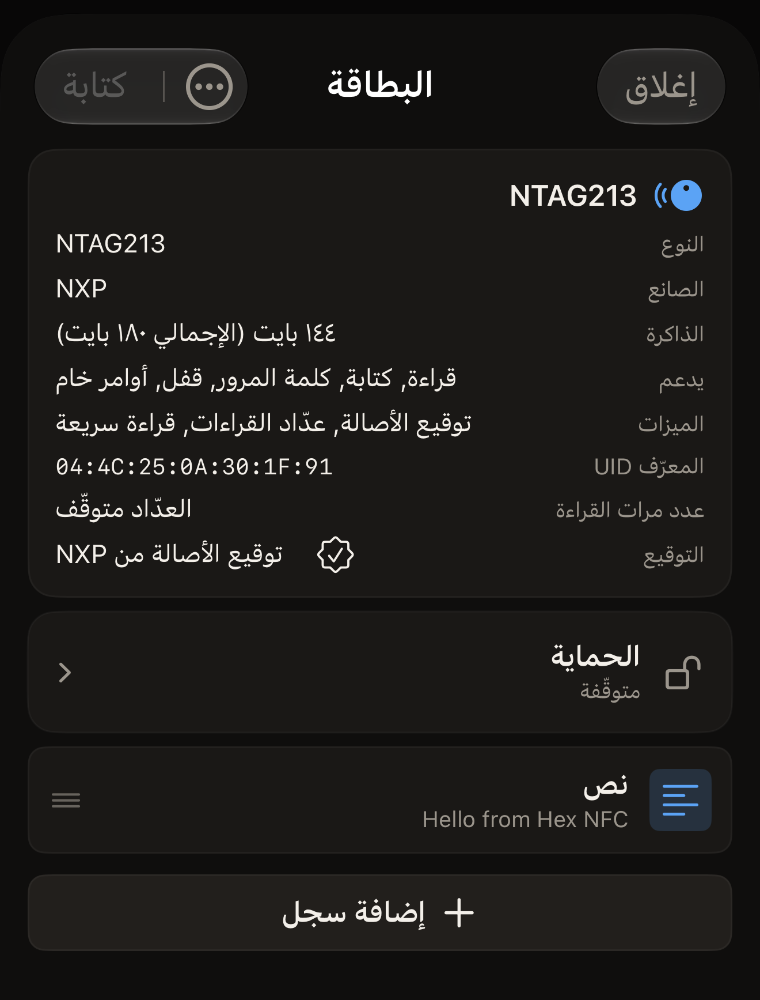

في نحو ٥ دقائق ستقرأ بطاقة NFC واحدة باستخدام Hex NFC وتعرف ما تحمله، على
الشاشة وفي سجل المسح داخل التطبيق. كل ما تحتاج إليه هو iPhone وبطاقة واحدة.

## قبل أن تبدأ

- ثبّت Hex NFC من [App Store](https://apps.apple.com/app/id6801457461) على iPhone يعمل بنظام iOS 17 أو أحدث.
  لا يلزم أي إعداد عند تشغيله أول مرة: يُفتح التطبيق على الشاشة الرئيسية في
  Hex NFC. وتجيب صفحة [أسئلة شائعة](faq.md) عن تكلفته وعن أجهزة iPhone التي
  يعمل عليها.
- جهّز بطاقة واحدة. يصلح لذلك ملصق أو بطاقة بلاستيكية أو ميدالية مفاتيح.
- تصلح البطاقة الفارغة أيضًا. يقرؤها التطبيق ويُظهر أنها لا تحمل شيئًا.
- لا تغيّر القراءة أي شيء على البطاقة، ولا يكتب أي شيء في هذه الصفحة على
  بطاقتك.

## قراءة بطاقتك الأولى

:::::steps
::::step[افتح شاشة المسح]
يُفتح Hex NFC على شاشته الرئيسية، وفيها أربعة مربعات تحت اسم التطبيق:
**مسح** و**إنشاء** و**المكتبة** و**متقدّم**. اضغط على **مسح**، وهو المربع
في أعلى اليمين. تُفتح شاشة المسح وتنتظر، وتظهر عليها عبارة
«ضع البطاقة بالقرب من أعلى الـ iPhone».
::::

::::step[ضع البطاقة بالقرب من iPhone]
ضع أعلى iPhone مسطّحًا على البطاقة وأبقِه ثابتًا. أثناء القراءة، تظهر لوحة
المسح في iOS على امتداد أسفل الشاشة، ويبقى نص التطبيق ظاهرًا فوقها. تعرض
شاشة المسح «جارٍ القراءة…» ثم «تم اكتشاف البطاقة». وحين تظهر
«تم اكتشاف البطاقة» يكون التطبيق قد انتهى من البطاقة، فيمكنك إبعاد iPhone
عنها. وإذا لم تُقرأ أي بطاقة، تعرض الشاشة «فشل المسح» وتذكر السبب تحتها.
اضغط على **حاول مرة أخرى**، ثم ضع البطاقة بالقرب من أعلى iPhone وأبقِها
ثابتة. وتتناول صفحة
[إذا تعذّرت قراءة البطاقة أو الكتابة عليها](troubleshooting.md) البطاقة التي
لا تستجيب.
::::

::::step[اقرأ ما عثر عليه التطبيق]
تحت «تم اكتشاف البطاقة» يذكر التطبيق اسم الشريحة ويعدّ ما قرأه. السجل جزء
واحد من المحتوى على البطاقة، كرابط أو نص، والبطاقة التي تحمل سجلًا واحدًا
تعرض «عُثر على سجل واحد». أما البطاقة التي لا تحمل أي سجل فتعرض
«لا توجد سجلات NDEF على هذه البطاقة». تبقى الشاشة معروضة نحو ثانية واحدة.
ويظهر اسم الشريحة والمعرّف UID للبطاقة مجددًا في الشاشة التالية، فلا حاجة
إلى حفظ أي شيء هنا. وتشرح صفحة [مسح بطاقة وقراءة محتواها](scan-a-tag.md)
بقية ما قد تعرضه الشاشة.
::::

::::step[افتح سجلًا]
تُفتح شاشة «البطاقة» تلقائيًا. يذكر القسم العلوي اسم الشريحة ويتضمن صف
**المعرّف UID**. وتحت هذا القسم يظهر كل سجل في صف يعرض نوعه ومعاينة لما
يحمله. اضغط على صف لعرض السجل كاملًا، ثم اضغط على **إلغاء** للعودة. يُغلق زر
**إلغاء** السجل دون أن يكتب أي شيء، لا على البطاقة ولا في التطبيق. وتعرض
البطاقة الفارغة «بطاقة فارغة» بدلًا من الصفوف، وهذه قراءة مكتملة وليست فشلًا.

:::figure[بعد مسح بطاقة NTAG213، يتضمن القسم العلوي في شاشة «البطاقة» صف **المعرّف UID**، ويظهر السجل الوحيد في البطاقة في الأسفل بوصفه صف **نص**.]

:::
::::

::::step[أغلق البطاقة]
اضغط على **إغلاق**. تُغلق شاشة «البطاقة» دون كتابة أي شيء، وتعود إلى
الشاشة الرئيسية في Hex NFC.
::::
:::::

## ما تعلّمته

أصبح بإمكانك الآن قراءة أي بطاقة تلتقطها ومعرفة ما تحمله. وقد احتفظ التطبيق
بعملية المسح هذه. اضغط على **المكتبة** في الشاشة الرئيسية في Hex NFC، ثم
على **السجل**، وهي الثانية من علامتَي التبويب في أعلى شاشة «المكتبة». تظهر
عملية المسح التي أجريتها في أعلى القائمة. وإذا ثبّتّ إحدى عمليات المسح، تبقى
محفوظة حتى بعد بلوغ الحدود التي تشرحها صفحة
[العثور على بطاقة مسحتها من قبل](scan-history.md). وعند فتح عملية مسح
محفوظة تعود شاشة «البطاقة» نفسها، دون الحاجة إلى تقريب البطاقة مرة أخرى.

## الخطوات التالية

- اقرأ [مسح بطاقة وقراءة محتواها](scan-a-tag.md) لمعرفة معنى كل نتيجة مسح،
  وللتعامل مع بطاقة تطلب كلمة المرور أولًا.
- اقرأ [العثور على بطاقة مسحتها من قبل](scan-history.md) لإعادة فتح عمليات
  المسح المحفوظة وتثبيتها وحذفها.
- اقرأ [كتابة رابط على بطاقة](write-a-link.md) لوضع عنوان ويب على بطاقة
  فارغة.
- اقرأ [البطاقات التي تعمل مع Hex NFC](tags-that-work.md) لمعرفة الشرائح التي
  يتعرّف عليها التطبيق.
- اقرأ [إذا تعذّرت قراءة البطاقة أو الكتابة عليها](troubleshooting.md) حين لا
  تستجيب بطاقة.
