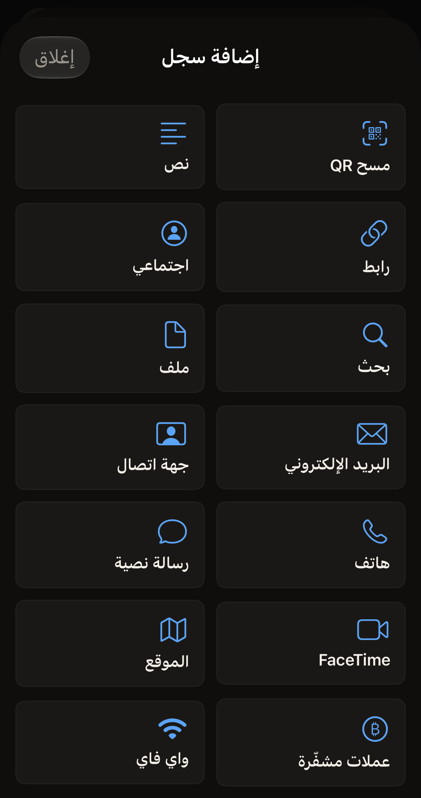
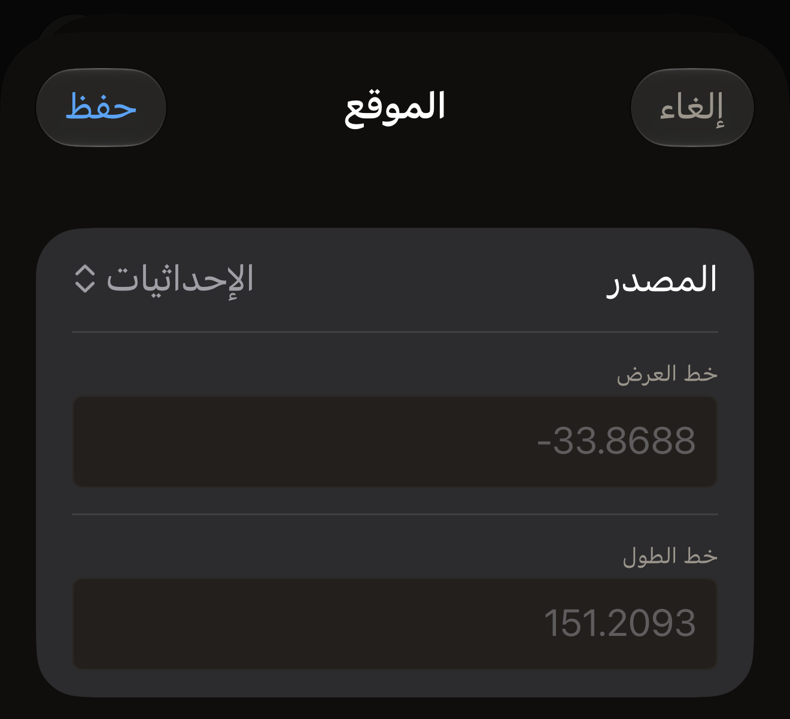

تحمل البطاقة قائمة من السجلات، ولكل سجل نوع. امسح بطاقة باستخدام iPhone، أو
اضغط على **إنشاء** في الشاشة الرئيسية في Hex NFC للبدء دون أي سجلات. ثم اضغط على
**إضافة سجل** في شاشة «البطاقة». يتيح التطبيق ١٣ نوعًا، وتشرح صفحة
[تعديل سجلات بطاقة](edit-records.md) خطوات إضافتها. والنوع الذي تختاره يحدد
الحقول التي يعرضها لك محرر السجل، ويحدد ما يجده أي هاتف آخر حين يقرأ البطاقة
لاحقًا. ويمكن أن تحمل البطاقة التي تمسحها أيضًا خمسة أنواع يفتحها التطبيق لكنه
لا يتيح إضافتها، وهي موضّحة في
[الأنواع التي يمكنك فتحها دون إضافتها](#types-you-can-open-but-not-add).

:::figure[تعرض شاشة **إضافة سجل** ١٣ نوعًا من السجلات، ويأتي قبلها مربع **مسح QR** لتحويل رمز QR إلى سجل.]

:::

## ما الذي يغيّره النوع

كل نوع هو شكل لمعلومة واحدة. فرقم الهاتف يوضع في سجل **هاتف**، والشبكة في
سجل **واي فاي**. ويحوّل التطبيق ما تكتبه إلى البايتات التي يحددها معيار NFC
لهذا الشكل. اختر أقرب نوع بدلًا من وضع رقم هاتف في سجل **نص**: فالهاتف الذي
يقرأ البطاقة يتصرف وفق الشكل، لا وفق ما تقصده.

وما يحدث على الهاتف القارئ يقرره ذلك الهاتف. فالرابط رابط في كل مكان. أما
الشبكة فلا، كما يقول نموذج **واي فاي**:
«لن يتصل iPhone تلقائيًا عبر NFC، لكن قارئات أندرويد ستفعل. يكتب Hex NFC السجل وفقًا للمواصفات حتى يتمكن أي قارئ من قراءته.»

تشغل السجلات مساحة، وتنفد مساحة الشريحة الصغيرة. وتجد سعة كل شريحة في صفحة
[البطاقات التي تعمل مع Hex NFC](tags-that-work.md).

## النصوص والروابط

:::table[أنواع السجلات للنصوص والروابط وعمليات البحث]
| النوع | ما تملؤه | ما يُكتب على البطاقة |
| --- | --- | --- |
| **نص** | **نص**، **رمز اللغة**، **الترميز** | كلماتك، موسومة برمز اللغة الذي تدخله ومكتوبة بالترميز الذي تختاره. |
| **رابط** | **رابط** | العنوان كما كتبته. وتُخزَّن بادئات الويب الشائعة في بايت واحد، فيشغل السجل مساحة أقل. |
| **اجتماعي** | **المنصّة**، **المُعرِّف** | رابط ملف شخصي، يُبنى من المنصة التي تختارها والمعرّف الذي تدخله. |
| **بحث** | **المحرّك**، **الاستعلام** | عنوان بحث في المحرك الذي تختاره، يحمل كلماتك. |
| **ملف** | **المسار** | عنوان ملف. ويصفه النموذج هكذا: «يُخزَّن كرابط ‎file://‎. يحدّ iOS من الأدلة التي يمكن أن يشير إليها.» |
:::

يبدأ سجل **نص** الجديد برمز اللغة en، وتوضح الملاحظة الخاصة بالحقل الصيغة
المطلوبة: «‏ISO 639-1، مثل en أو fr أو ja». ويضم حقل **الترميز** خيارين،
**UTF-8** و**UTF-16**، ويبدأ السجل الجديد على **UTF-8**.

في معظم المنصات يكون **المُعرِّف** هو الاسم الذي ينتهي به عنوان ملفك الشخصي،
وتدخله دون علامة @ في أوله. وست منصات تطلب شيئًا آخر، لأن عناوينها لا تُبنى
من معرّف.

- في **Whatsapp**، أدخل رقم الهاتف الذي يحمله رابط wa.me، وهو الرقم الدولي
  الكامل دون علامة الزائد.
- في **Skype**، أدخل اسم Skype.
- في **Steam**، أدخل الرابط المخصص الوارد في عنوان ملفك الشخصي.
- في **Slack**، أدخل اسم مساحة العمل الذي يبدأ به عنوانها.
- في **Facebook** و**Wechat**، أدخل ما يحمله رابط كل منهما، وقد يكون اسمًا أو
  رقمًا.

يضع التطبيق ما تدخله في عنوان الملف الشخصي على المنصة ولا يغيّر فيه شيئًا آخر.

يضم حقل **المحرّك** الخيارات **Google**، **Google Images**، **Bing**،
**Yandex**، **DuckDuckGo**، **YouTube** و**Wikipedia**. ويضم حقل **المنصّة**
الخيارات **Facebook**، **Bluesky**، **X**، **Github**، **Instagram**،
**Line**، **Linkedin**، **Medium**، **Pinterest**، **Skype**، **Slack**،
**Snapchat**، **Soundcloud**، **Steam**، **Telegram**، **Threads**، **Tiktok**،
**Twitch**، **Vk**، **Wechat**، **Whatsapp** و**Youtube**، ويظهر كل منها على
الشاشة بالتهجئة نفسها المستخدمة هنا.

## الأشخاص والرسائل

:::table[أنواع السجلات التي توصلك بشخص]
| النوع | ما تملؤه | ما يُكتب على البطاقة |
| --- | --- | --- |
| **البريد الإلكتروني** | **إلى**، **نسخة**، **نسخة مخفية**، **الموضوع**، **النص** | عنوان بريد يحمل المستلمين وسطر الموضوع والرسالة. |
| **جهة اتصال** | **الاسم الكامل** و**المؤسسة** ضمن **الهوية**، ثم **الهواتف** و**البريد الإلكتروني** و**المواقع** ضمن **وسيلة التواصل** | بيانات جهة اتصال، يمكن للهاتف القارئ إضافتها إلى دفتر عناوينه. |
| **هاتف** | **رقم الهاتف** | عنوان هاتف. والهاتف الذي يقرؤه يعرض الاتصال بالرقم. |
| **رسالة نصية** | **المستلِم**، **الرسالة** | عنوان رسالة يحمل الرقم والنص المراد إرساله. |
| **FaceTime** | **الهدف**، **الوضع** | عنوان FaceTime، لمكالمة فيديو أو صوت كما اخترت. |
:::

تقبل ستة من هذه الحقول أكثر من إدخال واحد: فكل من **إلى** و**نسخة**
و**نسخة مخفية** و**الهواتف** و**البريد الإلكتروني** و**المواقع** يُقسَّم عند
الفواصل، ولهذا يعرض الحقلان **إلى** و**الهواتف** التلميح «مفصولة بفواصل». وإذا
تركت حقل **المؤسسة** فارغًا، فلن يُدرج في بيانات جهة الاتصال.

## الأماكن والأموال والشبكات

:::table[أنواع السجلات لمكان أو دفعة مالية أو شبكة]
| النوع | ما تملؤه | ما يُكتب على البطاقة |
| --- | --- | --- |
| **الموقع** | **المصدر**، ثم إما **خط العرض** و**خط الطول** أو **رابط الخريطة** | عنوان خريطة: زوج من الإحداثيات، أو رابط الخريطة الذي تلصقه. |
| **عملات مشفّرة** | **الشبكة**، **العنوان**، **المبلغ**، **الرسالة** | عنوان دفع على الشبكة التي تختارها. ويُستبعد **المبلغ** و**الرسالة** إذا تركتهما فارغين. |
| **واي فاي** | **اسم الشبكة (SSID)**، **كلمة المرور**، **المصادقة**، **التشفير**، **شبكة مخفية** | سجل شبكة يحمل الاسم وكلمة المرور وإعدادات الأمان التي اخترتها. |
:::

يحدد حقل **المصدر** بقية نموذج **الموقع**، ويضم الخيارات **الإحداثيات**
و**رابط خرائط Apple** و**رابط خرائط Google**. يعرض خيار **الإحداثيات** الحقلين
**خط العرض** و**خط الطول**. أدخل كلًا منهما رقمًا عشريًا، مثل ‎`-33.8688`
و`151.2093`. ويمكنك أيضًا استخدام الفاصلة بدلًا من النقطة العشرية، فيُقرأ
`48,8566` على أنه `48.8566`. أما المصدران الآخران فيعرض كل منهما
**رابط الخريطة** بدلًا من ذلك. وأنت من يقدّم العنوان بنفسك. انسخ الرابط من
تطبيق الخرائط أو من المتصفح الذي وجدت فيه المكان، ثم الصقه في الحقل. وتتلقى
البطاقة الرابط كما لصقته تمامًا. ولا يُكتب على البطاقة أي شيء عن المصدر الذي
اخترته من الاثنين، فاختر المصدر الذي يصف من أين جاء رابطك. لا يقرأ التطبيق
موقع iPhone أبدًا. فكل موقع إما تكتبه أو تلصقه، أو يصل من رمز QR أو من بطاقة
مسحتها.

:::figure[حين يكون **المصدر** مضبوطًا على **الإحداثيات**، يعرض النموذج **خط العرض** و**خط الطول**، وفي كل منهما مثال باللون الرمادي إلى أن تكتب.]

:::

يحتاج سجل **الموقع** إلى خط عرض وخط طول معًا، أو إلى رابط خريطة. وإلى أن يتوفر
له ذلك، يعرض النموذج
«أدخل خط العرض وخط الطول، أو رابط الخريطة. وإلى أن تفعل، لا يمكن كتابة هذا السجل على بطاقة.»
ويعرض صف السجل في شاشة «البطاقة» عبارة «لا يوجد موقع». وسجل **الموقع** الذي
تضيفه ثم تغادره بالضغط على **إلغاء** يبقى في القائمة على هذه الحالة. وإذا حاولت
الكتابة على البطاقة والقائمة تضم سجلًا كهذا، تتوقف العملية قبل أن تُفتح لوحة
المسح في iOS، مع الرسالة
«أحد سجلات الموقع ليس فيه إحداثيات ولا رابط خريطة. لم يُكتب أي شيء على البطاقة.»
أكمل السجل أو احذفه، ثم اكتب مجددًا. ويتوقف **حفظ كقالب…** بالطريقة نفسها: ما
دامت القائمة تضم سجلًا كهذا، يبقى زر **حفظ** باهتًا وتوضح لوحة الحفظ السبب. ولا
يمكن تغيير القالب بعد حفظه، لذا فالقالب الذي حُفظ وفيه سجل **الموقع** فارغ في
إصدار سابق من التطبيق يُرفض في كل مرة تكتبه فيها. أعد إنشاء سجلاته في شاشة
«البطاقة»، واحفظها كقالب جديد، ثم احذف القالب القديم.

يضم حقل **الشبكة** الخيارات **Bitcoin**، **Ethereum**، **Monero**،
**Litecoin**، **Dogecoin** و**Solana**. أما **المبلغ** فحقل نصي عادي بلا تلميح
ولا تحقق. وينسخ التطبيق ما تكتبه في رابط الدفع دون تغيير. اكتب الرقم بالطريقة
التي تكتبه بها المحفظة التي تستخدمها، وراجع المبلغ في تلك المحفظة قبل أن يرسل
أي شخص أي شيء.

في نموذج **واي فاي**، يبدأ حقل **المصادقة** على **WPA2 Personal** ويبدأ حقل
**التشفير** على **AES**، وهذا ما تعمل به معظم أجهزة التوجيه المنزلية. ويضم حقل
**المصادقة** أيضًا **WPA3 Personal**، **WPA Personal**، **WEP** و**مفتوحة**.
ويضم حقل **التشفير** أيضًا **TKIP**، **TKIP + AES**، **WEP** و**بدون**. اختر
الزوج الذي تذكره صفحة الإعدادات الخاصة بجهاز التوجيه لديك.

:::warning[يحمل سجل واي فاي كلمة المرور بصيغة مقروءة]
كل هاتف يقرأ البطاقة يقرأ معها كلمة مرور الشبكة. لا تضع سجل **واي فاي** إلا على
بطاقة لا تمانع أن يقرأها أي شخص.
:::

## الأنواع التي يمكنك فتحها دون إضافتها {#types-you-can-open-but-not-add}

قد تحمل البطاقة الممسوحة أو القالب أو أحد إدخالات سجل المسح خمسة أنواع لا
تتيحها شاشة **إضافة سجل**: **رابط تطبيق**، **بلوتوث**، **بيانات**، **اختصار**
و**خام**. ولا يملك أيٌّ منها نموذجًا خاصًا به. والضغط على أحدها يفتح محرر نصوص
يعرض السجل بصيغة JSON، تحت الملاحظة
“يُحرَّر هذا النوع من السجلات بصيغة JSON. وما دام النص لا يمثّل سجلًا صالحًا، يحتفظ «حفظ» بآخر نسخة صالحة.”

:::table[ما تضعه الأنواع الخمسة على البطاقة]
| النوع | ما يُكتب على البطاقة |
| --- | --- |
| **رابط تطبيق** | عنوان في App Store، يُكتب كرابط. |
| **بلوتوث** | سجل اقتران يحمل عنوان جهاز واسم جهاز. |
| **بيانات** | بايتات السجل، موسومة بنوع الوسائط الخاص به. |
| **اختصار** | عنوان يشغّل اختصارًا باسمه، مع المُدخل الذي يقدّمه له السجل. |
| **خام** | بايتات السجل كما هي، تُكتب مجددًا دون تغيير. |
:::

يُفتح المحرر والسجل مكتوب فيه بالكامل. وتظهر على الشاشة المفاتيح التي تحمل قيمة
بالفعل، وتغيّر تلك القيم في مكانها. أما المفتاح الذي لا قيمة له بعد فلا يظهر.
وتبقى المفاتيح الاختيارية في الجدول أدناه غائبة إلى أن تكتبها بنفسك، بالتهجئة
الواردة هنا تمامًا. اترك `id` و`type` كما كتبهما التطبيق. أما بقية المفاتيح فهي:

:::table[المفاتيح التي يحملها كل نوع لا يُحرَّر إلا بصيغة JSON]
| النوع | المفاتيح التي تملؤها |
| --- | --- |
| **رابط تطبيق** | `appStoreURL`، ثم `universalLink` و`displayName` إن أردتهما |
| **بلوتوث** | `deviceMAC`، ثم `deviceName` إن أردته |
| **بيانات** | `mimeType`، و`payload` بترميز base64 |
| **اختصار** | `shortcutName`، ثم `input` إذا كان الاختصار يتطلب مُدخلًا |
| **خام** | `tnf` رقمًا من القائمة أدناه، ثم `typeBytes` و`idBytes` و`payload` بترميز base64 |
:::

يظهر سجل **بيانات** يحمل الكلمة Hello كنص عادي على النحو التالي:

```text title="سجل بيانات في محرر JSON"
{
  "id" : "9E2B1C64-6A2F-4D0E-9A52-0B7F1C3D8E44",
  "mimeType" : "text/plain",
  "payload" : "SGVsbG8=",
  "type" : "data"
}
```

لا يوجد محوّل خلف `payload` هذا. فيجب أن تكون القيمة بترميز base64 تُنتجه في
مكان آخر، ولصق نصك كما هو لا يرمّزه. وإذا لم تكن قيمة `payload` بترميز base64
صالح، يتعذّر قراءة السجل بأكمله. وتتناول الملاحظة التالية هذه الحالة.

النوع **خام** هو الذي يلجأ إليه التطبيق حين يقرأ سجلًا لا يستطيع تصنيفه. وما
يُفعل به عادةً هو إعادة كتابته دون تغيير. ويبدأ تغييره بالمفتاح `tnf`، وهو
الرقم الذي يستخدمه معيار NDEF لتحديد نوع الاسم الذي يحمله `typeBytes`. وتكون
قيمته أحد الأرقام التالية.

- 0 لسجل فارغ.
- 1 لاسم من قائمة NFC Forum نفسها.
- 2 لنوع وسائط.
- 3 لعنوان مطلق.
- 4 لاسم تحدده جهة مصنّعة.
- 5 لنوع غير معروف.
- 6 لتتمة سجل جرى تقسيمه.

وكل من `typeBytes` و`idBytes` و`payload` بترميز base64، وعادةً ما يكون `idBytes`
فارغًا.

```text title="سجل خام بنوع تحدده جهة مصنّعة"
{
  "id" : "3F7A9D21-4C88-4B0A-BE13-52C0A7E6D915",
  "idBytes" : "",
  "payload" : "SGVsbG8=",
  "tnf" : 4,
  "typeBytes" : "ZXhhbXBsZS5jb206bm90ZQ=="
}
```

:::note[يتجاهل المحرر النص الذي لا يستطيع قراءته]
يطبّق المحرر نصك بمجرد أن يُقرأ كسجل. وإلى أن يحدث ذلك، يحتفظ السجل بقيمه
السابقة، ولا تظهر أي رسالة. ولا شيء داخل المحرر يؤكد ذلك أيضًا، فتحقق بعد الضغط
على **حفظ**. إذ يحمل صف السجل في شاشة «البطاقة» سطرًا ثانيًا مأخوذًا من السجل
نفسه.

- في سجل **بيانات** يعرض السطر نوع الوسائط.
- في سجل **اختصار** يعرض اسم الاختصار.
- في سجل **رابط تطبيق** يعرض عنوان App Store.
- في سجل **بلوتوث** يعرض اسم الجهاز أو عنوانه.
- في سجل **خام** يعرض البايتات الأولى من الحمولة.

فإذا بقي السطر الثاني كما كان، فهذا يعني أن نصك لم يصبح سجلًا قط.
:::

## حفظ السجل أو تجاهل تغييراته أو حذفه

يحتفظ زر **حفظ** بتغييراتك، ويتجاهلها زر **إلغاء**. أما **حذف السجل** فيُخرج
السجل من القائمة ويغلق المحرر دون أن يسألك أولًا. وعندها لا يعود زر **إلغاء**
متاحًا، لذا فالسجل الذي تحذفه بهذه الطريقة يجب أن تضيفه من جديد. وتعمل الأزرار
الثلاثة على النسخة التي يحتفظ بها التطبيق، لا على البطاقة أبدًا. ولا تتغير
البطاقة إلا حين تكتب عليها، كما تشرح صفحة [تعديل سجلات بطاقة](edit-records.md).

يُبنى كل سجل مما تكتبه. ولا يقرأ محرر السجل شيئًا من جهات اتصالك أو موقعك أو
أجهزة البلوتوث من حولك. وتوضح صفحة [الخصوصية وبياناتك](privacy.md) ما يحتفظ به
التطبيق.

## كيف تظهر سجلات البطاقة الممسوحة

يصنّف التطبيق ما يقرؤه في أقرب نوع يعرفه. فعنوان الهاتف أو الرسالة أو البريد أو
FaceTime أو الخريطة أو الدفع أو الاختصار أو الملف يُفتح بنوعه هذا، وأي رابط آخر
يُفتح كسجل **رابط**. وتعود بيانات جهة الاتصال وسجل الشبكة وسجل الاقتران كلٌّ
إلى نوعه. وأي نوع وسائط آخر يصبح سجل **بيانات**، وكل ما تبقى يصبح سجل **خام**،
وهو يُكتب مجددًا بايتًا ببايت.

## انظر أيضًا

- [تعديل سجلات بطاقة](edit-records.md)
- [كتابة رابط على بطاقة](write-a-link.md)
- [حفظ بطاقة كقالب](presets.md)
- [مصفوفة دعم الشرائح](../developer/chip-support-matrix.md)
