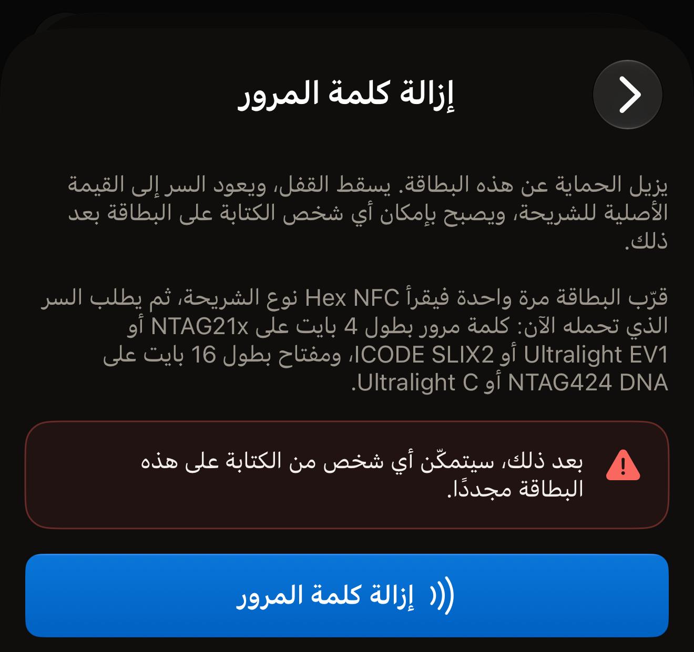
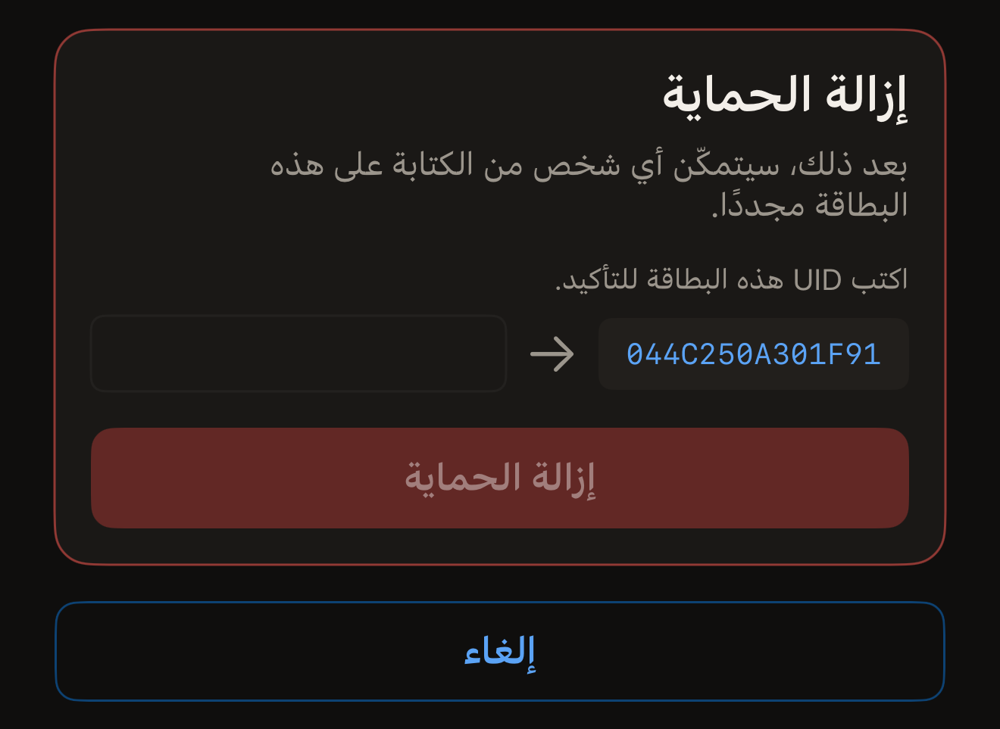
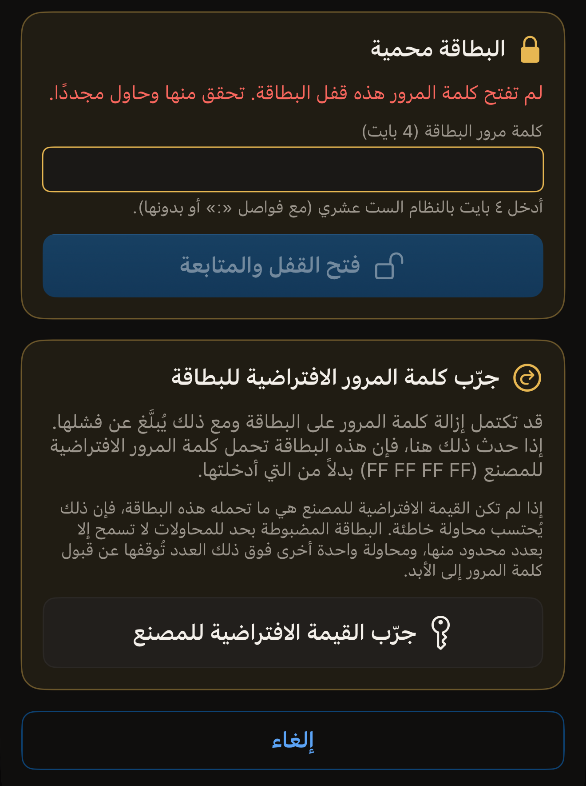

يمكن إزالة كلمة المرور التي وضعتها على البطاقة، ما دمت قادرًا على تقديم كلمة
المرور التي تحملها البطاقة. وبعد إزالتها، يستطيع أي شخص قراءة البطاقة والكتابة
عليها، وتعود كلمة المرور أو المفتاح إلى القيمة الافتراضية للمصنع في الشريحة.

قبل أن تبدأ، افتح Hex NFC على iPhone وامسح البطاقة حتى تظهر في شاشة «البطاقة»
(راجع [مسح بطاقة وقراءة محتواها](scan-a-tag.md)). واجعل كلمة المرور التي تحملها
البطاقة في متناول يدك. يذكر القسم الموجود أعلى تلك الشاشة اسم الشريحة في سطره
الأول، فوق UID البطاقة. وهذا الاسم يحدد نوع السر الذي تطلبه عملية الإزالة.
والشريحة التي لا يرد اسمها في أي من الطريقتين أدناه لا تحمل كلمة مرور يستطيع
Hex NFC إزالتها، لأن التطبيق لا يضع عليها كلمة مرور أصلًا.

## إزالة كلمة المرور من العمليات

يشمل هذا الطريق كل شريحة يستطيع التطبيق حمايتها. ولا يطلب أي شيء قبل اللمسة
الأولى. تقرأ تلك اللمسة نوع شريحة البطاقة، ثم تطلب الشاشة السر الذي تحمله البطاقة
الآن: كلمة مرور من ٤ بايت على شرائح NTAG21x، أي NTAG213 وNTAG213 TT وNTAG215
وNTAG216، أو على MIFARE Ultralight EV1 أو ICODE SLIX2، ومفتاحًا من ١٦ بايت على
NTAG424 DNA أو MIFARE Ultralight C. أما NTAG 210µ فلا تحمل كلمة مرور لإزالتها.
وتسرد [مصفوفة دعم الشرائح](../developer/chip-support-matrix.md) ما تحمله كل
شريحة.

:::::steps
::::step[افتح العمليات]
في شاشة **البطاقة**، افتح القائمة أعلى اليسار، ثم اضغط على **العمليات…**.
::::

::::step[افتح «إزالة كلمة المرور»]
اضغط على **إزالة كلمة المرور**.
::::

::::step[ابدأ الإزالة]
اضغط على **إزالة كلمة المرور**. ويذكر التحذير فوقه ثمن الإزالة:
«بعد ذلك، سيتمكّن أي شخص من الكتابة على هذه البطاقة مجددًا.»

:::figure[زر **إزالة كلمة المرور** الذي تضغط عليه هو الموجود أسفل الشاشة، تحت التحذير.]

:::
::::

::::step[ضع البطاقة بالقرب من أعلى iPhone]
يقرأ التطبيق UID البطاقة وينهي اللمسة حتى تتمكن من الكتابة.
::::

::::step[أدخل السر الذي تحمله البطاقة]
يطلب قسم عنوانه «البطاقة محمية» السر الذي تحمله البطاقة الآن. أدخل كلمة المرور
في **كلمة مرور البطاقة (4 بايت)** بثمانية أحرف ست عشرية. وعلى NTAG424 DNA يكون
الحقل **مفتاح البطاقة (AES، 16 بايت)**، وعلى MIFARE Ultralight C يكون
**مفتاح البطاقة (3DES، 16 بايت)**. ويتجاهل الحقل الفواصل، لذا فإن `FF FF FF FF`
و`FFFFFFFF` قيمة واحدة.
::::

::::step[أكّد البطاقة]
تعرض الشاشة UID البطاقة بجانب الحقل، تحت «اكتب UID هذه البطاقة للتأكيد.» اكتب
تلك الأحرف في الحقل دون فواصل. ولا يهم إن كانت الأحرف كبيرة أو صغيرة. اضغط على
**إزالة كلمة المرور**، ثم قرّب البطاقة من iPhone مرة أخرى.
::::
:::::

::include[two-tap-confirmation]

عندما تنتهي اللمسة الثانية، تعرض الشاشة «تمت إزالة كلمة المرور.» صارت البطاقة
مفتوحة. ويستطيع أي هاتف إعادة كتابة سجلاتها. وإذا كانت البطاقة تطلب كلمة المرور
أيضًا قبل أن تعرض أي شيء، فإن هذه الحماية تُزال مع الأخرى.

## إزالة الحماية من شاشة «البطاقة»

على أي شريحة يستطيع التطبيق حمايتها، يمكن أيضًا إزالة الحماية ضمن عملية كتابة،
وتحتاج لذلك إلى المفتاح أو كلمة المرور التي تحملها البطاقة. تعيد الكتابة السجلات
المدرجة في شاشة **البطاقة** إلى البطاقة. وبعد المسح تكون تلك القائمة هي ما تحمله
البطاقة بالفعل، لذا يبقى محتواها كما هو ما لم تعدّل القائمة بنفسك.

:::::steps
::::step[افتح الحماية]
في شاشة **البطاقة**، اضغط على **الحماية**.
::::

::::step[أوقف الحماية]
أوقف **حماية هذه البطاقة بمفتاح** على بطاقة NTAG424 DNA أو MIFARE Ultralight C،
أو **حماية هذه البطاقة بكلمة مرور** على شريحة تقبل كلمة مرور: NTAG21x أو
MIFARE Ultralight EV1 أو ICODE SLIX2. وتوضح الملاحظة تحته أن الكتابة التالية
تزيل الحماية من القراءة والحماية من الكتابة معًا، وتعيد السر إلى القيمة
الافتراضية للمصنع.
::::

::::step[احتفظ بالتغيير]
اضغط على **تم**.
::::

::::step[اكتب على البطاقة]
في شاشة **البطاقة**، اضغط على **كتابة**، ثم ضع البطاقة بالقرب من أعلى iPhone.
يقرأ التطبيق UID البطاقة ويطلب منك أن تكتبه.
::::

::::step[أكّد البطاقة]
اكتب UID الظاهر بجانب الحقل، دون فواصل وبأحرف كبيرة أو صغيرة، ثم اضغط على
**إزالة الحماية**. قرّب البطاقة من iPhone مرة أخرى لتنفيذ التغيير.

:::figure[يعرض قسم **إزالة الحماية** UID الذي قرأه التطبيق، وبينه وبين الحقل الفارغ الذي تكتبه فيه سهم.]

:::
::::
:::::

تقدّم الكتابة المفتاح أو كلمة المرور التي يحتفظ بها التطبيق للبطاقة بالفعل. وهي
التي أدخلتها في قسم **الحماية**، أو التي استخدمتها عندما حميت البطاقة. وعلى
بطاقة لا يحتفظ لها التطبيق بشيء، تتوقف الكتابة عند «البطاقة محمية» وتطلب السر.
ويتوقف الحقل الذي تطلبه فيه على الشريحة:

- على NTAG424 DNA، أدخله في **مفتاح البطاقة (AES، 16 بايت)**.
- على MIFARE Ultralight C، أدخله في **مفتاح البطاقة (3DES، 16 بايت)**.
- على NTAG21x أو MIFARE Ultralight EV1 أو ICODE SLIX2، أدخله في
  **كلمة مرور البطاقة (4 بايت)**.

ثم اضغط على **فتح القفل والمتابعة**. ولا تتبع ذلك لمسة إضافية، لأن التطبيق قرأ
UID البطاقة بالفعل. ويليه قسم التأكيد. اكتب UID، واضغط على **إزالة الحماية**، ثم
قرّب البطاقة مرة أخرى.

## إذا رفضت البطاقة كلمة المرور

على NTAG21x أو MIFARE Ultralight EV1، تقدّم اللمسة الواحدة كلمة مرور واحدة.
والبطاقة التي ترفضها تتوقف عن الاستجابة طوال ما تبقى من تلك اللمسة. ولا يجرّب
التطبيق أبدًا كلمة مرور ثانية في اللمسة نفسها.

عندما ترفض البطاقة كلمة المرور، يعود قسم «البطاقة محمية» وفيه
«لم تفتح كلمة المرور هذه قفل البطاقة. تحقق منها وحاول مجددًا.» ويبدأ حقله فارغًا،
لذا لا تُرسل كلمة المرور المرفوضة مرة أخرى إلا إذا كتبتها. أدخل كلمة المرور،
واضغط على **فتح القفل والمتابعة**، ثم قرّب البطاقة مرة أخرى. ويعيد **إلغاء**
الشاشة إلى حالتها الأولى.

إذا فشلت الإزالة لسبب آخر، تعرض الشاشة **أدخل كلمة مرور مختلفة**. فيعيد الشاشة
إلى بدايتها، وتطلب العملية التالية كلمة المرور مرة أخرى في حقل فارغ.

عندما ترفض البطاقة كلمة المرور التي أدخلتها، ولم تكن تلك الكلمة `FF FF FF FF`
أصلًا، يقترح التطبيق شيئًا واحدًا محددًا للتجربة. يظهر قسم عنوانه
«جرّب كلمة المرور الافتراضية للبطاقة» تحت رسالة الفشل في شاشة
**إزالة كلمة المرور**. وقد تكتمل الإزالة على البطاقة ثم تُبلغ رغم ذلك عن فشل.
وعندئذ تحمل البطاقة `FF FF FF FF` بدلًا من كلمة المرور التي أدخلتها. وهذه القيمة
هي التي تخرج بها كل شريحة NTAG21x وMIFARE Ultralight EV1 من المصنع. اضغط على
**جرّب القيمة الافتراضية للمصنع** لإرسالها في اللمسة التالية. وإلى أن تتم اللمسة،
تذكر الشاشة كلمة المرور التي سترسلها. ونصها:
«ستقدّم اللمسة التالية كلمة المرور الافتراضية للمصنع (FF FF FF FF) بدلاً من التي أدخلتها.»

:::figure[بعد رفض كلمة المرور، يظهر قسم القيمة الافتراضية للمصنع تحت قسم «البطاقة محمية»، وفي أسفله **جرّب القيمة الافتراضية للمصنع**.]

:::

:::warning
إذا لم تكن القيمة الافتراضية للمصنع هي ما تحمله البطاقة، تُحتسب اللمسة محاولة
خاطئة واحدة. والبطاقة المضبوطة بحد للمحاولات لا تسمح إلا بعدد محدود منها،
ومحاولة واحدة فوق ذلك تجعلها تتوقف عن قبول كلمة المرور إلى الأبد. راجع
[تحديد عدد محاولات كلمة المرور الخاطئة](attempt-limit.md).
:::

عندما تفتح القيمة الافتراضية للمصنع البطاقة، يخبرك التطبيق بذلك بعد انتهاء
العملية. ونص الرسالة:
«كلمة المرور الافتراضية للمصنع هي التي فتحت هذه البطاقة، أي أن إزالة سابقة كانت قد تمت عليها بالفعل. كلمة المرور التي كنت تحتفظ بها لهذه البطاقة ليست الكلمة التي تحملها.»

## إذا لم تكتمل الإزالة

تعني اللمستان فرصتين لأن تبتعد البطاقة مبكرًا. ويقرأ التطبيق حماية البطاقة
مجددًا قبل أن يُبلغ بأي شيء، لذا تذكر الرسالة ما تحمله البطاقة الآن:

- تعني «تمت إزالة كلمة المرور.» النجاح أينما ظهرت، حتى على شاشة تُبلغ عن فشل في
  كل ما عدا ذلك. فقد أظهرت القراءة مجددًا أن الحماية زالت.
- تعني
  «لا تزال هذه البطاقة محمية. لم يُفقد شيء: قرّبها من الهاتف مرة أخرى لإكمال إزالة كلمة المرور.»
  أن القراءة مجددًا أظهرت أن الحماية لا تزال مفعّلة. أعد الإزالة بكلمة المرور
  نفسها.
- تعني
  «تعذّر تأكيد ما إذا كانت كلمة المرور قد أُزيلت. قرّب البطاقة من الهاتف مرة أخرى للتحقق.»
  أن البطاقة خرجت من النطاق قبل أن يتمكن التطبيق من قراءة حمايتها. أعد الإزالة
  لتعرف حالة البطاقة.

إذا لم تفتح البطاقة أي كلمة مرور لديك، تبقى ذاكرتها المحمية على حالها. وتشرح صفحة
[حماية البطاقة](tag-protection.md) لماذا لا يمكن استرجاع كلمة مرور مفقودة.

## انظر أيضًا

- [حماية البطاقة](tag-protection.md)
- [حماية بطاقة بكلمة مرور](protect-a-tag.md)
- [تحديد عدد محاولات كلمة المرور الخاطئة](attempt-limit.md)
- [إذا تعذّرت قراءة البطاقة أو الكتابة عليها](troubleshooting.md)
