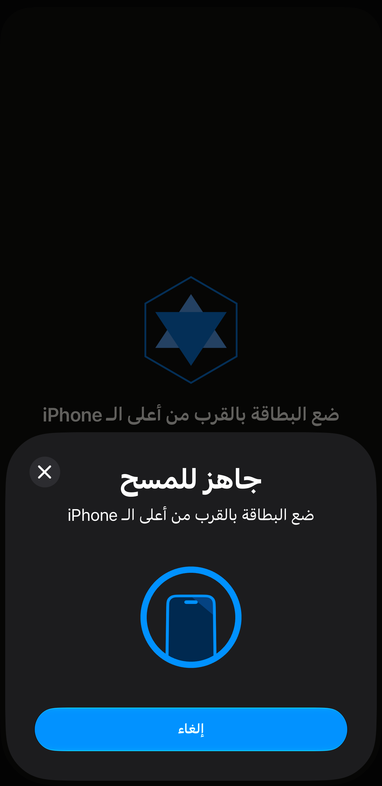
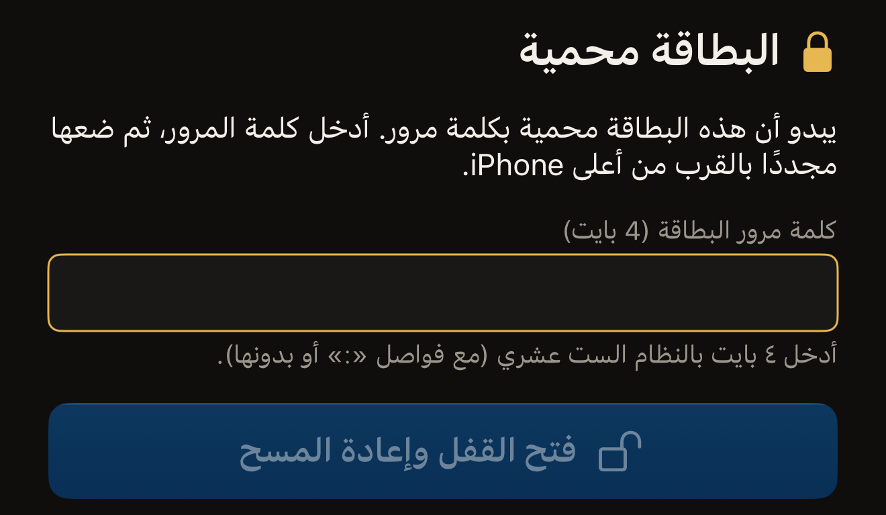
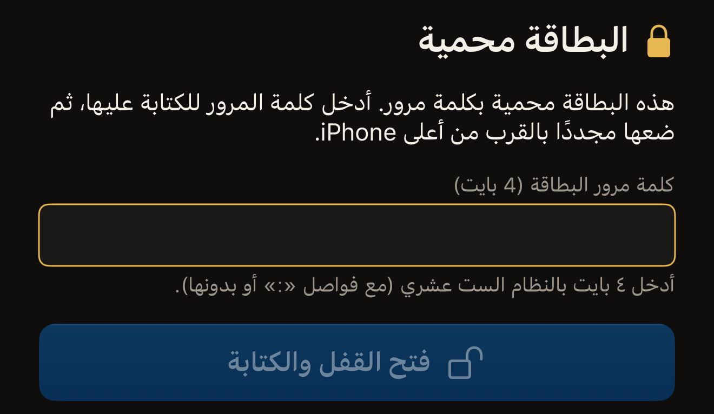

يقرأ Hex NFC البطاقة بلمسة واحدة. تضغط على **مسح**، وتضع البطاقة بالقرب من
أعلى iPhone، فيعرض التطبيق الشريحة التي عثر عليها وما تحمله البطاقة. المسح
قراءة فقط، فلا يتغير أي شيء على البطاقة.

ويمكن أيضًا ضبط البطاقة بحيث تطلب كلمة المرور قبل أن تُقرأ. والبطاقة المحمية
بهذه الطريقة ترفض القراءة إلى أن تُقدَّم كلمة المرور، وتقديمها يحتاج إلى
لمستين بدلًا من لمسة واحدة. ويتناول النصف الثاني من هذه الصفحة ذلك. ومعظم
البطاقات المحمية محمية من الكتابة فقط، وهذه تُمسح بلمسة واحدة مثل أي بطاقة
أخرى. وإذا لم يسبق لك مسح بطاقة، فصفحة
[قراءة بطاقتك الأولى](quick-start.md) تشرح اللمسة نفسها من البداية.

## مسح بطاقة

:::::steps
::::step[افتح شاشة المسح]
افتح Hex NFC واضغط على **مسح** في شاشته الرئيسية. تُفتح شاشة المسح وتظهر
عليها عبارة «ضع البطاقة بالقرب من أعلى الـ iPhone».

:::figure[أثناء انتظار التطبيق لبطاقة، يظهر سطره الخاص فوق لوحة المسح في iOS، ويوقف زر الإلغاء في اللوحة عملية المسح.]

:::
::::

::::step[ضع البطاقة بالقرب من أعلى iPhone]
ضع أعلى iPhone على البطاقة وأبقِه ثابتًا. تعرض الشاشة «جارٍ القراءة…» أثناء
قراءة البطاقة.
::::

::::step[اقرأ ما عثر عليه التطبيق]
تظهر «تم اكتشاف البطاقة» مع علامة صح، ويظهر اسم الشريحة تحتها. وتحت ذلك يذكر
التطبيق ما قرأه. يبيّن سطر «عُثر على سجل واحد» عدد السجلات على البطاقة، أما
«لا توجد سجلات NDEF على هذه البطاقة» فتعني أن البطاقة مهيّأة لكنها فارغة.
ويأتي المعرّف UID للبطاقة في الأخير.
::::
:::::

تبقى النتيجة معروضة نحو ثانية، ثم يفتح التطبيق شاشة **البطاقة** وفيها قائمة
السجلات، ويمكنك هناك تغييرها أو كتابتها مرة أخرى. ولا يضيع هناك شيء من
النتيجة. فاسم الشريحة هو عنوان قسم معلومات البطاقة، والسجلات هي القائمة التي
تحته. والمعرّف UID صف في ذلك القسم، والضغط عليه ينسخه في أي وقت. وتُحفظ كل
عملية مسح في سجل المسح أيضًا. راجع
[العثور على بطاقة مسحتها من قبل](scan-history.md)
و[تعديل سجلات بطاقة](edit-records.md).

للتوقف قبل قراءة البطاقة، اضغط على إلغاء في لوحة المسح في iOS. تُغلق
شاشة المسح وتعود إلى الشاشة الرئيسية في Hex NFC. وإذا لم تكن هناك بطاقة
بالقرب من iPhone، تُغلق لوحة iOS تلقائيًا بعد دقيقة تقريبًا، وتعرض شاشة المسح
«لم يُعثر على أي بطاقة» وتحتها **إلغاء** و**حاول مرة أخرى**.

تغادر بعض البطاقات شاشة المسح بطريقة أخرى. فبطاقة النقل اليابانية تفتح نتيجة
خاصة بها للقراءة فقط، وتشرحها صفحة [قراءة بطاقة نقل](transit-cards.md).
ويطلب جواز السفر الإلكتروني أولًا البيانات المدوّنة في صفحة الصورة، كما تشرح
صفحة [قراءة جواز سفر](passports.md). ويفتح الجهاز الصحي العامل بتقنية NFC، مثل قلم
الإنسولين، شاشة **جهاز صحي** للقراءة فقط ولا يُحفظ، كما تشرح صفحة
[الأجهزة الصحية](tags-that-work.md#health-devices). أما البطاقة المحمية فتطلب كلمة المرور،
وهذه هي المهمة التالية في هذه الصفحة.

إذا ظهرت في النتيجة عبارة «هذه البطاقة غير مهيّأة بعد»، فلن يمكن قراءة أي شيء
تكتبه على البطاقة إلى أن تُهيّأ. وتشرح صفحة
[مسح محتوى البطاقة أو تهيئتها](erase-or-format.md) كيفية ذلك.

## فتح قفل بطاقة محمية {#unlock-a-protected-tag}

البطاقة التي تطلب كلمة المرور لقراءتها توقف عملية المسح. تعرض شاشة المسح
«البطاقة محمية» وتحتها هذه الجملة: «يبدو أن هذه البطاقة محمية بكلمة مرور. أدخل كلمة المرور، ثم ضعها مجددًا بالقرب من أعلى iPhone.»
وتحت ذلك يظهر حقل كلمة المرور، وزر **فتح القفل وإعادة المسح**، وصف فيه
**إلغاء** و**حاول مرة أخرى**. كلمة المرور تخص البطاقة لا حسابًا ما، ولا
يعرفها إلا من عيّنها. والإعداد الذي يؤدي إلى هذه الحالة هو
**طلب كلمة المرور للقراءة أيضًا**، وتشرحه صفحة
[حماية بطاقة بكلمة مرور](protect-a-tag.md).

:::::steps
::::step[أدخل كلمة مرور البطاقة]
في حقل **كلمة مرور البطاقة (4 بايت)**، أدخل كلمة المرور بأحرف النظام الست
عشري، من 0 إلى 9 ومن A إلى F. تتألف كلمة المرور المكوّنة من ٤ بايت من ٨
أحرف: اكتبها على شكل `A1B2C3D4` أو `A1:B2:C3:D4`، فالفواصل بين البايتات
اختيارية ولا تُحتسب في الطول. وتعرض الملاحظة تحت الحقل «صالح» حين يصبح طول
ما أدخلته صحيحًا.

:::figure[توقف البطاقة المحمية المسح عند حقل **كلمة مرور البطاقة (4 بايت)**، ويبقى زر **فتح القفل وإعادة المسح** باهتًا إلى أن يصبح طول ما أدخلته صحيحًا.]

:::

على شريحة NTAG424 DNA يظهر الحقل باسم **مفتاح البطاقة (AES، 16 بايت)** بدلًا
من ذلك، وعلى MIFARE Ultralight C يظهر باسم **مفتاح البطاقة (3DES، 16 بايت)**.
فهاتان الشريحتان تُفتحان بمفتاح لا بكلمة مرور. وطول كل من المفتاحين ١٦ بايت،
أي ٣٢ حرفًا.
::::

::::step[ابدأ اللمسة الثانية]
اضغط على **فتح القفل وإعادة المسح**. يبقى الزر باهتًا إلى أن يصبح طول ما
أدخلته مناسبًا للشريحة.
::::

::::step[ضع البطاقة مجددًا بالقرب من أعلى iPhone]
يقدّم التطبيق كلمة المرور، ثم يقرأ البطاقة ويعرض «تم اكتشاف البطاقة» كما يفعل
مع أي بطاقة أخرى.
::::
:::::

إذا رفضت البطاقة كلمة المرور، تعود إلى «البطاقة محمية»، وتحل محل الرسالة
عبارة «لم تفتح كلمة المرور هذه قفل البطاقة. تحقق منها وحاول مجددًا.» وعلى
NTAG424 DNA أو MIFARE Ultralight C تظهر بدلًا منها
«لم يفتح هذا المفتاح قفل البطاقة. تحقق منه وحاول مجددًا.» صحّح ما أدخلته
واضغط على **فتح القفل وإعادة المسح** لإجراء لمسة أخرى. فكلمة المرور المرفوضة
تجعل الشريحة تتوقف عن الاستجابة لبقية تلك اللمسة. وقد صُمّم التطبيق بحيث
تكون كل محاولة لمسة جديدة. وللعودة إلى قراءة عادية بلا كلمة مرور، اضغط على
**حاول مرة أخرى**. أما **إلغاء** فيفعل شيئًا مختلفًا: يُغلق شاشة المسح دون
قراءة البطاقة، ويُحذف ما كتبته. ولا يغيّر أيٌّ منهما البطاقة.

:::warning[قد تكلّفك كلمة المرور المرفوضة محاولة]
يمكن ضبط البطاقة بحيث لا تقبل إلا عددًا محددًا من كلمات المرور الخاطئة، ثم
تتوقف عن قبول كلمة المرور إلى الأبد. وعلى البطاقة التي تُبلغ عن حد كهذا،
يعرض التطبيق نص الرفض نفسه بدلًا من النصيحة السابقة. والتحقق من كلمة المرور مرة
أخرى أجدى من محاولة جديدة. راجع
[تحديد عدد محاولات كلمة المرور الخاطئة](attempt-limit.md).
:::

## فتح قفل بطاقة محمية قبل الكتابة عليها

تبدأ الكتابة من شاشة **البطاقة**. وتصل البطاقة المحمية إلى شاشة **البطاقة**
عن طريق فتح القفل الموضّح أعلاه. أكمل عملية المسح تلك أولًا، وسيفتح التطبيق
شاشة **البطاقة** كما يفعل مع أي بطاقة أخرى. وهناك طريقان يتجاوزان تلك
القراءة. ففي **المكتبة** تسرد علامة التبويب **السجل** البطاقات التي مسحتها
من قبل، والضغط على صف يعيد فتح تلك البطاقة في شاشة **البطاقة**. وفي علامة
التبويب **القوالب**، يؤدي سحب قالب من اليمين إلى اليسار إلى إظهار زر
**كتابة**، وهو يفتح شاشة الكتابة مباشرةً بسجلات القالب.

في شاشة **البطاقة**، اضغط على **كتابة** في شريط الأدوات فتُفتح شاشة الكتابة.
وتشرح صفحة [كتابة رابط على بطاقة](write-a-link.md) عملية الكتابة من بدايتها
إلى نهايتها، أما ما يلي فهو الخطوة الإضافية التي تضيفها البطاقة المحمية.

تطلب شاشة الكتابة كلمة المرور مرة أخرى، حتى مع بطاقة فتحت قفلها قبل لحظات.
فكل لمسة جلسة مستقلة، ولا ينقل التطبيق كلمة المرور من جلسة إلى أخرى. وكتابتها
مرة ثانية أمر متوقع، وليست علامة على فشل فتح القفل. وإذا بدأت من الصفر، تحتاج
البطاقة المحمية إلى ثلاث لمسات: المسح الذي ترفضه، ثم مسح فتح القفل الذي يفتح
شاشة **البطاقة**، ثم الكتابة. تعرض الشاشة «البطاقة محمية»، ثم تطلب كلمة
المرور: «هذه البطاقة محمية بكلمة مرور. أدخل كلمة المرور للكتابة عليها، ثم ضعها مجددًا بالقرب من أعلى iPhone.»

:::::steps
::::step[أدخل كلمة المرور في شاشة الكتابة]
في حقل **كلمة مرور البطاقة (4 بايت)**، أدخل كلمة مرور البطاقة، وهي ٨ أحرف
بالنظام الست عشري، الأحرف نفسها التي يطلبها المسح. وعلى الشريحتين اللتين
تستخدمان مفتاحًا يحمل الحقل اسم مفتاح بدلًا من كلمة مرور، والمفتاح يتألف من
٣٢ حرفًا.

:::figure[في شاشة الكتابة تطلب الرسالة كلمة المرور للكتابة، ويظهر على الزر **فتح القفل والكتابة** بدلًا من **فتح القفل وإعادة المسح**.]

:::
::::

::::step[ابدأ اللمسة الثانية للكتابة]
اضغط على **فتح القفل والكتابة**. وإذا كانت الكتابة تغيّر حماية البطاقة أيضًا،
يظهر على الزر **فتح القفل والمتابعة** بدلًا من ذلك. عندئذٍ يعرض لك التطبيق
المعرّف UID للبطاقة ويطلب منك كتابته تحت «اكتب UID هذه البطاقة للتأكيد.» قبل
أن يكتب. راجع [حماية بطاقة بكلمة مرور](protect-a-tag.md).
::::

::::step[قرّب البطاقة لكتابتها]
ضع البطاقة مجددًا بالقرب من أعلى iPhone. يقدّم التطبيق كلمة المرور ثم يكتب.
::::
:::::

والرفض هنا أيضًا يظهر بعبارة
«لم تفتح كلمة المرور هذه قفل البطاقة. تحقق منها وحاول مجددًا.» ويُعالج
بالطريقة نفسها: تحقق مما أدخلته، ثم قرّب البطاقة مرة أخرى.

قد ينتهي المسح بعبارة «فشل المسح»، وقد تطلب بطاقة تظن أنها فارغة كلمة مرور.
وفي الحالتين، اتبع ما في صفحة
[إذا تعذّرت قراءة البطاقة أو الكتابة عليها](troubleshooting.md).
