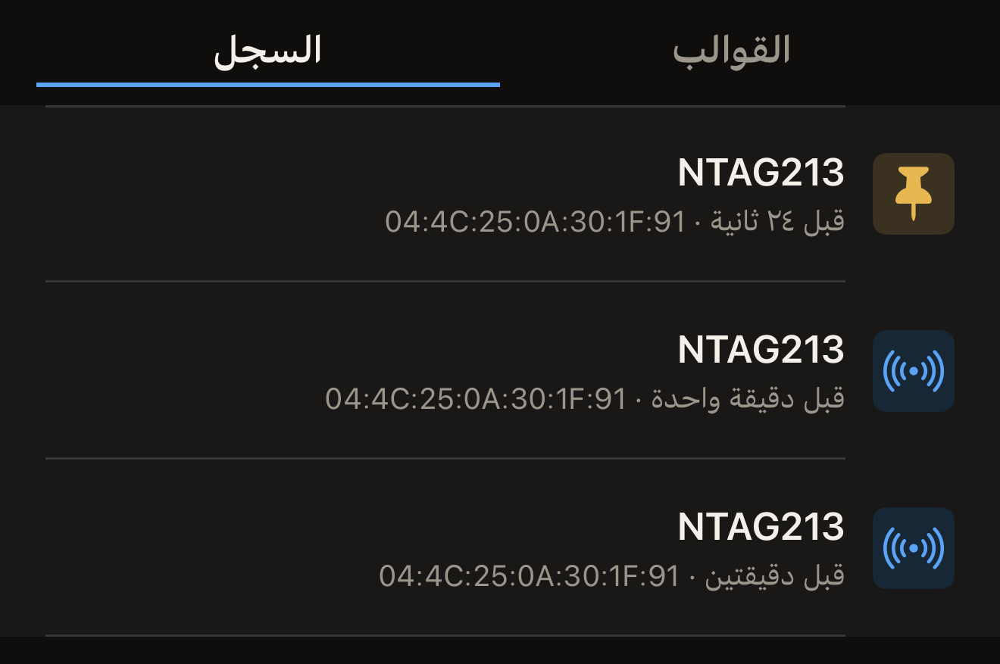

يحتفظ Hex NFC بنسخة من البطاقات التي يقرؤها، فتستطيع فتح عملية مسح مرة أخرى
والبطاقة بعيدة عنك. وتوجد عمليات المسح الأخيرة في المكتبة على iPhone، الأحدث
أولًا. ثبّت ما تريد الاحتفاظ به منها.

## فتح عملية مسح أجريتها من قبل

تحتاج إلى بطاقة قرأتها من قبل؛ فإلى أن تمسح بطاقة، تبقى علامة التبويب
**السجل** فارغة. راجع [مسح بطاقة وقراءة محتواها](scan-a-tag.md).

:::::steps
::::step[افتح Hex NFC]
يُفتح التطبيق على الشاشة الرئيسية في Hex NFC، وفيها مربعات **مسح**
و**إنشاء** و**المكتبة** و**متقدّم**.
::::

::::step[افتح المكتبة]
اضغط على **المكتبة**. تُفتح شاشة «المكتبة» على **القوالب**.
::::

::::step[انتقل إلى عمليات المسح]
في أعلى شاشة «المكتبة»، اضغط على **السجل**، على يسار **القوالب**. يبدأ كل صف
باسم الشريحة، وتحته UID البطاقة والمدة التي مرّت منذ قرأتها.

:::figure[يذكر كل صف اسم الشريحة، ثم المدة التي مرّت منذ قرأت البطاقة وUID الخاص بها، ويحل دبوس محل الأيقونة في عملية المسح المثبّتة.]

:::
::::

::::step[افتح عملية المسح]
اضغط على عملية المسح التي تريدها. تُغلق المكتبة وتُفتح عملية المسح في شاشة
«البطاقة»، وفيها السجلات وتفاصيل الشريحة من اللمسة التي أنتجتها.
::::
:::::

أما بطاقة النقل فتُفتح بدلًا من ذلك في شاشة «بطاقة نقل»، للقراءة فقط، كما
فُتحت عندما قرأت البطاقة. ولا تُحفظ قراءة جواز السفر أبدًا، لذا لا يظهر أي
جواز سفر في هذه القائمة. راجع [قراءة جواز سفر](passports.md). ولا يُحفظ الجهاز
الصحي أبدًا كذلك.

## تثبيت عملية مسح تريد الاحتفاظ بها

تتسع القائمة لـ ٥٠ عملية مسح. وعندما تصل عملية مسح جديدة والقائمة ممتلئة،
تخرج من نهايتها أقدم عملية مسح غير مثبّتة. وتُحذف عملية المسح غير المثبّتة
أيضًا بعد ٩٠ يومًا من القراءة التي أنتجتها، مهما كانت القائمة قصيرة. وإذا
أعدت مسح بطاقة وعادت النتيجة إلى صف موجود لديك، فهذا يُحسب قراءة جديدة وتبدأ
مدة الـ ٩٠ يومًا من جديد. أما عملية المسح المثبّتة فلا تخضع لأي من القاعدتين، وتبقى إلى
أن تحذفها.

تُعرض عمليات المسح من الأحدث إلى الأقدم، ولا يوجد في الشاشة ما يبحث فيها، لذا
ثبّت ما ستحتاج إلى العثور عليه مرة أخرى.

- لتثبيت عملية مسح، اسحبها إلى اليسار في **السجل**، ثم اضغط على **تثبيت**.

تحمل عملية المسح المثبّتة دبوسًا على يمين صفها بدلًا من الأيقونة المعتادة،
وتحتفظ بمكانها في القائمة بدلًا من الانتقال إلى أعلاها. وفي عملية مسح مثبّتة
من قبل، يظهر إجراء السحب نفسه باسم **إلغاء التثبيت**، وإلغاء التثبيت يجعل
عملية المسح تُحتسب من جديد ضمن الـ ٥٠.

## حذف عملية مسح

- لحذف عملية مسح، اسحبها إلى اليمين في **السجل**، ثم اضغط على **حذف**.
  والسحب إلى آخر الصف يحذف عملية المسح فورًا.

:::warning
تُحذف عملية المسح لحظة الضغط على **حذف**. لا يُطلب منك أي تأكيد، ولا سبيل إلى
استعادتها، وإن كانت قراءة البطاقة مرة أخرى تُنتج عملية مسح جديدة.
:::

## ما يحتويه سجل المسح

قبل أن تقرأ أي شيء، تعرض علامة التبويب **السجل** «لا يوجد سجل مسح»، وتحتها
السطر «تظهر هنا آخر 50 بطاقة مسحتها. ثبّت واحدة للاحتفاظ بها.»

- إذا قرأت البطاقة نفسها مرة أخرى ولم يتغير فيها شيء، تعود عملية المسح
  الموجودة لديك إلى أعلى القائمة، ولا يظهر صف ثانٍ. أما أي اختلاف في تفاصيل
  الشريحة أو السجلات أو حماية البطاقة بكلمة المرور فيمنحك صفًا جديدًا بدلًا
  من ذلك.
- تبقى عمليات المسح على هذا iPhone، ولا تصل إلى حساب iCloud إلا إذا فعّلت
  **مزامنة iCloud**، وهي متوقّفة في البداية. راجع
  [الخصوصية وبياناتك](privacy.md).

## انظر أيضًا

- [مسح بطاقة وقراءة محتواها](scan-a-tag.md)
- [تعديل سجلات بطاقة](edit-records.md)
- [حفظ بطاقة كقالب](presets.md)
