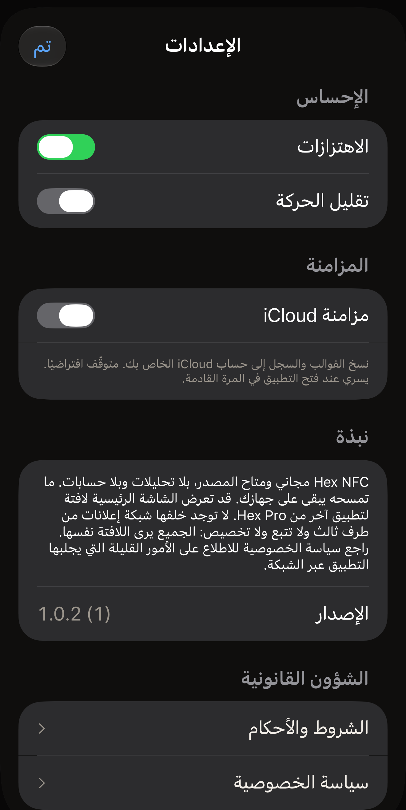

في Hex NFC ثلاثة إعدادات، تتشارك شاشة واحدة مع رقم إصدار التطبيق، وطريقة
لإرسال الملاحظات أو تقييم التطبيق، ومستنداته القانونية. في الشاشة الرئيسية في Hex NFC، اضغط على زر الترس في أعلى اليسار؛
لا يحمل الزر أي كلمة، ويقرؤه VoiceOver على أنه **الإعدادات**. واللوحة التي
تُفتح عنوانها **الإعدادات**. وتأتي المجموعات أدناه بالترتيب الذي تعرضها به
الشاشة.

:::figure[تُفتح لوحة **الإعدادات** على **الإحساس** و**المزامنة**، وكل زر تبديل على قيمته الافتراضية.]

:::

## الإحساس

:::table[إعدادات الإحساس]
| الإعداد | ما يفعله | القيمة الافتراضية |
| :--- | :--- | :--- |
| **الاهتزازات** | يجعل iPhone يهتز أثناء المسح والكتابة وغيرهما من اللحظات التي يميّزها التطبيق. وإيقافه يوقف تلك الاهتزازات فورًا. | مفعّل |
| **تقليل الحركة** | يقلّل الرسوم المتحركة في التطبيق. :more[يقلّل التطبيق الحركة عندما يكون زر التبديل هذا أو إعداد تقليل الحركة في iPhone نفسه مفعّلًا، لذا فإن إيقاف هذا الزر لا يلغي إعداد النظام.] | متوقّف |
:::

عندما يكون إعداد تقليل الحركة في iPhone نفسه مفعّلًا، يظهر تحت الصف سطر نصه:
“إعداد «تقليل الحركة» في النظام مُفعَّل: الرسوم المتحركة مخفّضة إلى الحد الأدنى بالفعل.”

## المزامنة

:::table[إعدادات المزامنة]
| الإعداد | ما يفعله | القيمة الافتراضية |
| :--- | :--- | :--- |
| **مزامنة iCloud** | ينسخ قوالبك وسجل المسح إلى حساب iCloud. ولا تُنسخ كلمة المرور الخاصة بأي بطاقة أبدًا، بل تبقى في سلسلة المفاتيح على iPhone الذي عيّنها. | متوقّف |
:::

يُنشئ Hex NFC مكتبته مرة واحدة عند التشغيل، لذا فإن تفعيل **مزامنة iCloud**
أو إيقافها لا يغيّر شيئًا إلى أن تغلق التطبيق وتفتحه مرة أخرى. وهذا ما يقوله
السطر الذي تحت الصف. والمقصود بالإغلاق هو إنهاء التطبيق، فالعودة إلى الشاشة
الرئيسية في iPhone تُبقي Hex NFC قيد التشغيل، ويظل زر التبديل الذي حرّكته بلا
أثر.

### تفعيل مزامنة iCloud {#turn-on-icloud-sync}

::::steps
:::step[افتح لوحة الإعدادات]
في الشاشة الرئيسية في Hex NFC، اضغط على زر الترس في أعلى اليسار.
:::

:::step[فعّل مزامنة iCloud]
فعّل **مزامنة iCloud**. يتحرك زر التبديل، ولا يتغير شيء آخر بعد.
:::

:::step[أغلق Hex NFC وافتحه مرة أخرى]
اتبع خطوات [إغلاق التطبيق وإعادة فتحه](#close-and-reopen-the-app). يعيد
التطبيق إنشاء مكتبته عند بدء تشغيله، والمزامنة تعمل هذه المرة.
:::

:::step[تحقّق من ظهور تحذير]
اضغط على زر الترس مرة أخرى وانظر تحت **مزامنة iCloud**. يظهر هناك الشرح
التالي: «نسخ القوالب والسجل إلى حساب iCloud الخاص بك. متوقّف افتراضيًا. يسري
عند فتح التطبيق في المرة القادمة.» وإذا تلته فقرة ثانية، فهذا يعني أن
المزامنة لم تبدأ؛ راجع [عندما لا تبدأ المزامنة](#when-sync-does-not-start).
:::
::::

### إغلاق التطبيق وإعادة فتحه {#close-and-reopen-the-app}

::::steps
:::step[أغلق Hex NFC]
اسحب لأعلى من الحافة السفلية للشاشة وتوقّف قليلًا حتى تظهر التطبيقات
المفتوحة. وفي iPhone المزوّد بزر الشاشة الرئيسية، اضغط على زر الشاشة
الرئيسية مرتين بدلًا من ذلك. ثم اسحب نافذة Hex NFC لأعلى، فتخرج من الشاشة.
:::

:::step[افتح Hex NFC مرة أخرى]
اضغط على أيقونة Hex NFC. يعيد التطبيق إنشاء مكتبته عند بدء تشغيله، وفق ما
كانت عليه **مزامنة iCloud** عند إغلاقه.
:::
::::

وإيقاف **مزامنة iCloud** من جديد يتطلب الإغلاق وإعادة الفتح نفسيهما. وفي
الحالتين تبقى قوالبك وسجل المسح على هذا iPhone. ولا يحذف Hex NFC ما يحتفظ به
iCloud بالفعل، ويحتفظ أي iPhone آخر مسجّل الدخول إلى الحساب نفسه بكل ما
تلقّاه. ما يتوقف هو تدفق التغييرات الجديدة من هذا الجهاز.

### عندما لا تبدأ المزامنة {#when-sync-does-not-start}

إذا كان زر التبديل مفعّلًا وتعذّر الوصول إلى iCloud عند بدء تشغيل التطبيق،
فلا تبدأ المزامنة. ويظهر سطر ثانٍ تحت الصف: «المزامنة لا تعمل. مكتبتك
محفوظة بأمان على هذا الجهاز، لكن iCloud لم يكن متاحًا عند بدء تشغيل التطبيق.
تحقّق من تسجيل دخولك إلى iCloud، ثم أعد فتح التطبيق.» وما زالت قوالبك وسجل
المسح على iPhone، والنسخ وحده هو ما توقف.

ثلاثة أسباب تؤدي إلى ظهور هذا السطر:

- لم يُسجَّل الدخول إلى iCloud على iPhone.
- لم تتبقَّ للحساب أي مساحة تخزين في iCloud.
- لم يكن iPhone متصلًا بالشبكة عند بدء تشغيل Hex NFC.

تحقّق منها بالترتيب.

::::steps
:::step[تحقّق من حساب iCloud]
افتح تطبيق الإعدادات في iPhone واضغط على اسمك في الأعلى. سجّل الدخول إذا طُلب
منك ذلك، ثم اضغط على صف iCloud واطّلع على المساحة المتبقية. وإذا لم تتبقَّ أي
مساحة، فأفرغ بعض المساحة أو غيّر خطة التخزين من تلك الشاشة.
:::

:::step[تحقّق من الشبكة]
تأكد من أن iPhone متصل بشبكة واي فاي أو بالبيانات الخلوية. ويكفي تحميل صفحة
في Safari للتأكد من ذلك.
:::

:::step[أغلق Hex NFC وافتحه مرة أخرى]
اترك **مزامنة iCloud** مفعّلة واتبع خطوات
[إغلاق التطبيق وإعادة فتحه](#close-and-reopen-the-app)، ثم اضغط على زر الترس
في الشاشة الرئيسية في Hex NFC. وإذا ظلت الفقرة الثانية تحت **مزامنة iCloud**،
فهذا يعني أن المزامنة لم تبدأ بعد.
:::
::::

## نبذة

يوضّح قسم «نبذة» ما يفعله التطبيق وما لا يفعله: لا تحليلات، ولا حسابات، وما
تمسحه يبقى على جهازك. ويتناول أيضًا اللافتة التي قد تعرضها الشاشة الرئيسية في
Hex NFC لتطبيق آخر من Hex Pro. لا تقف وراء تلك اللافتة شبكة إعلانات تابعة
لطرف ثالث، ولا تتبع، ولا تخصيص، والجميع يرون اللافتة نفسها. ولمعرفة الأشياء
القليلة التي يجلبها التطبيق عبر الشبكة، اقرأ [الخصوصية وبياناتك](privacy.md).

وتحت تلك الفقرة، يعرض **الإصدار** رقم إصدار التطبيق متبوعًا برقم البنية بين
قوسين.

## الملاحظات والتقييمات {#feedback-and-ratings}

يفتح **إرسال ملاحظات**، الموجود تحت **الإصدار**، نموذجًا لكتابة رسالة
إلى Hex Pro.

1. اكتب في مربع الرسالة ما لا يعمل كما ينبغي، أو ما يمكن تحسينه.
2. إن أردت ردًا، فأدخل عنوان بريدك الإلكتروني تحت **عنوان الرد (اختياري)**.
   وإن تركته فارغًا، تُرسل الرسالة من دونه.
3. راجع القائمة تحت **يُرسل مع رسالتك**. فهي تعرض إصدار التطبيق وإصدار iOS
   وطراز الجهاز واللغة، وهي التفاصيل التي تُرسل مع رسالتك. ولا يُرسل أي شيء من
   بطاقاتك أو عمليات المسح أو سجل المسح.
4. اضغط على **إرسال** في أعلى اليسار.

يشكرك النموذج بعد أن تنطلق الرسالة. وإذا تعذّر عليه الوصول إلى Hex Pro، فإنه
يحتفظ بما كتبته ويعرض **راسلنا عبر البريد الإلكتروني بدلًا من ذلك**، الذي يفتح
تطبيق البريد ومعه الرسالة والتفاصيل نفسها معبّأة مسبقًا.

يفتح **قيّم Hex NFC** صفحة التطبيق في App Store، حيث يمكنك تقييمه أو كتابة
مراجعة له.

تعرض الشاشة الرئيسية في Hex NFC من حين لآخر قسمًا على امتداد حافتها السفلية.
ويسأل هذا القسم **هل يعجبك Hex NFC؟** ولا يظهر إلا بعد عدة عمليات كتابة أو
تغييرات في الحماية نجحت، أو بعد قراءة بطاقة نقل أو جواز سفر كامل، وبشرط ألا
يكون أي شيء قد فشل في عمليات المسح الأخيرة. وينتظر حتى تبقى الشاشة الرئيسية
عشر ثوانٍ دون أن تلمسها، ولا يعود أكثر من مرة واحدة في الشهر، ولا يغطي أبدًا
أي شيء تحتاج إليه: فالشاشة فوقه تظل قابلة للتمرير، وكل زر يعمل.

اضغط على **أحببته!** فتظهر لوحة التقييم من Apple، عندما يقرر iOS عرضها. واضغط
على **عادي.** فيعرض القسم **إرسال ملاحظات** بدلًا من ذلك. وكلتا الإجابتين
نهائية، ولا يعود القسم إلى السؤال. ويؤدي الضغط على **إخفاء** إلى إبعاد القسم
لمدة شهر، وفتح أي شيء من الشاشة الرئيسية وهو ظاهر له الأثر نفسه.

## الشؤون القانونية

يفتح كل من **الشروط والأحكام** و**سياسة الخصوصية** المستند كاملًا في لوحة
قراءة تمرّرها ثم تغلقها بالزر **تم**. وتحمل كل لوحة سطرين فوق العنوان الأول:
تاريخ بدء سريان تلك النسخة، و«Ars Vitae Pty Ltd, trading as Hex Pro (Australia)‎».
والمستندان كلاهما باللغة الإنجليزية، أيًّا كانت لغة بقية التطبيق.

وتجيب الشروط عن سؤال تكلفة التطبيق في القسم الذي عنوانه «3. The app is free»،
وتجيب عنه أيضًا صفحة [أسئلة شائعة](faq.md). أما سياسة الخصوصية فهي المستند
الذي تستند إليه صفحة [الخصوصية وبياناتك](privacy.md).

## انظر أيضًا

- [حفظ بطاقة كقالب](presets.md)
- [العثور على بطاقة مسحتها من قبل](scan-history.md)
- [الخصوصية وبياناتك](privacy.md)
