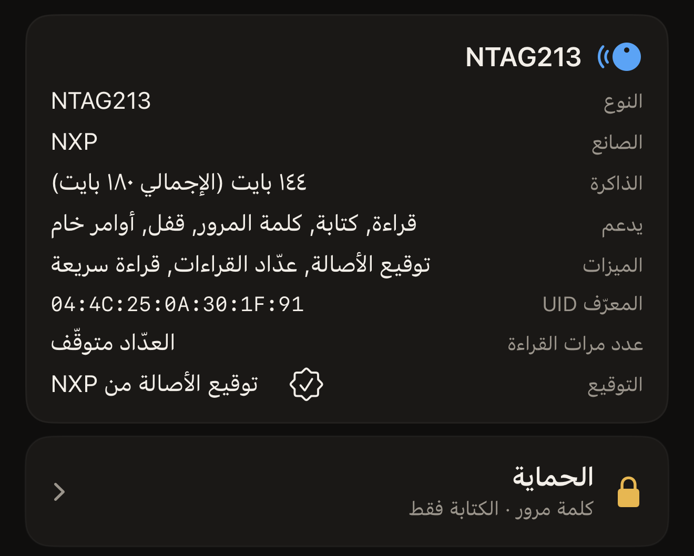

تستجيب البطاقة المثبّتة على ملصق إعلاني لكل هاتف يقترب منها، والشريحة غير
المحمية تسمح لأي هاتف منها بالكتابة فوق ما كتبته عليها. والحماية هي ردّ
الشريحة نفسها على ذلك. يُحفظ السر في صفحات الإعدادات داخل الشريحة، وترفض
الشريحة أي تغيير إلى أن يُقدَّم لها السر. ويستطيع Hex NFC ضبط هذا السر من
iPhone، وتقديمه عند مسح لاحق، ثم إزالته مرة أخرى. فالحماية تخص البطاقة نفسها،
لا التطبيق.

## ما الذي ترفضه البطاقة المحمية

تشمل الحماية الكتابة بشكل افتراضي. وتبقى البطاقة المحمية بهذه الطريقة مقروءة
لأي هاتف. وهذا ما تريده في ملصق إعلاني أو بطاقة عمل: يقرّب الناس هواتفهم منها
فيحصلون على الرابط، ولا يغيّره أحد غيرك. ويمكن لعائلتين من الشرائح أن تمدّا
الحماية إلى القراءة أيضًا، وهذا يغيّر ما يستطيع أي مسح لاحق فعله.

امسح البطاقة كما تشرح صفحة [مسح بطاقة وقراءة محتواها](scan-a-tag.md). على شريحة تدعم
الحماية، تُفتح شاشة «البطاقة» وفيها قسمان. يذكر قسم معلومات البطاقة اسم الشريحة
التي في يدك. ويضم قسم **الحماية** إعدادات الحماية. اضغط على **الحماية** فتُفتح
لوحة بالاسم نفسه وعليها الإعدادات. وتشرح صفحة
[حماية بطاقة بكلمة مرور](protect-a-tag.md) خطوات ضبطها.

الحماية من القراءة خاصة بعائلتين من الشرائح. على NTAG213 أو NTAG215 أو NTAG216
أو MIFARE Ultralight EV1، يكون الإعداد **طلب كلمة المرور للقراءة أيضًا**، ضمن
**متقدّم**. وتفعيله يمدّ الحماية إلى القراءة. وتذكر اللوحة النتيجة بوضوح:
«البطاقات المحمية ضد القراءة لا يمكن قراءتها مجددًا، بما في ذلك التحقق، بدون كلمة المرور.»
أما على NTAG424 DNA فالإعداد هو **طلب المفتاح للقراءة أيضًا**. ويقع بجانب المفتاح
نفسه، لا ضمن **متقدّم**. ولا يوجد إعداد كهذا في ICODE SLIX2 ولا في
MIFARE Ultralight C: فالسر فيهما يحمي الكتابة، وتبقى القراءة متاحة.

يعرض قسم **الحماية** في شاشة «البطاقة» ملخصًا من سطر واحد لما وجده المسح. تعني
«متوقّفة» أن المسح تأكد من عدم وجود أي سر مضبوط. وتعني «كلمة مرور · الكتابة فقط»
أن الكتابة محمية والقراءة متاحة، وتعني «كلمة مرور · قراءة وكتابة» أن كلتيهما
محميتان. والإجابة الرابعة هي «غير معروفة · تعذّرت قراءة حماية هذه البطاقة»، وهي
تختلف عن «متوقّفة»: فالبطاقة لم تُفصح عن حالتها. امسح البطاقة مرة أخرى، لأن
اللمسة التي تنتهي مبكرًا تترك التطبيق بلا إجابة. أما الشريحة التي لا يستطيع
التطبيق الاستعلام عن حمايتها فتُظهر النتيجة نفسها في كل مرة. ومع ذلك تبقى محاولة
الكتابة على بطاقة كهذه آمنة. فالبطاقة المحمية ترفض الكتابة، وتطلب شاشة الكتابة
السر بدلًا من تغيير أي شيء. ومسح بطاقة محمية من القراءة دون أن تكون كلمة المرور
في يدك يعرض «تحتاج هذه البطاقة إلى كلمة المرور الخاصة بها قبل أن تعرض أي شيء.»

:::figure[يذكر قسم معلومات البطاقة اسم الشريحة، ويعرض قسم **الحماية** تحته الملخص، وهو هنا «كلمة مرور · الكتابة فقط».]

:::

## الشرائح التي يمكن أن تحمل سرًا

يتبع شكل السر نوع الشريحة، وكذلك الحقل الذي يطلبه التطبيق فيه. ويقع هذا الحقل في
طلب فتح القفل، الذي يظهر عندما ترفضك البطاقة. فالبطاقة المحمية التي لا تستجيب للمسح
تعرض «البطاقة محمية» فوق الحقل، و**فتح القفل وإعادة المسح** تحته. والكتابة على
بطاقة محمية تطلب السر بالطريقة نفسها قبل أن تبدأ.

:::table[شكل السر في كل عائلة شرائح]
| الشريحة | السر | الحقل في طلب فتح القفل |
| --- | --- | --- |
| NTAG213 وNTAG215 وNTAG216 وMIFARE Ultralight EV1 | كلمة مرور من ٤ بايت | **كلمة مرور البطاقة (4 بايت)** |
| NTAG424 DNA | مفتاح AES من ١٦ بايت | **مفتاح البطاقة (AES، 16 بايت)** |
| MIFARE Ultralight C | مفتاح 3DES من ١٦ بايت، للكتابة فقط | **مفتاح البطاقة (3DES، 16 بايت)** |
| ICODE SLIX2 | كلمة مرور من ٤ بايت، للكتابة فقط | **كلمة مرور البطاقة (4 بايت)** |
:::

يقبل كل حقل من هذه الحقول السر بالنظام الست عشري، بحرفين لكل بايت: ٨ أحرف لكلمة
مرور من ٤ بايت، و٣٢ حرفًا لمفتاح من ١٦ بايت. ويقبل الحقل المسافات أو النقطتين
الرأسيتين بين البايتات، والأحرف الكبيرة والصغيرة على السواء، لذا فإن
`FF FF FF FF` و`ffffffff` كلمة مرور واحدة مكتوبة بطريقتين. ويعرض الحقل «صالح»
بمجرد أن يحتوي على العدد الصحيح من البايتات، ويكرر حتى ذلك الحين عدد البايتات
التي يحتاجها.

الشريحة الممسوحة التي لا تملك أي آلية لكلمة المرور لا يظهر لها قسم **الحماية**،
إلا إذا وجد المسح بتات قفل محروقة. فنتيجة القفل تعيد القسم ليعرضها. ويظهر فيه
عندئذ «مقفلة نهائيًا» أو «مقفلة جزئيًا · جزء من هذه البطاقة صار للقراءة فقط بشكل دائم»
أو «تمت كتابة القفل · امسح البطاقة مرة أخرى للتأكيد». وعلى البطاقة المقفلة يعرض
القسم النتيجة دون أن يُفتح. ويظهر القسم أيضًا في شاشة «البطاقة» قبل مسح أي
بطاقة، وبهذه الطريقة يأخذ القالب إعدادات الحماية. أما اسم الشريحة التي في يدك
فيبقى في قسم معلومات البطاقة. وتغطي صفحة
[البطاقات التي تعمل مع Hex NFC](tags-that-work.md) بقية ما تستطيع كل شريحة
فعله. والصورة الكاملة لكل شريحة في
[مصفوفة دعم الشرائح](../developer/chip-support-matrix.md).

الحماية من القراءة على MIFARE Ultralight C تخفي الصفحات نفسها التي يتعرّف
التطبيق على الشريحة من خلالها. والبطاقة المحمية بهذه الطريقة لن يُتعرّف عليها
مرة أخرى أبدًا، فضلًا عن فتح قفلها. ويصرّح التطبيق بأن الحماية هنا للكتابة فقط:
«يستطيع Hex NFC حماية هذه البطاقة من الكتابة، لكن ليس من القراءة.»

## لماذا يكون فقدان كلمة المرور نهائيًا

لا يمكن استرجاع أي شيء من سر البطاقة من الخارج. في كلمة مرور من ٤ بايت، يقول
تحذير التطبيق نفسه كل شيء: «إذا فقدت كلمة المرور، فقدت الذاكرة المحمية. لا توجد وسيلة استرجاع.»
وتقول الشرائح التي تحمل مفتاحًا الشيء نفسه بتفصيل أكبر:
«إذا فقدت هذا المفتاح فلن تتمكّن من إعادة كتابة هذه البطاقة أبدًا. لا توجد إعادة ضبط للمصنع في NTAG424، فاحفظه في مكان آمن.»
و«إذا فقدت هذا المفتاح فلن تتمكّن من إعادة كتابة الذاكرة المحمية أبدًا. لا تملك Ultralight C إعادة ضبط للمصنع، فاحفظه في مكان آمن.»
أما كلمة مرور SLIX2 فلا يمكن إعادة ضبطها إلا بتقديم الكلمة الحالية، لذا ينتهي
فقدانها بالطريقة نفسها.

يحفظ Hex NFC السر الذي تحفظه مع قالب في مكان واحد فقط:
«يُخزَّن السر على هذا الجهاز فقط (سلسلة المفاتيح). لا يُزامَن ولا يخرج ضمن أي تصدير.»
لذا فإن القالب الذي تشاركه مع شخص آخر، أو تستعيده على iPhone آخر، يصل بدون كلمة
المرور. وتشرح صفحة [حفظ بطاقة كقالب](presets.md) ما يعنيه ذلك عند إعادة استخدام قالب
واحد على مجموعة من البطاقات. واحتفظ بنسختك الخاصة في مكان تثق به.

## تغيير الحماية يتطلب لمستين

::include[two-tap-confirmation]

لا تحتاج إلى البحث عن UID بنفسك. يعرضه التطبيق بجانب الحقل، تحت
«اكتب UID هذه البطاقة للتأكيد.»، سلسلةً متصلة من الأحرف الست عشرية بلا فواصل.
وتُقبل الأحرف الكبيرة والصغيرة على السواء. وضبط سر وإزالته كلاهما تغيير على
البطاقة، لذا يمر كلاهما بهذا التأكيد.

## انظر أيضًا

- [مسح بطاقة وقراءة محتواها](scan-a-tag.md)
- [حماية بطاقة بكلمة مرور](protect-a-tag.md)
- [إزالة كلمة مرور البطاقة](remove-password.md)
- [تحديد عدد محاولات كلمة المرور الخاطئة](attempt-limit.md)
- [قفل بطاقة نهائيًا](permanent-lock.md)
