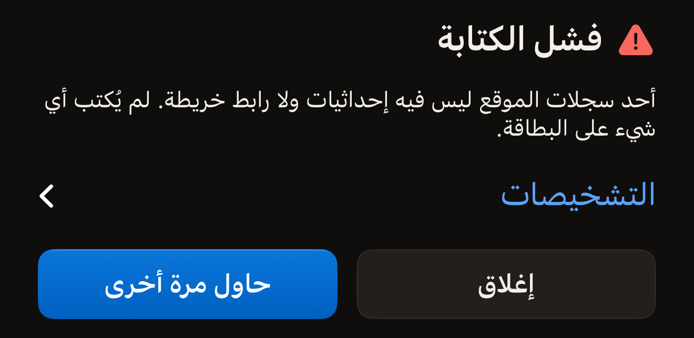
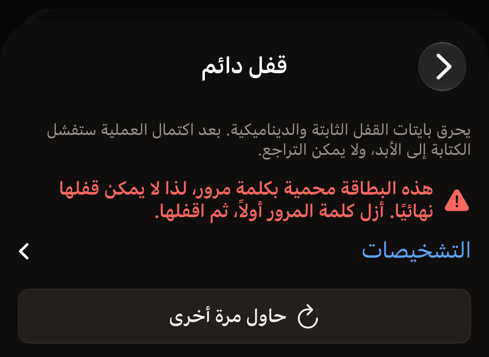

تكاد كل قراءة فاشلة تعود إلى بطاقة تحرّكت. ضع أعلى iPhone مسطّحًا على البطاقة، وأبقِه
ثابتًا لمدة ثانية تقريبًا، ثم اضغط على **حاول مرة أخرى**.

يصف Hex NFC ما حدث بجملة بدلًا من أن يعرض رمزًا. ابحث أدناه عن الجملة التي ظهرت لك. تحت
كل رسالة فشل مباشرةً صف مغلق عنوانه **التشخيصات**، وعلى يساره سهم صغير. اضغط على الصف
فتنفتح التفاصيل التقنية تحته.

## ابحث عن رسالتك

- [انتهاء المهلة، أو فقدان البطاقة أثناء القراءة، أو الإلغاء](#scan-stopped)
- [بطاقة MIFARE Classic، أو جهاز بلا NFC، أو نسخة غير مصرّح لها، أو عملية لا تدعمها
  البطاقة، أو جهاز صحي](#tag-not-readable)
- [سجلات أكبر من السعة، أو بطاقة أعادت محتوى مختلفًا](#write-failed)
- [بطاقة مختلفة بعد أن كتبت UID بطاقة](#different-tag)
- [تحقق من كلمة المرور لم يكتمل](#password-check)
- [حدث خطأ غير متوقّع](#unexpected)

## جرّب هذه أولًا

- ضع أعلى iPhone على البطاقة، لا منتصف ظهره.
- أخرِج iPhone من أي جراب معدني، وارفع البطاقة عن أي سطح معدني.
- أبقِ البطاقة وiPhone ثابتين معًا حتى يستجيب التطبيق.
- جرّب بطاقة ثانية. إذا قُرئت الثانية، فالبطاقة الأولى هي ما يستحق الفحص.

## ماذا تعني «فشل المسح»؟ {#scan-failed}

«فشل المسح» هو العنوان الذي يظهر فوق قراءة لم يستطع التطبيق إكمالها. وتذكر الجملة التي
تحته السبب، والعناوين أدناه مرتّبة بحسبه.

::::steps
:::step[افتح التشخيصات]
اضغط على **التشخيصات**، الصف الواقع تحت الرسالة مباشرةً. تنفتح التفاصيل تحته، ويمكن تحديد
النص لتنسخه.
:::

:::step[ابدأ مسحًا جديدًا]
اضغط على **حاول مرة أخرى**. تفتح شاشة المسح جلسة جديدة وتنتظر وهي تعرض
«ضع البطاقة بالقرب من أعلى الـ iPhone».
:::

:::step[أبقِ البطاقة ثابتة]
ضع أعلى iPhone مسطّحًا على البطاقة وأبقِه هناك حتى يستجيب التطبيق.
:::
::::

## لماذا توقف المسح في منتصفه؟ {#scan-stopped}

«انتهت مهلة المسح. أبقِ البطاقة ثابتة عند أعلى الهاتف وحاول مجددًا. وإذا انتهت المهلة مع بطاقة معيّنة في كل مرة، فقد تكون MIFARE Classic التي لا يستطيع iPhone قراءتها (قيد في iOS، لا عيب في البطاقة).»

أنهى iOS الجلسة لأن أي بطاقة لم تستجب له قبل انتهاء مهلة الجلسة. تظهر لك هذه الجملة إذا كان iPhone قد
عثر على بطاقة من قبل في الشاشة نفسها، مثلًا عند اللمسة الثانية لبطاقة محمية، أو إذا انتهت
محاولة سابقة في تلك الشاشة بخطأ. حرّك أعلى iPhone ببطء فوق البطاقة واتركه هناك.

وإذا لم يعثر iPhone على أي بطاقة إطلاقًا، تعرض الشاشة بدلًا من ذلك «لم يُعثر على أي بطاقة»،
وتحتها **حاول مرة أخرى**. هذا ليس فشلًا، لذا لا توجد تحته تشخيصات. والحل نفسه: ضع أعلى
iPhone مسطّحًا على البطاقة وأبقِه ثابتًا.

أما البطاقة التي تبدأ بالاستجابة ثم تتوقف فتظهر لها جملة أخرى:
«فُقدت البطاقة أثناء القراءة. أبقِها ملاصقة لأعلى الهاتف وحاول مجددًا.» فقد خرجت البطاقة
من مجال القراءة في منتصف أمر ما.

«تم إلغاء المسح.» تعني أن المسح أُغلق قبل أن يكتمل، إما بواسطتك أو بواسطة التطبيق. وتظهر
إذا كان iPhone قد عثر على بطاقة في الشاشة نفسها، أو بعد أن انتهت محاولة سابقة فيها بخطأ.
أما إغلاق لوحة iOS قبل العثور على أي بطاقة فيغلقها فقط، دون أي رسالة. والمسح يقرأ فقط، لذا
لم يتغيّر شيء على البطاقة.

## لماذا لا يستطيع iPhone قراءة هذه البطاقة إطلاقًا؟ {#tag-not-readable}

ثلاث رسائل تقول إن القراءة لا يمكن أن تتم إطلاقًا، مهما كانت طريقة تقريب البطاقة. وهنا
رسالتان أخريان أيضًا، وليست أيّ منهما فشلًا في القراءة.

«يبدو أنها بطاقة MIFARE Classic. يستطيع iPhone اكتشافها لكنه لا يقرأ ذاكرتها المشفّرة، لأن iOS لا يتيح مفاتيح MIFARE Classic التي يحتاجها أي تطبيق.»
استجابت الشريحة بالقدر الذي سمح للتطبيق بالتعرّف على عائلتها، ولم تتجاوز ذلك.

:::important[لا يقرأ أي تطبيق على iPhone بطاقة MIFARE Classic]
لا يعطي iOS أي تطبيق المفاتيح التي تفتح ذاكرة تلك الشريحة، لذا لا يوجد في Hex NFC أي إعداد
يغيّر النتيجة. استخدم بدلًا منها بطاقة من
[البطاقات التي تعمل مع Hex NFC](tags-that-work.md).
:::

«هذا الجهاز لا يدعم NFC.» لم يستطع التطبيق فتح جلسة NFC على جهاز iPhone هذا إطلاقًا. لا
يوجد في iPhone زر تبديل لـ NFC يمكن إعادة تفعيله. ولا يوجد في Hex NFC إعداد يغيّر ذلك، ولن
يفيد تقريب البطاقة بطريقة مختلفة. توضح صفحة [أسئلة شائعة](faq.md) ما يحتاجه التطبيق ليعمل.
وإذا ظهرت الرسالة على iPhone يعمل عليه Hex NFC دون مشكلات أخرى، فافتح **التشخيصات** وانسخ
النص، ثم أرسله كما تشرح
[إذا احتجت إلى مزيد من المساعدة](#if-you-need-more-help).

«هذه النسخة غير مصرّح لها بعد بهذا النوع من البطاقات.» نسختك من التطبيق غير مسجّلة لقراءة
هذا النوع من البطاقات، ولا يغيّر ذلك أي شيء يتعلق بالبطاقة أو بطريقة تقريبها. ابحث أولًا
في App Store عن تحديث لـ Hex NFC. وإذا عادت الرسالة، فافتح **التشخيصات** وأرسل النص كما
تشرح [إذا احتجت إلى مزيد من المساعدة](#if-you-need-more-help).

«لا تدعم هذه البطاقة تلك العملية.» هي الرسالة التي لا تتعلق بالقراءة. فالبطاقة قُرئت، لكن
ما لا تفعله هو العملية التي طلبتها، بالطريقة التي سلكتها. يذكر قسم معلومات البطاقة اسم
الشريحة، وحيثما تُبلغ الشريحة عنهما، يبيّن صفّا **يدعم** و**الميزات** ما تستطيع فعله.

يحمي المسار **العمليات** > **الحماية بكلمة مرور** وقسم **الحماية** في شاشة «البطاقة» كلاهما
سبع شرائح: NTAG213 وNTAG215 وNTAG216 وMIFARE Ultralight EV1 وMIFARE Ultralight C وNTAG424
DNA وICODE SLIX2. تشرح صفحة [حماية بطاقة بكلمة مرور](protect-a-tag.md) المسارين كليهما. وتتناول صفحة
[البطاقات التي تعمل مع Hex NFC](tags-that-work.md) الشرائح التي يتعرّف عليها التطبيق. وفي
[مصفوفة دعم الشرائح](../developer/chip-support-matrix.md) التفاصيل التقنية الكاملة، شريحةً
شريحة.

«هذا جهاز صحي. لا يكتب Hex NFC أبدًا إلى الأجهزة الصحية ولا يرسل إليها أوامر.» تعني أن ما
قرّبته جهاز طبي، مثل قلم الإنسولين. تتوقف الكتابة أو العملية أو أمر وحدة التحكم في
**متقدّم** الموجّه إليه قبل أن يُكتب إليه أي شيء أو يخرج أمرك، فلا يتغيّر الجهاز. ومسحه
بزر **مسح** يفتح شاشة **جهاز صحي**، التي تشرحها صفحة
[الأجهزة الصحية](tags-that-work.md#health-devices).

## ماذا تعني «فشل الكتابة»؟ {#write-failed}

«فشل الكتابة» هو العنوان الذي يظهر فوق كتابة، أو قراءة مجددًا بعد الكتابة، أو تغيير في
الحماية، لم يكتمل. وتحته ثلاثة عناصر تحكم: **التشخيصات** فيها التفاصيل، و**إغلاق** يعيدك
إلى المحرّر، و**حاول مرة أخرى** يعيد الكتابة مع الاحتفاظ بكلمة المرور التي كتبتها. في
الكتابة التي تبدأ من شاشة «البطاقة» وتفعّل الحماية أو توقفها، تقرأ إعادة المحاولة UID
البطاقة من جديد، وتطلب منك كتابته مرة ثانية. فموافقتك على تغيير البطاقة لا تنتقل عبر
الفشل. أما القالب الذي تكتبه من **المكتبة** فلا يُؤكَّد بهذه الطريقة: أي بطاقة تقرّبها هي
التعليمة نفسها، لذا تعود إعادة محاولته مباشرةً إلى لمسة واحدة.

:::figure[تذكر الكتابة الفاشلة سببها تحت «فشل الكتابة»، وتحته **التشخيصات**، ثم **إغلاق** بجانب **حاول مرة أخرى**.]

:::

ولرسالتين منها حل خاص بكلٍّ منهما.

«هذه السجلات أكبر من سعة هذه البطاقة.» تحتاج سجلاتك إلى مساحة أكبر مما تتسع له منطقة
بيانات الشريحة. اختصر سجلًا أو احذفه، أو اكتب على بطاقة ذات ذاكرة أكبر. وتوضح صفحة
[أنواع السجلات](record-types.md) المساحة التي يشغلها كل نوع من السجلات.

«أعادت البطاقة محتوى مختلفًا عمّا أُرسل. أعد محاولة الكتابة.» قرأ التطبيق البطاقة مجددًا
بعد الكتابة، فلم تطابق البايتات ما أرسله. اضغط على **حاول مرة أخرى** والبطاقة ثابتة في
مكانها.

## لماذا رُفضت البطاقة بعد أن كتبت UID الخاص بها؟ {#different-tag}

::include[two-tap-confirmation]

«هذه بطاقة مختلفة.» تعني أن البطاقة التي قرّبتها ليست البطاقة التي كان التطبيق يتوقعها.
ويذكر صف **التشخيصات** أي لمسة أظهرت الرسالة، وأي بطاقة كانت متوقعة.

في شاشة **العمليات** تظهر الرسالة عند اللمسة الثانية: البطاقة التي قرّبتها ليست البطاقة
التي كتبت UID الخاص بها. قرّب البطاقة نفسها مرة أخرى، أو ابدأ من جديد بالبطاقة التي قصدت
تغييرها.

أما تغيير الحماية من شاشة «البطاقة» فقد يُظهرها عند أيٍّ من اللمستين. عند اللمسة الثانية
تعني الشيء نفسه. وعند اللمسة الأولى لم يُكتب أي شيء بعد، وتعني هناك أن البطاقة التي
قرّبتها ليست البطاقة التي فُتح منها المحرّر. قرّب تلك البطاقة بدلًا منها.

في شاشة **العمليات**، تعرض العملية الفاشلة الرسالة، ثم **التشخيصات** تحتها مباشرةً، ثم
**حاول مرة أخرى** تحت ذلك. وتستبدل شاشتان هذا الزر: تعرض شاشة **حد المحاولات** زر
**ابدأ من جديد**، وتعرض شاشة **إزالة كلمة المرور** زر **أدخل كلمة مرور مختلفة**. وكلاهما يطلب
كلمة المرور من جديد، فترسل المحاولة التالية ما تكتبه بعد ذلك، لا كلمة المرور التي رفضتها
البطاقة للتو.

:::figure[في شاشة **قفل دائم**، يعرض القفل المرفوض رسالته، ثم **التشخيصات**، ثم **حاول مرة أخرى**.]

:::

## ماذا لو لم يكتمل التحقق من كلمة المرور؟ {#password-check}

«تعذّر التحقق من كلمة المرور: توقفت البطاقة عن الاستجابة. أبقِها ثابتة على أعلى الهاتف وحاول مجددًا.»
توقفت البطاقة عن الاستجابة بينما كان التطبيق يتحقق من كلمة المرور، فلم يُحسم شيء بشأنها
في أي اتجاه. التطبيق لا يقول لك إن كلمة المرور خاطئة. أبقِ البطاقة ثابتة وشغّل العملية مرة
أخرى. وتتناول صفحة [إزالة كلمة مرور البطاقة](remove-password.md) كلمة المرور التي لم تعد
تفتح البطاقة فعلًا.

## لماذا تقول رسالة إن خطأً غير متوقّع قد حدث؟ {#unexpected}

تظهر «حدث خطأ غير متوقّع.» في شاشة المسح وشاشة الكتابة وشاشة **العمليات**، عندما لا يتعرّف
التطبيق على الفشل بوصفه خطأً من البطاقة. وتأتي «حدث شيء غير متوقع. حاول مجددًا.» من طبقة
NFC للسبب نفسه.

ورسالتان أخريان تصفان بطاقة تستجيب بشكل لم يتوقعه التطبيق:

- «استجابت البطاقة خارج البروتوكول المتوقع.»
- «استجابت البطاقة ببيانات لم يستطع هذا التطبيق تحليلها.»

والخطوة التالية واحدة للرسائل الأربع. افتح **التشخيصات**، وانسخ النص، ثم قرّب البطاقة مرة
أخرى. وإذا عادت الرسالة نفسها مع البطاقة نفسها، فإن التشخيصات المنسوخة تحدّد العطل.

## إذا احتجت إلى مزيد من المساعدة {#if-you-need-more-help}

أرسل التشخيصات المنسوخة إلى Hex Pro من التطبيق: في الشاشة الرئيسية، اضغط على زر الترس،
ثم على **إرسال ملاحظات**، والصقها في الرسالة. وأضف اسم الشريحة إن قُرئت البطاقة بالقدر الذي
يكفي لظهور قسم معلومات البطاقة. وإذا لم تُقرأ إطلاقًا، فاذكر ذلك، واذكر أي البطاقات تُقرأ
وأيها لا تُقرأ. يضيف النموذج بنفسه إصدار التطبيق وإصدار iOS وطراز الجهاز واللغة. ولكي
يصلك رد، أضف بريدك الإلكتروني في **عنوان الرد (اختياري)**. وتشرح
[الملاحظات والتقييمات](settings.md#feedback-and-ratings) هذا النموذج.

ويمكنك أيضًا المراسلة على `support@hex.pro`، وهو العنوان المذكور في **سياسة الخصوصية**
و**الشروط والأحكام** ضمن **الشؤون القانونية** في **الإعدادات**. وعند المراسلة بالبريد،
أضف إصدار التطبيق من **الإصدار** في **الإعدادات**، وطراز iPhone وإصدار iOS، وهما يظهران
في تطبيق الإعدادات في iPhone ضمن عام ثم حول.

بعد ذلك، اقرأ [مسح بطاقة وقراءة محتواها](scan-a-tag.md) لترى كيف تبدو القراءة السليمة، أو
[أسئلة شائعة](faq.md) لمعرفة ما يحتاجه التطبيق ليعمل أصلًا.
