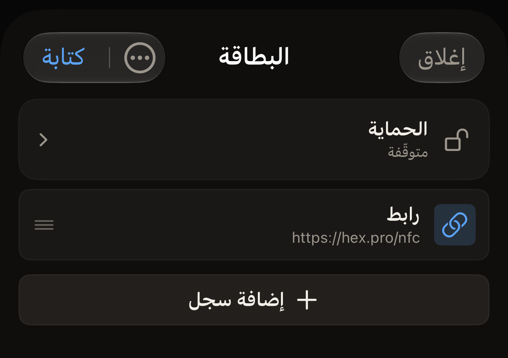
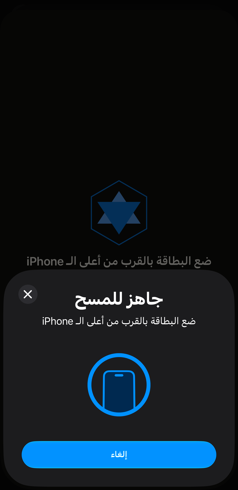

يمكن أن تحمل البطاقة عنوان موقع ويب، فيُعرض هذا العنوان على أي هاتف يقرأ
البطاقة. وفي Hex NFC يكون العنوان سجل رابط. تُنشئ السجل على iPhone، ثم تقرّب
البطاقة منه مرة واحدة لنقل السجل إليها.

قبل أن تبدأ، جهّز البطاقة. وإذا لم تكن متأكدًا من أن البطاقة لا تزال تقبل
الكتابة، فامسحها أولًا كما تشرح صفحة [مسح بطاقة وقراءة محتواها](scan-a-tag.md).
يفتح المسح شاشة «البطاقة». وهناك يكون زر **كتابة** متاحًا على البطاقة التي لا
تزال تقبل الكتابة، ويكون باهتًا على البطاقة التي يقرؤها التطبيق مقفلة نهائيًا،
وهي بطاقة ترفض أي كتابة. اضغط على **إغلاق** لمغادرة تلك الشاشة إلى الشاشة
الرئيسية في Hex NFC، ثم ابدأ من الخطوة ١.

## كتابة رابط على بطاقة فارغة

:::::steps
::::step[ابدأ إنشاءً جديدًا]
في الشاشة الرئيسية في Hex NFC، اضغط على **إنشاء**. تُفتح شاشة «البطاقة» دون
أي سجلات، تحت العنوان «بطاقة فارغة».
::::

::::step[أضف سجل رابط]
اضغط على **إضافة سجل** ثم على **رابط**. يُفتح محرر السجل على السجل الجديد.
::::

::::step[أدخل العنوان]
في حقل **رابط**، اكتب العنوان وفي أوله البروتوكول، مثل `https://hex.pro`، ثم
اضغط على **حفظ**. يظهر السجل في القائمة. يكتب التطبيق العنوان كما أدخلته
تمامًا ولا يضيف إليه شيئًا. والعنوان الذي يصل إلى البطاقة دون `https://` ليس
رابطًا صالحًا، فلا يجد الهاتف الذي يقرأ تلك البطاقة صفحة يفتحها.

:::figure[بعد الضغط على **حفظ**، تعرض شاشة «البطاقة» سجل **رابط** الجديد، ويصبح زر **كتابة** في أعلى اليسار جاهزًا للضغط.]

:::
::::

::::step[أرسل السجل إلى البطاقة]
اضغط على **كتابة** في أعلى شاشة «البطاقة». تُفتح شاشة الكتابة وتظهر عليها
عبارة «ضع البطاقة بالقرب من أعلى الـ iPhone». ويعرض iOS لوحة المسح الخاصة به
فوق التطبيق، وفيها السطر نفسه.

:::figure[يبقى سطر شاشة الكتابة ظاهرًا فوق لوحة المسح في iOS، التي تكرره وفيها زر إلغاء خاص بها.]

:::
::::

::::step[ضع البطاقة بالقرب من iPhone]
ضع أعلى iPhone على البطاقة وأبقِه هناك. تعرض الشاشة «جارٍ الكتابة…» ثم
«جارٍ التحقق…». لا شيء في هذه الخطوة يقفل البطاقة، ويمكنك الكتابة عليها مرة
أخرى كلما أردت. وعبارة النجاح «اكتملت الكتابة» تعني فقط أن السجلات كُتبت على
البطاقة ثم قُرئت مجددًا سليمة. تُغلق الشاشة تلقائيًا وتعود شاشة «البطاقة».
::::
:::::

تحل الكتابة محل كل ما كانت البطاقة تحمله. وإذا أردت الاحتفاظ ببعض ما على
البطاقة، فامسحها أولًا. ثم عدّل تلك القائمة بدلًا من إنشاء قائمة جديدة، كما
تشرح صفحة [تعديل سجلات بطاقة](edit-records.md).

:::tip[تُكتب كل أنواع السجلات بالطريقة نفسها]
الرابط أكثر ما يوضع على البطاقات شيوعًا، وهو واحد من ١٣ نوعًا من السجلات
يمكنك إضافتها. وتسرد صفحة [أنواع السجلات](record-types.md) هذه الأنواع كلها،
والخطوات السابقة هي نفسها أيًّا كان النوع الذي تختاره.
:::

## ما يتحقق منه التطبيق قبل أن يؤكد نجاح الكتابة

لا يكتفي التطبيق أبدًا بتأكيد البطاقة أن الكتابة تمت. فهو يرسل السجلات، ثم
يقرأ البطاقة مجددًا ويقارن ما عاد منها بما أرسله. وتعني «اكتملت الكتابة» أن
البطاقة قُرئت مجددًا وهي تحمل ما كتبته بالضبط.

هناك حالة واحدة توقف الكتابة بدلًا من إتمامها. فعلى البطاقة التي تحمي كلمة
المرور سجلاتها، تعرض شاشة الكتابة «البطاقة محمية» وتطلب كلمة المرور قبل كتابة
أي شيء. اكتب كلمة المرور في حقل **كلمة مرور البطاقة (4 بايت)** واضغط على
**فتح القفل والكتابة**. ثم ضع البطاقة مجددًا بالقرب من أعلى iPhone، فهذه
اللمسة الثانية هي التي تتم فيها المصادقة والكتابة. ويتخطى التطبيق هذا الطلب
إذا كانت كلمة المرور محفوظة لديه منذ أن حميت البطاقة. وعندئذٍ تتم الكتابة
بلمسة واحدة. وإذا كنت لا تعرف كلمة المرور، فاضغط على **إلغاء**: تبقى سجلاتك
في شاشة «البطاقة». راجع [حماية البطاقة](tag-protection.md) لمعرفة ما تفعله
كلمة المرور بالبطاقة.

أما البطاقة التي تفتقر إلى ترويسة تستقر فيها السجلات فلا تُوقَف قبل الكتابة.
يرسل التطبيق السجلات، ثم يقرأ البطاقة مجددًا فلا يجد عليها شيئًا مقروءًا،
وتنتهي الكتابة بعبارة «فشل الكتابة».

والمسح هو ما يجنّبك ذلك. فعلى البطاقة التي مسحها التطبيق ووجدها غير مهيّأة،
تعرض شاشة «البطاقة» فوق قائمة السجلات عبارة «هذه البطاقة غير مهيّأة»، وتحتها:
«لا تحتوي على Capability Container، لذا لن تكون السجلات المكتوبة الآن قابلة للقراءة. هيّئها أولًا.»
اضغط على هذا التنبيه لفتح شاشة «العمليات» وتهيئة البطاقة. أما البطاقة التي
بدأت معها من **إنشاء** فلم يسبقها مسح، فلا تجد شاشة «البطاقة» ما تحذّرك به.

ولا تضيع السجلات التي أنشأتها بسبب هذا الإصلاح. اضغط على زر القائمة في أعلى
يسار شاشة «البطاقة»، ثم على **العمليات…**. تُفتح شاشة «العمليات» فوق شاشة
«البطاقة»، وتبقى سجلاتك في مكانها حين تغلقها. راجع
[مسح محتوى البطاقة أو تهيئتها](erase-or-format.md).

لإيقاف الكتابة قبل أن تبدأ، اضغط على **إلغاء** في شاشة الكتابة ما دامت تنتظر
بطاقة. تبقى سجلاتك في شاشة «البطاقة». والضغط على زر الإلغاء في لوحة iOS قبل
قراءة أي بطاقة يؤدي إلى النتيجة نفسها. وإذا لم تكن هناك بطاقة بالقرب من
iPhone، تُغلق لوحة iOS تلقائيًا بعد دقيقة تقريبًا، وتعرض شاشة الكتابة
«لم يُعثر على أي بطاقة» مع **إغلاق** و**حاول مرة أخرى**.

## إذا فشلت الكتابة

إذا فشلت الكتابة، أو جاءت القراءة اللاحقة مختلفة عما أُرسل، تنتهي العملية
بعبارة «فشل الكتابة» ويظهر السبب تحتها. ومن هناك:

- لإرسال السجلات نفسها مرة أخرى، اضغط على **حاول مرة أخرى**. ويبقى كل ما
  كتبته من قبل.
- للعودة إلى شاشة «البطاقة» دون كتابة، اضغط على **إغلاق**.

والبطاقة التي تواصل الرفض قد لا تكون من النوع المناسب لما تكتبه. تذكر صفحة
[البطاقات التي تعمل مع Hex NFC](tags-that-work.md) الشرائح التي يتعرّف عليها
التطبيق، وتعرض [مصفوفة دعم الشرائح](../developer/chip-support-matrix.md)
التفاصيل لكل شريحة.

## انظر أيضًا

- [تعديل سجلات بطاقة](edit-records.md)
- [حفظ بطاقة كقالب](presets.md)
- [إذا تعذّرت قراءة البطاقة أو الكتابة عليها](troubleshooting.md)
