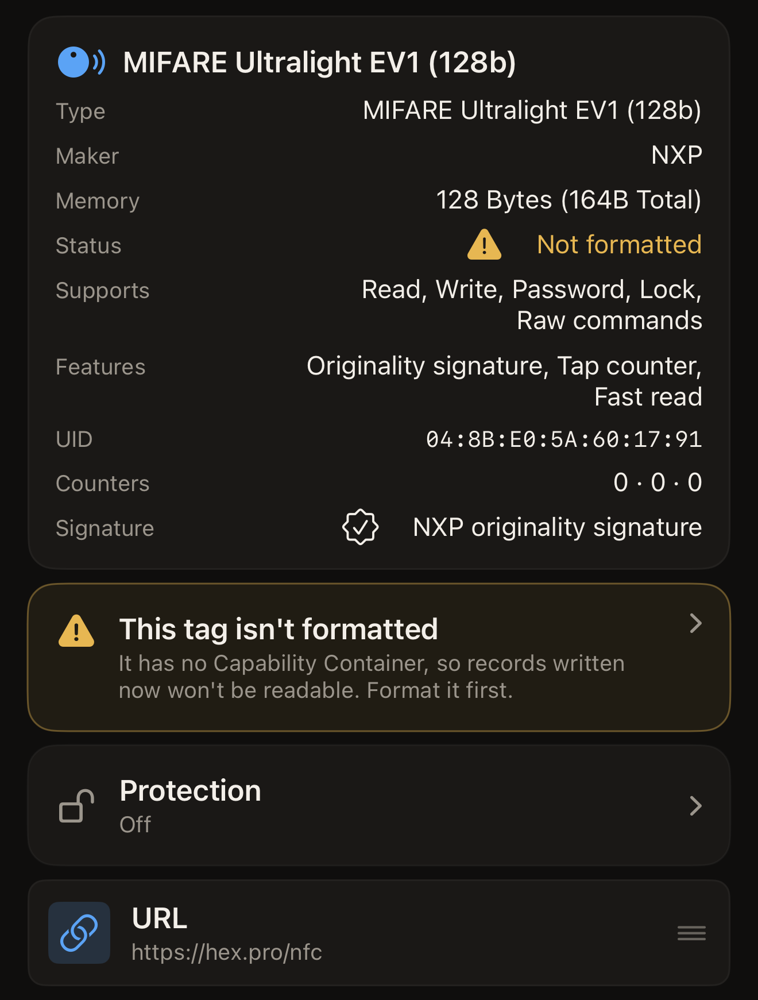
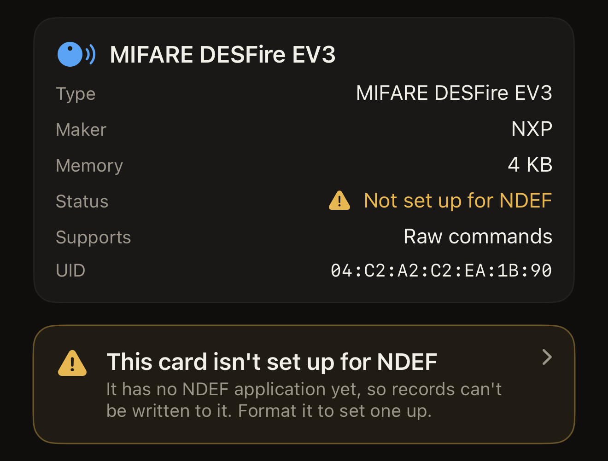
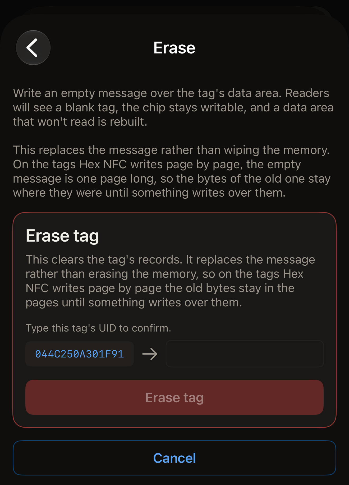
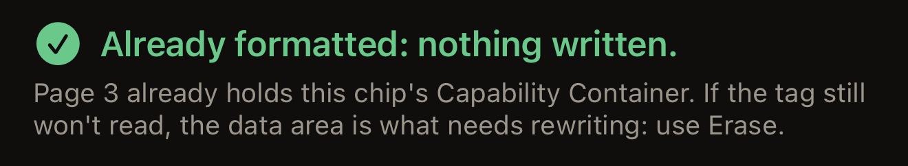
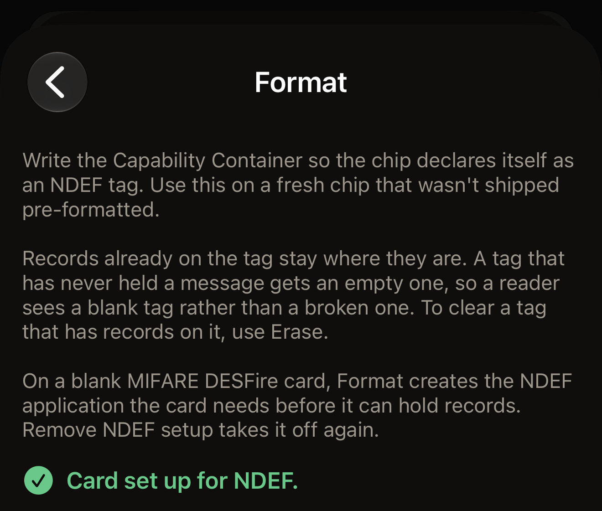
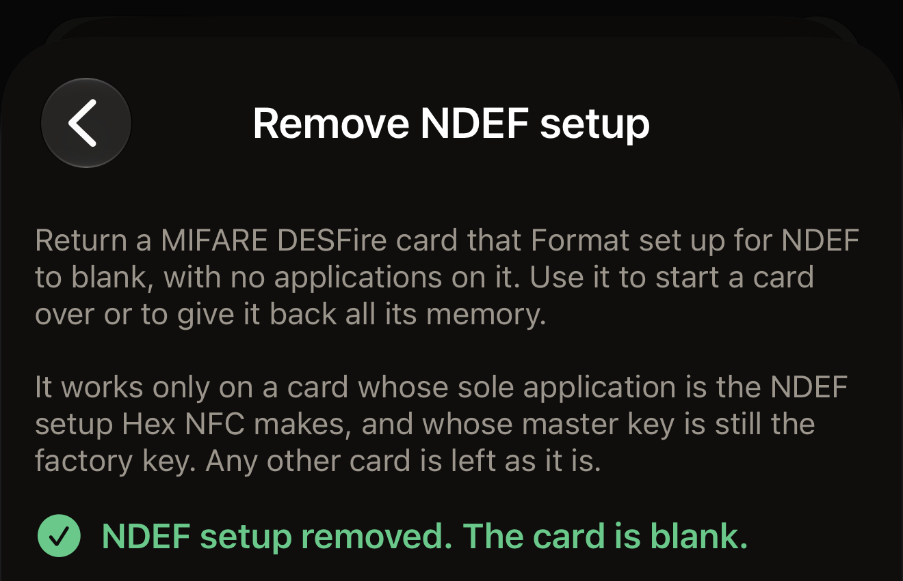

Hex NFC has two repairs for a tag that will not read, and they do opposite jobs. Erasing
writes an empty message over the tag's data area, so readers see a blank tag and the chip
stays writable. Formatting writes the Capability Container, the short header a reader looks
for before it reads anything else on the tag.

Before you start, scan the tag: on the Hex NFC home screen, tap **Scan**, then hold the tag
against the top of your iPhone. The **Tag** screen opens once the app has read it. It also opens
for a tag that is not formatted, a tag whose data will not read, and a MIFARE DESFire card
that is not set up for NDEF. In each case it follows the scan on its own, with nothing to
tap. A warning on the scan
screen is a diagnosis rather than a dead end. On the **Tag** screen, tap the
menu button at the top right, beside **Write**, then tap **Operations…**. Both repairs
sit under **Dangerous Actions** at the bottom of the **Operations** screen.
**Remove NDEF setup** sits beside them and undoes a format on a MIFARE DESFire card. Every operation
there confirms the tag before it changes it:

::include[two-tap-confirmation]

## Which repair the tag needs

The app names the fault on the screen where you meet it, and each name points to the repair
it needs.

- Format the tag when the scan screen reads "This tag isn't formatted yet", or the **Tag**
  screen reads "Not formatted". The tag has no Capability Container, so nothing you write to
  it is readable.
- Erase the tag when the scan screen reads "This tag's data won't read", or the **Tag**
  screen reads "Data won't read". The Capability Container is already in place, so a format
  has nothing there to repair.
- Format the card when the scan screen reads "This card isn't set up for NDEF yet", or the
  **Tag** screen reads "Not set up for NDEF". The card is a blank MIFARE DESFire, or one whose setup
  an earlier format did not finish, so records cannot be written to it yet. A transit or access card never shows this.

On a tag that still accepts writes, the **Tag** screen also shows a warning you can tap. It
reads "This tag isn't formatted", "This tag's data won't read" or "This card isn't set up for
NDEF". Tapping it opens
**Operations**. A permanently locked tag shows the status but no warning, because both
repairs are writes.

:::figure[A tag with no Capability Container reads "Not formatted" beside **Status**, with the "This tag isn't formatted" warning under the card.]

:::

:::figure[A blank MIFARE DESFire card reads "Not set up for NDEF" beside **Status**, with the "This card isn't set up for NDEF" warning below it.]

:::

## Erase a tag

An erase clears the tag's records and leaves the chip writable. It also rebuilds a data area
that has stopped reading.

:::::steps
::::step[Open the erase screen]
On the **Operations** screen, tap **Erase**. The screen that opens says what the erase
writes, and warns you before anything reaches the tag.
::::

::::step[Start the erase]
Tap **Erase tag**. Your iPhone asks you for the tag.
::::

::::step[Hold the tag against your iPhone]
Rest the top of your iPhone on the tag. The screen reads "Tap 1 of 2. Hold the tag to
identify it.", then shows the tag's UID.
::::

::::step[Type the UID back]
The screen reads "Type this tag's UID to confirm." and puts the UID beside an empty field.
Enter those same characters in the field, with no colons between them and in either case,
then tap **Erase tag**. If the tag's password covers its data area, a card headed "Tag is
protected" sits above the field and asks for the password or key the tag holds now.
**Erase tag** does nothing until that is filled in.

:::figure[After the first tap, the tag's UID sits on the left of an empty field, and **Erase tag** stays dimmed until you type it.]

:::
::::

::::step[Hold the tag a second time]
Hold the tag against the top of your iPhone again. The screen reads "Tag erased." once the
app has read the empty message back off the tag.
::::
:::::

An erase ends one of two ways. It reports "Tag erased." once the empty message reads back.
Otherwise it reports an error naming the fault, with the details under it for a bug report.
[If a tag does not scan or write](troubleshooting.md) covers what to try next.

:::note
An erase replaces the tag's message rather than wiping its memory. On NTAG and MIFARE
Ultralight tags, the chips most stickers and cards carry, the empty message is one page
long. The bytes of the old message stay where they were until something writes over them.
Write a message of your own over a tag you are handing on.
:::

## Format a tag {#format-a-tag}

Use a format on a fresh chip that was not shipped pre-formatted. A format writes the
Capability Container and leaves records already on the tag where they are. On ISO 15693 tags
such as ICODE SLIX2, a tag that has never held a message also gets an empty one, so a reader
sees a blank tag rather than a broken one. To clear a tag that has records on it, erase it
instead. On a blank MIFARE DESFire card, a format sets the card up for NDEF, as the last
part of this section describes.

::::steps
:::step[Open the format screen]
On the **Operations** screen, tap **Format**.
:::

:::step[Start the format]
Tap **Format tag**. Your iPhone asks you for the tag.
:::

:::step[Hold the tag against your iPhone]
Rest the top of your iPhone on the tag. The screen reads "Tap 1 of 2. Hold the tag to
identify it.", then shows the tag's UID.
:::

:::step[Type the UID back]
The screen reads "Type this tag's UID to confirm." and puts the UID beside an empty field.
Enter those same characters in the field, with no colons between them and in either case,
then tap **Format tag**.
:::

:::step[Hold the tag a second time]
Hold the tag against the top of your iPhone again. The screen reads "Tag formatted." once
the app has read the header back. On a MIFARE DESFire card it reads "Card set up for NDEF."
instead.
:::
::::

On an NTAG or MIFARE Ultralight tag, a format ends in one of three reports:

- "Tag formatted." means the header is written, read back and in place, and the tag is ready
  to take a message.
- "Already formatted: nothing written." means the tag was carrying the right header, so
  nothing reached it. The app sends you to **Erase**, because a tag that still will not read
  has its fault in the data area.
- "This tag already has a different Capability Container." means the header on the tag does
  not match the chip the app identified. Nothing was written.

:::figure[A format that finds the header already in place reports "Already formatted: nothing written." and points you to an erase instead.]

:::

An ISO 15693 tag reports "Tag formatted." every time, because its Capability Container block
stays rewritable and the app writes it on every run.

:::warning
On NTAG and MIFARE Ultralight tags, the Capability Container gets one write for the life of
the tag and can never be corrected. So the app reads that page first and writes only while
it is blank. It refuses a chip it could not identify rather than guessing at a header. The
chip name the app read sits at the top of the **Tag** screen, and
[Tags that work with Hex NFC](tags-that-work.md) says what the app can do with each chip.
:::

### Format a MIFARE DESFire card

A blank MIFARE DESFire EV1, EV2 or EV3 card holds no applications, and a format gives it the
NDEF application it needs before it can hold records. The steps are the ones above, with the
same two taps and typed UID. The app sizes the card's NDEF file to its free memory, up to
4 KB on a 4K card. Once the card is set up, iOS reads and writes it like any other NDEF tag.

On a MIFARE DESFire card, the second tap ends in one of two reports:

- "Card set up for NDEF." means the NDEF application is on the card and reads back, and the
  card is ready for records.
- "Already set up for NDEF: nothing written." means Hex NFC set this card up before, so
  nothing reached it.

:::figure[A blank MIFARE DESFire card that the format has set up reports "Card set up for NDEF."]

:::

The app refuses these cards and writes nothing to them:

- "This card already has other applications on it, so it can't be set up for NDEF here.
  Nothing was written." A transit or access card ends here.
- "This card needs its master key before anything can be added to it, so it can't be set up
  for NDEF here. Nothing was written."
- "This card was set up for NDEF by another app, so Hex NFC leaves it as it is. Nothing was
  written."

If the card leaves your iPhone during the second tap before the setup has written anything,
the screen reads "Lost the tag mid-read. Keep it pressed against the top of the phone and try
again." and nothing was written. Once the setup has started writing, it reads "The card is
partly set up. Tap Format again to finish." or "The card may be partly set up. Scan it to
check, or tap Format again." Another format picks up where the last one stopped.

A card that runs out of free memory reads "There isn't enough free memory on this card for an
NDEF file. Use Remove NDEF setup to clear what was started." on the first attempt. A later
attempt on the same card reads "There isn't enough free memory on this card for an NDEF file.
Nothing was written." Either way, **Remove NDEF setup** clears the card, as the next section
describes.

## Remove a card's NDEF setup {#remove-ndef-setup}

**Remove NDEF setup** returns a MIFARE DESFire card that a format set up to blank. It deletes
the card's NDEF application and every record in it, and gives the card back all its memory.
It works only on a card whose sole application is the NDEF setup Hex NFC makes, including a
setup a format left part way, and whose master key is still the factory key. Any other card is left as it is.

::::steps
:::step[Open the remove screen]
On the **Operations** screen, under **Dangerous Actions**, tap **Remove NDEF setup**.
:::

:::step[Start the removal]
Tap **Remove NDEF setup**. Your iPhone asks you for the card.
:::

:::step[Hold the card against your iPhone]
Rest the top of your iPhone on the card. The screen reads "Tap 1 of 2. Hold the tag to
identify it.", then shows the card's UID.
:::

:::step[Type the UID back]
The screen reads "Type this tag's UID to confirm." and puts the UID beside an empty field.
Enter those same characters in the field, with no colons between them and in either case,
then tap **Remove NDEF setup**.
:::

:::step[Hold the card a second time]
Hold the card against the top of your iPhone again, and keep it there until the result
appears. The screen reads "NDEF setup removed.
The card is blank." once the app has read the card back and found no applications on it.
:::
::::

:::figure[A card whose NDEF setup is gone reports "NDEF setup removed. The card is blank."]

:::

A card that is already blank reports "This card is already blank: nothing changed." The app
refuses these cards and changes nothing:

- "This card has other applications on it. Removing the setup would delete them too, so
  nothing was changed."
- "This card's NDEF setup was made by another app, so Hex NFC won't remove it. Nothing was
  changed."
- "This card's master key isn't the factory key, so the app can't remove its setup. Nothing
  was changed."

If the card leaves your iPhone during the second tap before the removal has changed anything,
the screen reads "Lost the tag mid-read. Keep it pressed against the top of the phone and try
again." and nothing on the card has changed. If it leaves once the removal has started, the
screen reads "The card may already be blank. Scan it to check." If the scan still shows the
card set up for NDEF, run **Remove NDEF setup** again: each removal reads the card first, and
a card that is already blank reports "This card is already blank: nothing changed."

Once the setup is gone, a scan shows "Not set up for NDEF" beside
**Status** on the **Tag** screen again, and a format sets the card up afresh.

## Clear a tag from the record list

A tag can also be cleared from the **Tag** screen, without going through **Operations**.
A clear write carries no protection change, so it holds the tag once and asks for no typed
UID. A write that also arms or removes a password holds the tag twice and asks for the UID.
That is the same two-tap confirmation every operation under **Dangerous Actions** asks for.

::::steps
:::step[Delete every record]
On the **Tag** screen, swipe a record left and tap **Delete**, until the screen reads
"No records left". The removals are not on the tag yet.
:::

:::step[Write the empty result]
The screen now reads "You've removed every record. Write to clear the tag, or add one
back." Below that line, above **Add record**, tap **Write to clear tag**. Your iPhone asks
you for the tag.
:::

:::step[Hold the tag against your iPhone]
Rest the top of your iPhone on the tag and keep it there until the write finishes.
:::
::::

## See also

- [Scan a tag](scan-a-tag.md)
- [Edit a tag's records](edit-records.md)
- [Write a link to a tag](write-a-link.md)
- [If a tag does not scan or write](troubleshooting.md)
- [Tags that work with Hex NFC](tags-that-work.md)
