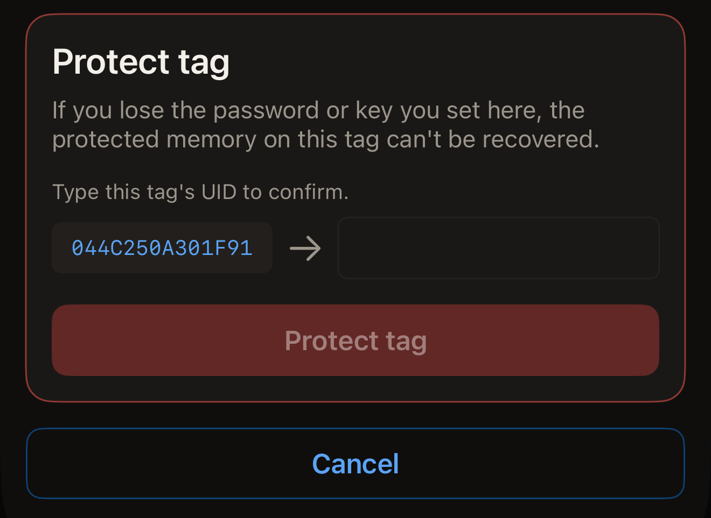
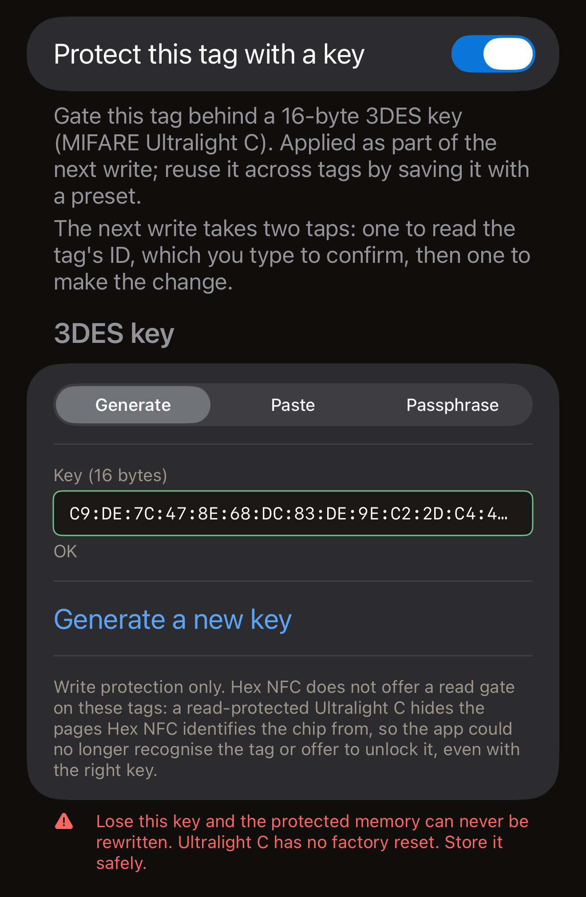
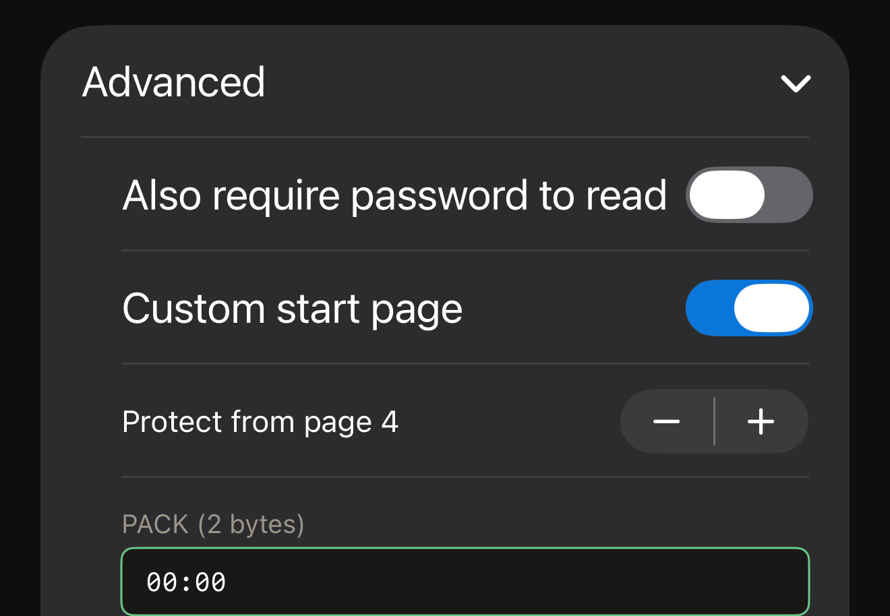

A password on a tag gates writing. The records still read back for anyone,
unless you gate reading too. A write is refused until the password is presented.
Hex NFC sets one from your iPhone in two ways, and both cover the same chips.
**Protect with password**, under **Operations…**, protects a tag on its own. The
**Protection** card on the Tag screen puts the credential on the tag as part of
the next write. Take the Operations route to protect a tag and change nothing
else, and the Protection card when you were writing to the tag anyway.

Before you start, scan the tag you want to protect, so it is open on the Tag
screen. See [Scan a tag](scan-a-tag.md). The card at the top of that screen names
the chip on its first line. That name says which kind of secret the tag takes.

The app can protect seven chips: NTAG213, NTAG215, NTAG216, MIFARE Ultralight
EV1, MIFARE Ultralight C, NTAG424 DNA and ICODE SLIX2. To settle whether the
tag in your hand can be protected at all, see
[Chip support matrix](../developer/chip-support-matrix.md). On any other chip,
**Protect with password** ends on "This tag does not support that operation."
The Tag screen carries no **Protection** card for those chips either, unless the
tag reports a lock.

::include[two-tap-confirmation]

## Protect a tag from Operations

This route asks for nothing before the first tap. That tap reads which chip the
tag is, and the screen then asks for the kind of secret that chip takes: a
4-byte password on an NTAG213, NTAG215, NTAG216, MIFARE Ultralight EV1 or
ICODE SLIX2, and a 16-byte key on an NTAG424 DNA or a MIFARE Ultralight C. For
what each chip carries, see
[Chip support matrix](../developer/chip-support-matrix.md).

:::::steps
::::step[Open Protect with password]
On the Tag screen, tap the menu button at the top right, beside **Write**, then
go to **Operations…** > **Protect with password**.
::::

::::step[Hold the tag so the app can identify it]
Tap **Protect tag**. The scan sheet opens and the screen reads "Tap 1 of 2. Hold
the tag to identify it." Hold the tag against the top of your iPhone until the
sheet closes.
::::

::::step[Enter the new password or key]
The screen names the chip it read, after "Tag identified:", and shows the
fields that chip takes. Enter the secret as hex, with or without colons between
the bytes.

- On an NTAG213, an NTAG215, an NTAG216 or a MIFARE Ultralight EV1, enter the
  password in **Password (4 bytes)**. On a tag that reads as unprotected, the
  field opens on the factory default, `FF FF FF FF`. Put your own password in
  its place. The PACK is the 2 bytes the tag sends back when it accepts the
  password. A reader checks it to confirm it is talking to the tag it expects.
  **PACK (2 bytes)** opens on two zero bytes, and leaving it there is the right
  choice unless a system you use asks for a particular value.
- On an NTAG424 DNA, enter the key in **Key (16 bytes)**.
- On an ICODE SLIX2, enter the write password in **Password (4 bytes)**. Reads
  stay open.
- On a MIFARE Ultralight C, the key goes in **Key (16 bytes)**. On a tag that
  reads as unprotected, the field opens on a randomly generated key. This chip
  gets write protection only.

On an NTAG21x, a MIFARE Ultralight EV1 or an NTAG424 DNA, a switch below the
field also gates reading. It reads **Also require password to read**, or
**Also require key to read** on an NTAG424 DNA. Leave it off and any reader can
still read the tag. Turn it on and nothing comes off the tag without the
secret, so a later scan in Hex NFC asks you for it first. The run itself still
ends on "Password set.", because the app presents the secret it has just
written to take its own read-back.
::::

::::step[Type the tag's UID]
Below the fields, the card headed **Protect tag** asks you to "Type this tag's
UID to confirm." Beside an empty field it shows the UID the app read on that tap.
If the tag already holds a password or key, a card headed "Tag is protected"
sits above it and asks for the secret the tag holds now. Type that UID into the
field, character for character, then tap **Protect tag**.

:::figure[The UID to copy sits on the left of the **Protect tag** card, and the field you type it into is on the right.]

:::
::::

::::step[Hold the same tag again]
The screen reads "Tap 2 of 2. Hold the same tag again." Hold the tag against your
iPhone once more. "Password set." appears when the app has read the tag's
configuration back and found protection armed.
::::
:::::

:::warning[Keep the password]
Nothing in the app reads a password back off a tag, so the copy you keep is the
only copy. The warning on the screen gives the reason: "If you lose the
password or key you set here, the protected memory on this tag can't be
recovered."
:::

If a run fails, the screen offers **Try again**, which takes the screen back to
its starting state so you can run it again from the first tap. While the UID
card is up, **Cancel** returns the screen to its starting state. The tag stays
as it was, and a scan sheet still open closes reading "Cancelled."

On a tag that is already protected, this route takes two secrets: the new one in
the fields, and the one the tag holds now in the "Tag is protected" card. The
one the tag holds opens it, and the new one replaces it.

## Set a key from the Protection card {#protection-card}

An NTAG424 DNA and a MIFARE Ultralight C take a 16-byte key instead of a
password. An ICODE SLIX2 takes a write password of its own. All three can be set
from the **Protection** card on the Tag screen, and the credential goes on as
part of the next write. The Type-2 password is on that card too.

:::::steps
::::step[Open the Protection card]
On the Tag screen, tap the **Protection** card, below the card that names the
chip.
::::

::::step[Turn protection on]
Turn on the switch at the top of the card. It reads **Protect this tag with a
key** on an NTAG424 DNA or a MIFARE Ultralight C, and **Password-protect this
tag** on the chips that take a password.
::::

::::step[Enter the key or the password]
Fill in the field the card shows for that chip.

- On an NTAG424 DNA, enter 16 bytes in **Key (16 bytes)**, or tap
  **Generate random key**. To gate reading as well, turn on
  **Also require key to read**.
- On a MIFARE Ultralight C, choose how the key is made in the picker under
  **3DES key**. On a tag with no key yet, the card opens on **Generate** with 16
  random bytes already in **Key (16 bytes)**, and **Generate a new key** replaces
  them. **Paste** takes 16 bytes of your own in **Key (16 bytes)**. A **Passphrase** produces the same key every time you use
  it.
- On an ICODE SLIX2, an NTAG213, an NTAG215, an NTAG216 or a
  MIFARE Ultralight EV1, enter 4 bytes in **Password (4 bytes)**.

On an NTAG213, an NTAG215, an NTAG216 or a MIFARE Ultralight EV1, **Advanced**
below the field holds the read gate, the page range and the PACK. Open it before
the next step if you want any of them. See
[Choose which pages a Type-2 password covers](#pages-a-type-2-password-covers).

Once the field holds a complete key or password, the note under the switch at the
top says what the next write will take. It reads: "The next write takes two taps:
one to read the tag's ID, which you type to confirm, then one to make the
change."

:::figure[On an unprotected MIFARE Ultralight C, the picker under **3DES key** starts on **Generate**, so **Key (16 bytes)** already holds a random key.]

:::
::::

::::step[Save the settings]
Tap **Done** at the top right. Nothing has reached the tag yet.
::::

::::step[Start the write]
Tap **Write** at the top right of the Tag screen. Hold the tag against the top of
your iPhone for the tap that reads its UID.
::::

::::step[Confirm the tag and hold it again]
The card headed **Protect tag** shows the UID the app read on that tap beside an
empty field. Type that UID into the field, tap **Protect tag**, then hold the
same tag once more. The **Protection** card then summarises what gates the tag.
::::
:::::

The warning on that card is written for the chip. An NTAG424 DNA key gets "Lose
this key and you can never rewrite this tag. There is no factory reset for an
NTAG424. Store it safely." A MIFARE Ultralight C key gets "Lose this key and the
protected memory can never be rewritten. Ultralight C has no factory reset. Store
it safely." A password gets "If you lose this password, protected memory on this
tag is irrecoverable."

A tag that already holds a password is opened with the password the card holds.
Type the tag's current password into the card and the first tap opens the gate,
with nothing more to answer.

Where the card holds no password that opens the tag, the first tap finds the
gate. The write stops to ask for that password, under the heading
"Tag is protected". The note
above the field says what is still to come. It reads: "A protection change takes
two holds: the first reads the tag's ID so you can confirm it, the second makes
the change."

Typing the password there costs no extra tap, because the tag's ID is already in
hand. The button reads **Unlock & continue**, and the UID card comes next.

## Choose which pages a Type-2 password covers {#pages-a-type-2-password-covers}

Before you tap **Done** on the Protection card, open **Advanced**. On an NTAG213,
NTAG215, NTAG216 or MIFARE Ultralight EV1 it holds three more settings:

- To gate reading as well as writing, turn on **Also require password to read**.
  The card notes that "Read-protected tags can't be read back, including
  verification, without the password."
- To cover part of the tag rather than all of it, turn on **Custom start page**,
  then set **Protect from page 4** to the first page you want covered. A page is
  a 4-byte block of the tag's memory. The setting runs from 3 to 254. That is the
  span of every chip it covers, not of the tag in your hand. The app does not
  trim it to fit. A start page past the end of your chip's memory writes the
  password and gates nothing. The write still ends on its success screen, so
  nothing on it says the tag is open. A fresh scan is what shows the tag gating
  nothing. Pick a page inside the chip's memory;
  [Chip support matrix](../developer/chip-support-matrix.md) gives how much each
  chip has. Left off, the setting "Protects the whole data area (the chip's first
  data page onward)."
- To choose the 2 bytes stored alongside the password, enter them in
  **PACK (2 bytes)**.

:::figure[With **Custom start page** turned on, **Advanced** shows the start page and its stepper above **PACK (2 bytes)**.]

:::

How many wrong passwords the chip accepts is set elsewhere. See
[Limit wrong password tries](attempt-limit.md).

## If the app cannot confirm the result

A protect run ends by reading the tag's configuration back, so a run is never
called a success on the tag's acknowledgement alone. When only half of it can be
settled, the message says which half.

The tag is protected when the screen reads one of these:

- "Password set."
- "Protection is on, but this app could not confirm the password took. Keep the
  password you entered: it is very likely the one now on the tag."

The tag is not protected when it reads one of these:

- "The tag is still unprotected, and the password you entered was not saved to
  it. Hold the tag against the phone again to try again."
- "Password stored on the tag. Protection is still off."
- "The password was saved to the tag, but protection did not switch on. Hold the
  tag against the phone again to finish."
- "The tag is still unprotected, and this app could not confirm which password it
  now holds. Keep both the password you entered and the one it had before, then
  hold the tag against the phone again."

Neither is settled when it reads one of these:

- "Couldn't confirm that protection switched on. Hold the tag against the phone
  again to check."
- "Couldn't confirm that protection switched on, or which password the tag now
  holds. Keep both the password you entered and the one it had before, then hold
  the tag against the phone again."

Where the message asks for another hold, hold the tag again, and keep both
passwords until one of them has opened the tag. Two of the messages ask for
nothing, and each has its own next move.

- After "Password stored on the tag. Protection is still off.", the tag is
  carrying the password you entered and is gating nothing. No password has to be
  presented to put it right. Run the procedure again with the same password.
  To take the stored password off the tag instead, see
  [Remove a tag's password](remove-password.md).
- After "Protection is on, but this app could not confirm the password took.
  Keep the password you entered: it is very likely the one now on the tag.", the
  tag is protected. Keep that password, and expect the next write to that tag to
  ask for it.

## See also

- [Tag protection](tag-protection.md)
- [Remove a tag's password](remove-password.md)
- [Limit wrong password tries](attempt-limit.md)
- [Chip support matrix](../developer/chip-support-matrix.md)
