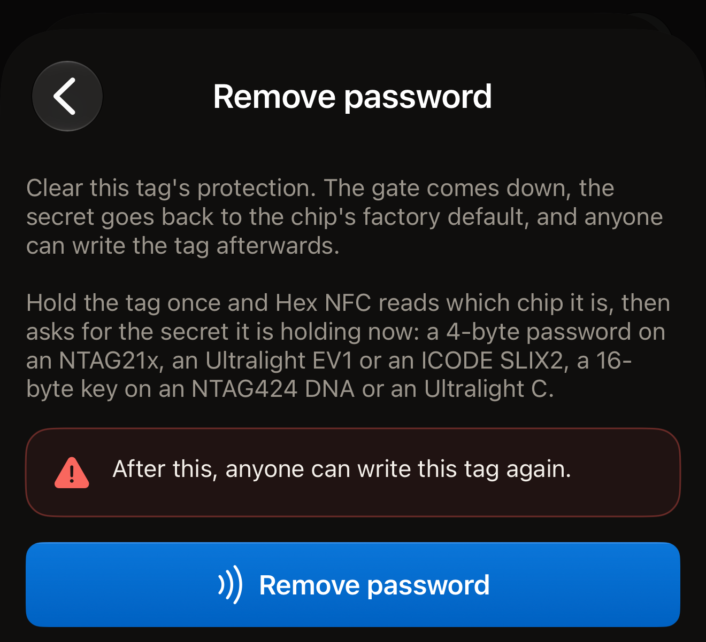
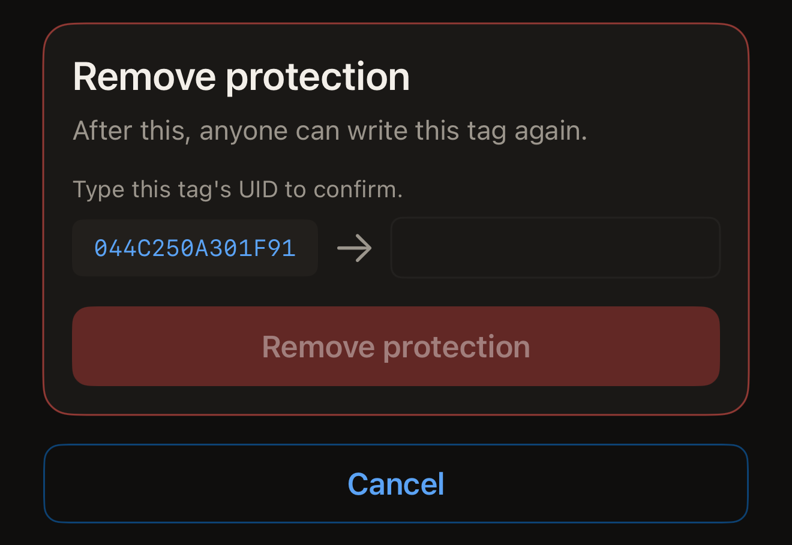
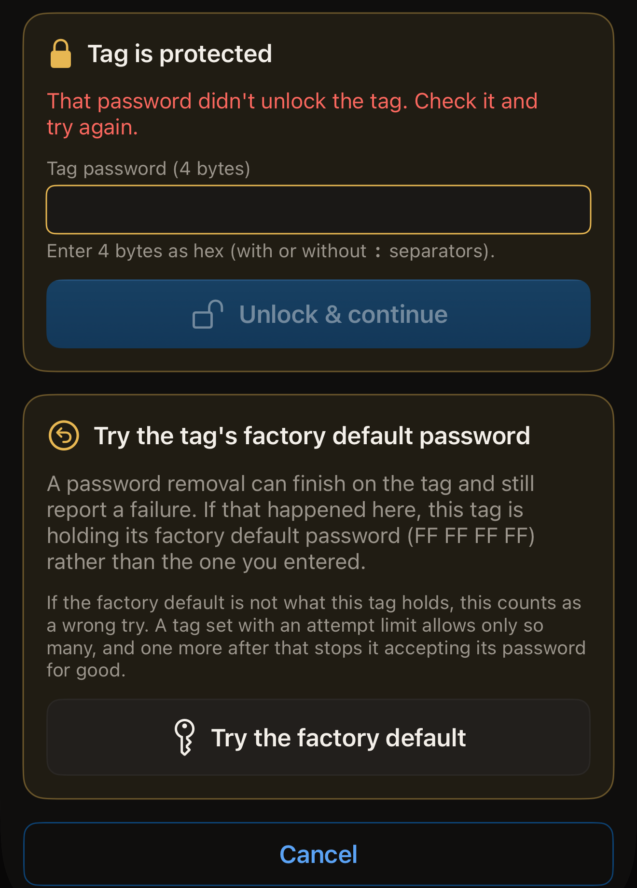

A password you put on a tag comes off again, as long as you can still present
the password the tag is holding. Once it is off, anyone can read and write the
tag, and its password or key goes back to the chip's factory default.

Before you start, open Hex NFC on your iPhone and scan the tag so it is on the
Tag screen (see [Scan a tag](scan-a-tag.md)). Have the password it holds to
hand. The card at the top of that screen names the chip on its first line, above
the tag's UID. That name decides which kind of secret the removal asks for. A
chip named on neither route below carries no password Hex NFC can remove,
because the app never puts one on it.

## Remove a password in Operations

This route covers every chip the app can protect. It asks for nothing before
the first tap. That tap reads which chip the tag is, and the screen then asks
for the secret the tag holds now: a 4-byte password on the NTAG21x chips
(NTAG213, NTAG213 TT, NTAG215, NTAG216), MIFARE Ultralight EV1 or ICODE SLIX2,
and a 16-byte key on an NTAG424 DNA or a MIFARE Ultralight C. NTAG 210µ has no
password to remove.
[Chip support matrix](../developer/chip-support-matrix.md) lists what each chip
carries.

:::::steps
::::step[Open Operations]
On the **Tag** screen, open the menu in the top right, then tap **Operations…**.
::::

::::step[Open Remove password]
Tap **Remove password**.
::::

::::step[Start the removal]
Tap **Remove password**. The warning above it says what the removal costs:
"After this, anyone can write this tag again."

:::figure[The **Remove password** button you tap is the one at the foot of the screen, under the warning.]

:::
::::

::::step[Hold the tag against the top of your iPhone]
The app reads the tag's UID and ends the tap so you can type.
::::

::::step[Enter the secret the tag holds]
A card headed "Tag is protected" asks for the secret the tag holds now. Enter a
password in **Tag password (4 bytes)** as eight hexadecimal characters. On an
NTAG424 DNA the field is **Tag key (16-byte AES)**, and on a
MIFARE Ultralight C it is **Tag key (16-byte 3DES)**. Separators are ignored, so
`FF FF FF FF` and `FFFFFFFF` are the same value.
::::

::::step[Confirm the tag]
The screen shows the tag's UID beside the field, under "Type this tag's UID to
confirm." Type those characters into the field, with no separators. Case does
not matter. Tap **Remove password**, then hold the tag against your iPhone once
more.
::::
:::::

::include[two-tap-confirmation]

When the second tap finishes, the screen reads "Password removed." The tag is
open. Any phone can rewrite its records. If the tag also asked for the password
before it would show anything, that gate comes down with the other one.

## Remove protection from the Tag screen

On any chip the app can protect, protection can also come off as part of a
write, and you need the key or password the tag holds to do it. The write puts
the records
listed on the **Tag** screen back on the tag. After a scan that list is what the
tag already holds, so its contents survive unless you edited the list yourself.

:::::steps
::::step[Open Protection]
On the **Tag** screen, tap **Protection**.
::::

::::step[Turn the protection off]
Turn off **Protect this tag with a key** on an NTAG424 DNA or MIFARE
Ultralight C tag, or **Password-protect this tag** on a chip that takes a
password: an NTAG21x, MIFARE Ultralight EV1 or ICODE SLIX2. The note below it says
the next write removes both the read and the write protection and returns the
secret to its factory default.
::::

::::step[Keep the change]
Tap **Done**.
::::

::::step[Write the tag]
On the **Tag** screen, tap **Write**, then hold the tag against the top of your
iPhone. The app reads the tag's UID and asks you to type it back.
::::

::::step[Confirm the tag]
Type the UID shown beside the field, with no separators and in either case, then
tap **Remove protection**. Hold the tag against your iPhone once more to make
the change.

:::figure[The **Remove protection** card shows the UID the app read, with an arrow to the empty field you type it into.]

:::
::::
:::::

The write presents the key or password the app already holds for the tag. That
is the one you entered on the **Protection** card, or the one you used when you
protected it. On a tag it holds nothing for, the write stops at
"Tag is protected" and asks for the secret. Which field it asks in depends on
the chip:

- On an NTAG424 DNA, enter it in **Tag key (16-byte AES)**.
- On a MIFARE Ultralight C, enter it in **Tag key (16-byte 3DES)**.
- On an NTAG21x, a MIFARE Ultralight EV1 or an ICODE SLIX2, enter it in
  **Tag password (4 bytes)**.

Then tap **Unlock & continue**. No extra tap follows, because the app already
read the tag's UID. The confirmation card comes next. Type the UID, tap
**Remove protection**, then hold the tag once more.

## If the tag refuses the password

On an NTAG21x or a MIFARE Ultralight EV1, one tap presents one password. A tag
that refuses it stops answering for the rest of that tap. The app never tries a
second password on the same tap.

When the tag refuses the password, the "Tag is protected" card comes back and
reads "That password didn't unlock the tag. Check it and try again." Its field
starts empty, so the refused password is not sent again unless you type it.
Enter the password, tap **Unlock & continue**, and hold the tag once more.
**Cancel** returns the screen to its starting state.

If the removal fails for another reason, the screen offers
**Enter a different password**. It takes the screen back to its start, and the
next run asks for the password again in an empty field.

When the tag refuses the password you entered, and that password was not already
`FF FF FF FF`, the app offers one specific thing to try. A card headed "Try the
tag's factory default password" appears under the failure on the
**Remove password** screen. A removal can finish on the tag and still report a
failure. The tag is then holding `FF FF FF FF` rather than the password you
entered. That value is what every NTAG21x and MIFARE Ultralight EV1 leaves the
factory with. Tap **Try the factory default** to send it on the next tap. Until
the tap runs, the screen says which password it will send. It reads: "The next
tap will present this tag's factory default password (FF FF FF FF) instead of
the one you entered."

:::figure[After a refused password, the factory default card sits under the "Tag is protected" card, with **Try the factory default** at its foot.]

:::

:::warning
If the factory default is not what the tag holds, the tap counts as one wrong
try. A tag carrying an attempt limit allows only so many, and one try past that
stops it accepting its password for good. See
[Limit wrong password tries](attempt-limit.md).
:::

When the factory default opens the tag, the app says so once the run is done.
The message reads: "The factory default password is what opened this tag, so an
earlier removal had already gone through on it. The password you were keeping
for this tag is not the one it holds."

## If the removal does not finish

Two taps mean two chances for the tag to move away early. The app reads the
tag's protection back before it reports anything, so the message names what the
tag now holds:

- "Password removed." is a success wherever it appears, including on a screen
  that is otherwise reporting a failure. The protection was read back as gone.
- "This tag is still protected. Nothing has been lost: hold it against the phone
  again to finish removing the password." means the protection was read back as
  on. Run the removal again with the same password.
- "Couldn't confirm whether the password was removed. Hold the tag against the
  phone again to check." means the tag went out of range before the app could
  read its protection. Run the removal again to find out where the tag stands.

If no password you have opens the tag, its protected memory stays as it is.
[Tag protection](tag-protection.md) says why a lost password cannot be
recovered.

## See also

- [Tag protection](tag-protection.md)
- [Protect a tag with a password](protect-a-tag.md)
- [Limit wrong password tries](attempt-limit.md)
- [If a tag does not scan or write](troubleshooting.md)
