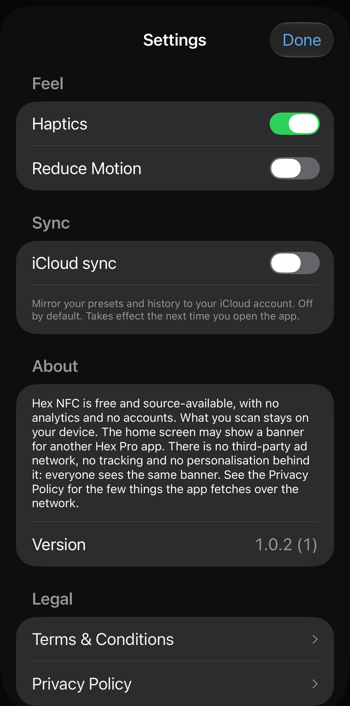

Hex NFC has three settings, and they share one screen with the app's version
number, a way to send feedback or rate the app, and its legal documents. On the Hex NFC home screen, tap the gear button
in the top right; it carries no word, and VoiceOver reads it as **Settings**.
The sheet that opens is titled **Settings**. The groups below run in the order
the screen shows them.

:::figure[The **Settings** sheet opens on **Feel** and **Sync**, with every switch at its default.]

:::

## Feel

:::table[Feel settings]
| Setting | What it does | Default |
| :--- | :--- | :--- |
| **Haptics** | Vibrates your iPhone during a scan, a write and the other moments the app marks. Turning it off stops those vibrations at once. | On |
| **Reduce Motion** | Cuts back the app's animations. :more[The app reduces motion when this switch or your iPhone's own Reduce Motion setting is on, so turning this one off does not undo the system setting.] | Off |
:::

While your iPhone's own Reduce Motion is on, a line under the row reads
"System Reduce Motion is on: animations are already minimised."

## Sync

:::table[Sync settings]
| Setting | What it does | Default |
| :--- | :--- | :--- |
| **iCloud sync** | Mirrors your presets and your scan history to your iCloud account. Tag passwords are never mirrored. They stay in the Keychain on the iPhone that set them. | Off |
:::

Hex NFC builds its library once, at launch, so turning **iCloud sync** on or off
changes nothing until you close the app and open it again. The line under the
row says as much. Closing it means quitting the app. Going back to the iPhone's
Home Screen leaves Hex NFC running, and the switch you moved keeps doing
nothing.

### Turn on iCloud sync {#turn-on-icloud-sync}

::::steps
:::step[Open Settings]
In Hex NFC, on the home screen, tap the gear button in the top right.
:::

:::step[Turn on iCloud sync]
Turn on **iCloud sync**. The switch moves, and nothing else changes yet.
:::

:::step[Close Hex NFC and open it again]
Follow [Close and reopen the app](#close-and-reopen-the-app). The app rebuilds
its library as it starts, this time with sync running.
:::

:::step[Check for a warning]
Tap the gear button again and look under **iCloud sync**. The explanation there
reads "Mirror your presets and history to your iCloud account. Off by default.
Takes effect the next time you open the app." If a second paragraph follows it,
sync did not start; see [When sync does not start](#when-sync-does-not-start).
:::
::::

### Close and reopen the app {#close-and-reopen-the-app}

::::steps
:::step[Close Hex NFC]
Swipe up from the bottom edge of the screen and pause until the open apps
appear. On an iPhone with a Home button, double-press the Home button instead.
Then swipe up on the Hex NFC card, and the card leaves the screen.
:::

:::step[Open Hex NFC again]
Tap the Hex NFC icon. The app rebuilds its library as it starts, with whatever
**iCloud sync** was set to when you closed it.
:::
::::

Turning **iCloud sync** off again needs the same close and reopen. Either way
your presets and your history stay on this iPhone. Hex NFC does not delete what
iCloud already holds. Another iPhone signed in to the same account keeps
everything it has received. What stops is the flow of new changes from this
one.

### When sync does not start {#when-sync-does-not-start}

If the switch is on and iCloud was out of reach when the app started, sync does
not start. A second line appears under the row: "Sync is not running. Your
library is safe on this device, but iCloud was unavailable when the app started.
Check that you are signed in to iCloud, then reopen the app." Your presets and
your history are still on the iPhone. Only the mirroring stopped.

Three things cause that line:

- The iPhone is not signed in to iCloud.
- The account has no iCloud storage left.
- The iPhone had no network when Hex NFC started.

Work through them in order.

::::steps
:::step[Check your iCloud account]
Open the Settings app on your iPhone and tap your name at the top. Sign in if
you are asked to, then tap the iCloud row and read how much storage is left. If
there is none left, free some space or change your storage plan on that screen.
:::

:::step[Check the network]
Make sure your iPhone is on Wi-Fi or mobile data. Loading a page in Safari
settles it.
:::

:::step[Close Hex NFC and open it again]
Leave **iCloud sync** on and follow
[Close and reopen the app](#close-and-reopen-the-app), then tap the gear button
on the home screen. A second paragraph still under **iCloud sync** means sync
still has not started.
:::
::::

## About

The About section says what the app does and does not do: no analytics, no
accounts, and what you scan stays on your device. It also covers the banner the
home screen may show for another Hex Pro app. That banner has no third-party ad
network, no tracking and no personalisation behind it. Everyone sees the same
banner. For the few things the app fetches over the network, read
[Privacy and your data](privacy.md).

Under that paragraph, **Version** shows the app's version number followed by
its build number in brackets.

## Feedback and ratings {#feedback-and-ratings}

**Send Feedback**, below **Version**, opens a form for a message to Hex Pro.

1. Type what is not right, or what could be better, in the message box.
2. To get an answer, put your email address under **Reply address
   (optional)**. Leave it empty and the message goes without one.
3. Check the list under **Sent with your message**. It shows the app version,
   iOS version, device model and language that go with your message. Nothing
   from your tags, scans or history is sent.
4. Tap **Send** in the top right.

The form thanks you once the message is on its way. If it cannot reach Hex Pro,
it keeps what you typed and offers **Email us instead**, which opens your mail
app with the message and the same details filled in.

**Rate Hex NFC** opens the app's page on the App Store, where you can give it a
rating or write a review.

Now and then the home screen asks **Loving Hex NFC?** in a card along its
bottom edge. It appears only after a few successful writes or protection
changes, or after reading a transit card or a whole passport, and only when
nothing in your recent scans failed. It waits until the home screen has sat
untouched for ten seconds, comes back at most once a month, and never covers
anything you need: the screen above it still scrolls and every button works.

Tap **Love it!** and Apple's rating sheet appears, when iOS chooses to show it.
Tap **Meh.** and the card offers **Send Feedback** instead. Either answer is
final, and the card does not ask again. **Hide** puts it away for a month, and
opening anything from the home screen while it is up does the same.

## Legal

**Terms & Conditions** and **Privacy Policy** each open the full document in a
reading card that you scroll and then close with **Done**. Each card carries
two lines above the first heading: the date that version took effect, and "Ars
Vitae Pty Ltd, trading as Hex Pro (Australia)". Both documents are in English,
whatever language the rest of the app is in.

The Terms answer what the app costs, in the section headed "3. The app is
free", and [Common questions](faq.md) answers it as well. The Privacy Policy is
the document behind [Privacy and your data](privacy.md).

## See also

- [Save a tag as a preset](presets.md)
- [Find a tag you scanned before](scan-history.md)
- [Privacy and your data](privacy.md)
