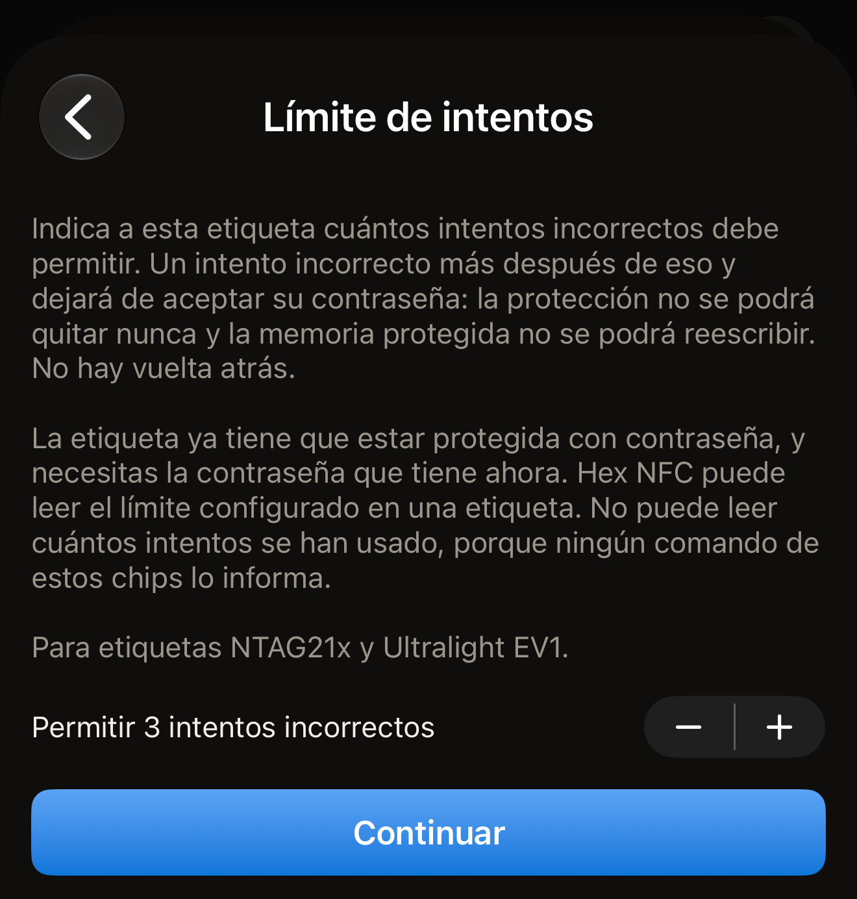
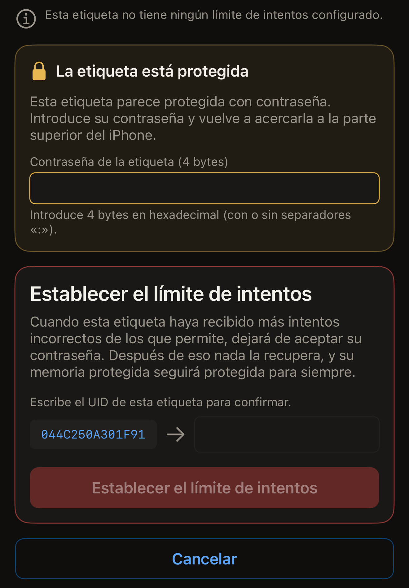

Un límite de intentos indica a una etiqueta protegida con contraseña cuántas
contraseñas incorrectas debe admitir, y Hex NFC escribe ese número en la etiqueta
desde el iPhone. Si lo pones en 3, la etiqueta acepta tres intentos incorrectos;
el siguiente intento hace que deje de aceptar su contraseña para siempre. A
partir de entonces, la protección no se puede quitar nunca y la memoria
protegida no se puede volver a escribir. No hay vuelta atrás.

Antes de empezar:

- La etiqueta ya tiene que estar protegida con contraseña.
- Necesitas la contraseña que tiene ahora.
- El chip tiene que ser un NTAG21x o un MIFARE Ultralight EV1, que son los chips
  que tienen este campo.

Para ver qué lleva un chip, consulta
[Etiquetas compatibles con Hex NFC](tags-that-work.md) o la
[matriz de compatibilidad de chips](../developer/chip-support-matrix.md).

El límite no forma parte de la tarjeta **Protección**. Está en la pantalla
Operaciones, en **Acciones peligrosas**, porque se configura en una sola etiqueta
cada vez y no se puede deshacer.

::include[two-tap-confirmation]

El escaneo que abre la etiqueta no es uno de esos dos acercamientos. Aquí acercas
la etiqueta tres veces en total: una para escanearla y, después, los dos
acercamientos de la operación.

:::warning[Una contraseña incorrecta puede gastar un intento]
Si la etiqueta ya tiene un límite, la contraseña que escribas aquí cuenta para
ese límite cuando la etiqueta la rechaza. Hex NFC indica el límite configurado en
una etiqueta, pero ningún comando de estos chips dice cuántos intentos se han
gastado. Tampoco hay forma de probar una contraseña sin gastar uno de esos
intentos. La app nunca te muestra la contraseña de una etiqueta. Ningún chip la
entrega. La contraseña que debes escribir es la que has guardado al proteger la
etiqueta.
:::

## Establecer el límite de intentos

:::::steps
::::step[Escanear la etiqueta]
En la pantalla de inicio de Hex NFC, toca **Escanear** y acerca la etiqueta a la
parte superior del iPhone. El contenido de la etiqueta se abre en la pantalla
Etiqueta. La tarjeta de la parte superior lleva como título el nombre del chip.
La tarjeta **Protección** está justo debajo, encima de los registros.

Una etiqueta cuya contraseña protege solo la escritura se escanea como cualquier
otra. Su tarjeta **Protección** indica «Contraseña · solo escritura».

En cambio, una etiqueta cuya contraseña protege también la lectura detiene el
escaneo. La pantalla de escaneo muestra «La etiqueta está protegida» y pide la
contraseña. Introdúcela y toca **Desbloquear y volver a escanear**. Después se
abre la pantalla Etiqueta, y su tarjeta **Protección** indica «Contraseña ·
lectura y escritura». Ese desbloqueo presenta la contraseña a la etiqueta, así
que una contraseña incorrecta gasta uno de los intentos de los que trata esta
página. [Escanear una etiqueta](scan-a-tag.md#unlock-a-protected-tag) explica el
desbloqueo en detalle.
::::

::::step[Abrir la pantalla del límite de intentos]
En la pantalla Etiqueta, toca el botón de menú de la parte superior derecha,
junto a **Escribir**, y luego toca **Operaciones…**. En la pantalla Operaciones,
toca **Límite de intentos** en la tarjeta **Acciones peligrosas**.
::::

::::step[Elegir cuántos intentos incorrectos permitir]
La fila indica **Permitir 3 intentos incorrectos**, y el número cambia al tocar
los botones de más y menos que hay al lado. Elige cualquier número del 1 al 7.
Empieza en 3. Los botones de más y menos no tienen una opción para ninguno, así
que esta pantalla puede cambiar el límite de una etiqueta, pero nunca quitarlo.
Al quitar la contraseña de la etiqueta se borra también el límite, y para eso
hace falta una contraseña que la etiqueta todavía acepte.

:::figure[La pantalla **Límite de intentos** se abre con un límite de 3, con los botones de más y menos junto a la fila y **Continuar** debajo.]

:::
::::

::::step[Tocar Continuar]
Toca **Continuar**. Los botones de más y menos dejan de admitir cambios, y la
pantalla pide el primer acercamiento.
::::

::::step[Hacer el primer acercamiento de la operación]
Toca **Establecer el límite de intentos** y acerca la etiqueta a la parte
superior del iPhone. Este acercamiento lee el UID de la etiqueta y el límite que
ya tiene configurado.

Si cierras el panel de escaneo de iOS antes de acercar una etiqueta, vuelves a los
botones de más y menos y a **Continuar**, para que puedas elegir otro límite. Si
el panel se cierra solo sin ninguna etiqueta junto al iPhone, la pantalla indica
«No se encontró ninguna etiqueta» con **Reintentar** y **Empezar de nuevo**.
::::

::::step[Introducir la contraseña y escribir el UID de la etiqueta]
Una tarjeta con el título «La etiqueta está protegida» pide la contraseña que
tiene ahora la etiqueta. Introdúcela en **Contraseña de la etiqueta (4 bytes)**,
en hexadecimal, con o sin separadores `:`. Después, escribe el UID que aparece en
la pantalla en el campo que hay al lado.

:::figure[La contraseña va en la tarjeta «La etiqueta está protegida», y el UID, en la tarjeta de debajo, encima de **Establecer el límite de intentos**.]

:::
::::

::::step[Hacer el segundo acercamiento con la misma etiqueta]
Toca **Establecer el límite de intentos** y vuelve a acercar la etiqueta a la
parte superior del iPhone. La app escribe el nuevo límite y lo relee. La pantalla
indica «Esta etiqueta ahora está configurada para permitir 3 intentos
incorrectos.»

Debajo añade «Un intento incorrecto más después de eso y dejará de aceptar su
contraseña para siempre.»
::::
:::::

## Qué indica la app entre los dos acercamientos

El primer acercamiento lee la configuración de la propia etiqueta, así que la
pantalla indica lo que tiene la etiqueta antes de que escribas su UID. Indica una
de estas tres cosas:

- «Esta etiqueta no tiene ningún límite de intentos configurado.» Ningún número
  de intentos incorrectos puede hacer que deje de aceptar su contraseña.
- «Esta etiqueta ya está configurada para permitir 3 intentos incorrectos.» El
  número es el que tiene la etiqueta, y el nuevo límite lo sustituye.
- «Esta etiqueta está protegida contra lectura, así que el límite que tiene ahora
  no se puede leer hasta presentar su contraseña.» No hay nada que indicar. Las
  páginas de configuración están protegidas por la contraseña. La operación
  continúa a partir de aquí: escribe el UID, y el segundo acercamiento presenta
  la contraseña y escribe el nuevo límite.

La app nunca indica cuántos intentos ha gastado ya una etiqueta, porque ningún
comando de estos chips lo revela.

## Si la etiqueta no tiene contraseña

Un límite de intentos protege una contraseña, así que la app rechaza la operación
en una etiqueta que no la tiene. El rechazo dice «Esta etiqueta no tiene
contraseña, así que no hay nada que un límite de intentos pueda proteger.»

El rechazo llega antes de escribir nada. La etiqueta se queda exactamente como
estaba. Establece primero una contraseña, como se describe en
[Proteger una etiqueta con contraseña](protect-a-tag.md), y vuelve aquí.

## Si la app no puede releer el límite

Una etiqueta que se aparta en plena escritura recibe el titular «Límite de
intentos escrito.»

La explicación dice «La etiqueta confirmó la escritura, pero en este acercamiento
no se pudo volver a leer el byte. Inicia la operación de nuevo: el primer
acercamiento indica el límite que tiene la etiqueta.» El chip ha aceptado la
escritura. Este acercamiento no ha podido demostrar qué se ha escrito.

En ese punto la operación ha terminado, así que la pantalla no ofrece
reintentarla. Vuelve a la pantalla Operaciones y abre de nuevo
**Límite de intentos**. Llévala hasta el final: el primer acercamiento de la nueva
operación indica el límite que tiene la etiqueta.

## Si una contraseña deja de funcionar más adelante

En una etiqueta con un límite configurado, cuando la etiqueta rechaza una
contraseña aparece «La etiqueta rechazó esa contraseña. Esta etiqueta tiene un
límite de intentos configurado, así que puede estar bloqueada aunque la
contraseña sea correcta.»

Una comprobación que no ha llegado a terminar muestra «Esa contraseña no abrió la
etiqueta. Esta etiqueta tiene un límite de intentos configurado, y cada intento
incorrecto cuenta para ese límite. Comprueba la contraseña antes de volver a
intentarlo.»

Los dos significan lo mismo para tu siguiente paso: encuentra la contraseña
correcta antes de volver a acercar la etiqueta. Cualquiera de los dos mensajes
puede ocupar el lugar del texto que pide la contraseña en la tarjeta «La etiqueta
está protegida». Su campo aparece vacío, así que la contraseña rechazada no se
envía por segunda vez a menos que la escribas. Si, en cambio, la operación
termina en un fallo, la pantalla muestra **Empezar de nuevo**, que te devuelve el
formulario y vuelve a pedir la contraseña. Cuando una etiqueta ha recibido más
intentos incorrectos de los que permite, nada la abre y su memoria protegida
sigue protegida para siempre.

## Ver también

- [Quitar la contraseña de una etiqueta](remove-password.md)
- [Protección de etiquetas](tag-protection.md)
- [Si no se puede escanear o escribir una etiqueta](troubleshooting.md)
