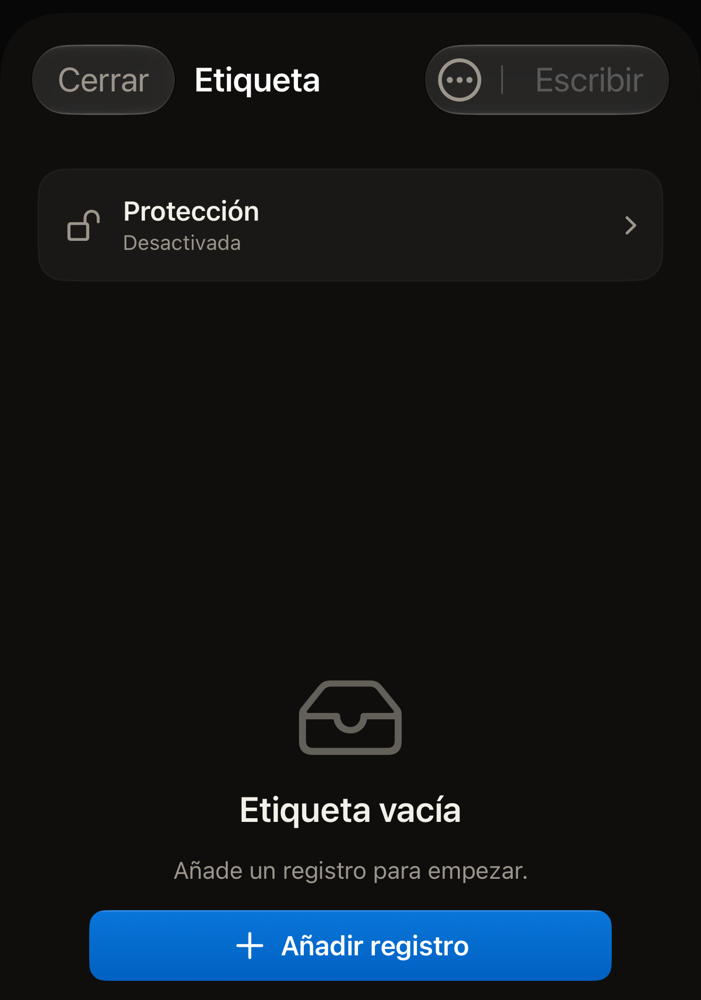
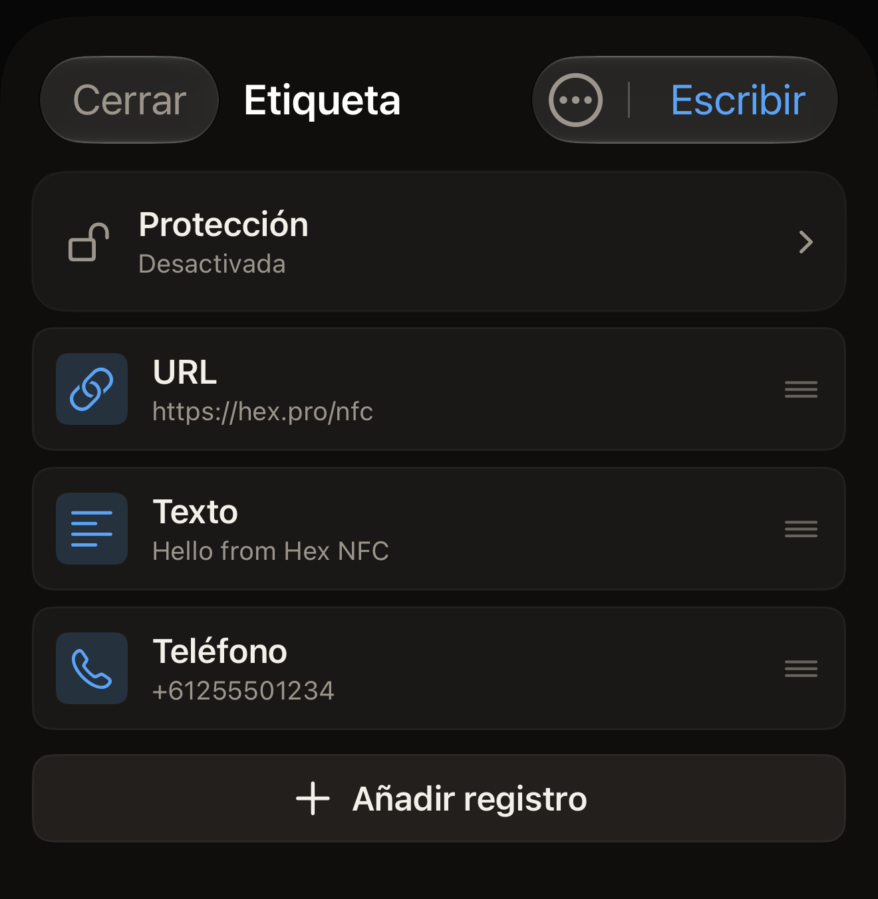

Una etiqueta contiene una lista de registros, y Hex NFC muestra esa lista en
la pantalla Etiqueta. Puedes añadir un registro, cambiarlo, subirlo en la
lista o eliminarlo, y después escribir en la etiqueta desde el iPhone cuando
la lista quede como quieres.

## Abrir la lista de registros

Haz una de estas dos cosas:

- Para trabajar con una etiqueta que tienes en la mano, escanéala. Sus
  registros aparecen en la pantalla Etiqueta. Consulta
  [Escanear una etiqueta](scan-a-tag.md).
- Para crear un conjunto de registros sin tener una etiqueta delante, toca
  **Crear** en la pantalla de inicio de Hex NFC.

Una etiqueta o un conjunto nuevo que todavía no contiene nada muestra
«Etiqueta vacía», con «Añade un registro para empezar.» debajo.

:::figure[Un conjunto nuevo sin registros muestra «Etiqueta vacía», y **Añadir registro** aparece debajo del mensaje.]

:::

## Añadir un registro

::::steps
:::step[Abrir el selector de registros]
En la pantalla Etiqueta, toca **Añadir registro**. Está al final de la lista
de registros, o debajo de «Etiqueta vacía» cuando la etiqueta no contiene
nada. Se abre la pantalla Añadir registro, con un recuadro por cada tipo que
puedes añadir.
:::

:::step[Elegir un tipo]
Toca el recuadro que quieras, como **Texto**, **URL**, **Contacto** o
**Wi-Fi**. La app añade un registro de ese tipo y lo abre para que lo
rellenes.
:::

:::step[Rellenar el registro]
Introduce los datos que necesita el registro y toca **Guardar**. El registro
aparece al final de la lista en la pantalla Etiqueta.
:::
::::

Hay 13 tipos para elegir. [Tipos de registro](record-types.md) explica lo que
contiene cada uno y lo que hace un teléfono con él cuando lee la etiqueta.

## Añadir un registro desde un código QR

::::steps
:::step[Abrir el lector de códigos QR]
En la pantalla Añadir registro, toca **Escanear QR**. Se abre la pantalla
Escanear un código QR.
:::

:::step[Permitir la cámara]
La primera vez, la pantalla muestra «Permitir la cámara para escanear un QR»
y «El fotograma se procesa en el dispositivo. No se sube nada.» Toca
**Permitir la cámara** y permite el acceso cuando iOS lo pida. Si antes
has rechazado la cámara, la pantalla muestra en su lugar «Se necesita
acceso a la cámara». Toca **Abrir Ajustes** y, en la app Ajustes del iPhone,
vuelve a activar la cámara para Hex NFC.
:::

:::step[Apuntar con la cámara al código]
Mantén el código dentro del marco. La app lee el primer código que ve, lo
convierte en un registro y lo abre para que lo revises.
:::
::::

El tipo que elige la app corresponde a lo que lleva el código: una red Wi-Fi,
un contacto, un correo electrónico, un mensaje de texto, un número de
teléfono o una ubicación. Una dirección web se convierte en un registro URL.
Cualquier otra cosa se convierte en un registro de texto.

## Cambiar, mover o eliminar un registro

Haz cualquiera de estas cosas en la pantalla Etiqueta:

- Para cambiar un registro, toca su fila, edita los campos y toca
  **Guardar**.
- Para mover un registro, arrastra su fila hacia arriba o hacia abajo. El
  orden de la lista es el orden en que se escriben los registros en la
  etiqueta.
- Para eliminar un registro, desliza su fila hacia la izquierda y toca
  **Eliminar**. Si deslizas la fila hasta el otro extremo, se elimina sin que
  tengas que tocar nada más.

:::figure[Los registros aparecen en el orden en que se escriben, con **Añadir registro** al final de la lista.]

:::

Un registro que eliminas aquí desaparece de la lista, no de la etiqueta. La
etiqueta conserva lo que tenía hasta la siguiente escritura, así que vaciar
una lista por error no te cuesta nada. Para borrar de verdad el contenido de
una etiqueta, consulta [Borrar o formatear una etiqueta](erase-or-format.md).

## Terminar la edición

Nada de lo que haces en esta pantalla llega a la etiqueta hasta que escribes
en ella. Cuando la lista esté bien, haz una de estas cosas:

- Para poner los registros en la etiqueta, toca **Escribir**. Consulta
  [Escribir un enlace en una etiqueta](write-a-link.md).
- Para guardar el conjunto para otro día, abre el menú de la parte superior
  de la pantalla Etiqueta y toca **Guardar como preajuste…**. Consulta
  [Guardar una etiqueta como preajuste](presets.md).
- Para salir, toca **Cerrar**. La etiqueta se queda como estaba, y se
  descartan los cambios que no hayas escrito ni guardado.

## Ver también

- [Tipos de registro](record-types.md)
- [Escribir un enlace en una etiqueta](write-a-link.md)
- [Guardar una etiqueta como preajuste](presets.md)
