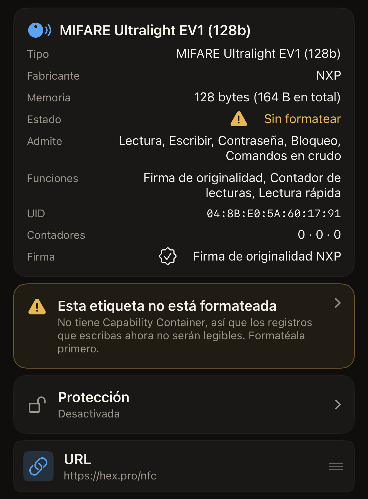
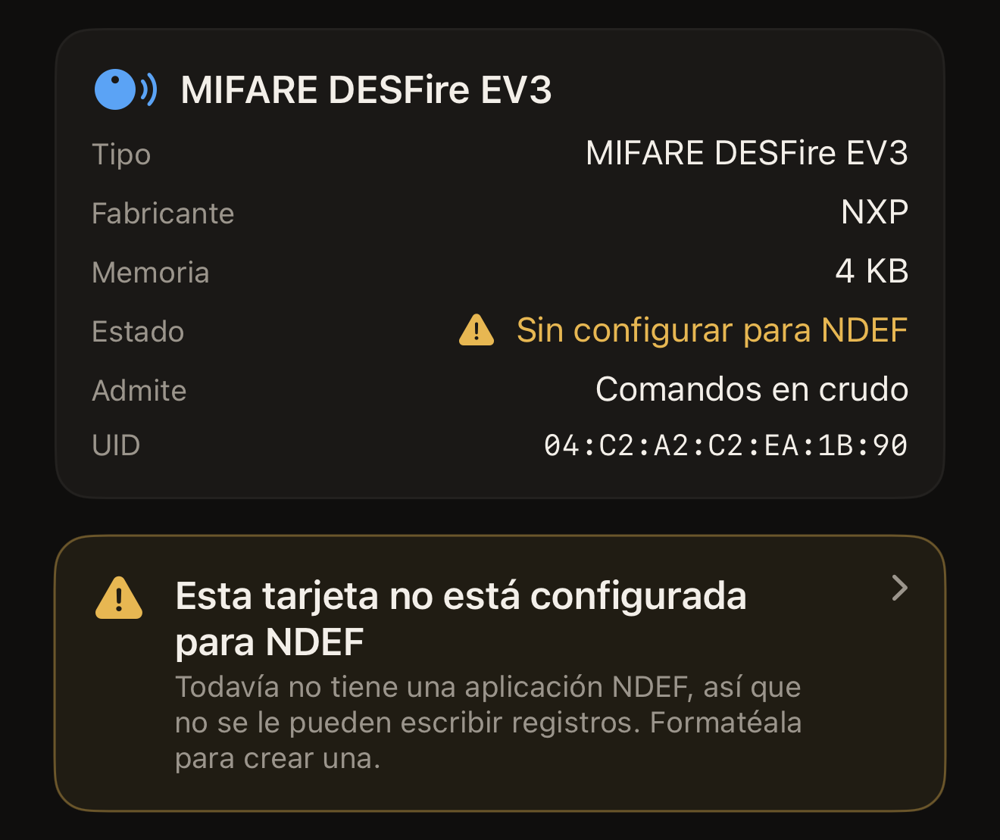
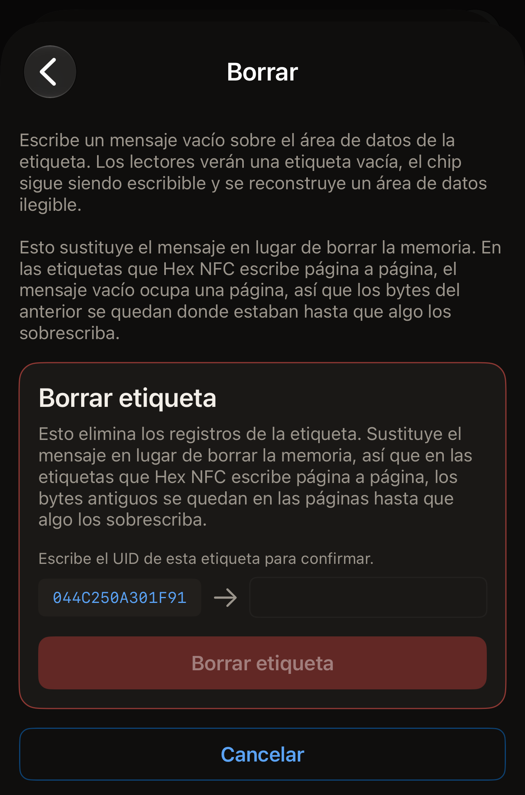
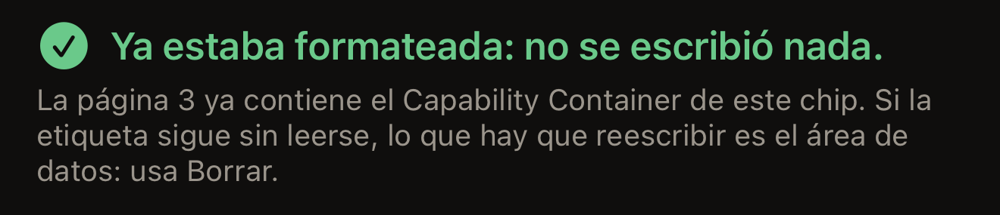
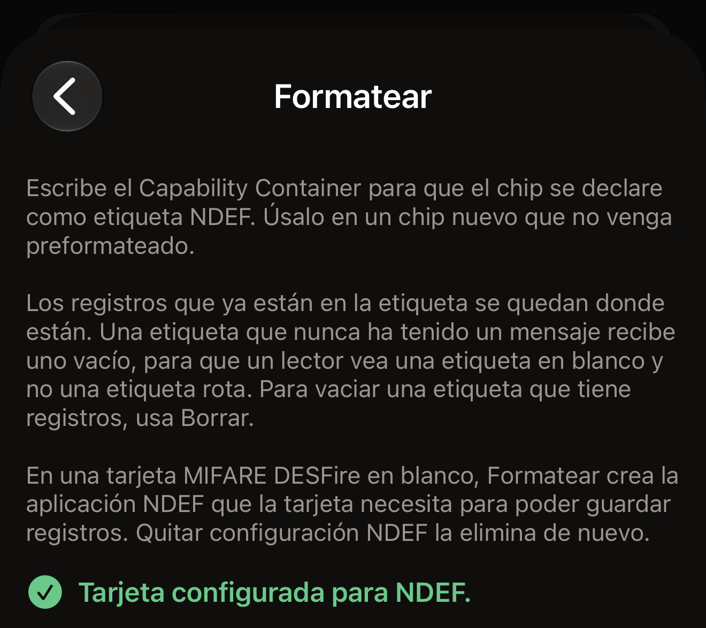
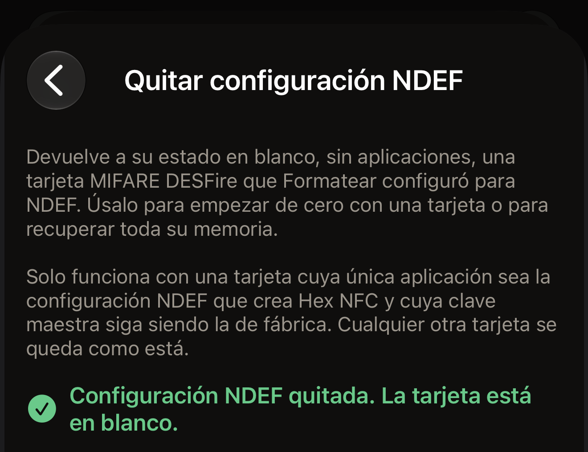

Hex NFC ofrece dos reparaciones para una etiqueta que no se puede leer, y cada
una hace lo contrario de la otra. El borrado escribe un mensaje vacío sobre el
área de datos de la etiqueta, de modo que los lectores ven una etiqueta vacía y
el chip sigue admitiendo escrituras. El formateo escribe el Capability Container, el
breve encabezado que un lector busca antes de leer cualquier otra cosa de la
etiqueta.

Antes de empezar, escanea la etiqueta: en la pantalla de inicio de Hex NFC,
toca **Escanear** y acerca la etiqueta a la parte superior del iPhone. La
pantalla **Etiqueta** se abre en cuanto la app la ha leído. También se abre con
una etiqueta sin formatear, con una etiqueta cuyos datos no se pueden leer y con
una tarjeta MIFARE DESFire que no está configurada para NDEF. En todos esos
casos aparece sola después del escaneo, sin que tengas que tocar nada. Un aviso
en la pantalla de escaneo es un diagnóstico, no un callejón sin salida. En la
pantalla **Etiqueta**, toca el botón de menú de la esquina superior derecha,
junto a **Escribir**, y después toca **Operaciones…**. Las dos reparaciones
están en **Acciones peligrosas**, al final de la pantalla **Operaciones**.
Junto a ellas está **Quitar configuración NDEF**, que deshace el formateo de una
tarjeta MIFARE DESFire. Allí, cada operación confirma la etiqueta antes de
cambiarla:

::include[two-tap-confirmation]

## Qué reparación necesita la etiqueta

La app pone nombre al fallo en la pantalla en la que lo encuentras, y cada
nombre indica qué reparación hace falta.

- Formatea la etiqueta cuando la pantalla de escaneo diga «Esta etiqueta aún no
  está formateada» o la pantalla **Etiqueta** diga «Sin formatear». La etiqueta
  no tiene Capability Container, así que nada de lo que escribas en ella se
  podrá leer.
- Borra la etiqueta cuando la pantalla de escaneo diga «Los datos de esta
  etiqueta no se pueden leer» o la pantalla **Etiqueta** diga «Datos ilegibles».
  El Capability Container ya está en su sitio, así que un formateo no tiene nada
  que reparar ahí.
- Formatea la tarjeta cuando la pantalla de escaneo diga «Esta tarjeta aún no
  está configurada para NDEF» o la pantalla **Etiqueta** diga
  «Sin configurar para NDEF». Es una MIFARE DESFire en blanco, o una que un
  formateo anterior dejó configurada a medias, así que todavía no se pueden
  escribir registros en ella. Con una tarjeta de transporte o de acceso no
  aparece nunca.

En una etiqueta que todavía admite escrituras, la pantalla **Etiqueta** muestra
además un aviso que puedes tocar. Dice «Esta etiqueta no está formateada», «Los
datos de esta etiqueta no se pueden leer» o «Esta tarjeta no está configurada
para NDEF». Al tocarlo se abre **Operaciones**.
Una etiqueta bloqueada permanentemente muestra el estado, pero no el aviso,
porque las dos reparaciones son escrituras.

:::figure[Una etiqueta sin Capability Container muestra «Sin formatear» junto a **Estado**, con el aviso «Esta etiqueta no está formateada» debajo de la tarjeta.]

:::

:::figure[Una tarjeta MIFARE DESFire en blanco muestra «Sin configurar para NDEF» junto a **Estado**, con el aviso «Esta tarjeta no está configurada para NDEF» debajo.]

:::

## Borrar una etiqueta

Un borrado elimina los registros de la etiqueta y el chip sigue admitiendo
escrituras.
También reconstruye un área de datos que ha dejado de leerse.

:::::steps
::::step[Abrir la pantalla de borrado]
En la pantalla **Operaciones**, toca **Borrar**. La pantalla que se abre explica
qué escribe el borrado y te avisa antes de que nada llegue a la etiqueta.
::::

::::step[Iniciar el borrado]
Toca **Borrar etiqueta**. El iPhone te pide que acerques la etiqueta.
::::

::::step[Acercar la etiqueta al iPhone]
Apoya la parte superior del iPhone sobre la etiqueta. La pantalla dice «Paso 1
de 2. Mantén la etiqueta para identificarla.» y después muestra el UID de la
etiqueta.
::::

::::step[Volver a escribir el UID]
La pantalla dice «Escribe el UID de esta etiqueta para confirmar.» y coloca el
UID junto a un campo vacío. Introduce esos mismos caracteres en el campo, sin
dos puntos entre ellos, en mayúsculas o en minúsculas, y toca **Borrar
etiqueta**. Si la contraseña de la etiqueta cubre su área de datos, encima del
campo aparece una tarjeta con el título «La etiqueta está protegida» que pide la
contraseña o la clave que tiene ahora la etiqueta. **Borrar etiqueta** no hace
nada hasta que la introduces.

:::figure[Tras el primer acercamiento, el UID de la etiqueta aparece a la izquierda de un campo vacío, y **Borrar etiqueta** sigue atenuado hasta que lo escribes.]

:::
::::

::::step[Acercar la etiqueta por segunda vez]
Vuelve a acercar la etiqueta a la parte superior del iPhone. La pantalla dice
«Etiqueta borrada.» cuando la app ha releído el mensaje vacío de la etiqueta.
::::
:::::

Un borrado termina de una de estas dos maneras. Muestra «Etiqueta borrada.»
cuando el mensaje vacío se relee. Si no, muestra un error que indica el fallo,
con los detalles debajo para un informe de errores.
[Si no se puede escanear o escribir una etiqueta](troubleshooting.md) explica
qué probar a continuación.

:::note
Un borrado sustituye el mensaje de la etiqueta en lugar de borrar su memoria. En
las etiquetas NTAG y MIFARE Ultralight, los chips que llevan la mayoría de las
pegatinas y tarjetas, el mensaje vacío ocupa una página. Los bytes del mensaje
anterior se quedan donde estaban hasta que algo los sobrescribe. Si vas a dar
una etiqueta a otra persona, escribe en ella un mensaje tuyo.
:::

## Formatear una etiqueta {#format-a-tag}

Formatea un chip nuevo que no venga preformateado. El formateo escribe el
Capability Container y deja donde están los registros que ya tenga la etiqueta.
En las etiquetas ISO 15693, como ICODE SLIX2, si la etiqueta nunca ha tenido un
mensaje, el formateo le escribe además uno vacío, así que un lector ve una
etiqueta vacía y no una dañada. Si quieres vaciar una etiqueta que tiene
registros, bórrala. En una tarjeta MIFARE DESFire en blanco, el formateo
configura la tarjeta para NDEF, como se explica al final de esta sección.

::::steps
:::step[Abrir la pantalla de formateo]
En la pantalla **Operaciones**, toca **Formatear**.
:::

:::step[Iniciar el formateo]
Toca **Formatear etiqueta**. El iPhone te pide que acerques la etiqueta.
:::

:::step[Acercar la etiqueta al iPhone]
Apoya la parte superior del iPhone sobre la etiqueta. La pantalla dice «Paso 1
de 2. Mantén la etiqueta para identificarla.» y después muestra el UID de la
etiqueta.
:::

:::step[Volver a escribir el UID]
La pantalla dice «Escribe el UID de esta etiqueta para confirmar.» y coloca el
UID junto a un campo vacío. Introduce esos mismos caracteres en el campo, sin
dos puntos entre ellos, en mayúsculas o en minúsculas, y toca **Formatear
etiqueta**.
:::

:::step[Acercar la etiqueta por segunda vez]
Vuelve a acercar la etiqueta a la parte superior del iPhone. La pantalla dice
«Etiqueta formateada.» cuando la app ha releído el encabezado. En una tarjeta
MIFARE DESFire dice, en cambio, «Tarjeta configurada para NDEF.»
:::
::::

En una etiqueta NTAG o MIFARE Ultralight, el formateo termina con uno de estos
tres resultados:

- «Etiqueta formateada.» significa que el encabezado está escrito, releído y en
  su sitio, y que la etiqueta está lista para recibir un mensaje.
- «Ya estaba formateada: no se escribió nada.» significa que la etiqueta ya
  tenía el encabezado correcto, así que no le ha llegado nada. La app te remite a
  **Borrar**, porque si una etiqueta sigue sin leerse, el fallo está en el área
  de datos.
- «Esta etiqueta ya tiene un Capability Container distinto.» significa que el
  encabezado de la etiqueta no coincide con el chip que ha identificado la app.
  No se ha escrito nada.

:::figure[Un formateo que encuentra el encabezado ya en su sitio muestra «Ya estaba formateada: no se escribió nada.» y te remite a un borrado.]

:::

Una etiqueta ISO 15693 muestra «Etiqueta formateada.» siempre, porque su bloque
de Capability Container sigue siendo reescribible y la app lo escribe cada vez.

:::warning
En las etiquetas NTAG y MIFARE Ultralight, el Capability Container admite una
sola escritura en toda la vida de la etiqueta y nunca se puede corregir. Por eso
la app lee primero esa página y solo escribe en ella mientras está vacía.
Rechaza un chip que no ha podido identificar en lugar de adivinar un encabezado.
El nombre del chip que ha leído la app aparece en la parte superior de la
pantalla **Etiqueta**, y [Etiquetas compatibles con Hex NFC](tags-that-work.md)
explica qué puede hacer la app con cada chip.
:::

### Formatear una tarjeta MIFARE DESFire

Una tarjeta MIFARE DESFire EV1, EV2 o EV3 en blanco no tiene ninguna
aplicación, y el formateo le añade la aplicación NDEF que necesita para poder
guardar registros. Los pasos son los de arriba, con los mismos dos
acercamientos y el mismo UID escrito. La app ajusta el archivo NDEF de la
tarjeta a su memoria libre, hasta 4 KB en una tarjeta de 4K. Una vez
configurada la tarjeta, iOS la lee y escribe en ella como en cualquier otra
etiqueta NDEF.

En una tarjeta MIFARE DESFire, el segundo acercamiento termina con uno de estos
dos resultados:

- «Tarjeta configurada para NDEF.» significa que la aplicación NDEF está en la
  tarjeta, que Hex NFC la ha releído y que la tarjeta está lista para recibir
  registros.
- «Ya estaba configurada para NDEF: no se escribió nada.» significa que Hex NFC
  ya había configurado esta tarjeta, así que no le ha llegado nada.

:::figure[Una tarjeta MIFARE DESFire en blanco que el formateo ha configurado muestra «Tarjeta configurada para NDEF.»]

:::

Hex NFC rechaza estas tarjetas sin escribir nada en ellas, con uno de estos
mensajes:

- «Esta tarjeta ya tiene otras aplicaciones, así que no se puede configurar para
  NDEF aquí. No se escribió nada.» Es lo que ocurre con una tarjeta de
  transporte o de acceso.
- «Esta tarjeta necesita su clave maestra para añadirle cualquier cosa, así que
  no se puede configurar para NDEF aquí. No se escribió nada.»
- «Esta tarjeta la configuró para NDEF otra app, así que Hex NFC la deja como
  está. No se escribió nada.»

Si la tarjeta se separa del iPhone durante el segundo acercamiento antes de que
la configuración haya escrito nada, la pantalla dice «Se perdió la etiqueta a
mitad de la lectura. Mantenla apoyada en la parte superior del teléfono e
inténtalo de nuevo.» y no se ha escrito nada. Si se separa cuando la
configuración ya ha empezado a escribir, dice «La tarjeta está configurada a
medias. Toca Formatear otra vez para terminar.» o «Puede que la tarjeta esté
configurada a medias. Escanéala para comprobarlo o toca Formatear otra vez.» Un
nuevo formateo sigue desde donde se quedó el anterior.

Si la tarjeta se queda sin memoria libre, el primer intento muestra «No hay
suficiente memoria libre en esta tarjeta para un archivo NDEF. Usa Quitar
configuración NDEF para borrar lo que se empezó.» Un intento posterior con la
misma tarjeta muestra «No hay suficiente memoria libre en esta tarjeta para un
archivo NDEF. No se escribió nada.» En los dos casos,
**Quitar configuración NDEF** deja la tarjeta en blanco, como se explica en la
sección siguiente.

## Quitar la configuración NDEF de una tarjeta {#remove-ndef-setup}

**Quitar configuración NDEF** deja en blanco una tarjeta MIFARE DESFire que se
configuró con un formateo. Elimina la aplicación NDEF de la tarjeta y todos los
registros que contiene, y devuelve a la tarjeta toda su memoria. Solo funciona
en una tarjeta cuya clave maestra siga siendo la de fábrica y cuya única
aplicación sea la configuración NDEF que crea Hex NFC, aunque un formateo la haya
dejado a medias. Cualquier otra tarjeta se queda como está.

::::steps
:::step[Abrir la pantalla para quitar la configuración]
En la pantalla **Operaciones**, dentro de **Acciones peligrosas**, toca
**Quitar configuración NDEF**.
:::

:::step[Iniciar la eliminación]
Toca **Quitar configuración NDEF**. El iPhone te pide que acerques la tarjeta.
:::

:::step[Acercar la tarjeta al iPhone]
Apoya la parte superior del iPhone sobre la tarjeta. La pantalla dice «Paso 1
de 2. Mantén la etiqueta para identificarla.» y después muestra el UID de la
tarjeta.
:::

:::step[Volver a escribir el UID]
La pantalla dice «Escribe el UID de esta etiqueta para confirmar.» y coloca el
UID junto a un campo vacío. Introduce esos mismos caracteres en el campo, sin
dos puntos entre ellos, en mayúsculas o en minúsculas, y toca
**Quitar configuración NDEF**.
:::

:::step[Acercar la tarjeta por segunda vez]
Vuelve a acercar la tarjeta a la parte superior del iPhone y mantenla ahí hasta
que aparezca el resultado. La pantalla dice «Configuración NDEF quitada. La
tarjeta está en blanco.» cuando Hex NFC ha releído la tarjeta y ha comprobado
que no le queda ninguna aplicación.
:::
::::

:::figure[Una tarjeta a la que se le ha quitado la configuración NDEF muestra «Configuración NDEF quitada. La tarjeta está en blanco.»]

:::

Una tarjeta que ya está en blanco muestra «Esta tarjeta ya está en blanco: no se
cambió nada.» Hex NFC rechaza estas tarjetas sin cambiar nada, con uno de estos
mensajes:

- «Esta tarjeta tiene otras aplicaciones. Quitar la configuración también las
  borraría, así que no se cambió nada.»
- «La configuración NDEF de esta tarjeta la hizo otra app, así que Hex NFC no la
  quitará. No se cambió nada.»
- «La clave maestra de esta tarjeta no es la de fábrica, así que la app no puede
  quitar su configuración. No se cambió nada.»

Si la tarjeta se separa del iPhone durante el segundo acercamiento antes de que
la app haya cambiado nada, la pantalla dice «Se perdió la etiqueta a mitad de la
lectura. Mantenla apoyada en la parte superior del teléfono e inténtalo de
nuevo.» y la tarjeta sigue como estaba. Si se separa cuando la app ya ha
empezado a quitar la configuración, la pantalla dice «Puede que la tarjeta ya
esté en blanco. Escanéala para comprobarlo.» Si el escaneo sigue mostrando la
tarjeta configurada para NDEF, vuelve a usar **Quitar configuración NDEF**: la
app siempre lee primero la tarjeta, y una que ya está en blanco muestra «Esta
tarjeta ya está en blanco: no se cambió nada.»

Una vez quitada la configuración, al escanear la tarjeta la pantalla
**Etiqueta** muestra otra vez «Sin configurar para NDEF» junto a **Estado**, y
un formateo la configura de nuevo desde cero.

## Vaciar una etiqueta desde la lista de registros

También puedes vaciar una etiqueta desde la pantalla **Etiqueta**, sin pasar por
**Operaciones**. Una escritura que vacía la etiqueta no lleva ningún cambio de
protección, así que solo necesita un acercamiento y no te pide que escribas el
UID. Una escritura que además activa o quita una contraseña necesita dos
acercamientos y te pide el UID. Es la misma confirmación con dos acercamientos
que piden todas las operaciones de **Acciones peligrosas**.

::::steps
:::step[Eliminar todos los registros]
En la pantalla **Etiqueta**, desliza un registro hacia la izquierda y toca
**Eliminar**, hasta que la pantalla diga «No queda ningún registro». Las
eliminaciones todavía no están en la etiqueta.
:::

:::step[Escribir el resultado vacío]
La pantalla dice ahora «Has eliminado todos los registros. Escribe para vaciar
la etiqueta, o vuelve a añadir uno.» Debajo de esa línea, encima de **Añadir
registro**, toca **Escribir para vaciar la etiqueta**. El iPhone te pide que
acerques la etiqueta.
:::

:::step[Acercar la etiqueta al iPhone]
Apoya la parte superior del iPhone sobre la etiqueta y mantenlo ahí hasta que
termine la escritura.
:::
::::

## Ver también

- [Escanear una etiqueta](scan-a-tag.md)
- [Editar los registros de una etiqueta](edit-records.md)
- [Escribir un enlace en una etiqueta](write-a-link.md)
- [Si no se puede escanear o escribir una etiqueta](troubleshooting.md)
- [Etiquetas compatibles con Hex NFC](tags-that-work.md)
