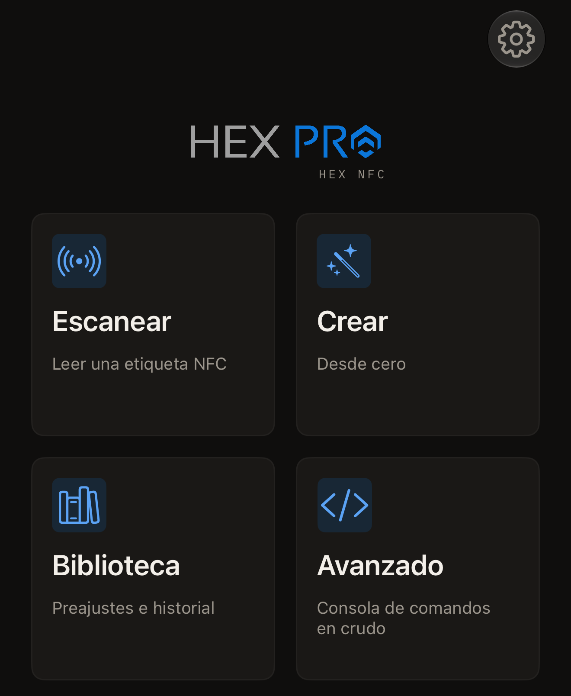

Hex NFC lee las etiquetas NFC que tienes a tu alrededor y muestra todos los
registros que contiene cada una. Escribe registros en una etiqueta vacía y
pone una contraseña en los chips que la admiten. La app también lee una
tarjeta de transporte japonesa o el chip de un pasaporte electrónico. No hay
que crear ninguna cuenta, y la app no incluye analíticas.

## Lo que necesitas

- Hex NFC, instalada desde el [App Store](https://apps.apple.com/app/id6801457461), en el iPhone.
- Un iPhone con iOS 17 o posterior.
- Una etiqueta NFC. La mayoría de las pegatinas, tarjetas y llaveros NFC
  vacíos llevan un chip que la app lee. [Etiquetas compatibles con Hex
  NFC](tags-that-work.md) los enumera, y la [matriz de compatibilidad de
  chips](../developer/chip-support-matrix.md) indica lo que puede hacer cada
  uno.

## Lo que puedes hacer

Hex NFC se abre en su pantalla de inicio, que tiene cuatro recuadros.

- Toca **Escanear** para leer una etiqueta y ver lo que contiene:
  [Escanear una etiqueta](scan-a-tag.md). Una
  [tarjeta de transporte](transit-cards.md) se lee de la misma forma, y un
  [pasaporte](passports.md) necesita dos acercamientos.
- Toca **Crear** para reunir registros desde cero y después escribirlos:
  [Escribir un enlace en una etiqueta](write-a-link.md).
- Toca **Biblioteca** para ver las etiquetas que has escaneado antes:
  [Buscar una etiqueta que has escaneado antes](scan-history.md). Ahí están
  también los conjuntos de registros que has guardado:
  [Guardar una etiqueta como preajuste](presets.md).
- Toca **Avanzado** para enviar un comando en crudo a un chip cuyo juego de
  comandos conoces:
  [Enviar un comando en crudo a una etiqueta](advanced-console.md).

:::figure[La pantalla de inicio de Hex NFC se abre con cuatro recuadros: **Escanear**, **Crear**, **Biblioteca** y **Avanzado**.]

:::

## Cambiar el contenido de una etiqueta

Con una etiqueta abierta, puedes rehacer sus registros con
[Editar los registros de una etiqueta](edit-records.md), eligiendo entre los
tipos que recoge [Tipos de registro](record-types.md).
[Proteger una etiqueta con contraseña](protect-a-tag.md) establece el secreto
que comprueba el chip, y
[Quitar la contraseña de una etiqueta](remove-password.md) lo vuelve a quitar.
[Limitar los intentos incorrectos de contraseña](attempt-limit.md) indica
cuántos rechazos acepta el chip. Hay tres herramientas que actúan sobre la
propia etiqueta: [Borrar o formatear una etiqueta](erase-or-format.md),
[Bloquear una etiqueta permanentemente](permanent-lock.md) y
[Guardar una copia de la memoria de una etiqueta](memory-dump.md).

## Por dónde empezar

[Leer tu primera etiqueta](quick-start.md) te lleva de la pantalla de inicio
de Hex NFC a tu primer escaneo en unos 5 minutos.
[Protección de etiquetas](tag-protection.md) explica qué protege una
contraseña y por qué no se puede recuperar si se pierde. Cuando una etiqueta
no responda, ve a
[Si no se puede escanear o escribir una etiqueta](troubleshooting.md).
[Ajustes](settings.md) enumera todos los interruptores de la app,
[La privacidad y tus datos](privacy.md) explica lo que se queda en el iPhone,
y [Preguntas frecuentes](faq.md) responde a cuánto cuesta.
