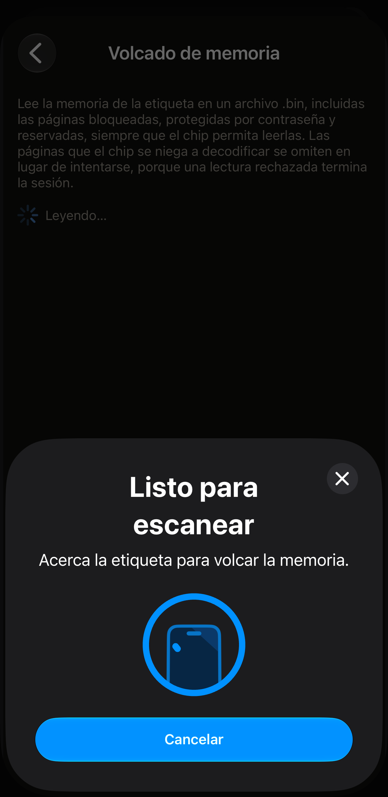
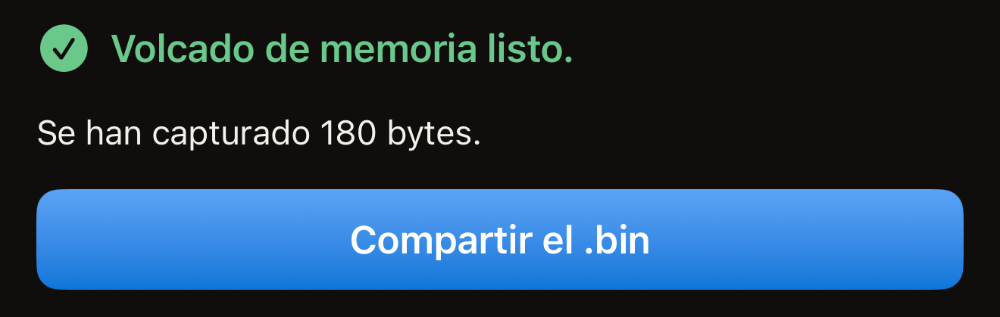
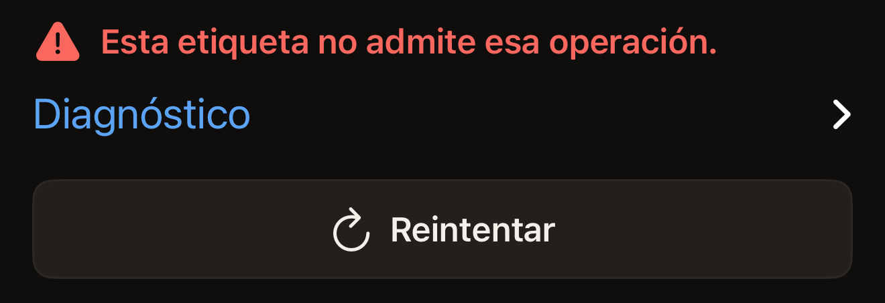

La operación Volcado de memoria copia las páginas de una etiqueta en un archivo
`.bin` y pasa ese archivo al menú Compartir de iOS. Solo lee. La etiqueta queda
igual que estaba. El volcado necesita un acercamiento de la etiqueta, o dos en
una etiqueta cuya contraseña protege la lectura, y nunca te pide que vuelvas a
escribir el UID de la etiqueta.

Necesitas un iPhone con NFC, Hex NFC instalada desde el App Store y la etiqueta
en la mano. Si todavía no has leído ninguna etiqueta con la app, empieza por
[Leer tu primera etiqueta](quick-start.md). Volcado de memoria está en la
pantalla Operaciones. Esa pantalla se abre desde el botón de menú de la esquina
superior derecha de la pantalla Etiqueta. Los pasos siguientes escanean una
etiqueta para llegar hasta ahí. [Escanear una etiqueta](scan-a-tag.md) explica
el escaneo por separado.

Funciona con los chips a los que Hex NFC accede página a página. Esos chips son
NTAG 210µ, NTAG213, NTAG213 TT, NTAG215, NTAG216, MIFARE Ultralight EV1,
MIFARE Ultralight C, EM V10, EM V11 y EM V16. Con cualquier otra etiqueta, la
pantalla muestra «Esta etiqueta no admite esa operación.»

[Etiquetas compatibles con Hex NFC](tags-that-work.md) explica cómo saber qué
chip tienes en la mano.

## Volcar la memoria de una etiqueta

:::warning[Envía el archivo antes de salir de la pantalla]
La app no guarda ninguna copia del volcado. Si cierras el menú Compartir o sales
de la pantalla Volcado de memoria sin enviar el archivo, se pierde. Tendrás que
volver a leer la etiqueta.
:::

:::::steps
::::step[Abrir la pantalla de escaneo]
En la pantalla de inicio de Hex NFC, toca **Escanear**. Se abre la pantalla de
escaneo, que empieza a buscar una etiqueta.
::::

::::step[Acercar la etiqueta al iPhone]
Apoya el borde superior del iPhone en plano sobre la etiqueta y mantenlo quieto
durante un segundo, más o menos. Se abre la pantalla Etiqueta con lo que
contiene la etiqueta.
::::

::::step[Abrir Operaciones]
En la pantalla Etiqueta, toca el botón de menú de la esquina superior derecha,
el que está a la izquierda de **Escribir**. El menú tiene dos filas, **Guardar
como preajuste…** y **Operaciones…**. Toca **Operaciones…**.
::::

::::step[Iniciar el volcado]
Toca **Volcado de memoria**. La pantalla se abre y empieza a escanear al
momento, sin ninguna confirmación previa.
::::

::::step[Volver a acercar la etiqueta al iPhone]
Apoya de nuevo el borde superior del iPhone sobre la etiqueta. La línea de
estado dice «Mantén la etiqueta en la parte superior del iPhone.» mientras
espera. Cambia a «Leyendo…» en cuanto la etiqueta responde. Al final muestra
«Volcado de memoria listo.» con el número de bytes capturados debajo.

:::figure[Mientras se lee la etiqueta, el panel de escaneo de iOS sigue diciendo «Acerca la etiqueta para volcar la memoria.» y la línea de estado de detrás dice «Leyendo…».]

:::

En una etiqueta cuya contraseña también protege la lectura, el volcado se
detiene antes de leer nada. Una tarjeta con el título «La etiqueta está
protegida» pide la contraseña o la clave de la etiqueta. Introdúcela, toca
**Desbloquear y volcar** y vuelve a acercar la etiqueta al iPhone.
::::

::::step[Compartir el archivo]
Toca **Compartir el .bin** y elige adónde enviar el archivo. Ese botón solo
aparece después de una lectura que ha terminado.

:::figure[Una lectura terminada muestra «Volcado de memoria listo.» con el número de bytes debajo y, más abajo, **Compartir el .bin**.]

:::
::::
:::::

## Qué contiene el archivo

El archivo es la memoria del chip copiada página a página desde la primera, a
4 bytes por página, sin encabezado y sin nada añadido. Contiene las páginas
bloqueadas, las protegidas con contraseña y las reservadas, siempre que el chip
permita leerlas. Las páginas que el chip se niega a decodificar se omiten en
lugar de pedirse. Una sola lectura rechazada termina la sesión y te haría perder
el resto del volcado. En un MIFARE Ultralight C, la copia se detiene antes de
las cuatro últimas páginas, que contienen la clave del chip y no responden a
ninguna lectura.

Un volcado completo tiene un tamaño fijo para cada chip, así que el número que
aparece bajo «Volcado de memoria listo.» te indica si lo tienes entero. La
pantalla Etiqueta muestra el nombre del chip en la parte superior de la tarjeta
de información de la etiqueta. Usa las mismas palabras que la primera columna
de la tabla siguiente. Un MIFARE Ultralight EV1 indica ahí cuál de los dos
tamaños tiene.

:::table[Bytes de un volcado completo]
| Chip | Volcado completo |
| :--- | ---: |
| NTAG 210µ, EM V10, EM V11, EM V16 | 64 bytes |
| NTAG213, NTAG213 TT | 180 bytes |
| NTAG215 | 540 bytes |
| NTAG216 | 924 bytes |
| MIFARE Ultralight EV1 (48b) | 80 bytes |
| MIFARE Ultralight EV1 (128b) | 164 bytes |
| MIFARE Ultralight C | 176 bytes |
:::

Hex NFC escribe el archivo en un almacenamiento temporal, con un nombre que
lleva la fecha y la hora de la lectura. Lo que lo conserva es compartirlo. La
app no tiene ninguna lista de volcados. Nada en la pantalla Etiqueta remite al
archivo. Envíalo a algún sitio antes de salir de la pantalla.

## Si el volcado no termina

Un volcado fallido deja la etiqueta exactamente como estaba, así que volver a
leerla no cuesta nada.

- Para volver a leer la misma etiqueta, toca **Reintentar**. La pantalla inicia
  un nuevo escaneo.
- Para ver qué ha respondido la etiqueta, abre **Diagnóstico**, debajo del mensaje
  de error. El texto que contiene se puede seleccionar y copiar en un informe de
  errores.

Si tocas Cancelar en el panel de escaneo de iOS antes de que se lea ninguna etiqueta,
vuelves a la pantalla Operaciones. Si no hay ninguna etiqueta junto al iPhone,
el panel se cierra solo y la pantalla dice «No se encontró ninguna etiqueta»,
con **Reintentar** debajo.

«Esta etiqueta no admite esa operación.» significa que el chip no es uno de los
que aparecen al principio de esta página. NTAG424 DNA, ICODE SLIX, ICODE SLIX2,
los chips MIFARE DESFire y FeliCa responden todos así. La
[matriz de compatibilidad de chips](../developer/chip-support-matrix.md) indica
qué puede hacer cada chip.

:::figure[Con un chip que el volcado no puede leer, la pantalla muestra «Esta etiqueta no admite esa operación.» con **Diagnóstico** y **Reintentar** debajo.]

:::

Si una etiqueta se pierde a mitad de una lectura, consulta
[Si no se puede escanear o escribir una etiqueta](troubleshooting.md).
Consúltala también para cualquier mensaje que esta página no explique.

## Ver también

- [Escanear una etiqueta](scan-a-tag.md)
- [Etiquetas compatibles con Hex NFC](tags-that-work.md)
- [Enviar un comando en crudo a una etiqueta](advanced-console.md)
