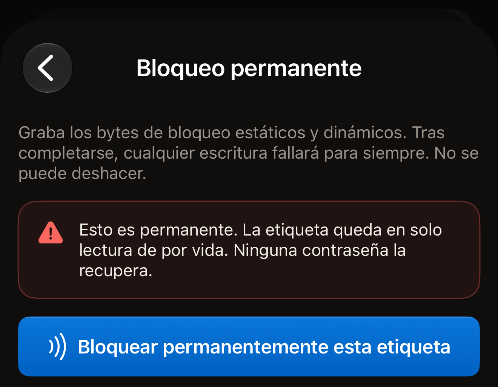
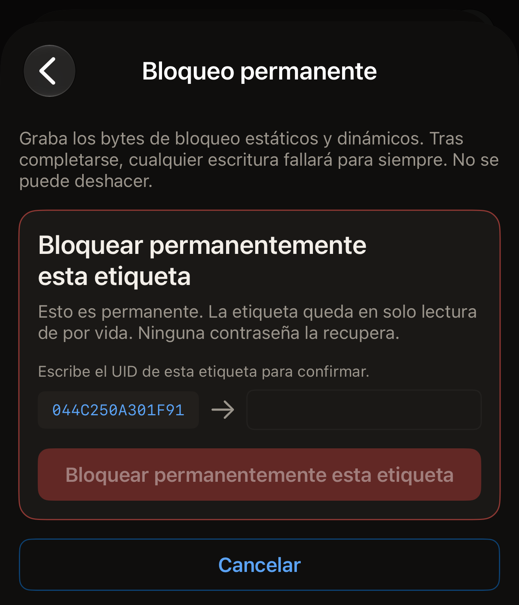
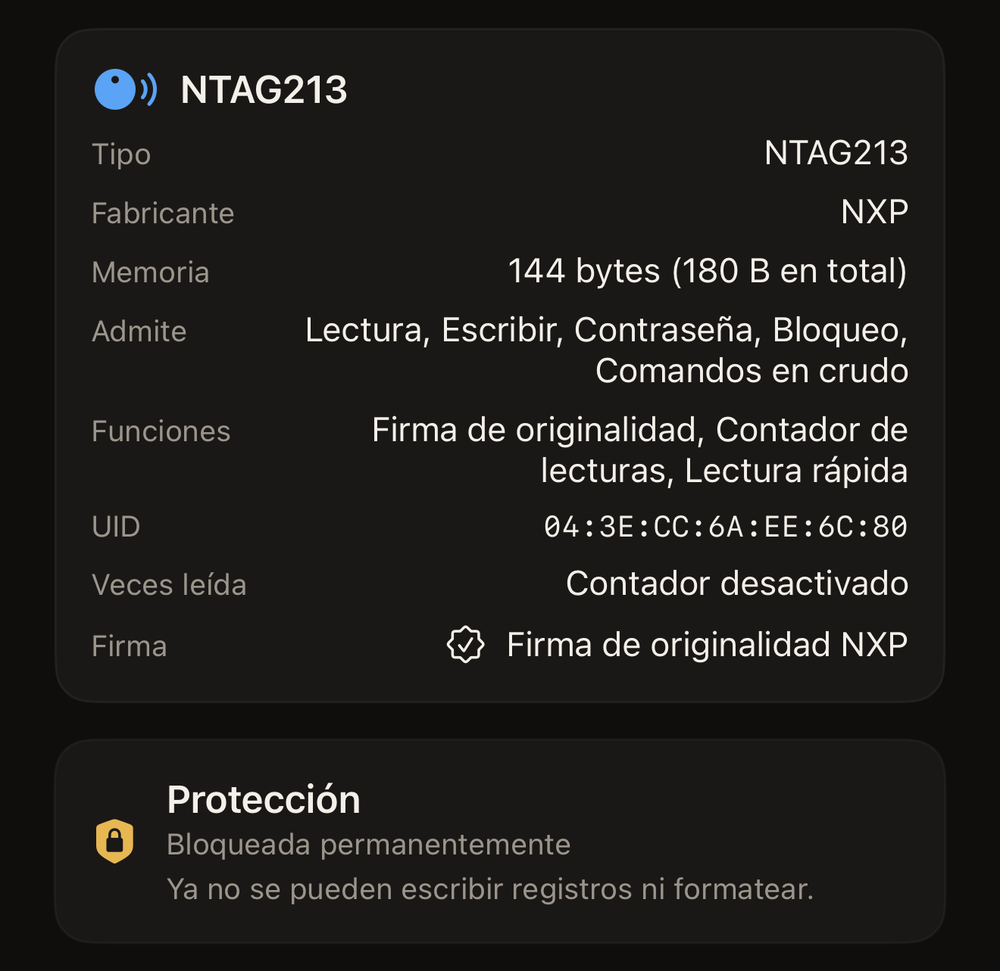

Hex NFC puede bloquear una etiqueta permanentemente desde el iPhone activando los
bits de bloqueo del propio chip. La etiqueta conserva los registros que contiene,
y ya nunca se podrán escribir en ella registros ni volver a formatearla. La
lectura no se ve afectada, así que cualquier teléfono puede seguir leyendo la
etiqueta.

Hay dos cosas que deciden si una etiqueta se puede bloquear, y un escaneo te
muestra las dos. En la pantalla **Etiqueta**, la tarjeta de la parte superior
lleva como título el nombre del chip. Tiene una fila **Admite**. «Bloqueo»
aparece en esa fila solo en los chips que esta app puede bloquear. Debajo, la
tarjeta **Protección** indica qué protege ahora la etiqueta. «Desactivada»
significa que no la protege nada, y el bloqueo puede seguir adelante. Un chip que
no usa contraseña no tiene tarjeta **Protección**, y no hay nada en él que pueda
impedir un bloqueo.

Un resumen que menciona una contraseña o una clave, como «Contraseña · solo
escritura», significa que la protección está activada. Una etiqueta en ese
estado no se bloquea. La forma en que la app lo indica depende del chip.

En un NTAG o un MIFARE Ultralight EV1, Hex NFC lo comprueba antes de escribir
nada. Responde «Esta etiqueta está protegida con contraseña, así que no se puede
bloquear permanentemente. Quita primero la contraseña y luego bloquéala.» En un
MIFARE Ultralight C o un ICODE SLIX2, la app inicia el bloqueo. En esos dos
chips, el resumen menciona una clave 3DES o una contraseña. La propia protección
de la etiqueta rechaza la primera escritura. Ese rechazo llega como «No se
bloqueó nada.» En ningún caso se graba nada, así que el acercamiento no le cuesta
nada a la etiqueta. Quita primero la contraseña o la clave: consulta
[Quitar la contraseña de una etiqueta](remove-password.md).

Lo que impide el bloqueo es que la protección esté activada, no la contraseña en
sí. Una contraseña guardada en una etiqueta que ya no protege nada aparece como
«Desactivada» en la tarjeta **Protección** tras un nuevo escaneo. Una etiqueta en
ese estado sí se puede bloquear.

:::warning[Una etiqueta bloqueada no se puede desbloquear]
Ninguna contraseña, ninguna otra app y ningún acercamiento posterior deshace un
bloqueo permanente. Bloquea una etiqueta solo cuando su contenido sea definitivo.
:::

## Bloquear una etiqueta permanentemente

::include[two-tap-confirmation]

:::::steps
::::step[Escanear la etiqueta que quieres bloquear]
En la pantalla de inicio de Hex NFC, toca **Escanear** y acerca la etiqueta a la
parte superior del iPhone. Se abre la pantalla **Etiqueta** con el contenido de
la etiqueta. Consulta [Escanear una etiqueta](scan-a-tag.md).
::::

::::step[Comprobar que la etiqueta se puede bloquear]
En la pantalla Etiqueta, busca «Bloqueo» en la fila **Admite** de la tarjeta de
información de la etiqueta, y comprueba que la tarjeta **Protección** indica
«Desactivada». Un chip que no usa contraseña no muestra la tarjeta
**Protección**, y eso también está bien.
::::

::::step[Abrir la pantalla Operaciones]
En la pantalla Etiqueta, toca el botón de menú de la parte superior derecha,
junto a **Escribir**, y luego toca **Operaciones…**.
::::

::::step[Elegir Bloqueo permanente]
Desplázate hasta **Acciones peligrosas** y toca **Bloqueo permanente**. La
pantalla que se abre explica lo que supone el bloqueo y que no se puede
deshacer. El recuadro aparece para todas las etiquetas, incluidos los chips que no
tienen bits de bloqueo. La app comprueba el chip en el primer acercamiento. En un
chip que no se puede bloquear, responde «Esta etiqueta no admite esa operación.»
después de ese acercamiento, antes de que escribas el UID. No se escribe nada.

:::figure[La pantalla **Bloqueo permanente** se abre con su advertencia, y no llega nada a la etiqueta hasta que tocas **Bloquear permanentemente esta etiqueta**.]

:::
::::

::::step[Hacer el primer acercamiento]
Lee la advertencia y toca **Bloquear permanentemente esta etiqueta**. La pantalla
indica «Paso 1 de 2. Mantén la etiqueta para identificarla.», así que acerca la
etiqueta a la parte superior del iPhone hasta que se cierre el panel de escaneo
de iOS.
::::

::::step[Escribir el UID de la etiqueta]
El UID de la etiqueta aparece junto a un campo vacío, bajo «Escribe el UID de
esta etiqueta para confirmar.» Se muestra en mayúsculas, sin dos puntos ni
espacios, y hay que escribirlo entero. Un UID que la tarjeta de información de la
etiqueta muestra como `04:BA:4A:92:1B:21:90` aparece aquí como `04BA4A921B2190`.
Sirven tanto las mayúsculas como las minúsculas, y se ignora un espacio antes o
después de lo que escribas. El botón sigue atenuado hasta que lo que escribes
coincide.

:::figure[Entre los dos acercamientos, el UID de la etiqueta aparece a la izquierda de un campo vacío, y **Bloquear permanentemente esta etiqueta** sigue atenuado hasta que lo escribes.]

:::
::::

::::step[Hacer el segundo acercamiento]
Vuelve a tocar **Bloquear permanentemente esta etiqueta** y acerca la etiqueta a
la parte superior del iPhone. Mientras espera, la pantalla indica «Paso 2 de 2.
Vuelve a acercar la misma etiqueta.», y muestra el resultado cuando apartas la
etiqueta.
::::
:::::

## Qué dice la app cuando el bloqueo se aplica

«Etiqueta bloqueada permanentemente.» es el resultado que buscas. Después de
activar los bits, la app ha pedido a la etiqueta que acepte una escritura más,
la etiqueta la ha rechazado, y ese rechazo es la prueba.

«Bloqueo escrito.» significa que los bits se han escrito pero este acercamiento no
ha podido comprobarlo. Algunos chips solo aplican sus bits de bloqueo la próxima
vez que la etiqueta se activa. La app añade «En este chip los bits de bloqueo solo surten efecto en el siguiente acercamiento, así que no se puede comprobar en esta sesión. Vuelve a escanear la etiqueta para confirmar que ahora rechaza la escritura.» Escanea la etiqueta una vez más y consulta el resultado en la tarjeta
**Protección**.

En la pantalla **Etiqueta**, **Protección** indica «Bloqueada permanentemente» en
una etiqueta que la app ha releído como bloqueada. Debajo aparece «Ya no se
pueden escribir registros ni formatear.» Hasta ese escaneo de confirmación,
indica en su lugar «Bloqueo escrito · vuelve a escanear para confirmarlo».
**Escribir** no está disponible en una etiqueta que se ha releído como bloqueada.

:::figure[Tras un escaneo de confirmación, la tarjeta **Protección** indica «Bloqueada permanentemente», con «Ya no se pueden escribir registros ni formatear.» debajo.]

:::

Una contraseña guardada en la etiqueta se mantiene tras el bloqueo, y en ese caso
la tarjeta indica «Bloqueada permanentemente · la contraseña sigue activa». La
línea de debajo indica si esa contraseña todavía se puede quitar. Qué chips se
pueden bloquear se explica en
[Etiquetas compatibles con Hex NFC](tags-that-work.md).

## Si el bloqueo no ha terminado

Un bloqueo se hace por etapas. Si la operación se detiene a medias, la app indica
el estado en que queda la etiqueta en lugar de llamarlo fallo.

- «No se bloqueó nada.» El chip ha rechazado todas las etapas y lo ha comunicado.
  No se ha grabado nada y la etiqueta está exactamente como estaba, así que repetir la
  operación no le cuesta nada. Vuelve a escanear la etiqueta y comprueba las dos
  cosas que necesita un bloqueo. La tarjeta **Protección** indica «Desactivada»,
  o un chip que no usa contraseña no muestra ninguna tarjeta **Protección**.
  «Bloqueo» aparece en la fila **Admite** de la tarjeta de información de la
  etiqueta. En un MIFARE Ultralight C o un ICODE SLIX2, este mensaje es la señal
  de que hay protección. Quita la clave o la contraseña y vuelve a hacer el
  bloqueo.
- «Esta etiqueta ahora está bloqueada en parte, y eso no se puede deshacer. Parte
  de su memoria es de solo lectura para siempre; el resto se rechazó y sigue
  siendo escribible.» Parte del chip ya está gastada. Repetir la operación no
  completa el resto. De vuelta en la pantalla Etiqueta, la tarjeta **Protección**
  indica «Bloqueada en parte · parte de esta etiqueta es de solo lectura para
  siempre». Si la etiqueta todavía tiene una contraseña, indica en su lugar
  «Bloqueada en parte · la contraseña sigue activa». En un NTAG21x o un MIFARE
  Ultralight, un nuevo escaneo vuelve a decir lo mismo, porque la app relee esos
  bytes de bloqueo. En un ICODE SLIX2 no relee los bloqueos de cada bloque al
  escanear, así que un nuevo escaneo no dice nada del bloqueo parcial. En ese
  chip, el resultado al final de la operación es la única constancia que tendrás.
- «La etiqueta dejó de responder durante un bloqueo que no se puede deshacer, así
  que esta app no puede decir si alguna parte de su memoria es ahora de solo
  lectura. Trata esta etiqueta como una que puede estar bloqueada.» La etiqueta
  se ha apartado en plena escritura. Vuelve a escanearla y consulta la tarjeta
  **Protección** antes de usarla para nada.
- «Parte de esta etiqueta es ahora de solo lectura para siempre, y eso no se
  puede deshacer. La etiqueta dejó de responder antes de poder confirmar el
  resto, así que el resto también puede estar bloqueado.» Una etapa está
  confirmada. La otra se desconoce. Vuelve a escanear la etiqueta y trátala como
  bloqueada.

## Ver también

- [Protección de etiquetas](tag-protection.md)
- [Borrar o formatear una etiqueta](erase-or-format.md)
- [Si no se puede escanear o escribir una etiqueta](troubleshooting.md)
