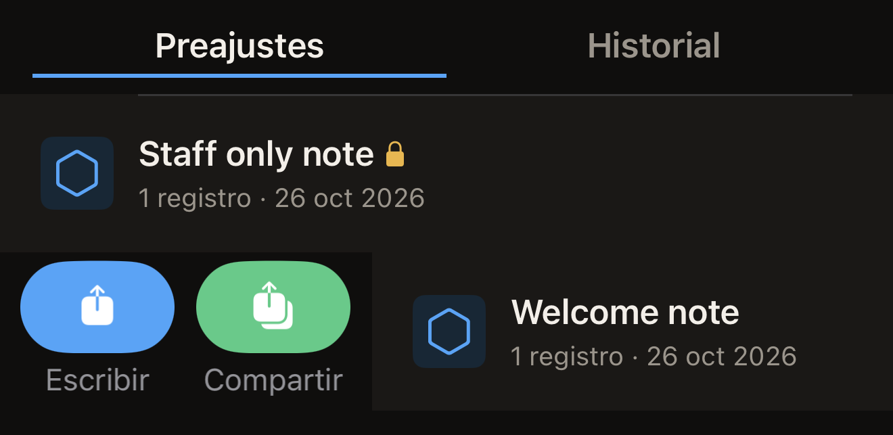
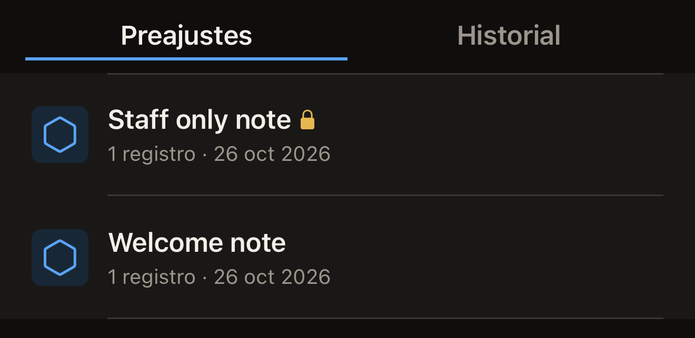

Un preajuste es un conjunto de registros con nombre que se guarda en el
iPhone. Guarda uno a partir de la etiqueta que estás editando y después escribe
esos mismos registros en todas las etiquetas que quieras sin tener que crearlos
de nuevo.

Antes de empezar, pon un conjunto de registros en la pantalla Etiqueta para que
haya algo que guardar. En la pantalla de inicio de Hex NFC, toca **Escanear** y
acerca la etiqueta que quieras copiar. Para empezar sin ninguna etiqueta
delante, toca **Crear**. Cualquiera de las dos opciones abre la pantalla
Etiqueta. Consulta [Escanear una etiqueta](scan-a-tag.md) y
[Editar los registros de una etiqueta](edit-records.md).

## Guardar los registros que estás editando

::::steps
:::step[Abrir el panel de guardado]
En la pantalla Etiqueta, toca el botón de menú de la parte superior derecha y
luego toca **Guardar como preajuste…**. Esa opción del menú aparece atenuada
hasta que la etiqueta tiene al menos un registro o un ajuste de protección.
:::

:::step[Poner nombre al preajuste]
En **Nombre**, introduce un nombre que puedas reconocer más adelante, como el
lugar al que van las etiquetas. **Guardar** sigue atenuado hasta que se rellena
el nombre.
:::

:::step[Añadir una nota]
Opcional: en **Notas**, escribe para qué sirve el preajuste. El campo admite
hasta cuatro líneas.
:::

:::step[Elegir un icono]
En **Icono**, toca uno de los tres segmentos, que aparecen nombrados con
palabras en lugar de dibujados como formas: **Marco exterior**,
**Triángulo arriba** o **Triángulo abajo**. El que toques define el distintivo
hexagonal que se muestra junto al preajuste en la **Biblioteca**.
:::

:::step[Comprobar lo que contendrá el preajuste]
**Registros** cuenta los registros que se guardarán. Si el preajuste lleva
protección y nada más, en su lugar aparece «Sin registros. Este preajuste solo
aplica protección.»

Si la lista contiene un registro **Ubicación** sin coordenadas ni URL del mapa,
**Registros** también muestra «Un registro de ubicación no tiene coordenadas ni
URL del mapa, así que este preajuste nunca podría escribirse en una etiqueta.
Complétalo o elimínalo en la pantalla Etiqueta y luego guarda.» Mientras
aparezca ese mensaje, **Guardar** sigue atenuado. Toca **Cancelar**, completa
el registro o elimínalo y vuelve a abrir el panel de guardado. Consulta
[Tipos de registro](record-types.md).
:::

:::step[Guardar el preajuste]
Toca **Guardar**. El panel se cierra y el preajuste aparece al principio de la
pestaña **Preajustes** de la **Biblioteca**.
:::
::::

Un preajuste solo lleva protección si configuras una contraseña o una clave en
la etiqueta antes de guardarlo. Eso se hace en la pantalla Etiqueta, que
muestra **Protección** en las etiquetas que se pueden proteger. Toca
**Protección** y activa **Proteger esta etiqueta con contraseña**. Introduce el
secreto en el campo que muestra el panel, como **Contraseña (4 bytes)**, y toca
**Listo**. Consulta
[Proteger una etiqueta con contraseña](protect-a-tag.md).

Hecho esto, el panel de guardado añade una sección **Protección** que indica lo
que contiene el preajuste, como «Protección con contraseña (solo escritura)».
El secreto no se guarda dentro del propio preajuste. La app lo indica en esa
misma sección: «El secreto se guarda solo en este dispositivo (Llavero). Nunca
se sincroniza ni viaja en una exportación.» Un preajuste solo activa la
protección de una etiqueta mientras ese secreto esté en este iPhone. Uno que
hayas guardado sin introducir ningún secreto no activa nada.

Si el iPhone no permite guardar, aparece una línea roja al final del
formulario. Dice «No se pudo guardar:» seguido del motivo que ha dado el
iPhone. El panel sigue abierto y tus registros siguen en la pantalla Etiqueta,
así que no pierdes nada de lo que has introducido. Vuelve a tocar **Guardar**.
Si vuelve a aparecer el mismo motivo, toca **Cancelar**. Los registros siguen
en la pantalla Etiqueta. Puedes escribirlos directamente en una etiqueta en
lugar de conservarlos como preajuste.

## Escribir un preajuste en una etiqueta {#write-a-preset-to-a-tag}

Un candado junto al nombre de un preajuste indica que lleva ajustes de
protección. La fila no dice nada más. No te indica si la escritura activará la
protección de la etiqueta, porque eso depende del secreto que se guarda junto
al preajuste. El secreto no se muestra. Un preajuste que has guardado en este
iPhone después de introducir una contraseña o una clave propia contiene ese
secreto y activa la protección de la etiqueta. Un preajuste guardado a partir
de una etiqueta que ya estaba protegida, cuya contraseña nunca has introducido,
no contiene ninguno. Escribe sus registros y no protege nada. Si no sabes cuál de
los dos tienes delante, trátalo como uno de los que activan la protección.

:::::steps
::::step[Abrir la Biblioteca]
En la pantalla de inicio de Hex NFC, toca **Biblioteca**. La pantalla
Biblioteca se abre en **Preajustes**, con el preajuste que has modificado más
recientemente al principio.
::::

::::step[Iniciar la escritura]
Desliza el preajuste un poco desde su borde izquierdo y toca **Escribir**. La
**Biblioteca** se cierra y se abre la pantalla de escritura.

:::figure[Al deslizar un poco un preajuste desde su borde izquierdo aparecen **Escribir** y **Compartir**.]

:::
::::

::::step[Acercar la etiqueta al iPhone]
Acerca la etiqueta a la parte superior del iPhone mientras la pantalla muestra
«Acerca la etiqueta a la parte superior del iPhone». Cuando los registros ya
están en la etiqueta, muestra «Escritura completada».
::::
:::::

:::warning[Un preajuste que aplica protección no te pide que confirmes la etiqueta]
Un preajuste que lleva ajustes de protección y cuyo secreto sigue en este
iPhone configura ese secreto en cualquier etiqueta que acerques. Es el único
lugar de la app en el que la protección se activa sin un primer acercamiento
para leer la etiqueta. No hay que escribir ningún UID para confirmar. Acerca
solo la etiqueta que querías proteger. Conserva el preajuste mientras esas
etiquetas sigan en uso. Volver a escribirlo es la forma de recuperar el acceso
a una etiqueta que ha protegido. Si lo eliminas, eliminas esa copia del secreto.
:::

## Gestionar tus preajustes

Hasta que guardes uno, la pestaña **Preajustes** muestra «No hay preajustes
guardados». A partir de entonces, cada fila lleva el nombre y el icono del
preajuste. Debajo, una línea indica el número de registros y la fecha del
último cambio del preajuste.

Un candado junto al nombre señala un preajuste que lleva ajustes de protección,
y VoiceOver lo lee como «Aplica protección». Lo que ese candado garantiza y lo
que no se explica más arriba, en
[Escribir un preajuste en una etiqueta](#write-a-preset-to-a-tag).

:::figure[Un candado tras el nombre de un preajuste señala que lleva ajustes de protección.]

:::

Al deslizar un preajuste desde su borde izquierdo aparecen **Escribir** y
**Compartir**. Al deslizarlo desde su borde derecho aparecen **Eliminar** y
**Duplicar**. Desliza un poco y toca el botón que quieras. Si deslizas desde el
borde derecho hasta el otro extremo, el preajuste se elimina sin más.

Un preajuste guardado no se puede modificar. Para cambiar lo que contiene un
preajuste sin candado, vuelve a crear los registros en la pantalla Etiqueta.
Guárdalos como un preajuste nuevo y luego elimina el antiguo.

Deja como está un preajuste con candado. Si lo vuelves a crear desde la pantalla
Etiqueta, obtienes los registros sin el secreto, salvo que antes vuelvas a
configurar la contraseña o la clave. Al eliminar el preajuste antiguo
desaparece la única copia del secreto que abre las etiquetas que ha protegido. Para
tener una segunda copia de un preajuste así, usa **Duplicar**, que copia
también el secreto guardado.

Desde la pestaña **Preajustes**, puedes hacer lo siguiente:

- Para conservar una copia de un preajuste fuera de la app, deslízalo desde su
  borde izquierdo y toca **Compartir**. La app crea un archivo `.hexnfc` con el
  nombre del preajuste y lo pasa al menú Compartir. Los registros y los ajustes
  de protección viajan en ese archivo; la contraseña o la clave, nunca. Hex NFC
  no puede abrir un archivo `.hexnfc`. Lo que envías a alguien es una copia de
  los registros para conservarla, no un preajuste que pueda añadir a su propia
  app.
- Para hacer una segunda copia de un preajuste, deslízalo desde su borde
  derecho y toca **Duplicar**. La copia contiene los mismos registros, los
  mismos ajustes de protección y el mismo secreto guardado.
- Para quitar un preajuste, deslízalo desde su borde derecho y toca
  **Eliminar**. No se pide confirmación, y el secreto guardado del preajuste
  desaparece con él.

## Ver también

- [Editar los registros de una etiqueta](edit-records.md)
- [Escribir un enlace en una etiqueta](write-a-link.md)
- [Protección de etiquetas](tag-protection.md)
- [Buscar una etiqueta que has escaneado antes](scan-history.md)
