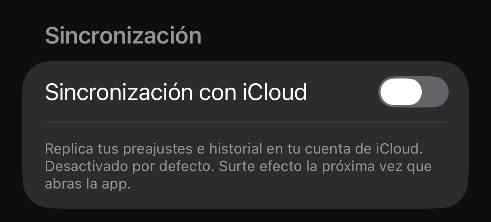

Acercas una etiqueta al iPhone y lo que contiene aparece en la pantalla. Esa
lectura se hace en el iPhone, y el resultado se queda ahí. Hex NFC no tiene
cuentas ni analíticas. Hace cuatro tipos de solicitud a los servidores de Hex
Pro. Tres no llevan ningún dato sobre ti, y el cuarto, un mensaje de
comentarios, lleva solo lo que decides enviar. El texto completo de la política
está en la app. En la pantalla de inicio de Hex NFC, toca el botón del
engranaje de la esquina superior derecha. Después, en **Aviso legal**, toca
**Política de privacidad**.

## Lo que se queda en el iPhone

Tu historial de escaneos y tus preajustes guardados están en una base de datos
local de este iPhone, y tus ajustes también se guardan localmente. Lo mismo
pasa con todo lo que hay detrás de la tarjeta que de vez en cuando pregunta
**¿Te encanta Hex NFC?**: si ya ha preguntado, cómo has respondido y el
recuento de escrituras y lecturas recientes que decide cuándo puede volver a
preguntar. [Ajustes](settings.md#feedback-and-ratings) describe esa tarjeta. Al
eliminar un elemento, desaparece de esa base de datos. Al eliminar la app, se eliminan
con ella sus datos locales.

Las contraseñas de las etiquetas se guardan aparte de todo eso, en el Llavero
de iOS del único iPhone que las configuró. Una contraseña nunca se sincroniza,
nunca se escribe en un archivo que exportes y nunca se envía a ningún sitio. La
app guarda dos tipos de elemento. Uno es para una etiqueta a la que una
escritura ha aplicado protección, y se guarda asociado al UID de esa etiqueta. Esa
escritura se hace desde la tarjeta **Protección** de la pantalla Etiqueta o
desde un preajuste que aplica protección. El otro elemento es para un preajuste
que aplica protección, y se guarda asociado al preajuste. Ninguno de los dos
contiene nada sobre ti. Una contraseña que escribas en **Operaciones…** >
**Proteger con contraseña** no se guarda en ninguno de los dos, así que
conserva tu propia copia. Eliminar la app no elimina las contraseñas guardadas,
porque iOS conserva los elementos del Llavero después de que se elimine una
app. La lectura de un pasaporte no se guarda en ningún sitio. Lo que devuelve
el chip aparece en la pantalla durante esa sesión y desaparece cuando la sesión
termina. [Leer un pasaporte](passports.md) lo explica en detalle.

Hay dos cosas que eliminan una contraseña guardada. Al eliminar un preajuste,
se descarta la contraseña guardada con él. Eso ocurre tanto si la etiqueta en
la que se escribió sigue protegida como si no. Una etiqueta puede quedar así
protegida con una contraseña que la app ya no guarda. La otra es desactivar la
protección en la tarjeta **Protección** de la etiqueta y después escribir en la
etiqueta, como explica
[Quitar la contraseña de una etiqueta](remove-password.md). Incluso en ese
caso, la app solo descarta la contraseña después de releer la etiqueta. Esa
relectura tiene que comprobar estas dos cosas:

- La protección ha desaparecido.
- La contraseña de la etiqueta vuelve a ser la contraseña predeterminada de
  fábrica del chip.

Si al quitar la contraseña se demuestra lo primero pero no lo segundo, la
contraseña guardada se conserva. Una etiqueta sin protección que sigue teniendo
tu contraseña no se puede volver a proteger sin ella. Si quitas la contraseña
desde **Operaciones**, no se quita nada del Llavero. Cualquier elemento ya
guardado para esa etiqueta se queda donde está.

Hex NFC no tiene ninguna lista de las etiquetas cuya contraseña guarda. Si no
puedes volver a acercar una etiqueta, no puedes eliminar su contraseña guardada
desde la app. Ese elemento del Llavero se queda en este iPhone salvo que una
eliminación posterior lo quite o que borres el iPhone.

**Sincronización con iCloud** empieza desactivada, y el interruptor surte
efecto la próxima vez que abras la app. Si está activada, tus preajustes y tu
historial de escaneos se replican en tu base de datos privada de iCloud, que
gestiona Apple y protege tu Apple ID. Hex Pro no puede leerla. Las contraseñas
de las etiquetas quedan fuera en cualquier caso. El interruptor está en
[Ajustes](settings.md).

:::figure[**Sincronización con iCloud** sigue desactivada hasta que la activas, y la línea de debajo indica que el cambio espera a la próxima vez que abras la app.]

:::

Al desactivar la sincronización, la replicación solo se detiene cuando cierras
Hex NFC y la vuelves a abrir, como explica
[Cerrar y volver a abrir la app](settings.md#close-and-reopen-the-app). Si
vuelves a la pantalla de inicio del iPhone, la app sigue en marcha, y la
replicación también.

Detener la replicación no es lo mismo que eliminar lo que ya está en iCloud, y
eliminar la app tampoco lo elimina. Para quitar esa copia, abre la app Ajustes
del iPhone. Toca tu nombre en la parte superior y luego toca la fila iCloud.
Revisa el almacenamiento que muestra, donde se pueden eliminar los datos que
guarda cada app.

:::note[Una etiqueta no es un almacenamiento privado]
Todo lo que escribes en una etiqueta queda en un hardware ajeno al iPhone, y
cualquiera con un lector puede leer una etiqueta sin protección. Considera
público lo que contiene una etiqueta salvo que la protejas, como explica
[Protección de etiquetas](tag-protection.md).
:::

## Las cuatro ocasiones en que la app se conecta con Hex Pro {#when-the-app-reaches-hex-pro}

Ninguna de ellas se ejecuta en segundo plano. Las tres primeras no llevan nada
que te identifique.

- La pantalla de inicio de Hex NFC descarga de api.apps.hex.pro una cifra
  pública sobre los costes de desarrollo del proyecto. La solicitud no contiene
  datos personales.
- Cuando tocas **Enviar** en una parada desconocida de una tarjeta de
  transporte, se envía una sugerencia de nombre de estación. También se envía
  si tocas la tecla de envío del teclado mientras el campo del nombre está
  abierto. Lleva los códigos de línea, estación y zona, el código de sistema de
  la tarjeta y el nombre que has escrito. El número de serie de la tarjeta, el
  saldo y el historial de viajes no forman parte de ella, así que no pongas
  datos personales en el campo del nombre.
- La tarjeta **Más apps de Hex Pro** descarga de api.p.hex.pro un banner de
  otra app de Hex Pro. La solicitud envía el identificador de paquete de esta
  app, la plataforma y un nombre de espacio. La respuesta indica una imagen o
  un vídeo, que la app descarga de una segunda dirección y guarda en el iPhone.
  Todo el mundo ve el mismo banner. Detrás no hay ninguna red publicitaria,
  ningún identificador de seguimiento ni ninguna personalización.
- Un mensaje de comentarios se envía cuando tocas **Enviar** en el formulario
  **Enviar comentarios**. Lleva tu mensaje, la dirección de correo que hayas
  escrito si has dado una y los cuatro datos que el formulario muestra en
  **Se envía con tu mensaje**: la versión de la app, la versión de iOS, el
  modelo de dispositivo y el idioma. Va a api.hex.pro y de ahí al buzón de
  comentarios de Hex Pro, se guarda durante 24 meses como máximo y nunca se usa
  con fines de marketing. No incluye nada de tus etiquetas, tus escaneos ni tu
  historial de escaneos.

La sincronización con iCloud es lo otro que usa la red, y la excepción al
párrafo anterior. Si está activada, tus preajustes y tu historial de escaneos
viajan en segundo plano entre el iPhone y Apple. Nada de eso llega a Hex Pro.

Toda solicitud por internet muestra tu dirección IP al servidor que la
responde. Hex Pro guarda registros de funcionamiento de corta duración y no usa
ninguna dirección IP para identificar a nadie ni para elaborar perfiles. Un
mensaje de comentarios se guarda con una versión codificada de tu dirección IP,
que solo sirve para impedir que una misma conexión envíe demasiados mensajes y
que se borra en un plazo de siete días.

## Para qué sirve cada permiso

Hex NFC te pide dos permisos. El NFC es el permiso sin el que no puede
funcionar, e iOS no ofrece ningún interruptor para él. La cámara es opcional, e
iOS pide acceso a ella la primera vez que escaneas un código QR o la página de
la fotografía de un pasaporte. Lo que capta
cualquiera de los dos se queda en el iPhone.

La Política de privacidad de la app describe tres más: contactos, ubicación y
Bluetooth. Nada en la app los solicita, así que iOS nunca te pregunta por
ellos.

:::table[Los permisos que pide Hex NFC]
| Permiso | Para qué se usa |
| :--- | :--- |
| NFC | Leer y escribir en etiquetas, solo mientras está abierta una pantalla de escaneo o de escritura. |
| Cámara | Escanear un código QR que decidas convertir en un registro y leer la página de la fotografía de un pasaporte cuando decidas escanearla. Los fotogramas nunca se guardan ni se suben. |
:::

## Lo que Hex Pro nunca hace

Hex NFC no incluye SDK de analíticas ni de telemetría ni publicidad de
terceros, y nada en ella toma la huella digital del iPhone. Hex Pro no vende,
alquila ni comparte información personal. No hay cuentas, así que ningún
servidor de Hex Pro tiene un perfil tuyo. Un archivo que exportes contiene los
registros y preajustes que has elegido, y nunca una contraseña de etiqueta.

## Ver también

- [Ajustes](settings.md)
- [Leer una tarjeta de transporte](transit-cards.md)
- [Leer un pasaporte](passports.md)
- [Protección de etiquetas](tag-protection.md)
