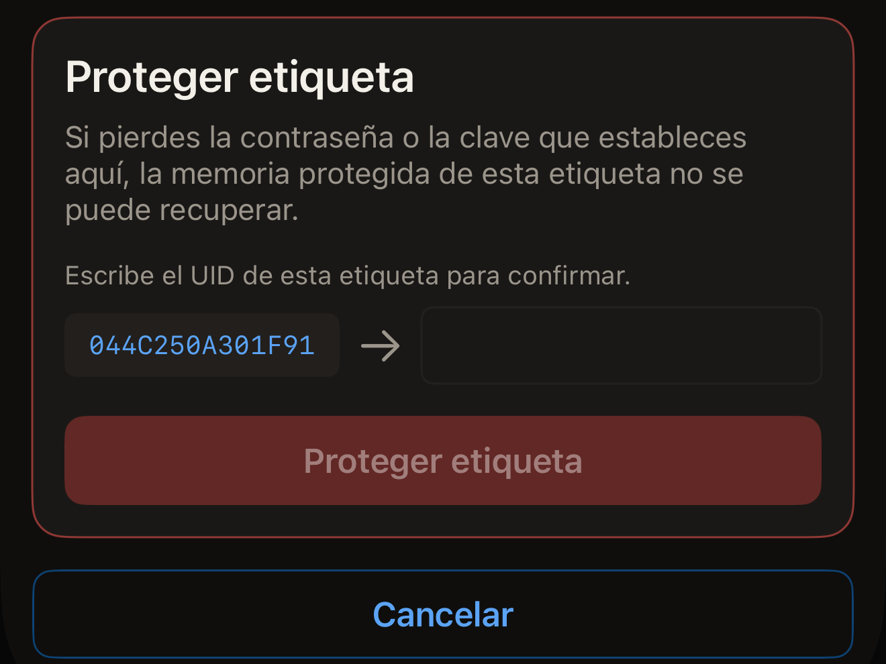
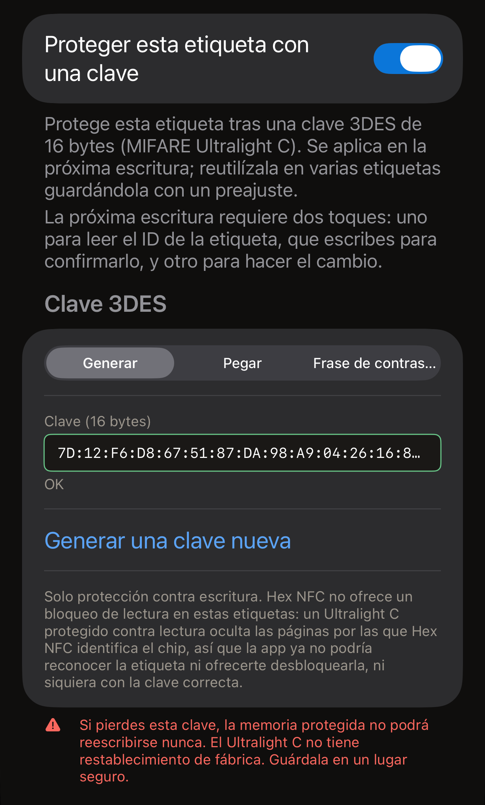
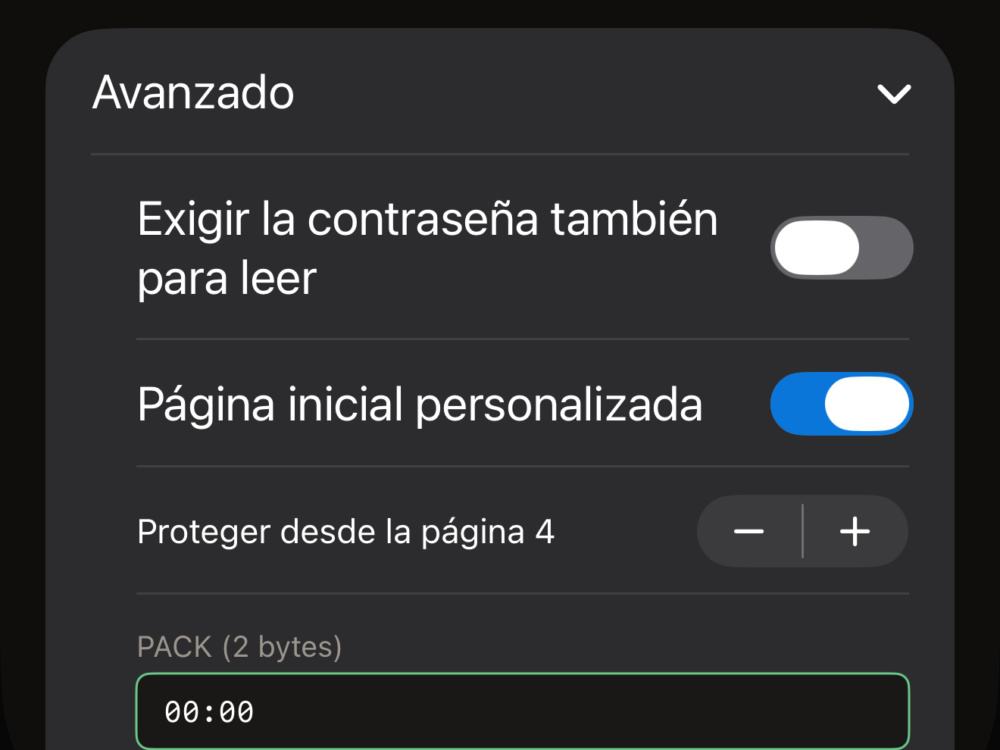

Una contraseña en una etiqueta protege la escritura. Cualquiera puede seguir
leyendo los registros, a menos que protejas también la lectura. Toda escritura se
rechaza hasta que se presenta la contraseña. Hex NFC la establece desde el iPhone
de dos formas, y las dos sirven para los mismos chips.
**Proteger con contraseña**, en **Operaciones…**, protege una etiqueta como
operación independiente. La tarjeta **Protección** de la pantalla Etiqueta pone
el secreto en la etiqueta como parte de la siguiente escritura. Usa la vía de
Operaciones para proteger una etiqueta sin cambiar nada más, y la tarjeta
Protección cuando ibas a escribir en la etiqueta de todos modos.

Antes de empezar, escanea la etiqueta que quieres proteger para que quede abierta
en la pantalla Etiqueta. Consulta [Escanear una etiqueta](scan-a-tag.md). La
tarjeta de la parte superior de esa pantalla indica el chip en su primera línea.
Ese nombre indica qué tipo de secreto admite la etiqueta.

La app puede proteger siete chips: NTAG213, NTAG215, NTAG216, MIFARE Ultralight
EV1, MIFARE Ultralight C, NTAG424 DNA y ICODE SLIX2. Para saber si la etiqueta
que tienes en la mano se puede proteger, consulta la
[matriz de compatibilidad de chips](../developer/chip-support-matrix.md). En
cualquier otro chip, **Proteger con contraseña** termina con «Esta etiqueta no
admite esa operación.» Tampoco aparece la tarjeta **Protección** en la pantalla
Etiqueta para esos chips, salvo que la etiqueta indique un bloqueo.

::include[two-tap-confirmation]

## Proteger una etiqueta desde Operaciones

Esta vía no pide nada antes del primer acercamiento. Ese acercamiento lee qué
chip es la etiqueta, y después la pantalla pide el tipo de secreto que admite ese
chip: una contraseña de 4 bytes en un NTAG213, NTAG215, NTAG216, MIFARE
Ultralight EV1 o ICODE SLIX2, y una clave de 16 bytes en un NTAG424 DNA o un
MIFARE Ultralight C. Para saber qué lleva cada chip, consulta la
[matriz de compatibilidad de chips](../developer/chip-support-matrix.md).

:::::steps
::::step[Abrir Proteger con contraseña]
En la pantalla Etiqueta, toca el botón de menú de la parte superior derecha,
junto a **Escribir**, y ve a **Operaciones…** > **Proteger con contraseña**.
::::

::::step[Acercar la etiqueta para que la app la identifique]
Toca **Proteger etiqueta**. Se abre el panel de escaneo de iOS y la pantalla indica
«Paso 1 de 2. Mantén la etiqueta para identificarla.» Acerca la etiqueta a la
parte superior del iPhone hasta que se cierre el panel.
::::

::::step[Introducir la nueva contraseña o clave]
La pantalla indica el chip que ha leído, después de «Etiqueta identificada:», y
muestra los campos que admite ese chip. Introduce el secreto en hexadecimal, con
o sin dos puntos entre los bytes.

- En un NTAG213, un NTAG215, un NTAG216 o un MIFARE Ultralight EV1, introduce la
  contraseña en **Contraseña (4 bytes)**. Si la etiqueta aparece sin protección,
  el campo se abre con el valor de fábrica, `FF FF FF FF`. Sustitúyelo por tu
  propia contraseña. El PACK son los 2 bytes que devuelve la etiqueta cuando
  acepta la contraseña. Un lector lo comprueba para confirmar que se está
  comunicando con la etiqueta que espera. **PACK (2 bytes)** se abre con dos
  bytes a cero, y dejarlo así es lo correcto salvo que algún sistema que uses
  pida un valor concreto.
- En un NTAG424 DNA, introduce la clave en **Clave (16 bytes)**.
- En un ICODE SLIX2, introduce la contraseña de escritura en
  **Contraseña (4 bytes)**. La lectura sigue abierta.
- En un MIFARE Ultralight C, la clave va en **Clave (16 bytes)**. Si la etiqueta
  aparece sin protección, el campo se abre con una clave generada al azar. Este
  chip solo admite protección contra escritura.

En un NTAG21x, un MIFARE Ultralight EV1 o un NTAG424 DNA, un interruptor debajo
del campo protege también la lectura. Se llama
**Exigir la contraseña también para leer**, o
**Exigir la clave también para leer** en un NTAG424 DNA. Si lo dejas
desactivado, cualquier lector puede seguir leyendo la etiqueta. Si lo activas, no
se puede leer nada de la etiqueta sin el secreto, así que un escaneo posterior en
Hex NFC te lo pide primero. Aun así, la operación termina con «Contraseña
establecida.», porque la app presenta el secreto que acaba de escribir para hacer
su propia relectura.
::::

::::step[Escribir el UID de la etiqueta]
Debajo de los campos, la tarjeta con el título **Proteger etiqueta** te pide:
«Escribe el UID de esta etiqueta para confirmar.» Junto a un campo vacío muestra
el UID que la app ha leído en ese acercamiento. Si la etiqueta ya tiene una
contraseña o una clave, encima aparece una tarjeta con el título «La etiqueta
está protegida» que pide el secreto que tiene ahora la etiqueta. Escribe ese UID
en el campo, carácter por carácter, y toca **Proteger etiqueta**.

:::figure[El UID que hay que copiar está a la izquierda en la tarjeta **Proteger etiqueta**, y el campo donde lo escribes, a la derecha.]

:::
::::

::::step[Volver a acercar la misma etiqueta]
La pantalla indica «Paso 2 de 2. Vuelve a acercar la misma etiqueta.» Acerca la
etiqueta al iPhone una vez más. «Contraseña establecida.» aparece cuando la app
ha releído la configuración de la etiqueta y ha comprobado que la protección está
activada.
::::
:::::

:::warning[Conserva la contraseña]
La app no tiene ninguna forma de leer la contraseña que hay en una etiqueta, así
que la copia que guardes es la única. La advertencia de la pantalla explica por qué: «Si pierdes
la contraseña o la clave que estableces aquí, la memoria protegida de esta
etiqueta no se puede recuperar.»
:::

Si una operación falla, la pantalla ofrece **Reintentar**, que la devuelve a su
estado inicial para que puedas repetirla desde el primer acercamiento. Mientras
está a la vista la tarjeta del UID, **Cancelar** devuelve la pantalla a su estado
inicial. La etiqueta se queda como estaba, y si el panel de escaneo de iOS
sigue abierto, se cierra con «Cancelado.»

En una etiqueta que ya está protegida, esta vía pide dos secretos: el nuevo, en
los campos, y el que tiene ahora la etiqueta, en la tarjeta «La etiqueta está
protegida». El que tiene la etiqueta la abre, y el nuevo lo sustituye.

## Establecer una clave desde la tarjeta Protección {#protection-card}

Un NTAG424 DNA y un MIFARE Ultralight C usan una clave de 16 bytes en lugar de
una contraseña. Un ICODE SLIX2 usa su propia contraseña de escritura. Las tres se
pueden establecer desde la tarjeta **Protección** de la pantalla Etiqueta, y el
secreto se aplica como parte de la siguiente escritura. La contraseña de Type 2
también está en esa tarjeta.

:::::steps
::::step[Abrir la tarjeta Protección]
En la pantalla Etiqueta, toca la tarjeta **Protección**, debajo de la tarjeta que
indica el chip.
::::

::::step[Activar la protección]
Activa el interruptor de la parte superior de la tarjeta. Se llama
**Proteger esta etiqueta con una clave** en un NTAG424 DNA o un MIFARE
Ultralight C, y **Proteger esta etiqueta con contraseña** en los chips que usan
contraseña.
::::

::::step[Introducir la clave o la contraseña]
Rellena el campo que muestra la tarjeta para ese chip.

- En un NTAG424 DNA, introduce 16 bytes en **Clave (16 bytes)** o toca
  **Generar una clave aleatoria**. Para proteger también la lectura, activa
  **Exigir la clave también para leer**.
- En un MIFARE Ultralight C, elige cómo se crea la clave en el selector que hay
  bajo **Clave 3DES**. En una etiqueta que aún no tiene clave, la tarjeta se abre
  en **Generar** con 16 bytes aleatorios ya en **Clave (16 bytes)**, y
  **Generar una clave nueva** los sustituye. Con **Pegar** introduces 16 bytes
  propios en **Clave (16 bytes)**. Una **Frase clave** genera la misma clave
  cada vez que la usas.
- En un ICODE SLIX2, un NTAG213, un NTAG215, un NTAG216 o un MIFARE
  Ultralight EV1, introduce 4 bytes en **Contraseña (4 bytes)**.

En un NTAG213, un NTAG215, un NTAG216 o un MIFARE Ultralight EV1,
**Avanzado**, debajo del campo, contiene la protección contra lectura, el rango
de páginas y el PACK. Ábrelo antes del siguiente paso si quieres usar alguno de
ellos. Consulta
[Elegir qué páginas cubre una contraseña de Type 2](#pages-a-type-2-password-covers).

Cuando el campo contiene una clave o una contraseña completa, la nota que hay bajo
el interruptor de la parte superior indica qué requerirá la siguiente escritura.
Dice: «La próxima escritura requiere dos acercamientos: uno para leer el ID de la etiqueta, que escribes para confirmarlo, y otro para hacer el cambio.»

:::figure[En un MIFARE Ultralight C sin protección, el selector de **Clave 3DES** empieza en **Generar**, así que **Clave (16 bytes)** ya contiene una clave aleatoria.]

:::
::::

::::step[Guardar los ajustes]
Toca **Listo** arriba a la derecha. Todavía no ha llegado nada a la etiqueta.
::::

::::step[Iniciar la escritura]
Toca **Escribir** en la parte superior derecha de la pantalla Etiqueta. Acerca la
etiqueta a la parte superior del iPhone para el acercamiento que lee su UID.
::::

::::step[Confirmar la etiqueta y volver a acercarla]
La tarjeta con el título **Proteger etiqueta** muestra, junto a un campo vacío,
el UID que la app ha leído en ese acercamiento. Escribe ese UID en el campo, toca
**Proteger etiqueta** y vuelve a acercar la misma etiqueta. Después, la tarjeta
**Protección** resume la protección que tiene la etiqueta.
::::
:::::

La advertencia de esa tarjeta depende del chip. Con una clave de NTAG424 DNA
aparece «Si pierdes esta clave, no podrás volver a escribir esta etiqueta nunca.
No hay restablecimiento de fábrica para un NTAG424. Guárdala en un lugar
seguro.» Con una clave de MIFARE Ultralight C aparece «Si pierdes esta clave, la
memoria protegida no podrá reescribirse nunca. El Ultralight C no tiene
restablecimiento de fábrica. Guárdala en un lugar seguro.» Con una contraseña
aparece «Si pierdes esta contraseña, la memoria protegida de esta etiqueta es
irrecuperable.»

Una etiqueta que ya tiene una contraseña se abre con la contraseña que contiene
la tarjeta. Escribe en la tarjeta la contraseña actual de la etiqueta y el primer
acercamiento la desbloquea sin que tengas que responder nada más.

Si la tarjeta no contiene ninguna contraseña que abra la etiqueta, el primer
acercamiento se encuentra con la protección. La escritura se detiene para pedir
esa contraseña, con el título «La etiqueta está protegida». La nota que hay
encima del campo indica lo que falta. Dice: «Cambiar la protección requiere
acercar la etiqueta dos veces: la primera lee su ID para que lo confirmes, la
segunda hace el cambio.»

Escribir ahí la contraseña no cuesta ningún acercamiento más, porque la app ya
tiene el UID de la etiqueta. El botón dice **Desbloquear y continuar**, y a
continuación aparece la tarjeta del UID.

## Elegir qué páginas cubre una contraseña de Type 2 {#pages-a-type-2-password-covers}

Antes de tocar **Listo** en la tarjeta Protección, abre **Avanzado**. En un
NTAG213, NTAG215, NTAG216 o MIFARE Ultralight EV1 contiene tres ajustes más:

- Para proteger la lectura además de la escritura, activa
  **Exigir la contraseña también para leer**. La tarjeta advierte: «Las etiquetas
  protegidas contra lectura no pueden releerse, ni siquiera para verificar, sin
  la contraseña.»
- Para cubrir solo una parte de la etiqueta en lugar de toda, activa
  **Página inicial personalizada** y ajusta **Proteger desde la página 4** a la
  primera página que quieras cubrir. Una página es un bloque de 4 bytes de la
  memoria de la etiqueta. El ajuste va de 3 a 254. Ese es el intervalo de todos
  los chips que abarca, no el de la etiqueta que tienes en la mano. La app no lo
  recorta para que encaje. Una página inicial que queda más allá del final de la
  memoria del chip escribe la contraseña y no protege nada. Aun así, la escritura
  termina en su pantalla de éxito, así que nada en ella indica que la etiqueta
  está abierta. Es un nuevo escaneo lo que muestra que la etiqueta no protege
  nada. Elige una página dentro de la memoria del chip; la
  [matriz de compatibilidad de chips](../developer/chip-support-matrix.md) indica
  cuánta tiene cada chip. Si lo dejas desactivado, el ajuste indica «Protege toda
  el área de datos (desde la primera página de datos del chip).»
- Para elegir los 2 bytes que se guardan junto con la contraseña, introdúcelos en
  **PACK (2 bytes)**.

:::figure[Con **Página inicial personalizada** activada, **Avanzado** muestra la página inicial y sus botones de más y menos encima de **PACK (2 bytes)**.]

:::

El número de contraseñas incorrectas que acepta el chip se configura en otro
sitio. Consulta
[Limitar los intentos incorrectos de contraseña](attempt-limit.md).

## Si la app no puede confirmar el resultado

Una operación de protección termina releyendo la configuración de la etiqueta,
así que nunca se da por buena solo porque la etiqueta haya confirmado la
escritura. Cuando solo se puede confirmar la mitad, el mensaje dice cuál.

La etiqueta está protegida si la pantalla muestra uno de estos mensajes:

- «Contraseña establecida.»
- «La protección está activada, pero esta app no ha podido confirmar que la
  contraseña se aplicara. Guarda la contraseña que has introducido: es muy
  probable que sea la que ahora tiene la etiqueta.»

La etiqueta no está protegida si muestra uno de estos:

- «La etiqueta sigue sin protección y la contraseña que has introducido no se
  guardó en ella. Acerca de nuevo la etiqueta al teléfono para volver a
  intentarlo.»
- «Contraseña guardada en la etiqueta. La protección sigue desactivada.»
- «La contraseña se guardó en la etiqueta, pero la protección no se activó.
  Acerca de nuevo la etiqueta al teléfono para terminar.»
- «La etiqueta sigue sin protección y esta app no ha podido confirmar qué
  contraseña tiene ahora. Guarda tanto la contraseña que has introducido como la
  que tenía antes, y luego acerca de nuevo la etiqueta al teléfono.»

No se sabe ni una cosa ni la otra si muestra uno de estos:

- «No se ha podido confirmar que la protección se activara. Acerca de nuevo la
  etiqueta al teléfono para comprobarlo.»
- «No se ha podido confirmar que la protección se activara, ni qué contraseña
  tiene ahora la etiqueta. Guarda tanto la contraseña que has introducido como la
  que tenía antes, y luego acerca de nuevo la etiqueta al teléfono.»

Si el mensaje pide acercarla otra vez, vuelve a acercar la etiqueta y conserva las
dos contraseñas hasta que una de ellas la haya abierto. Dos de los mensajes no
piden nada, y cada uno tiene su propio paso siguiente.

- Después de «Contraseña guardada en la etiqueta. La protección sigue
  desactivada.», la etiqueta tiene la contraseña que has introducido pero no
  protege nada. Para arreglarlo no hace falta presentar ninguna contraseña.
  Repite el procedimiento con la misma contraseña. Si prefieres quitar de la
  etiqueta la contraseña guardada, consulta
  [Quitar la contraseña de una etiqueta](remove-password.md).
- Después de «La protección está activada, pero esta app no ha podido confirmar
  que la contraseña se aplicara. Guarda la contraseña que has introducido: es muy
  probable que sea la que ahora tiene la etiqueta.», la etiqueta está protegida.
  Guarda esa contraseña y cuenta con que la próxima escritura en esa etiqueta te
  la pida.

## Ver también

- [Protección de etiquetas](tag-protection.md)
- [Quitar la contraseña de una etiqueta](remove-password.md)
- [Limitar los intentos incorrectos de contraseña](attempt-limit.md)
- [Matriz de compatibilidad de chips](../developer/chip-support-matrix.md)
