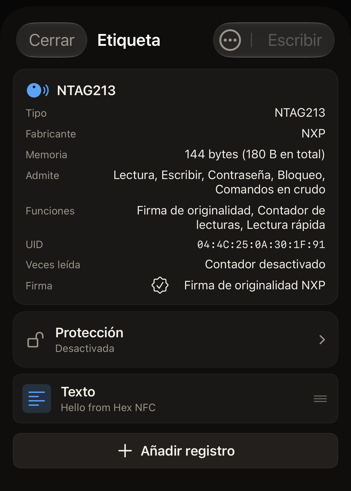

En unos 5 minutos vas a leer una etiqueta NFC con Hex NFC y a ver lo que
contiene, en la pantalla y en el historial de la app. Necesitas el iPhone y
una etiqueta.

## Antes de empezar

- Instala Hex NFC desde el [App Store](https://apps.apple.com/app/id6801457461) en un iPhone con iOS 17 o posterior.
  No hay nada que configurar la primera vez: la app se abre en su pantalla de
  inicio. [Preguntas frecuentes](faq.md) explica cuánto cuesta y en qué
  modelos de iPhone funciona.
- Ten a mano una etiqueta. Sirve una pegatina, una tarjeta o un llavero NFC.
- También sirve una etiqueta vacía. La app la lee y muestra que no contiene
  nada.
- Leer una etiqueta no cambia nada en ella. Ningún paso de esta página escribe
  en tu etiqueta.

## Leer tu primera etiqueta

:::::steps
::::step[Abrir la pantalla de escaneo]
Hex NFC se abre en su pantalla de inicio, que tiene cuatro recuadros debajo
del nombre de la app: **Escanear**, **Crear**, **Biblioteca** y **Avanzado**.
Toca **Escanear**, el recuadro de arriba a la izquierda. Se abre la pantalla
de escaneo, que espera con el texto «Acerca la etiqueta a la parte superior
del iPhone».
::::

::::step[Acercar la etiqueta al iPhone]
Apoya el borde superior del iPhone en plano sobre la etiqueta y mantenlo
quieto. Mientras dura la lectura, iOS muestra un panel propio en la parte
inferior de la pantalla. El texto de la app queda por encima. La pantalla de
escaneo muestra «Leyendo…» y después «Etiqueta detectada». Cuando aparece
«Etiqueta detectada», la app ya ha terminado con la etiqueta, así que puedes
retirar el iPhone. Si no se lee ninguna etiqueta, la pantalla muestra «Error
al escanear» con el motivo debajo. Toca **Reintentar** y vuelve a acercar la
etiqueta a la parte superior del iPhone, sin moverla.
[Si no se puede escanear o escribir una etiqueta](troubleshooting.md) explica
qué hacer con una etiqueta que no responde.
::::

::::step[Ver lo que ha encontrado la app]
Debajo de «Etiqueta detectada», la app muestra el nombre del chip y cuenta lo
que ha leído. Un registro es un elemento de contenido de una etiqueta, como
un enlace o un texto, y una etiqueta que lleva uno muestra «1 registro
encontrado». Una etiqueta que no lleva ninguno muestra «No hay registros NDEF
en esta etiqueta». La pantalla se mantiene un segundo, más o menos. El nombre
del chip y el UID de la etiqueta vuelven a aparecer en la pantalla siguiente,
así que no hace falta memorizar nada aquí.
[Escanear una etiqueta](scan-a-tag.md) recoge los demás resultados.
::::

::::step[Abrir un registro]
La pantalla Etiqueta se abre sola. La tarjeta de la parte superior muestra el
nombre del chip e incluye una fila **UID**. Debajo de la tarjeta, cada
registro es una fila con su tipo y una vista previa de lo que contiene. Toca
una fila para ver el registro completo y después toca **Cancelar** para
volver. **Cancelar** cierra el registro y no escribe nada, ni en la etiqueta
ni en la app. En una etiqueta vacía aparece «Etiqueta vacía» en lugar de las
filas, y eso significa que la lectura se ha completado, no que haya fallado.

:::figure[Tras escanear un NTAG213, la tarjeta de la parte superior de la pantalla Etiqueta contiene la fila **UID**, y el único registro de la etiqueta aparece más abajo como una fila **Texto**.]

:::
::::

::::step[Cerrar la etiqueta]
Toca **Cerrar**. La pantalla Etiqueta se cierra sin escribir nada y vuelves a
la pantalla de inicio de Hex NFC.
::::
:::::

## Lo que has aprendido

Ya puedes leer cualquier etiqueta que tengas a mano y saber lo que lleva. La
app ha guardado ese escaneo. Toca **Biblioteca** en la pantalla de inicio de
Hex NFC y después **Historial**, la segunda de las dos pestañas de la parte
superior de la pantalla Biblioteca. Tu escaneo aparece el primero de la
lista. Un escaneo fijado se conserva más allá de los límites que explica
[Buscar una etiqueta que has escaneado antes](scan-history.md). Al abrir un
escaneo guardado vuelve la misma pantalla Etiqueta, sin tener que acercar
otra vez la etiqueta.

## Qué hacer después

- Consulta [Escanear una etiqueta](scan-a-tag.md) para saber qué significa
  cada resultado de un escaneo y qué hacer con una etiqueta que pide primero
  una contraseña.
- Consulta [Buscar una etiqueta que has escaneado antes](scan-history.md) para
  volver a abrir, fijar y eliminar escaneos guardados.
- Consulta [Escribir un enlace en una etiqueta](write-a-link.md) para poner
  una dirección web en una etiqueta vacía.
- Consulta [Etiquetas compatibles con Hex NFC](tags-that-work.md) para ver qué
  chips reconoce la app.
- Consulta [Si no se puede escanear o escribir una etiqueta](troubleshooting.md)
  cuando una etiqueta no responda.
