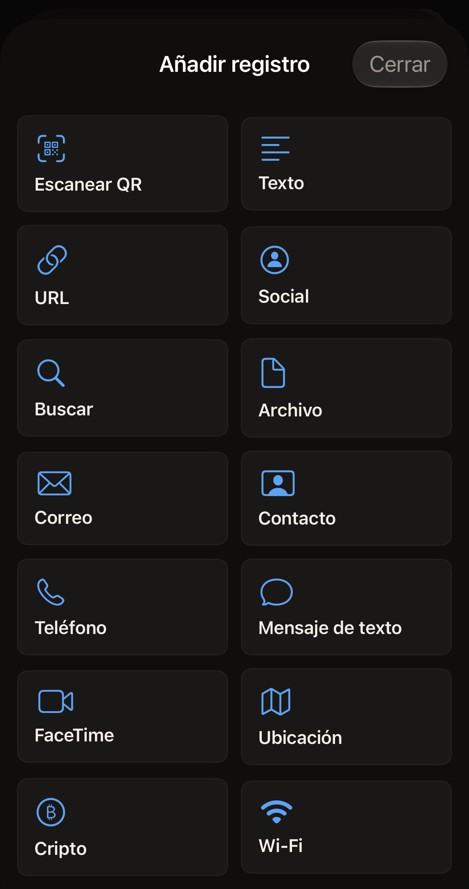
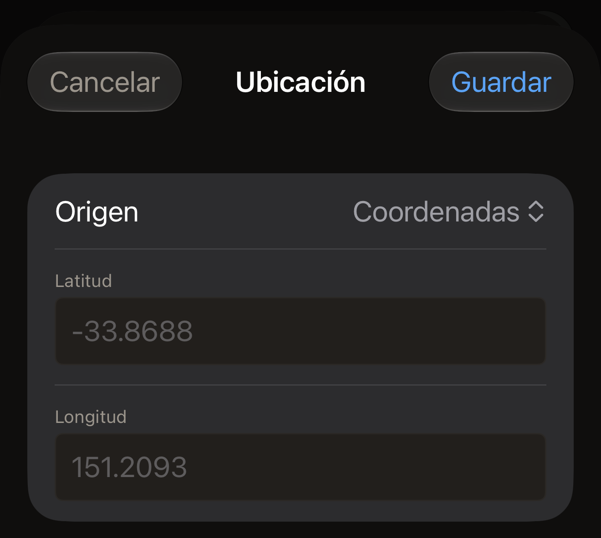

Una etiqueta contiene una lista de registros, y cada registro tiene un tipo.
Escanea una etiqueta con el iPhone, o toca **Crear** en la pantalla de inicio
de Hex NFC para empezar sin registros. Después, toca **Añadir registro** en la
pantalla Etiqueta. La app ofrece 13 tipos, que
[Editar los registros de una etiqueta](edit-records.md) explica paso a paso.
El tipo que eliges determina qué campos te muestra el editor de registros, y
también lo que encuentra otro teléfono cuando lee la etiqueta más adelante.
Una etiqueta que escaneas puede contener además cinco tipos que la app abre
pero no ofrece para añadir, que se tratan en
[Tipos que puedes abrir pero no añadir](#types-you-can-open-but-not-add).

:::figure[**Añadir registro** ofrece 13 tipos de registro, con **Escanear QR** en primer lugar para convertir un código QR en un registro.]

:::

## Qué cambia el tipo

Cada tipo es una estructura para un dato concreto. Un número de teléfono va
en un registro **Teléfono**, y una red, en un registro **Wi-Fi**. La app
convierte lo que escribes en los bytes que define el estándar NFC para esa
estructura. Elige el tipo que más se ajuste en lugar de poner un número de
teléfono en un registro **Texto**: el teléfono que lee la etiqueta actúa según
la estructura, no según tu intención.

Lo que ocurre en el teléfono que lee la etiqueta lo decide ese teléfono. Un
enlace es un enlace en todas partes. Una red no: como dice el formulario
**Wi-Fi**, «iPhone no se conecta automáticamente por NFC; los lectores
Android sí. Hex NFC escribe el registro según el estándar para que cualquier
lector lo lea.»

Los registros ocupan espacio, y un chip pequeño se queda sin él. Lo que cabe
en cada chip está en [Etiquetas compatibles con Hex NFC](tags-that-work.md).

## Texto y enlaces

:::table[Tipos de registro para texto, enlaces y búsquedas]
| Tipo | Lo que rellenas | Lo que llega a la etiqueta |
| --- | --- | --- |
| **Texto** | **Texto**, **Código de idioma**, **Codificación** | Tus palabras, marcadas con el código de idioma que introduces y escritas en la codificación que eliges. |
| **URL** | **URL** | La dirección tal como la has escrito. Los prefijos web habituales se guardan como un solo byte, así que el registro ocupa menos espacio. |
| **Social** | **Plataforma**, **Usuario** | Un enlace a un perfil, creado a partir de la plataforma que eliges y el usuario que introduces. |
| **Buscar** | **Motor**, **Consulta** | Una dirección de búsqueda para el motor que eliges, con tus palabras. |
| **Archivo** | **Ruta** | Una dirección de archivo. El formulario lo explica así: «Se guarda como URL file://. iOS limita los directorios a los que puede apuntar.» |
:::

Un registro **Texto** nuevo empieza con el código de idioma *en*, y la nota
del propio campo indica el formato que hay que usar: «ISO 639-1, p. ej. en,
fr, ja». **Codificación** tiene dos opciones, **UTF-8** y **UTF-16**, y un
registro nuevo empieza en **UTF-8**.

En la mayoría de las plataformas, el **Usuario** es el nombre con el que
termina la dirección de tu perfil, y se introduce sin la @ delante. Seis de
ellas piden otra cosa, porque sus direcciones no se forman a partir de un
nombre de usuario.

- Para **Whatsapp**, introduce el número de teléfono que lleva un enlace
  wa.me, es decir, el número internacional completo sin el signo más.
- Para **Skype**, introduce el nombre de Skype.
- Para **Steam**, introduce la URL personalizada de la dirección de tu
  perfil.
- Para **Slack**, introduce el nombre del espacio de trabajo con el que
  empieza su dirección.
- Para **Facebook** y **Wechat**, introduce lo que lleve su propio enlace,
  que puede ser un nombre o un número.

La app pone lo que introduces en la dirección del perfil de la plataforma y
no cambia nada más.

**Motor** incluye **Google**, **Google Images**, **Bing**, **Yandex**,
**DuckDuckGo**, **YouTube** y **Wikipedia**. **Plataforma** incluye
**Facebook**, **Bluesky**, **X**, **Github**, **Instagram**, **Line**,
**Linkedin**, **Medium**, **Pinterest**, **Skype**, **Slack**, **Snapchat**,
**Soundcloud**, **Steam**, **Telegram**, **Threads**, **Tiktok**, **Twitch**,
**Vk**, **Wechat**, **Whatsapp** y **Youtube**, cada una escrita en pantalla
tal como aparece aquí.

## Personas y mensajes

:::table[Tipos de registro para llegar a una persona]
| Tipo | Lo que rellenas | Lo que llega a la etiqueta |
| --- | --- | --- |
| **Correo** | **Para**, **Cc**, **Cco**, **Asunto**, **Cuerpo** | Una dirección de correo con los destinatarios, el asunto y el mensaje. |
| **Contacto** | **Nombre completo** y **Organización** en la sección **Identidad**, y después **Teléfonos**, **Correos** y **Sitios web** en la sección **Contacto** | Una tarjeta de contacto, que el teléfono que la lee puede añadir a su agenda. |
| **Teléfono** | **Número de teléfono** | Una dirección de teléfono. El teléfono que la lee ofrece llamar al número. |
| **Mensaje de texto** | **Destinatario**, **Mensaje** | Una dirección de mensaje con el número y el texto que se va a enviar. |
| **FaceTime** | **Destino**, **Modo** | Una dirección de FaceTime, para vídeo o audio, según lo que hayas elegido. |
:::

Seis de estos campos admiten más de una entrada: **Para**, **Cc**, **Cco**,
**Teléfonos**, **Correos** y **Sitios web** separan las entradas por comas, y
por eso **Para** y **Teléfonos** muestran la indicación «separados por comas».
Si dejas **Organización** vacío, no se incluye en la tarjeta.

## Lugares, dinero y redes

:::table[Tipos de registro para un lugar, un pago o una red]
| Tipo | Lo que rellenas | Lo que llega a la etiqueta |
| --- | --- | --- |
| **Ubicación** | **Origen** y, después, **Latitud** y **Longitud** o bien **URL del mapa** | Una dirección de mapa: un par de coordenadas o el enlace de mapa que pegues. |
| **Cripto** | **Red**, **Dirección**, **Importe**, **Mensaje** | Una dirección de pago en la red que elijas. **Importe** y **Mensaje** se omiten si los dejas vacíos. |
| **Wi-Fi** | **Nombre de red (SSID)**, **Contraseña**, **Autenticación**, **Cifrado**, **Red oculta** | Un registro de red con el nombre, la contraseña y los ajustes de seguridad que hayas elegido. |
:::

**Origen** determina el resto del formulario **Ubicación**. Incluye
**Coordenadas**, **URL de Apple Maps** y **URL de Google Maps**.
**Coordenadas** muestra **Latitud** y **Longitud**. Introduce cada una como
un número decimal, por ejemplo `-33.8688` y `151.2093`. También funciona la
coma decimal, así que `48,8566` se lee como `48.8566`. Los otros dos orígenes
muestran **URL del mapa** en su lugar. La dirección la pones tú. Copia el
enlace de la app de mapas o del navegador donde has encontrado el lugar y pégalo
en el campo. La etiqueta recibe el enlace exactamente como lo has pegado.
Cuál de los dos has elegido no se escribe en la etiqueta. Elige el que
describa de dónde viene tu enlace. La app nunca consulta dónde está el
iPhone. Cada ubicación es una que escribes o pegas, o una que llega desde un
código QR o desde una etiqueta que has escaneado.

:::figure[Con **Origen** en **Coordenadas**, el formulario muestra **Latitud** y **Longitud**, cada uno con un ejemplo en gris hasta que escribes.]

:::

Un registro **Ubicación** necesita una latitud y una longitud, o bien una URL
del mapa. Hasta que tenga una de las dos cosas, el formulario muestra
«Introduce una latitud y una longitud, o una URL del mapa. Hasta entonces,
este registro no se puede escribir en una etiqueta.» y la fila del registro
en la pantalla Etiqueta muestra «Sin ubicación». Un registro **Ubicación** que
añades y del que después sales con **Cancelar** se queda en la lista en ese
estado. Si escribes en la etiqueta mientras la lista contiene uno, la
escritura se detiene antes de que se abra el panel de escaneo de iOS, con «A
un registro de ubicación le faltan las coordenadas o la URL del mapa. No se ha
escrito nada en la etiqueta.» Rellena el registro o elimínalo y vuelve a
escribir. **Guardar como preajuste…** se frena de la misma forma: mientras la
lista contiene un registro así, **Guardar** sigue atenuado y el panel de
guardado explica por qué. Un preajuste no se puede cambiar una vez guardado,
así que uno que se guardó con un registro **Ubicación** vacío en una versión
anterior de la app se rechaza cada vez que lo escribes. Vuelve a crear sus registros
en la pantalla Etiqueta, guárdalos como un preajuste nuevo y después elimina
el antiguo.

**Red** incluye **Bitcoin**, **Ethereum**, **Monero**, **Litecoin**,
**Dogecoin** y **Solana**. **Importe** es un campo de texto normal, sin
indicación y sin ninguna comprobación. La app copia lo que escribes en el
enlace de pago sin cambiarlo. Escribe la cifra como la escribe el monedero
que usas. Comprueba el importe en ese monedero antes de que nadie envíe nada.

En el formulario **Wi-Fi**, **Autenticación** empieza en **WPA2 Personal** y
**Cifrado** empieza en **AES**, que es lo que usan la mayoría de los routers
domésticos. **Autenticación** incluye también **WPA3 Personal**, **WPA
Personal**, **WEP** y **Abierta**. **Cifrado** incluye también **TKIP**,
**TKIP + AES**, **WEP** y **Ninguna**. Elige la misma pareja que indique la
página de configuración del propio router.

:::warning[Un registro Wi-Fi lleva la contraseña a la vista]
Todos los teléfonos que leen la etiqueta leen también la contraseña de la
red. Pon un registro **Wi-Fi** solo en una etiqueta que no te importe que
lea cualquiera.
:::

## Tipos que puedes abrir pero no añadir {#types-you-can-open-but-not-add}

Una etiqueta escaneada, un preajuste o una entrada del historial pueden
contener cinco tipos que **Añadir registro** no ofrece: **Enlace de app**,
**Bluetooth**, **Datos**, **Atajo** y **En crudo**. Ninguno tiene formulario
propio. Al tocar uno se abre un editor de texto con el registro en JSON, bajo
la nota «Este tipo de registro se edita en JSON. Mientras el texto no sea un
registro válido, Guardar conserva la última versión válida.»

:::table[Lo que ponen en la etiqueta los cinco tipos]
| Tipo | Lo que llega a la etiqueta |
| --- | --- |
| **Enlace de app** | Una dirección del App Store, escrita como enlace. |
| **Bluetooth** | Un registro de emparejamiento con la dirección y el nombre de un dispositivo. |
| **Datos** | Los bytes del registro, marcados con su tipo de contenido. |
| **Atajo** | Una dirección que ejecuta un atajo por su nombre, con la entrada que le da el registro. |
| **En crudo** | Los bytes exactos del registro, que se vuelven a escribir sin cambios. |
:::

El editor se abre con el registro ya escrito. Las claves que ya tienen un
valor aparecen en pantalla, y esos valores se cambian ahí mismo. Una clave que
todavía no tiene valor no aparece. Las claves opcionales de la tabla
siguiente no aparecen hasta que las escribes, exactamente como se indican
aquí. Deja `id` y `type` tal como los ha escrito la app. Las demás son estas:

:::table[Las claves de cada tipo que solo se edita en JSON]
| Tipo | Claves que rellenas |
| --- | --- |
| **Enlace de app** | `appStoreURL` y, si las quieres, `universalLink` y `displayName` |
| **Bluetooth** | `deviceMAC` y, si la quieres, `deviceName` |
| **Datos** | `mimeType`, y `payload` en base64 |
| **Atajo** | `shortcutName` y, si el atajo recibe una entrada, `input` |
| **En crudo** | `tnf` como uno de los números de la lista siguiente, y después `typeBytes`, `idBytes` y `payload` en base64 |
:::

Un registro **Datos** que lleva la palabra Hello como texto plano tiene este
aspecto:

```text title="Un registro Datos en el editor JSON"
{
  "id" : "9E2B1C64-6A2F-4D0E-9A52-0B7F1C3D8E44",
  "mimeType" : "text/plain",
  "payload" : "SGVsbG8=",
  "type" : "data"
}
```

No hay ningún conversor detrás de ese `payload`. El valor tiene que ser
base64 que generes en otro sitio. Pegar el texto tal cual no lo codifica. Un
`payload` que no es base64 válido hace que no se pueda leer el registro
entero. La nota siguiente trata ese caso.

**En crudo** es el tipo al que recurre la app cuando lee un registro que no
sabe clasificar. Lo habitual con uno de estos registros es volver a escribirlo
sin cambios. Para cambiarlo, se empieza por `tnf`, el número que usa el
estándar NDEF para indicar qué clase de nombre contiene `typeBytes`. El valor
es uno de estos números.

- 0 para un registro vacío.
- 1 para un nombre de la lista propia del NFC Forum.
- 2 para un tipo de contenido.
- 3 para una dirección absoluta.
- 4 para un nombre que define un fabricante.
- 5 para desconocido.
- 6 para la continuación de un registro que se ha dividido.

`typeBytes`, `idBytes` y `payload` van en base64, y `idBytes` suele estar
vacío.

```text title="Un registro En crudo con un tipo definido por un fabricante"
{
  "id" : "3F7A9D21-4C88-4B0A-BE13-52C0A7E6D915",
  "idBytes" : "",
  "payload" : "SGVsbG8=",
  "tnf" : 4,
  "typeBytes" : "ZXhhbXBsZS5jb206bm90ZQ=="
}
```

:::note[El texto que el editor no puede leer se ignora]
El editor aplica tu texto en cuanto se puede leer como un registro. Hasta
entonces, el registro conserva los valores que tenía y no aparece ningún
mensaje. Tampoco hay nada dentro del editor que lo confirme, así que
compruébalo después de tocar **Guardar**. La fila del registro en la pantalla
Etiqueta tiene una segunda línea que sale del propio registro.

- Para **Datos**, es el tipo de contenido.
- Para **Atajo**, es el nombre del atajo.
- Para **Enlace de app**, es la dirección del App Store.
- Para **Bluetooth**, es el nombre o la dirección del dispositivo.
- Para **En crudo**, son los primeros bytes de la carga útil.

Si la segunda línea sigue igual que antes, tu texto nunca ha llegado a
convertirse en un registro.
:::

## Guardar, descartar y eliminar un registro

**Guardar** conserva tus cambios y **Cancelar** los descarta. **Eliminar
registro** quita el registro de la lista y cierra el editor sin preguntar
antes. Para entonces **Cancelar** ya no está disponible, así que un registro
que eliminas de esa forma hay que volver a añadirlo. Los tres actúan sobre la
copia que tiene la app, nunca sobre la etiqueta. La etiqueta solo cambia
cuando escribes en ella, como se explica en
[Editar los registros de una etiqueta](edit-records.md).

Cada registro se crea a partir de lo que escribes. Nada del editor de
registros lee tus contactos, tu ubicación ni los dispositivos Bluetooth que
tienes cerca. [La privacidad y tus datos](privacy.md) explica lo que guarda
la app.

## Cómo se abre una etiqueta escaneada

La app clasifica lo que lee en el tipo más parecido que conoce. Una dirección
de teléfono, mensaje, correo, FaceTime, mapa, pago, atajo o archivo se abre
como ese tipo, y cualquier otro enlace se abre como un registro **URL**. Una
tarjeta de contacto, un registro de red y un registro de emparejamiento
vuelven cada uno a su propio tipo. Cualquier otro tipo de contenido se
convierte en un registro **Datos**, y todo lo demás se convierte en un
registro **En crudo**, que se vuelve a escribir byte a byte.

## Ver también

- [Editar los registros de una etiqueta](edit-records.md)
- [Escribir un enlace en una etiqueta](write-a-link.md)
- [Guardar una etiqueta como preajuste](presets.md)
- [Matriz de compatibilidad de chips](../developer/chip-support-matrix.md)
