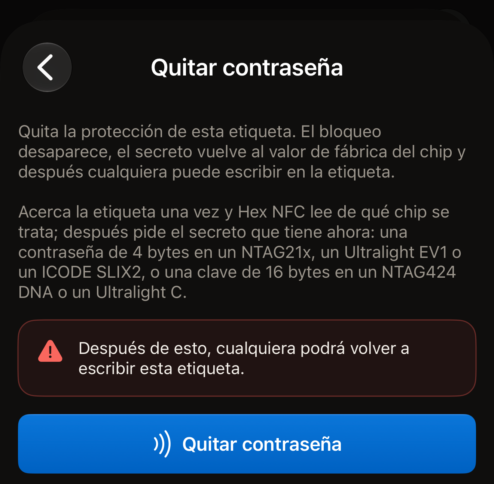
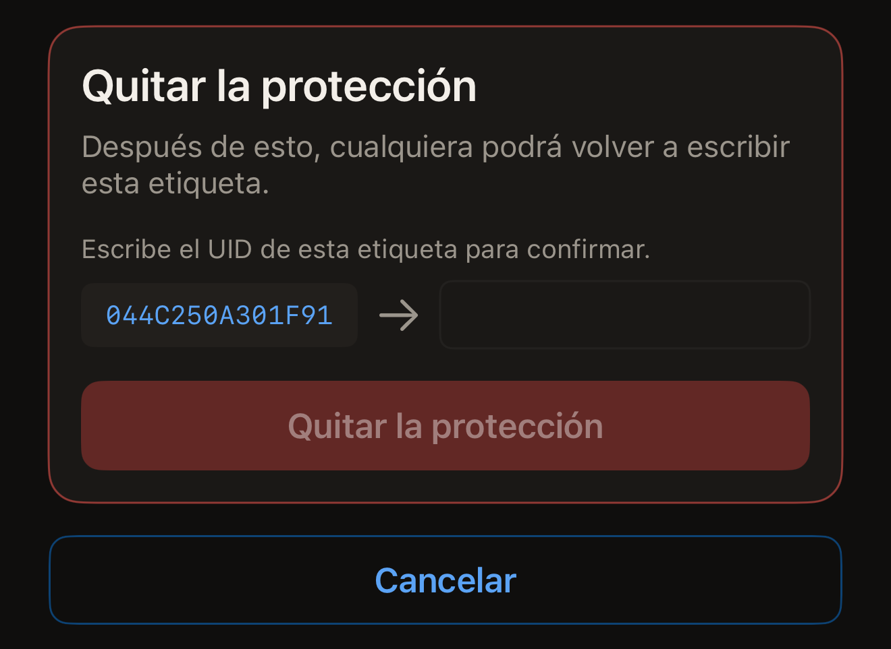
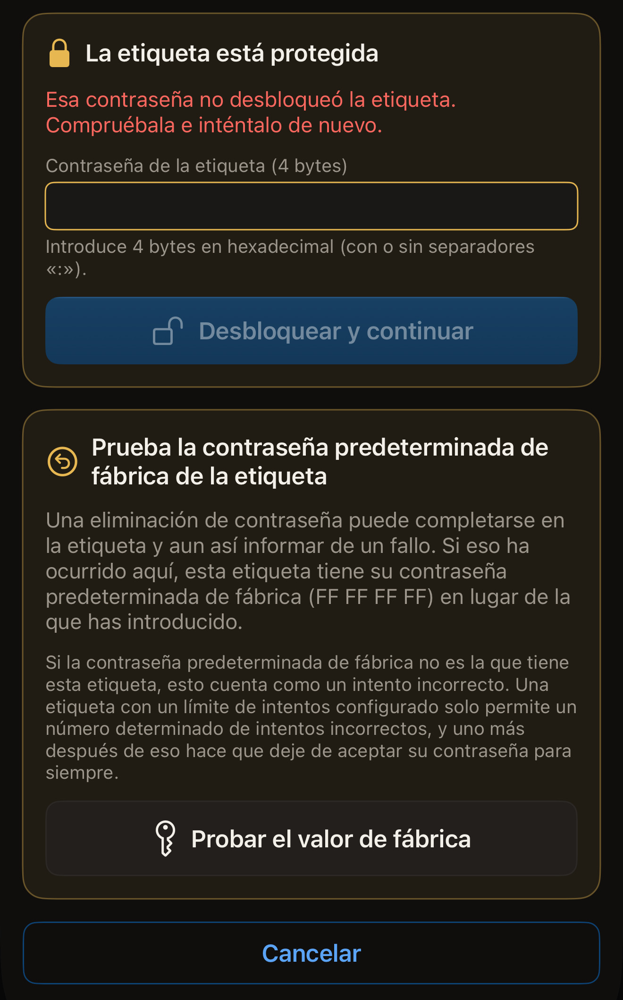

La contraseña que pones en una etiqueta se puede volver a quitar, siempre que
todavía puedas presentar la contraseña que tiene la etiqueta. Una vez quitada,
cualquiera puede leer la etiqueta y escribir en ella, y su contraseña o clave
vuelve al valor de fábrica del chip.

Antes de empezar, abre Hex NFC en el iPhone y escanea la etiqueta para que
aparezca en la pantalla Etiqueta (consulta
[Escanear una etiqueta](scan-a-tag.md)). Ten a mano la contraseña que tiene. La
tarjeta de la parte superior de esa pantalla indica el chip en su primera línea,
encima del UID de la etiqueta. Ese nombre determina qué tipo de secreto pide la
eliminación. Un chip que no aparece en ninguna de las dos vías siguientes no
lleva ninguna contraseña que Hex NFC pueda quitar, porque la app nunca le pone
una.

## Quitar una contraseña en Operaciones

Esta vía sirve para todos los chips que la app puede proteger. No pide nada antes
del primer acercamiento. Ese acercamiento lee qué chip es la etiqueta, y después
la pantalla pide el secreto que tiene ahora la etiqueta: una contraseña de 4
bytes en los chips NTAG21x (NTAG213, NTAG213 TT, NTAG215, NTAG216), MIFARE
Ultralight EV1 o ICODE SLIX2, y una clave de 16 bytes en un NTAG424 DNA o un
MIFARE Ultralight C. El NTAG 210µ no tiene contraseña que quitar. La
[matriz de compatibilidad de chips](../developer/chip-support-matrix.md) indica
qué lleva cada chip.

:::::steps
::::step[Abrir Operaciones]
En la pantalla **Etiqueta**, abre el menú de la parte superior derecha y toca
**Operaciones…**.
::::

::::step[Abrir Quitar contraseña]
Toca **Quitar contraseña**.
::::

::::step[Iniciar la eliminación]
Toca **Quitar contraseña**. La advertencia que hay encima indica lo que supone la
eliminación: «Después de esto, cualquiera podrá volver a escribir esta
etiqueta.»

:::figure[El botón **Quitar contraseña** que debes tocar es el de la parte inferior de la pantalla, debajo de la advertencia.]

:::
::::

::::step[Acercar la etiqueta a la parte superior del iPhone]
La app lee el UID de la etiqueta y termina el acercamiento para que puedas
escribir.
::::

::::step[Introducir el secreto que tiene la etiqueta]
Una tarjeta con el título «La etiqueta está protegida» pide el secreto que tiene
ahora la etiqueta. Introduce la contraseña en
**Contraseña de la etiqueta (4 bytes)** como ocho caracteres hexadecimales. En un
NTAG424 DNA el campo es **Clave de la etiqueta (AES, 16 bytes)**, y en un
MIFARE Ultralight C es **Clave de la etiqueta (3DES, 16 bytes)**. Los
separadores se ignoran, así que `FF FF FF FF` y `FFFFFFFF` son el mismo valor.
::::

::::step[Confirmar la etiqueta]
La pantalla muestra el UID de la etiqueta junto al campo, bajo «Escribe el UID de
esta etiqueta para confirmar.» Escribe esos caracteres en el campo, sin
separadores. Da igual que uses mayúsculas o minúsculas. Toca
**Quitar contraseña** y vuelve a acercar la etiqueta al iPhone.
::::
:::::

::include[two-tap-confirmation]

Cuando termina el segundo acercamiento, la pantalla indica «Contraseña
eliminada.» La etiqueta queda abierta. Cualquier teléfono puede reescribir sus
registros. Si la etiqueta también pedía la contraseña antes de mostrar nada, esa
protección desaparece junto con la otra.

## Quitar la protección desde la pantalla Etiqueta

En cualquier chip que la app pueda proteger, la protección también se puede
quitar como parte de una escritura, y para ello necesitas la clave o la
contraseña que tiene la etiqueta. La escritura vuelve a poner en la etiqueta los
registros que aparecen en la pantalla **Etiqueta**. Después de un escaneo, esa
lista es lo que la etiqueta ya contiene, así que su contenido se conserva salvo
que hayas editado la lista tú.

:::::steps
::::step[Abrir Protección]
En la pantalla **Etiqueta**, toca **Protección**.
::::

::::step[Desactivar la protección]
Desactiva **Proteger esta etiqueta con una clave** en una etiqueta NTAG424 DNA o
MIFARE Ultralight C, o **Proteger esta etiqueta con contraseña** en un chip que
usa contraseña: un NTAG21x, MIFARE Ultralight EV1 o ICODE SLIX2. La nota que hay
debajo indica que la siguiente escritura quita tanto la protección contra lectura
como la protección contra escritura y devuelve el secreto a su valor de fábrica.
::::

::::step[Guardar el cambio]
Toca **Listo**.
::::

::::step[Escribir en la etiqueta]
En la pantalla **Etiqueta**, toca **Escribir** y acerca la etiqueta a la parte
superior del iPhone. La app lee el UID de la etiqueta y te pide que lo vuelvas a
escribir.
::::

::::step[Confirmar la etiqueta]
Escribe el UID que aparece junto al campo, sin separadores y en mayúsculas o
minúsculas, y toca **Quitar la protección**. Vuelve a acercar la etiqueta al
iPhone para hacer el cambio.

:::figure[La tarjeta **Quitar la protección** muestra el UID que ha leído la app, con una flecha hacia el campo vacío donde lo escribes.]

:::
::::
:::::

La escritura presenta la clave o la contraseña que la app ya tiene para la
etiqueta. Es la que has introducido en la tarjeta **Protección**, o la que has usado
al protegerla. En una etiqueta para la que no tiene nada, la escritura se detiene
en «La etiqueta está protegida» y pide el secreto. El campo en el que lo pide
depende del chip:

- En un NTAG424 DNA, introdúcelo en **Clave de la etiqueta (AES, 16 bytes)**.
- En un MIFARE Ultralight C, introdúcelo en
  **Clave de la etiqueta (3DES, 16 bytes)**.
- En un NTAG21x, un MIFARE Ultralight EV1 o un ICODE SLIX2, introdúcelo en
  **Contraseña de la etiqueta (4 bytes)**.

Después, toca **Desbloquear y continuar**. No hace falta ningún acercamiento más,
porque la app ya ha leído el UID de la etiqueta. A continuación aparece la
tarjeta de confirmación. Escribe el UID, toca **Quitar la protección** y vuelve a
acercar la etiqueta.

## Si la etiqueta rechaza la contraseña

En un NTAG21x o un MIFARE Ultralight EV1, cada acercamiento presenta una sola
contraseña. Una etiqueta que la rechaza deja de responder durante el resto de ese
acercamiento. La app nunca prueba una segunda contraseña en el mismo
acercamiento.

Cuando la etiqueta rechaza la contraseña, vuelve a aparecer la tarjeta «La
etiqueta está protegida» con el mensaje «Esa contraseña no desbloqueó la
etiqueta. Compruébala e inténtalo de nuevo.» Su campo aparece vacío, así que la
contraseña rechazada no se vuelve a enviar a menos que la escribas. Introduce la
contraseña, toca **Desbloquear y continuar** y vuelve a acercar la etiqueta.
**Cancelar** devuelve la pantalla a su estado inicial.

Si la eliminación falla por otro motivo, la pantalla ofrece
**Introducir otra contraseña**. Esto devuelve la pantalla al principio, y la
siguiente operación vuelve a pedir la contraseña en un campo vacío.

Cuando la etiqueta rechaza la contraseña que has introducido, y esa contraseña no
era ya `FF FF FF FF`, la app propone algo concreto que probar. Debajo del fallo,
en la pantalla **Quitar contraseña**, aparece una tarjeta con el título «Prueba
la contraseña predeterminada de fábrica de la etiqueta». Una eliminación puede
completarse en la etiqueta y aun así informar de un fallo. En ese caso, la
etiqueta tiene `FF FF FF FF` en lugar de la contraseña que has introducido. Ese
es el valor con el que sale de fábrica cualquier NTAG21x y MIFARE Ultralight EV1.
Toca **Probar el valor de fábrica** para enviarlo en el siguiente acercamiento.
Hasta que se haga ese acercamiento, la pantalla indica qué contraseña va a
enviar. Dice: «El siguiente acercamiento presentará la contraseña predeterminada
de fábrica (FF FF FF FF) en lugar de la que has introducido.»

:::figure[Tras una contraseña rechazada, la tarjeta del valor de fábrica aparece debajo de la tarjeta «La etiqueta está protegida», con **Probar el valor de fábrica** en la parte inferior.]

:::

:::warning
Si el valor de fábrica no es lo que tiene la etiqueta, el acercamiento cuenta como
un intento incorrecto. Una etiqueta con límite de intentos solo permite un número
determinado, y un intento más hace que deje de aceptar su contraseña para
siempre. Consulta
[Limitar los intentos incorrectos de contraseña](attempt-limit.md).
:::

Cuando el valor de fábrica abre la etiqueta, la app lo indica al terminar la
operación. El mensaje dice: «La contraseña predeterminada de fábrica es la que ha
abierto esta etiqueta, así que una eliminación anterior sí se había aplicado. La
contraseña que guardabas para esta etiqueta no es la que tiene.»

## Si la eliminación no termina

Dos acercamientos son dos ocasiones para que la etiqueta se aparte antes de
tiempo. La app relee la protección de la etiqueta antes de informar de nada, así
que el mensaje indica lo que tiene ahora la etiqueta:

- «Contraseña eliminada.» es un éxito dondequiera que aparezca, incluso en una
  pantalla que por lo demás informa de un fallo. La relectura ha confirmado que la
  protección ya no está.
- «Esta etiqueta sigue protegida. No se ha perdido nada: acércala de nuevo al
  teléfono para terminar de quitar la contraseña.» significa que la relectura
  ha encontrado la protección activada. Repite la eliminación con la misma contraseña.
- «No se ha podido confirmar si la contraseña se quitó. Acerca de nuevo la
  etiqueta al teléfono para comprobarlo.» significa que la etiqueta ha salido del
  alcance antes de que la app pudiera leer su protección. Repite la eliminación
  para saber en qué estado está la etiqueta.

Si ninguna de las contraseñas que tienes abre la etiqueta, su memoria protegida
se queda como está. [Protección de etiquetas](tag-protection.md) explica por qué
una contraseña perdida no se puede recuperar.

## Ver también

- [Protección de etiquetas](tag-protection.md)
- [Proteger una etiqueta con contraseña](protect-a-tag.md)
- [Limitar los intentos incorrectos de contraseña](attempt-limit.md)
- [Si no se puede escanear o escribir una etiqueta](troubleshooting.md)
