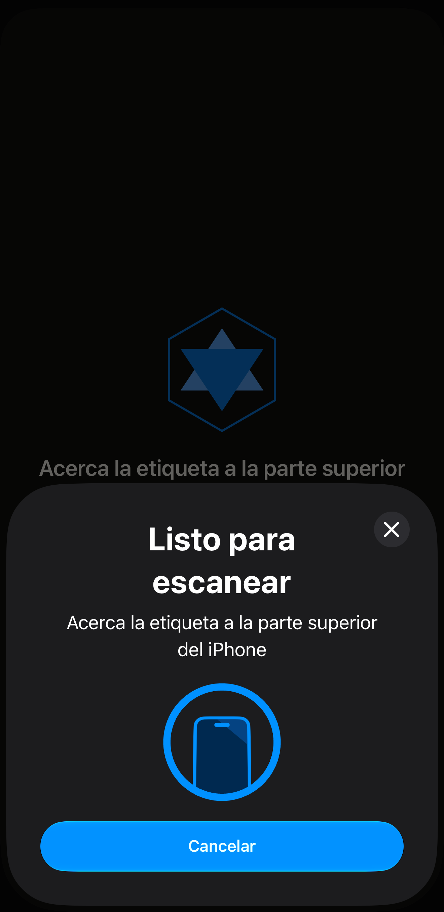
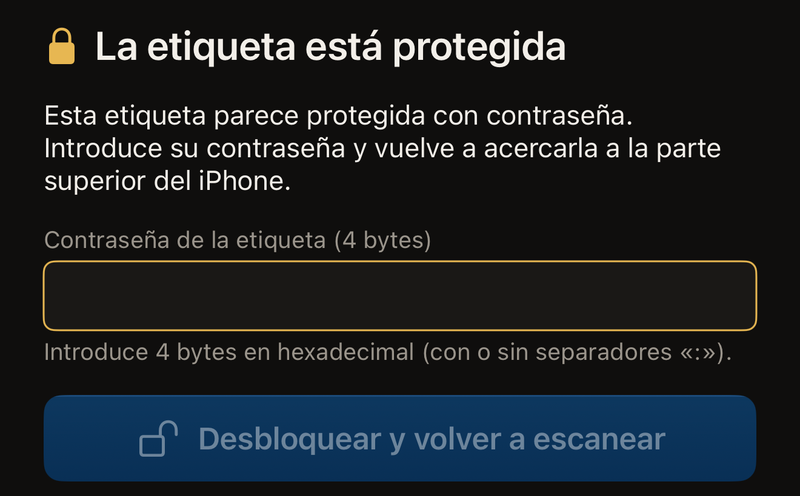
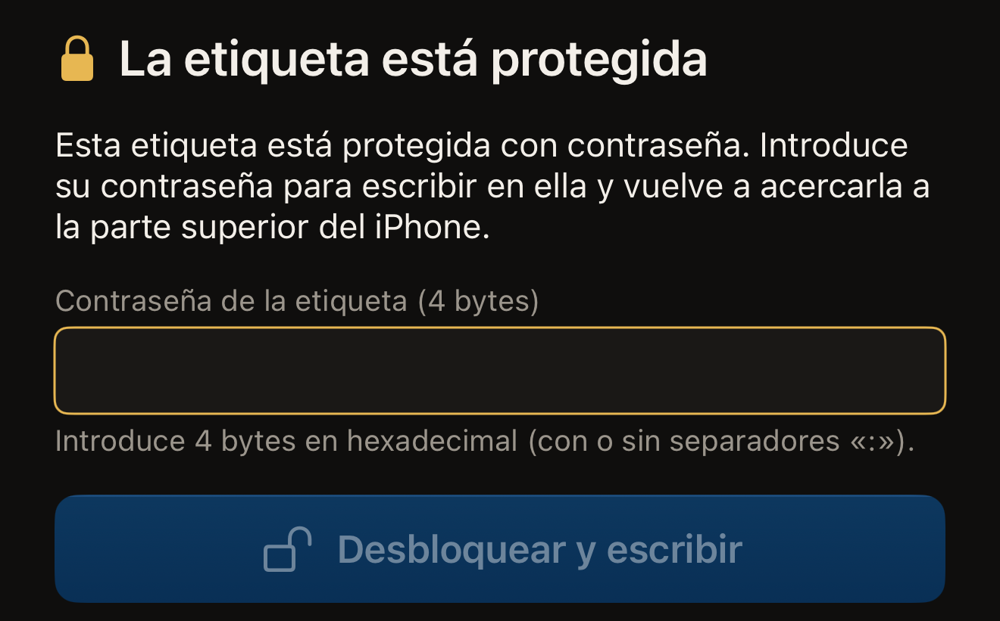

Hex NFC lee una etiqueta en un solo acercamiento. Tocas **Escanear**, acercas
la etiqueta a la parte superior del iPhone y la app muestra qué chip ha
encontrado y lo que contiene la etiqueta. Un escaneo solo lee, así que no
cambia nada en la etiqueta.

También se puede configurar una etiqueta para que exija su contraseña antes
de dejarse leer. Una etiqueta protegida de esa forma rechaza la lectura hasta
que se presenta la contraseña. Presentarla requiere dos acercamientos en
lugar de uno. La segunda mitad de esta página trata ese caso. La mayoría de
las etiquetas protegidas solo tienen protección contra escritura, y esas se
escanean en un acercamiento, como cualquier otra. Si nunca has escaneado una
etiqueta, [Leer tu primera etiqueta](quick-start.md) explica ese mismo
acercamiento desde el principio.

## Escanear una etiqueta

:::::steps
::::step[Abrir la pantalla de escaneo]
Abre Hex NFC y toca **Escanear** en su pantalla de inicio. Se abre la
pantalla de escaneo, que muestra «Acerca la etiqueta a la parte superior del
iPhone».

:::figure[Mientras la app espera una etiqueta, su propia línea asoma por encima del panel de escaneo de iOS, y el botón Cancelar del panel detiene el escaneo.]

:::
::::

::::step[Acercar la etiqueta a la parte superior del iPhone]
Apoya el borde superior del iPhone sobre la etiqueta y mantenlo quieto.
Mientras se lee la etiqueta, la pantalla muestra «Leyendo…».
::::

::::step[Ver lo que ha encontrado la app]
«Etiqueta detectada» aparece con una marca de verificación, y el nombre del
chip, debajo. Más abajo, la app indica lo que ha leído. La línea «1 registro
encontrado» da el número de registros de la etiqueta. «No hay registros NDEF
en esta etiqueta» significa que la etiqueta está formateada pero vacía. El
UID de la etiqueta aparece al final.
::::
:::::

El resultado se mantiene un segundo, más o menos, y después la app abre la
pantalla **Etiqueta** con la lista de registros, donde puedes cambiarlos o
volver a escribirlos. Ahí no se pierde nada del resultado. El nombre del chip
es el título de la tarjeta de información de la etiqueta, y los registros son
la lista que hay debajo. El UID es una fila de esa tarjeta; tócala en
cualquier momento para copiarlo. Además, cada escaneo se guarda en el
historial. Consulta
[Buscar una etiqueta que has escaneado antes](scan-history.md) y
[Editar los registros de una etiqueta](edit-records.md).

Para detener el escaneo antes de que se lea una etiqueta, toca Cancelar en
el panel de escaneo de iOS. La pantalla de escaneo se cierra y vuelves a
la pantalla de inicio de Hex NFC. Si no hay ninguna etiqueta junto al iPhone,
el panel de escaneo de iOS se cierra solo al cabo de un minuto aproximadamente, y la
pantalla de escaneo muestra «No se encontró ninguna etiqueta» con **Cancelar**
y **Reintentar** debajo.

Algunas etiquetas salen de la pantalla de escaneo por otro camino. Una
tarjeta de transporte japonesa abre su propio resultado, de solo lectura, que
se explica en [Leer una tarjeta de transporte](transit-cards.md). Un
pasaporte electrónico pide primero los datos de su página de la fotografía,
como se explica en [Leer un pasaporte](passports.md). Un dispositivo de salud
NFC, como una pluma de insulina, abre una pantalla **Dispositivo de salud** de
solo lectura y no se guarda, como se explica en
[Dispositivos de salud](tags-that-work.md#health-devices). Una etiqueta
protegida pide su contraseña, que es la siguiente tarea de esta página.

Si el resultado indica «Esta etiqueta aún no está formateada», nada de lo que
escribas en la etiqueta será legible hasta que se formatee.
[Borrar o formatear una etiqueta](erase-or-format.md) explica cómo hacerlo.

## Desbloquear una etiqueta protegida {#unlock-a-protected-tag}

Una etiqueta que exige su contraseña para leerse detiene el escaneo. La
pantalla de escaneo muestra «La etiqueta está protegida» encima de esta
frase: «Esta etiqueta parece protegida con contraseña. Introduce su
contraseña y vuelve a acercarla a la parte superior del iPhone.» Debajo están
el campo de la contraseña, **Desbloquear y volver a escanear** y una fila con
**Cancelar** y **Reintentar**. La contraseña es de la etiqueta, no de una
cuenta, y solo la tiene quien la ha puesto. El ajuste que produce este estado es
**Exigir la contraseña también para leer**, que se explica en
[Proteger una etiqueta con contraseña](protect-a-tag.md).

:::::steps
::::step[Introducir la contraseña de la etiqueta]
En **Contraseña de la etiqueta (4 bytes)**, introduce la contraseña en
caracteres hexadecimales, del 0 al 9 y de la A a la F. Una contraseña de 4
bytes tiene 8 caracteres: escríbela como `A1B2C3D4` o como `A1:B2:C3:D4`,
porque los dos puntos entre los bytes son opcionales y no cuentan para la
longitud. La nota que hay debajo del campo muestra «OK» cuando la entrada
tiene la longitud correcta.

:::figure[Una etiqueta protegida detiene el escaneo en **Contraseña de la etiqueta (4 bytes)**, y **Desbloquear y volver a escanear** sigue atenuado hasta que la entrada tiene la longitud correcta.]

:::

En un NTAG424 DNA, el campo se llama **Clave de la etiqueta (AES, 16 bytes)**.
En un MIFARE Ultralight C se llama **Clave de la etiqueta (3DES, 16 bytes)**.
Esos dos chips se abren con una clave, no con una contraseña. Las dos claves
tienen 16 bytes, es decir, 32 caracteres.
::::

::::step[Iniciar el segundo acercamiento]
Toca **Desbloquear y volver a escanear**. El botón sigue atenuado hasta que
lo que has introducido tiene la longitud correcta para el chip.
::::

::::step[Volver a acercar la etiqueta a la parte superior del iPhone]
La app presenta la contraseña, después lee la etiqueta y muestra «Etiqueta
detectada», igual que con cualquier otra etiqueta.
::::
:::::

Si la etiqueta rechaza la contraseña, vuelves a «La etiqueta está protegida»,
y la indicación se sustituye por «Esa contraseña no desbloqueó la etiqueta.
Compruébala e inténtalo de nuevo.» En un NTAG424 DNA o un MIFARE Ultralight C
aparece en su lugar «Esa clave no desbloqueó la etiqueta. Compruébala e
inténtalo de nuevo.» Corrige la entrada y toca **Desbloquear y volver a
escanear** para otro acercamiento. Una contraseña rechazada hace que el chip
deje de responder durante el resto de ese acercamiento. Está pensado para que
cada intento sea un acercamiento nuevo. Para volver a una lectura normal sin
contraseña, toca **Reintentar**. **Cancelar** hace otra cosa: cierra la
pantalla de escaneo sin leer la etiqueta y descarta lo que hayas escrito.
Ninguno de los dos cambia la etiqueta.

:::warning[Una contraseña rechazada puede costarte un intento]
Una etiqueta se puede configurar para que acepte solo un número limitado de
contraseñas incorrectas antes de dejar de aceptar su contraseña para siempre.
En una etiqueta que informa de ese límite, la app sustituye el consejo anterior
por el texto del propio rechazo. Comprobar otra vez la contraseña vale más que
gastar otro intento. Consulta
[Limitar los intentos incorrectos de contraseña](attempt-limit.md).
:::

## Desbloquear una etiqueta protegida antes de escribir en ella

Una escritura empieza en la pantalla **Etiqueta**. Una etiqueta protegida
llega a la pantalla **Etiqueta** a través del desbloqueo anterior. Termina
primero ese escaneo y la app abrirá la pantalla **Etiqueta**, igual que con
cualquier otra etiqueta. Hay dos caminos que se saltan esa lectura. En
**Biblioteca**, la pestaña **Historial** muestra las etiquetas que has escaneado
antes, y al tocar una fila esa etiqueta se vuelve a abrir en la pantalla
**Etiqueta**. Si deslizas un preajuste de izquierda a derecha en la pestaña
**Preajustes**, aparece **Escribir**,
que abre directamente la pantalla de escritura con los registros del
preajuste.

En la pantalla **Etiqueta**, toca **Escribir** en la barra de herramientas y
se abre la pantalla de escritura.
[Escribir un enlace en una etiqueta](write-a-link.md) explica una escritura
de principio a fin; lo que sigue es el paso adicional que añade una etiqueta
protegida.

La pantalla de escritura vuelve a pedir la contraseña, incluso en una
etiqueta que acabas de desbloquear. Cada acercamiento es una sesión
independiente, y la app no traslada ninguna contraseña de una sesión a otra.
Es normal tener que escribirla una segunda vez; no significa que el
desbloqueo haya fallado. Contando desde el principio, una etiqueta protegida
necesita tres acercamientos: el escaneo que la etiqueta rechaza, el escaneo de
desbloqueo que abre la pantalla **Etiqueta** y la escritura. La pantalla muestra «La etiqueta está
protegida» y después pide la contraseña: «Esta etiqueta está protegida con
contraseña. Introduce su contraseña para escribir en ella y vuelve a
acercarla a la parte superior del iPhone.»

:::::steps
::::step[Introducir la contraseña en la pantalla de escritura]
En **Contraseña de la etiqueta (4 bytes)**, introduce la contraseña de la
etiqueta, los mismos 8 caracteres hexadecimales que pide un escaneo. En los
dos chips que usan una clave, el campo pide una clave en lugar de una
contraseña, y una clave tiene 32 caracteres.

:::figure[En la pantalla de escritura, la indicación pide la contraseña para escribir, y el botón dice **Desbloquear y escribir** en lugar de **Desbloquear y volver a escanear**.]

:::
::::

::::step[Iniciar el segundo acercamiento de la escritura]
Toca **Desbloquear y escribir**. Si la escritura también cambia la protección
de la etiqueta, el botón dice **Desbloquear y continuar**. En ese caso, antes
de escribir, la app te muestra el UID de la etiqueta y, debajo de «Escribe
el UID de esta etiqueta para confirmar.», te pide que lo escribas. Consulta [Proteger una etiqueta con contraseña](protect-a-tag.md).
::::

::::step[Acercar la etiqueta para escribir en ella]
Vuelve a acercar la etiqueta a la parte superior del iPhone. La app presenta
la contraseña y después escribe.
::::
:::::

Aquí, un rechazo también muestra «Esa contraseña no desbloqueó la etiqueta.
Compruébala e inténtalo de nuevo.», y se resuelve de la misma forma: comprueba
lo que has introducido y vuelve a acercar la etiqueta.

Un escaneo puede terminar en «Error al escanear». Una etiqueta que crees
vacía podría pedir una contraseña. En cualquiera de los dos casos, sigue los
pasos de [Si no se puede escanear o escribir una etiqueta](troubleshooting.md).
