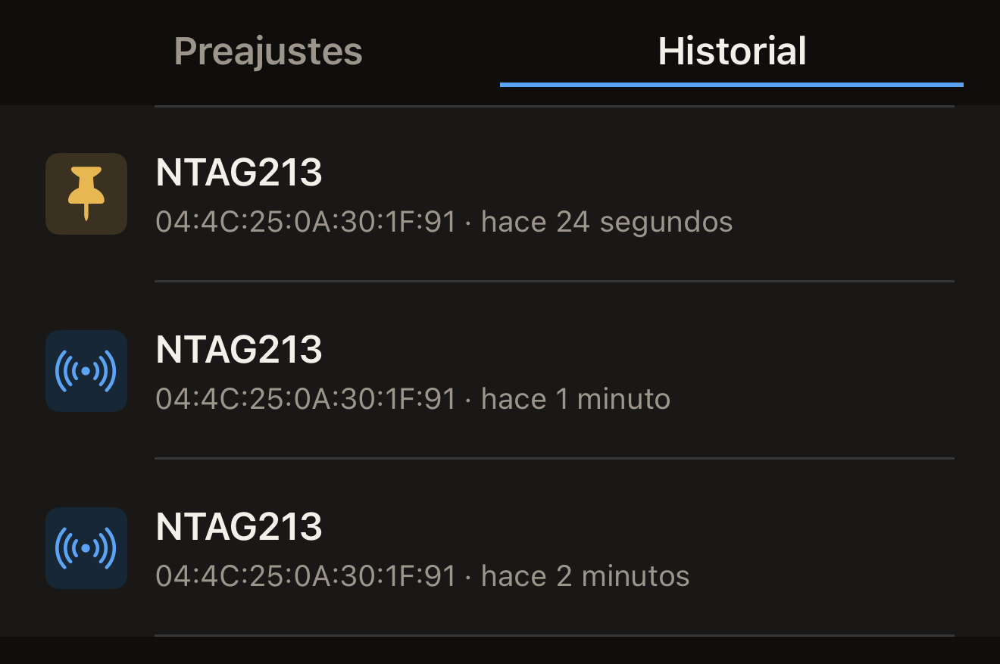

Hex NFC guarda una copia de las etiquetas que lee, así que puedes volver a
abrir un escaneo sin tener la etiqueta cerca. Tus escaneos recientes están en
la Biblioteca del iPhone, del más reciente al más antiguo. Fija los que quieras
conservar.

## Abrir un escaneo que has hecho antes

Necesitas una etiqueta que ya hayas leído; hasta que escanees una,
**Historial** está vacío. Consulta [Escanear una etiqueta](scan-a-tag.md).

:::::steps
::::step[Abrir Hex NFC]
La app se abre en la pantalla de inicio de Hex NFC, que tiene los recuadros
**Escanear**, **Crear**, **Biblioteca** y **Avanzado**.
::::

::::step[Abrir la Biblioteca]
Toca **Biblioteca**. La pantalla Biblioteca se abre en **Preajustes**.
::::

::::step[Ir a tus escaneos]
En la parte superior de la pantalla Biblioteca, toca **Historial**, a la
derecha de **Preajustes**. Cada fila lleva como título el nombre del chip y,
debajo, el UID de la etiqueta y cuánto tiempo hace que la has leído.

:::figure[Cada fila indica el chip y, después, el UID de la etiqueta y cuánto hace que la has leído; en un escaneo fijado, una chincheta sustituye al icono.]

:::
::::

::::step[Abrir el escaneo]
Toca el escaneo que quieras. La Biblioteca se cierra y el escaneo se abre en la
pantalla Etiqueta, con los registros y los datos del chip del acercamiento con
el que se hizo.
::::
:::::

Una tarjeta de transporte se abre en cambio en la pantalla Tarjeta de
transporte, en modo de solo lectura, igual que cuando la has leído. La lectura de
un pasaporte nunca se guarda, así que en esta lista no aparece ningún
pasaporte. Consulta [Leer un pasaporte](passports.md). Un dispositivo de salud
tampoco se guarda nunca.

## Fijar un escaneo que quieras conservar

La lista admite 50 escaneos. Cuando llega un escaneo nuevo y la lista está
llena, el escaneo sin fijar más antiguo sale por el final. Un escaneo sin fijar
también desaparece a los 90 días de la lectura que lo creó, por corta que sea
la lista. Si al volver a escanear una etiqueta el resultado coincide con una
fila que ya tienes, cuenta como una lectura nueva y los 90 días empiezan de
nuevo. Un escaneo fijado queda fuera de ambas reglas y se conserva hasta que lo
elimines.

Los escaneos aparecen del más reciente al más antiguo y la pantalla no ofrece
ninguna forma de buscarlos, así que fija los que vayas a querer encontrar de
nuevo.

- Para fijar un escaneo, deslízalo hacia la derecha en **Historial** y toca
  **Fijar**.

Un escaneo fijado muestra una chincheta a la izquierda de su fila en lugar del
icono habitual. Mantiene su posición en la lista en vez de subir al principio.
En un escaneo que ya está fijado, la misma acción de deslizar muestra
**Dejar de fijar**, y al dejar de fijarlo el escaneo vuelve a contar entre los
50.

## Eliminar un escaneo

- Para eliminar un escaneo, deslízalo hacia la izquierda en **Historial** y
  toca **Eliminar**. Si deslizas hasta el otro extremo, el escaneo se elimina
  al instante.

:::warning
El escaneo desaparece en cuanto tocas **Eliminar**. No se pide confirmación y
no hay forma de recuperarlo, aunque si vuelves a leer la etiqueta se crea un
escaneo nuevo.
:::

## Qué contiene el historial

Antes de que leas nada, **Historial** muestra «No hay historial de escaneos»
y, debajo, la línea «Aquí aparecen las últimas 50 etiquetas que escanees. Fija
una para conservarla.»

- Si vuelves a leer la misma etiqueta y nada ha cambiado en ella, el
  escaneo que ya tienes vuelve al principio de la lista. No aparece una segunda
  fila. Cualquier diferencia en los datos del chip, en los registros o en la
  protección con contraseña de la etiqueta crea en cambio una fila nueva.
- Los escaneos se quedan en este iPhone. Solo llegan a tu cuenta de iCloud si
  activas **Sincronización con iCloud**, que al principio está desactivada.
  Consulta [La privacidad y tus datos](privacy.md).

## Ver también

- [Escanear una etiqueta](scan-a-tag.md)
- [Editar los registros de una etiqueta](edit-records.md)
- [Guardar una etiqueta como preajuste](presets.md)
