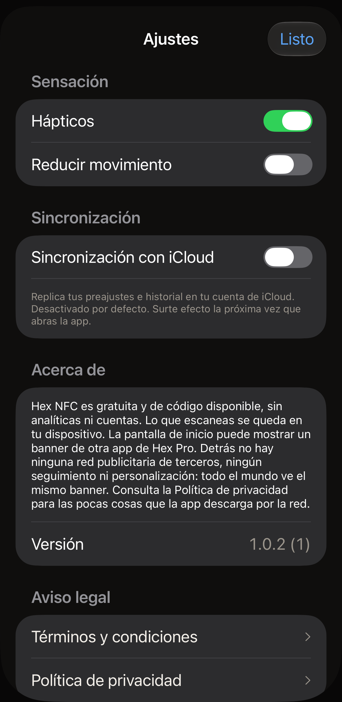

Hex NFC tiene tres ajustes, que comparten pantalla con el número de versión de
la app, una forma de enviar comentarios o valorar la app, y sus documentos
legales. En la pantalla de inicio de Hex NFC, toca el
botón del engranaje de la esquina superior derecha; no lleva ningún texto y
VoiceOver lo lee como **Ajustes**. El panel que se abre se titula **Ajustes**.
Los grupos que siguen van en el mismo orden en que los muestra la pantalla.

:::figure[El panel **Ajustes** muestra al abrirse **Sensación** y **Sincronización**, con todos los interruptores en su valor predeterminado.]

:::

## Sensación

:::table[Ajustes de Sensación]
| Ajuste | Qué hace | Valor predeterminado |
| :--- | :--- | :--- |
| **Hápticos** | Hace vibrar el iPhone durante un escaneo, una escritura y los demás momentos que la app destaca. Al desactivarlo, esas vibraciones se detienen al instante. | Activado |
| **Reducir movimiento** | Reduce las animaciones de la app. :more[La app reduce el movimiento cuando está activado este interruptor o el ajuste Reducir movimiento del propio iPhone, así que desactivar este no anula el ajuste del sistema.] | Desactivado |
:::

Mientras el ajuste Reducir movimiento del propio iPhone está activado, una
línea bajo la fila dice “«Reducir movimiento» está activado en el sistema: las
animaciones ya están al mínimo.”

## Sincronización

:::table[Ajustes de Sincronización]
| Ajuste | Qué hace | Valor predeterminado |
| :--- | :--- | :--- |
| **Sincronización con iCloud** | Replica tus preajustes y tu historial de escaneos en tu cuenta de iCloud. Las contraseñas de las etiquetas nunca se replican. Se quedan en el Llavero del iPhone que las configuró. | Desactivado |
:::

Hex NFC carga su biblioteca una sola vez, al iniciarse, así que activar o
desactivar **Sincronización con iCloud** no cambia nada hasta que cierras la
app y la vuelves a abrir. La línea bajo la fila lo indica. Cerrarla significa
salir de la app por completo. Si vuelves a la pantalla de inicio del iPhone,
Hex NFC sigue en marcha, y el interruptor que has movido sigue sin tener efecto.

### Activar la sincronización con iCloud {#turn-on-icloud-sync}

::::steps
:::step[Abrir Ajustes]
En la pantalla de inicio de Hex NFC, toca el botón del engranaje de la esquina
superior derecha.
:::

:::step[Activar la sincronización con iCloud]
Activa **Sincronización con iCloud**. El interruptor cambia de posición, pero
de momento no cambia nada más.
:::

:::step[Cerrar Hex NFC y volver a abrirla]
Sigue los pasos de [Cerrar y volver a abrir la app](#close-and-reopen-the-app).
La app vuelve a cargar su biblioteca al iniciarse, esta vez con la
sincronización en marcha.
:::

:::step[Comprobar si hay un aviso]
Vuelve a tocar el botón del engranaje y mira debajo de
**Sincronización con iCloud**. La explicación dice «Replica tus preajustes e
historial en tu cuenta de iCloud. Desactivado por defecto. Surte efecto la
próxima vez que abras la app.» Si le sigue un segundo párrafo, la
sincronización no se ha iniciado; consulta
[Si la sincronización no se inicia](#when-sync-does-not-start).
:::
::::

### Cerrar y volver a abrir la app {#close-and-reopen-the-app}

::::steps
:::step[Cerrar Hex NFC]
Desliza hacia arriba desde el borde inferior de la pantalla y detente hasta que
aparezcan las apps abiertas. En un iPhone con botón de inicio, pulsa en su lugar
dos veces el botón de inicio. Después, desliza hacia arriba la tarjeta de Hex NFC para
que salga de la pantalla.
:::

:::step[Volver a abrir Hex NFC]
Toca el icono de Hex NFC. La app vuelve a cargar su biblioteca al iniciarse,
con el valor que tenía **Sincronización con iCloud** al cerrarla.
:::
::::

Para volver a desactivar **Sincronización con iCloud** también hay que cerrar
la app y volver a abrirla. En ambos casos, tus preajustes y tu historial se
quedan en este iPhone. Hex NFC no elimina lo que ya está en iCloud. Otro iPhone
con sesión iniciada en la misma cuenta conserva todo lo que ha recibido. Lo que
se detiene es el envío de cambios nuevos desde este.

### Si la sincronización no se inicia {#when-sync-does-not-start}

Si el interruptor está activado pero iCloud no estaba accesible cuando se
inició la app, la sincronización no se inicia. Aparece una segunda línea bajo
la fila: «La sincronización no está funcionando. Tu biblioteca está a salvo en
este dispositivo, pero iCloud no estaba disponible al iniciar la app. Comprueba
que has iniciado sesión en iCloud y vuelve a abrir la app.» Tus preajustes y tu
historial siguen en el iPhone. Solo se ha detenido la replicación.

Esa línea aparece por tres motivos:

- El iPhone no tiene la sesión iniciada en iCloud.
- A la cuenta no le queda almacenamiento de iCloud.
- El iPhone no tenía conexión de red cuando se inició Hex NFC.

Revísalos en orden.

::::steps
:::step[Comprobar tu cuenta de iCloud]
Abre la app Ajustes del iPhone y toca tu nombre en la parte superior. Inicia
sesión si te lo pide y luego toca la fila iCloud y mira cuánto almacenamiento
te queda. Si no te queda nada, libera espacio o cambia tu plan de
almacenamiento en esa pantalla.
:::

:::step[Comprobar la red]
Asegúrate de que el iPhone está conectado a una red Wi-Fi o a los datos
móviles. Si cargas una página en Safari, saldrás de dudas.
:::

:::step[Cerrar Hex NFC y volver a abrirla]
Deja **Sincronización con iCloud** activada, sigue los pasos de
[Cerrar y volver a abrir la app](#close-and-reopen-the-app) y luego toca el
botón del engranaje en la pantalla de inicio de Hex NFC. Si sigue habiendo un
segundo párrafo bajo **Sincronización con iCloud**, la sincronización sigue
sin iniciarse.
:::
::::

## Acerca de

La sección Acerca de explica lo que la app hace y lo que no: no tiene
analíticas ni cuentas, y lo que escaneas se queda en tu dispositivo. También
habla del banner de otra app de Hex Pro que puede mostrar la pantalla de inicio
de Hex NFC. Detrás de ese banner no hay ninguna red publicitaria de terceros,
ningún seguimiento ni ninguna personalización. Todo el mundo ve el mismo
banner. Para saber qué pocas cosas descarga la app por la red, lee
[La privacidad y tus datos](privacy.md).

Debajo de ese párrafo, **Versión** muestra el número de versión de la app
seguido de su número de compilación entre paréntesis.

## Comentarios y valoraciones {#feedback-and-ratings}

**Enviar comentarios**, debajo de **Versión**, abre un formulario para escribir
un mensaje a Hex Pro.

1. Escribe en el cuadro del mensaje qué no va bien o qué podría mejorar.
2. Si quieres una respuesta, pon tu dirección de correo en
   **Dirección para responderte (opcional)**. Si lo dejas vacío, el mensaje se
   envía sin ella.
3. Revisa la lista de **Se envía con tu mensaje**. Muestra la versión de la
   app, la versión de iOS, el modelo de dispositivo y el idioma que acompañan a
   tu mensaje. No se envía nada de tus etiquetas, tus escaneos ni tu historial
   de escaneos.
4. Toca **Enviar** en la esquina superior derecha.

El formulario te da las gracias en cuanto el mensaje está en camino. Si no
puede conectar con Hex Pro, conserva lo que has escrito y te ofrece
**Escríbenos por correo**, que abre tu app de correo con el mensaje y los
mismos datos ya rellenados.

**Valorar Hex NFC** abre la página de la app en el App Store, donde puedes
puntuarla o escribir una reseña.

De vez en cuando, la pantalla de inicio de Hex NFC pregunta
**¿Te encanta Hex NFC?** en una tarjeta junto a su borde inferior. Solo aparece
después de unas cuantas escrituras o cambios de protección hechos con éxito, o
después de leer una tarjeta de transporte o un pasaporte completo, y solo si no
ha fallado nada en tus escaneos recientes. Espera a que la pantalla de inicio
lleve diez segundos sin que la toques, vuelve como mucho una vez al mes y nunca
tapa nada que necesites: la pantalla de encima se sigue pudiendo desplazar y
todos los botones funcionan.

Toca **¡Me encanta!** y aparece el panel de valoración de Apple, si iOS decide
mostrarlo. Toca **Regular.** y la tarjeta te ofrece **Enviar comentarios** en
su lugar. Las dos respuestas son definitivas, y la tarjeta no vuelve a
preguntar. **Ocultar** la retira durante un mes, y abrir cualquier cosa desde
la pantalla de inicio mientras está a la vista tiene el mismo efecto.

## Aviso legal

**Términos y condiciones** y **Política de privacidad** abren cada uno el
documento completo en una tarjeta de lectura que puedes desplazar y luego
cerrar con **Listo**. Cada tarjeta lleva dos líneas sobre el primer
encabezado: la fecha en que entró en vigor esa versión y «Ars Vitae Pty Ltd,
trading as Hex Pro (Australia)». Los dos documentos están en inglés, sea cual sea el idioma
del resto de la app.

Los Términos y condiciones indican lo que cuesta la app, en la sección titulada
«3. The app is free», y [Preguntas frecuentes](faq.md) también lo responde. La
Política de privacidad es el documento en el que se basa
[La privacidad y tus datos](privacy.md).

## Ver también

- [Guardar una etiqueta como preajuste](presets.md)
- [Buscar una etiqueta que has escaneado antes](scan-history.md)
- [La privacidad y tus datos](privacy.md)
