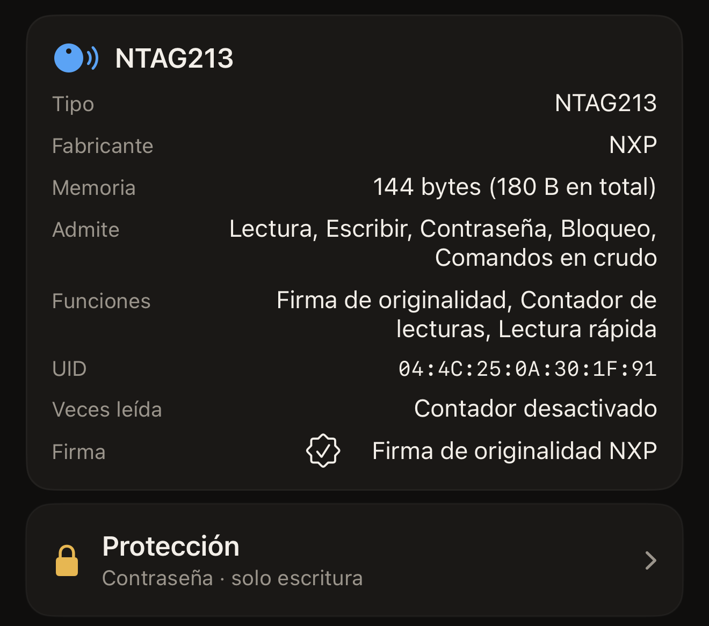

Una etiqueta pegada en un cartel responde a cualquier teléfono que se le acerque,
y un chip sin protección permite que cualquiera de ellos sobrescriba lo que has
escrito. La protección es la respuesta del propio chip a ese problema. El secreto
se guarda en las páginas de configuración del chip, y el chip rechaza cualquier
cambio hasta que se le presenta el secreto. Hex NFC puede establecer ese secreto
desde el iPhone, presentarlo en un escaneo posterior y volver a quitarlo. La
protección pertenece a la etiqueta, no a la app.

## Qué rechaza una etiqueta protegida

De forma predeterminada, la protección cubre la escritura. Una etiqueta protegida
así se sigue pudiendo leer desde cualquier teléfono, que es lo que conviene en un
cartel o en una tarjeta de visita. La gente acerca el teléfono y obtiene el
enlace, y nadie más lo cambia. Dos familias de chips pueden extender la
protección también a la lectura, lo que cambia lo que puede hacer cualquier
escaneo posterior.

Escanea la etiqueta, como se explica en [Escanear una etiqueta](scan-a-tag.md).
En un chip que admite protección, la pantalla Etiqueta se abre con dos tarjetas. La tarjeta de información de la
etiqueta indica qué chip tienes en la mano. La tarjeta **Protección** muestra la
protección de la etiqueta. Toca **Protección** y se abre el panel del mismo
nombre con los ajustes.
[Proteger una etiqueta con contraseña](protect-a-tag.md) explica paso a paso
cómo establecer una.

La protección contra lectura es cosa de dos familias. En un NTAG213, NTAG215,
NTAG216 o MIFARE Ultralight EV1, el ajuste es
**Exigir la contraseña también para leer**, en **Avanzado**. Al activarlo, la
protección se extiende a la lectura. El panel deja clara la consecuencia: «Las
etiquetas protegidas contra lectura no pueden releerse, ni siquiera para
verificar, sin la contraseña.» En un NTAG424 DNA el ajuste es **Exigir la clave
también para leer**. Está junto a la propia clave, no en **Avanzado**. Un ICODE
SLIX2 y un MIFARE Ultralight C no tienen ese ajuste: su secreto cubre la
escritura y la lectura sigue abierta.

La tarjeta **Protección** de la pantalla Etiqueta muestra en una línea un resumen
de lo que ha encontrado el escaneo. «Desactivada» significa que el escaneo ha
confirmado que no hay ningún secreto establecido. «Contraseña · solo escritura»
significa que la escritura está protegida y la lectura abierta, y «Contraseña ·
lectura y escritura» significa que lo están las dos. La cuarta respuesta es
«Desconocida · no se pudo leer la protección de esta etiqueta», que no equivale a
«Desactivada»: la etiqueta no lo ha dicho. Vuelve a escanear la etiqueta: un
acercamiento que termina antes de tiempo deja a la app sin respuesta. Un chip
cuya protección la app no puede consultar da siempre esa misma respuesta. Aun
así, intentar escribir en una etiqueta de este tipo no entraña ningún riesgo. Una etiqueta
protegida rechaza la escritura, y la pantalla de escritura pide el secreto en
lugar de cambiar nada. Si escaneas una etiqueta protegida contra lectura sin
tener la contraseña, aparece «Esta etiqueta necesita su contraseña antes de
mostrar nada.»

:::figure[La tarjeta de información de la etiqueta indica el chip, y la tarjeta **Protección**, debajo, muestra el resumen, en este caso «Contraseña · solo escritura».]

:::

## Qué chips pueden llevar un secreto

La forma del secreto depende del chip, y también el campo en el que la app lo
pide. Ese campo está en la solicitud de desbloqueo, que aparece cuando una etiqueta te
rechaza. Una etiqueta protegida que no responde a un escaneo muestra «La etiqueta
está protegida» encima del campo, con **Desbloquear y volver a escanear** debajo.
Una escritura en una etiqueta protegida lo pide de la misma forma antes de
continuar.

:::table[Cómo es el secreto de cada familia de chips]
| Chip | El secreto | El campo de la solicitud de desbloqueo |
| --- | --- | --- |
| NTAG213, NTAG215, NTAG216, MIFARE Ultralight EV1 | Una contraseña de 4 bytes | **Contraseña de la etiqueta (4 bytes)** |
| NTAG424 DNA | Una clave AES de 16 bytes | **Clave de la etiqueta (AES, 16 bytes)** |
| MIFARE Ultralight C | Una clave 3DES de 16 bytes, solo escritura | **Clave de la etiqueta (3DES, 16 bytes)** |
| ICODE SLIX2 | Una contraseña de 4 bytes, solo escritura | **Contraseña de la etiqueta (4 bytes)** |
:::

Cada uno de esos campos admite el secreto en hexadecimal, dos caracteres por
byte: 8 caracteres para una contraseña de 4 bytes y 32 para una clave de 16
bytes. Se aceptan espacios o dos puntos entre los bytes, y también mayúsculas o
minúsculas, así que `FF FF FF FF` y `ffffffff` son la misma contraseña escrita de
dos formas. El campo indica «OK» cuando contiene el número correcto de bytes, y
hasta entonces repite cuántos necesita.

Un chip escaneado que no tiene ningún mecanismo de contraseña no muestra la
tarjeta **Protección**, salvo que el escaneo encuentre bits de bloqueo grabados.
Un resultado de bloqueo hace que la tarjeta vuelva a aparecer para mostrarlo.
Indica «Bloqueada permanentemente», «Bloqueada en parte · parte de esta etiqueta
es de solo lectura para siempre» o «Bloqueo escrito · vuelve a escanear para
confirmarlo». En una etiqueta bloqueada, la tarjeta informa sin abrirse. La
tarjeta también aparece en la pantalla Etiqueta antes de escanear ninguna
etiqueta, y así es como un preajuste recoge los ajustes de protección. Qué chip
tienes en la mano lo sigue indicando la tarjeta de información de la etiqueta.
[Etiquetas compatibles con Hex NFC](tags-that-work.md) explica todo lo demás que
puede hacer cada uno. El panorama completo, chip por chip, está en la
[matriz de compatibilidad de chips](../developer/chip-support-matrix.md).

En un MIFARE Ultralight C, la protección contra lectura oculta precisamente las
páginas con las que la app identifica el chip. Una etiqueta protegida así no se
podría volver a reconocer nunca, y mucho menos desbloquear. La app explica ese
límite de solo escritura con estas palabras: «Hex NFC puede proteger esta
etiqueta contra escritura, pero no contra lectura.»

## Por qué perder la contraseña es definitivo

Nada del secreto de una etiqueta se puede recuperar desde fuera. Para una
contraseña de 4 bytes, la propia advertencia de la app lo dice todo: «Si pierdes
la contraseña, la memoria protegida se pierde. No hay recuperación posible.» Los
chips que usan clave dicen lo mismo con más detalle: «Si pierdes esta clave, no
podrás volver a escribir esta etiqueta nunca. No hay restablecimiento de fábrica
para un NTAG424. Guárdala en un lugar seguro.» y «Si pierdes esta clave, la
memoria protegida no podrá reescribirse nunca. El Ultralight C no tiene
restablecimiento de fábrica. Guárdala en un lugar seguro.» La contraseña de un
SLIX2 solo se puede restablecer presentando la actual, así que perderla acaba
igual.

Hex NFC conserva en un único lugar el secreto que guardas con un preajuste: «El
secreto se guarda solo en este dispositivo (Llavero). Nunca se sincroniza ni
viaja en una exportación.» Por eso, un preajuste que compartes con otra persona,
o que restauras en otro iPhone, llega sin la contraseña.
[Guardar una etiqueta como preajuste](presets.md) explica qué supone eso para
reutilizar uno en un montón de etiquetas. Guarda tu propia copia en un lugar de
confianza.

## Cambiar la protección requiere dos acercamientos

::include[two-tap-confirmation]

No tienes que ir a buscar ese UID. La app lo muestra junto al campo, bajo
«Escribe el UID de esta etiqueta para confirmar.», como una serie continua de
caracteres hexadecimales, sin separadores. Se aceptan mayúsculas y minúsculas.
Establecer un secreto y quitarlo son cambios en la etiqueta, así que los dos
pasan por esa confirmación.

## Ver también

- [Escanear una etiqueta](scan-a-tag.md)
- [Proteger una etiqueta con contraseña](protect-a-tag.md)
- [Quitar la contraseña de una etiqueta](remove-password.md)
- [Limitar los intentos incorrectos de contraseña](attempt-limit.md)
- [Bloquear una etiqueta permanentemente](permanent-lock.md)
