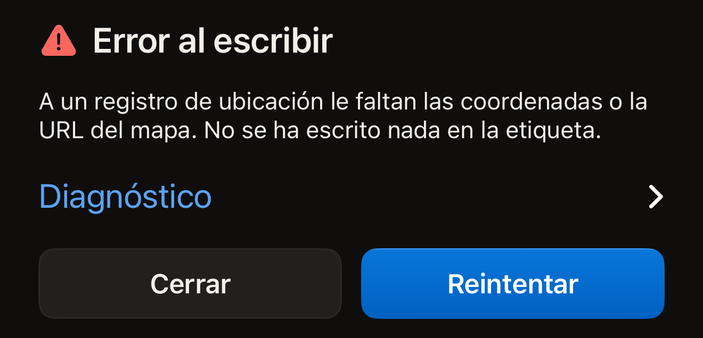
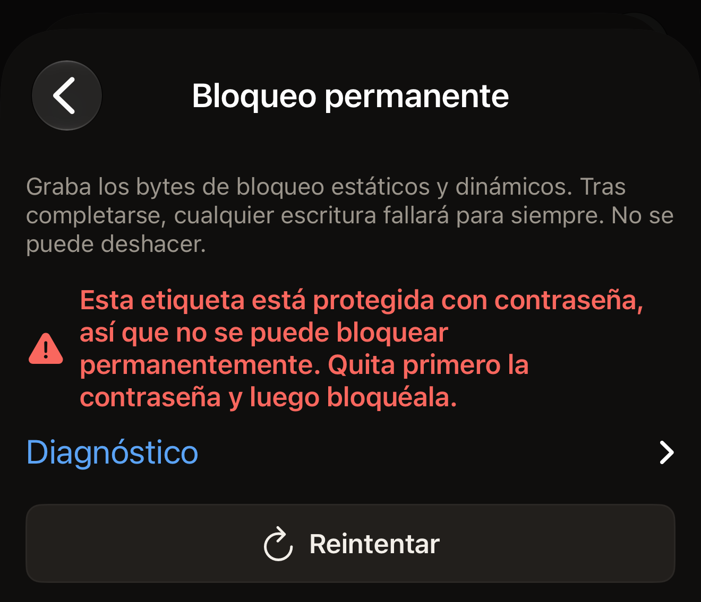

Casi todas las lecturas fallidas se deben a una etiqueta que se ha movido. Apoya
el borde superior del iPhone en plano sobre la etiqueta, mantenlo quieto durante
un segundo, más o menos, y toca **Reintentar**.

Hex NFC explica lo que ha fallado con una frase en lugar de mostrar un código.
Busca más abajo la frase que has visto. Justo debajo de cada mensaje de error
hay una fila cerrada llamada **Diagnóstico**, con una flecha a la derecha. Toca
la fila y el detalle técnico se abre debajo.

## Buscar tu mensaje

- [Tiempo agotado, etiqueta perdida a mitad de la lectura o escaneo cancelado](#scan-stopped)
- [MIFARE Classic, sin NFC en este dispositivo, una compilación no autorizada,
  una operación que la etiqueta no admite o un dispositivo de salud](#tag-not-readable)
- [Registros demasiado grandes, o la etiqueta ha devuelto algo distinto](#write-failed)
- [Otra etiqueta, después de escribir el UID de una etiqueta](#different-tag)
- [Una comprobación de contraseña que no ha terminado](#password-check)
- [Ha ocurrido un error inesperado](#unexpected)

## Probar esto primero

- Apoya el borde superior del iPhone sobre la etiqueta, no el centro de la parte
  trasera.
- Si el iPhone lleva una funda metálica, quítasela, y separa la etiqueta de
  cualquier superficie de metal.
- Mantén la etiqueta y el iPhone quietos, juntos, hasta que la app responda.
- Prueba con otra etiqueta. Si la segunda se lee, lo que hay que revisar es la
  primera.

## ¿Qué significa «Error al escanear»? {#scan-failed}

«Error al escanear» es el título que aparece sobre una lectura que la app no ha
podido terminar. La frase que hay debajo indica el motivo, y los apartados
siguientes se agrupan según ese motivo.

::::steps
:::step[Abrir el diagnóstico]
Toca **Diagnóstico**, la fila que está justo debajo del mensaje. El detalle se
abre debajo, y el texto se puede seleccionar para que lo copies.
:::

:::step[Iniciar un nuevo escaneo]
Toca **Reintentar**. La pantalla de escaneo abre una sesión nueva y espera con
«Acerca la etiqueta a la parte superior del iPhone».
:::

:::step[Mantener la etiqueta quieta]
Apoya el borde superior del iPhone en plano sobre la etiqueta y mantenlo ahí
hasta que la app responda.
:::
::::

## ¿Por qué se ha detenido el escaneo a medias? {#scan-stopped}

«Se ha agotado el tiempo de escaneo. Mantén la etiqueta firme en la parte
superior del teléfono e inténtalo de nuevo. Si con una etiqueta concreta se
agota el tiempo cada vez, puede que sea una MIFARE Classic, que el iPhone no
puede leer (una limitación de iOS, no un fallo de la etiqueta).»

iOS ha terminado la sesión porque ninguna etiqueta le ha respondido antes de
que se agotara el tiempo. Ves esta frase cuando el iPhone ya había encontrado una
etiqueta en la misma pantalla, por ejemplo en el segundo acercamiento de una
etiqueta protegida, o cuando un intento anterior en esa pantalla ha terminado con
un error. Mueve despacio el borde superior del iPhone sobre la etiqueta y déjalo
ahí.

Cuando el iPhone no ha encontrado ninguna etiqueta, la pantalla dice en cambio
«No se encontró ninguna etiqueta», con **Reintentar** debajo. No es un fallo,
así que no hay diagnóstico debajo. La solución es la misma: apoya el borde
superior del iPhone en plano sobre la etiqueta y mantenlo quieto.

Si una etiqueta empieza a responder y luego deja de hacerlo, la frase es otra:
«Se perdió la etiqueta a mitad de la lectura. Mantenla apoyada en la parte
superior del teléfono e inténtalo de nuevo.» La etiqueta ha salido del campo de
lectura a mitad de un comando.

«Escaneo cancelado.» significa que el escaneo se ha cerrado antes de terminar, ya
sea porque lo has cerrado tú o porque lo ha cerrado la app. Aparece cuando el iPhone
ya ha encontrado una etiqueta en la misma pantalla, o después de que un intento
anterior en ella terminara con un error. Si cierras el panel de escaneo de iOS antes de
que se encuentre ninguna etiqueta, se cierra sin más, sin ningún mensaje. Un escaneo
solo lee, así que no ha cambiado nada en la etiqueta.

## ¿Por qué el iPhone no puede leer esta etiqueta en absoluto? {#tag-not-readable}

Tres mensajes indican que la lectura es imposible, da igual cómo sostengas la
etiqueta. Aquí se incluyen también otros dos, y ninguno es un fallo de lectura.

«Parece una etiqueta MIFARE Classic. El iPhone la detecta pero no puede leer su
memoria cifrada: iOS no expone las claves MIFARE Classic que cualquier app
necesitaría.» El chip ha respondido lo suficiente para que la app reconozca la
familia. No ha llegado más lejos.

:::important[Ninguna app de iPhone lee una MIFARE Classic]
iOS no entrega a ninguna app las claves que desbloquean la memoria de ese chip,
así que ningún ajuste de Hex NFC cambia el resultado. Usa en su lugar una
etiqueta de [Etiquetas compatibles con Hex NFC](tags-that-work.md).
:::

«Este dispositivo no admite NFC.» La app no ha podido abrir ninguna sesión NFC
en este iPhone. El iPhone no tiene ningún interruptor de NFC que se pueda volver
a activar. Ningún ajuste de Hex NFC cambia esto. Acercar la etiqueta de otra
manera no servirá de nada. [Preguntas frecuentes](faq.md) explica lo que
necesita la app para funcionar. Si el mensaje aparece en un iPhone en el que
Hex NFC funciona por lo demás, abre **Diagnóstico** y copia el texto. Envíalo
como se explica en [Si necesitas más ayuda](#if-you-need-more-help).

«Esta compilación aún no está autorizada para ese tipo de etiqueta.» Tu copia de
la app no está registrada para leer ese tipo de etiqueta. Nada de la etiqueta ni
de la forma de sostenerla cambia eso. Busca primero en el App Store una
actualización de Hex NFC. Si el mensaje vuelve a aparecer, abre **Diagnóstico**
y envía el texto como se explica en
[Si necesitas más ayuda](#if-you-need-more-help).

«Esta etiqueta no admite esa operación.» es el mensaje que no tiene que ver con
la lectura. La etiqueta se ha leído. Lo que no hace es la operación que has
pedido, por el camino que has elegido. La tarjeta de información de la etiqueta
muestra el nombre del chip. Cuando el chip aporta esos datos, sus filas
**Admite** y **Funciones** dicen lo que puede hacer.

**Operaciones** > **Proteger con contraseña** y la tarjeta **Protección** de la
pantalla Etiqueta protegen los mismos siete chips: NTAG213, NTAG215, NTAG216,
MIFARE Ultralight EV1, MIFARE Ultralight C, NTAG424 DNA e ICODE SLIX2.
[Proteger una etiqueta con contraseña](protect-a-tag.md) explica los dos
caminos. [Etiquetas compatibles con Hex NFC](tags-that-work.md) trata de los
chips que reconoce la app. La
[matriz de compatibilidad de chips](../developer/chip-support-matrix.md) tiene
todo el detalle técnico, chip por chip.

«Esto es un dispositivo de salud. Hex NFC nunca escribe en dispositivos de salud
ni les envía comandos.» significa que lo que has acercado es un dispositivo
médico, como una pluma de insulina. Una escritura, una operación o un comando de
la consola de **Avanzado** dirigido a él se detiene antes de escribir nada o de
enviar tu comando, así que el dispositivo no cambia. Si lo escaneas con
**Escanear**, se abre su pantalla **Dispositivo de salud**, que se explica en
[Dispositivos de salud](tags-that-work.md#health-devices).

## ¿Qué significa «Error al escribir»? {#write-failed}

«Error al escribir» es el título que aparece sobre una escritura, una relectura
o un cambio de protección que no ha terminado. Debajo hay tres controles.
**Diagnóstico** contiene el detalle, **Cerrar** te devuelve al editor y
**Reintentar** vuelve a ejecutar la escritura y conserva la contraseña que
has escrito. En una escritura iniciada desde la pantalla Etiqueta que activa o
desactiva la protección, el reintento vuelve a leer el UID de la etiqueta. Te
pide que lo escribas otra vez. Tu consentimiento para cambiar una etiqueta no se
conserva tras un fallo. Un preajuste escrito desde **Biblioteca** no se confirma
así: la etiqueta que acerques es la instrucción, así que su reintento vuelve
directamente a un solo acercamiento.

:::figure[Una escritura fallida indica su motivo bajo «Error al escribir», con **Diagnóstico** debajo y **Cerrar** junto a **Reintentar**.]

:::

Dos de los mensajes tienen su propia solución.

«Estos registros son demasiado grandes para esta etiqueta.» Tus registros
necesitan más espacio del que tiene el área de datos del chip. Acorta o elimina
un registro, o escribe en una etiqueta con más memoria.
[Tipos de registro](record-types.md) indica cuánto espacio ocupa cada tipo de
registro.

«La etiqueta devolvió algo distinto de lo que se envió. Vuelve a intentar la
escritura.» La app ha releído la etiqueta después de escribir y los bytes no
coincidían con lo que había enviado. Toca **Reintentar** con la etiqueta quieta.

## ¿Por qué se ha rechazado la etiqueta después de escribir su UID? {#different-tag}

::include[two-tap-confirmation]

«Esa es otra etiqueta.» significa que la etiqueta que has acercado no es la que
esperaba la app. La fila **Diagnóstico** indica qué acercamiento ha provocado el
mensaje y qué etiqueta se esperaba.

En la pantalla **Operaciones** aparece en el segundo acercamiento. La etiqueta
que has acercado no es aquella cuyo UID has escrito. Vuelve a acercar la misma
etiqueta o empieza de nuevo con la etiqueta que querías cambiar.

Un cambio de protección desde la pantalla Etiqueta puede provocarlo en
cualquiera de los dos acercamientos. En el segundo significa lo mismo. En el
primero todavía no se ha escrito nada. Ahí, la etiqueta que has acercado no es
la etiqueta desde la que se ha abierto el editor. Acerca esa etiqueta.

En la pantalla **Operaciones**, una operación fallida muestra el mensaje, con
**Diagnóstico** justo debajo y **Reintentar** debajo de este. Dos pantallas
sustituyen ese botón: **Límite de intentos** muestra **Empezar de nuevo**, y
**Quitar contraseña** muestra **Introducir otra contraseña**. Las dos vuelven a
pedir la contraseña, así que el siguiente intento envía lo que escribas a
continuación y no la contraseña que la etiqueta acaba de rechazar.

:::figure[En la pantalla **Bloqueo permanente**, un bloqueo rechazado muestra su mensaje, luego **Diagnóstico** y luego **Reintentar**.]

:::

## ¿Qué pasa si la comprobación de la contraseña no termina? {#password-check}

«No se ha podido comprobar la contraseña: la etiqueta dejó de responder.
Mantenla quieta en la parte superior del teléfono e inténtalo de nuevo.» La
etiqueta se ha quedado en silencio mientras la app comprobaba la contraseña. No se ha
determinado nada sobre ella, ni en un sentido ni en otro. La app no te está
diciendo que la contraseña sea incorrecta. Mantén la etiqueta quieta y vuelve a
ejecutar la operación.
[Quitar la contraseña de una etiqueta](remove-password.md) trata de la
contraseña que de verdad ya no abre una etiqueta.

## ¿Por qué un mensaje dice que ha ocurrido un error inesperado? {#unexpected}

«Ha ocurrido un error inesperado.» aparece en la pantalla de escaneo, en la de
escritura y en la pantalla **Operaciones**. Se muestra cuando la app no reconoce
un fallo como un error de la etiqueta. «Ha ocurrido algo inesperado. Inténtalo
de nuevo.» procede de la capa NFC por el mismo motivo.

Otros dos describen una etiqueta que responde de una forma que la app no
esperaba:

- «La etiqueta respondió fuera del protocolo esperado.»
- «La etiqueta respondió con datos que esta app no pudo interpretar.»

Con los cuatro hay que hacer lo mismo. Abre **Diagnóstico**, copia el texto y
vuelve a acercar la etiqueta. Si el mismo mensaje vuelve a aparecer con la misma
etiqueta, el diagnóstico copiado identifica el fallo.

## Si necesitas más ayuda {#if-you-need-more-help}

Envía el diagnóstico copiado a Hex Pro desde la app: en la pantalla de inicio,
toca el botón del engranaje y luego **Enviar comentarios**, y pégalo en el
mensaje. Añade el nombre del chip si la etiqueta se ha leído lo suficiente para
mostrar una tarjeta de información. Si no ha llegado a leerse, dilo, e indica
qué etiquetas se leen y cuáles no. El formulario añade por sí solo la versión
de la app, la versión de iOS, el modelo del dispositivo y el idioma. Para
recibir respuesta, escribe tu correo en
**Dirección para responderte (opcional)**.
[Comentarios y valoraciones](settings.md#feedback-and-ratings) describe el
formulario.

También puedes escribir a `support@hex.pro`, la dirección que aparece en la
**Política de privacidad** y en los **Términos y condiciones**, dentro de
**Aviso legal** en **Ajustes**. Por correo, incluye la versión de la app que
aparece en **Versión** en **Ajustes**, y el modelo del iPhone y la versión de
iOS, que la app Ajustes del iPhone muestra en General y luego Información.

A continuación, lee [Escanear una etiqueta](scan-a-tag.md) para ver cómo es una
lectura correcta, o [Preguntas frecuentes](faq.md) para saber qué necesita la
app para funcionar.
