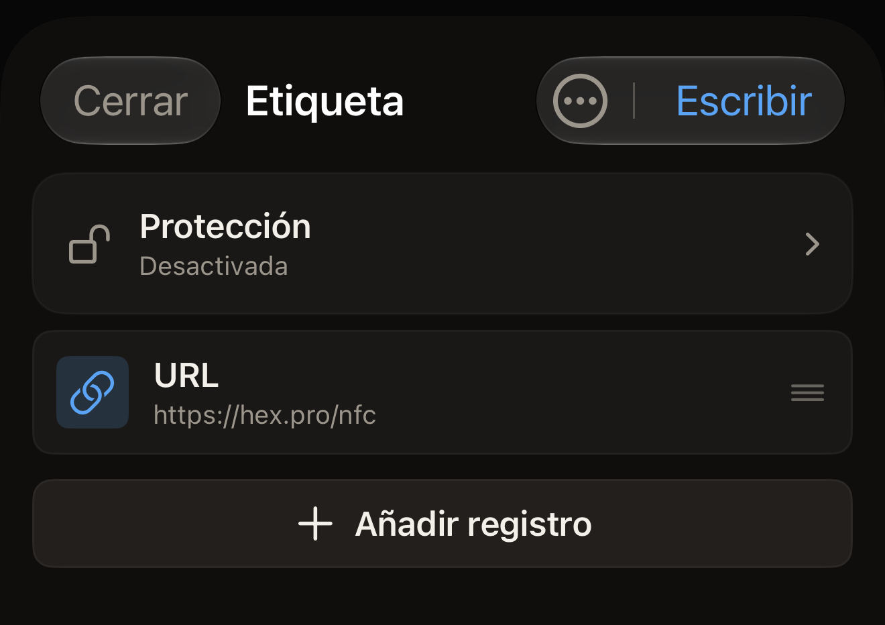
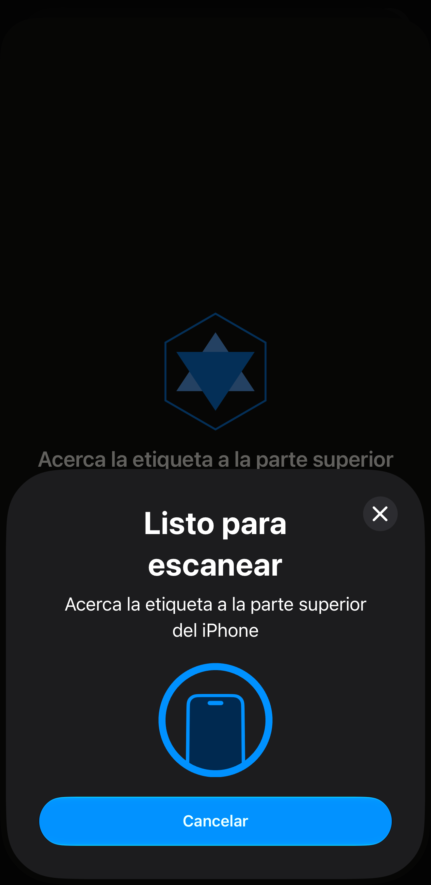

Una etiqueta puede contener una dirección web, y el teléfono que la lee
ofrece esa dirección. En Hex NFC, la dirección es un registro URL. Creas el
registro en el iPhone y después acercas la etiqueta una vez para transferirle
el registro.

Antes de empezar, ten a mano la etiqueta. Si no estás seguro de que todavía
se pueda escribir en una etiqueta, escanéala primero, como se explica en
[Escanear una etiqueta](scan-a-tag.md). El escaneo abre la pantalla Etiqueta.
Ahí, **Escribir** está disponible en una etiqueta que todavía admite
escritura. Aparece atenuado en una etiqueta que la app lee como bloqueada
permanentemente, que rechaza cualquier escritura. Toca **Cerrar** para salir
de esa pantalla a la pantalla de inicio de Hex NFC y empieza por el paso 1.

## Escribir un enlace en una etiqueta vacía

:::::steps
::::step[Empezar desde cero]
En la pantalla de inicio de Hex NFC, toca **Crear**. Se abre la pantalla
Etiqueta sin registros, bajo el título «Etiqueta vacía».
::::

::::step[Añadir un registro URL]
Toca **Añadir registro** > **URL**. El editor de registros se abre con el
registro nuevo.
::::

::::step[Introducir la dirección]
En **URL**, escribe la dirección con su esquema delante, por ejemplo
`https://hex.pro`, y toca **Guardar**. El registro aparece en la lista. La
app escribe la dirección exactamente como la has introducido y no añade nada.
Una dirección que llega a la etiqueta sin su `https://` no es un enlace que
funcione. El teléfono que lea esa etiqueta no tendrá ninguna página que
abrir.

:::figure[Después de tocar **Guardar**, la pantalla Etiqueta muestra el nuevo registro **URL**, y **Escribir**, arriba a la derecha, ya se puede tocar.]

:::
::::

::::step[Enviar el registro a la etiqueta]
Toca **Escribir**, en la parte superior de la pantalla Etiqueta. Se abre la
pantalla de escritura con el texto «Acerca la etiqueta a la parte superior del
iPhone». iOS coloca su propio panel de escaneo encima de la app, con la misma
línea.

:::figure[La línea de la pantalla de escritura asoma por encima del panel de escaneo de iOS, que la repite y tiene su propio botón Cancelar.]

:::
::::

::::step[Acercar la etiqueta al iPhone]
Apoya el borde superior del iPhone sobre la etiqueta y mantenlo ahí. La
pantalla muestra «Escribiendo…» y después «Verificando…». Nada de este paso
bloquea la etiqueta. Puedes volver a escribir en ella tantas veces como
quieras. El mensaje final, «Escritura completada», solo indica que los
registros se han escrito y se han releído intactos. La pantalla se cierra
sola y vuelve la pantalla Etiqueta.
::::
:::::

Al escribir se sustituye todo lo que contenía la etiqueta. Si quieres
conservar parte de lo que ya hay en una etiqueta, escanéala primero. Edita
esa lista en lugar de crear una nueva, como se explica en
[Editar los registros de una etiqueta](edit-records.md).

:::tip[Cualquier tipo de registro se escribe igual]
Un enlace es lo más habitual en una etiqueta, y es uno de los 13 tipos de
registro que puedes añadir. [Tipos de registro](record-types.md) los enumera
todos, y los pasos anteriores son los mismos sea cual sea el que elijas.
:::

## Qué comprueba la app antes de dar la escritura por buena

La app nunca se fía de lo que dice la etiqueta sobre una escritura. Envía los
registros, vuelve a leer la etiqueta y compara lo que recibe con lo que ha
enviado. «Escritura completada» significa que, al releerla, la etiqueta
contenía exactamente lo que has escrito.

Hay un estado que detiene la escritura en lugar de completarla. En una
etiqueta cuya contraseña protege sus registros, la pantalla de escritura
muestra «La etiqueta está protegida» y pide esa contraseña antes de escribir
nada. Escribe la contraseña en **Contraseña de la etiqueta (4 bytes)** y toca
**Desbloquear y escribir**. Después, vuelve a acercar la etiqueta a la parte
superior del iPhone. Ese segundo acercamiento es el que autentica y escribe.
La app no muestra la solicitud cuando ya tiene la contraseña desde que
has protegido la etiqueta, y la escritura se completa en un solo acercamiento.
Si no sabes la contraseña, toca **Cancelar**: tus registros se quedan en la
pantalla Etiqueta. Consulta [Protección de etiquetas](tag-protection.md) para
saber qué hace una contraseña en una etiqueta.

Con una etiqueta que no tiene el encabezado donde van los registros, nada
detiene la escritura antes de empezar. La app envía los registros, la
relectura no encuentra nada legible en la etiqueta y la escritura termina en
«Error al escribir».

Lo que te libra de ese caso es un escaneo. En una etiqueta que la app ha
detectado sin formatear al escanearla, la pantalla Etiqueta muestra «Esta
etiqueta no está formateada» encima de la lista de registros. Debajo, la
pantalla dice «No tiene Capability Container, así que los registros que
escribas ahora no serán legibles. Formatéala primero.» Toca ese aviso para
abrir la pantalla Operaciones y formatear la etiqueta. Una etiqueta que has
empezado desde **Crear** no tiene ningún escaneo detrás, así que la pantalla
Etiqueta no tiene con qué avisarte.

Los registros que has creado no se pierden con la reparación. Toca el botón
de menú de la parte superior derecha de la pantalla Etiqueta y después
**Operaciones…**. La pantalla Operaciones se abre encima de la pantalla
Etiqueta, y tus registros siguen ahí cuando la cierras. Consulta
[Borrar o formatear una etiqueta](erase-or-format.md).

Para detener una escritura antes de que empiece, toca **Cancelar** en la
pantalla de escritura mientras todavía espera una etiqueta. Tus registros se
quedan en la pantalla Etiqueta. Tocar Cancelar en el panel de escaneo de iOS
antes de que se lea ninguna etiqueta tiene el mismo efecto. Si no hay ninguna
etiqueta junto al iPhone, el panel de escaneo de iOS se cierra solo al cabo de un minuto
aproximadamente, y la pantalla de escritura muestra «No se encontró ninguna
etiqueta» con **Cerrar** y **Reintentar**.

## Si falla la escritura

Una escritura que falla, o una relectura que no coincide con lo que se ha enviado,
termina en «Error al escribir» con el motivo debajo. Desde ahí:

- Para enviar otra vez los mismos registros, toca **Reintentar**. Conservas
  todo lo que ya hayas escrito.
- Para volver a la pantalla Etiqueta sin escribir, toca **Cerrar**.

Si una etiqueta sigue rechazando la escritura, puede que no sea del tipo
adecuado para lo que escribes.
[Etiquetas compatibles con Hex NFC](tags-that-work.md) indica qué chips
reconoce la app, y la
[matriz de compatibilidad de chips](../developer/chip-support-matrix.md)
tiene los detalles de cada chip.

## Ver también

- [Editar los registros de una etiqueta](edit-records.md)
- [Guardar una etiqueta como preajuste](presets.md)
- [Si no se puede escanear o escribir una etiqueta](troubleshooting.md)
