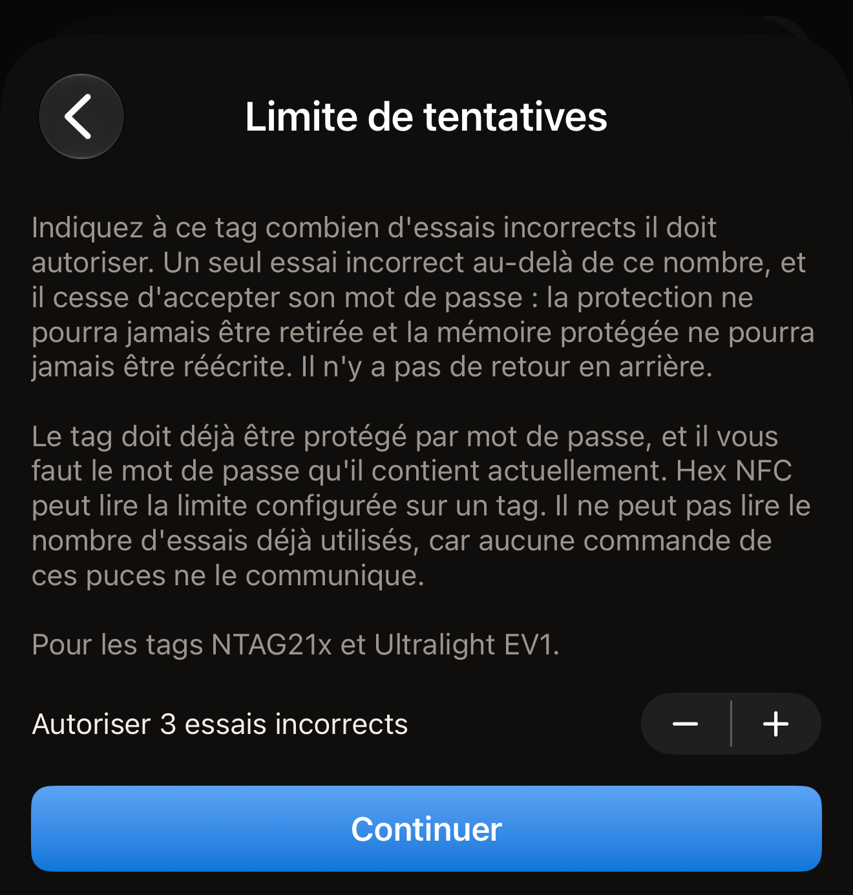
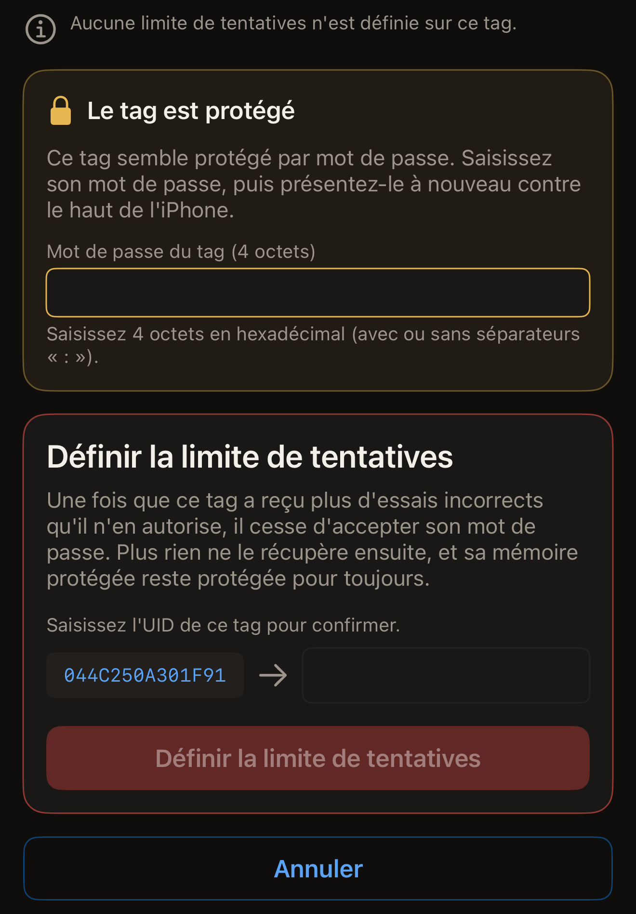

Une limite de tentatives indique à un tag protégé par mot de passe combien de
mots de passe incorrects accepter, et Hex NFC écrit ce nombre sur le tag depuis
l'iPhone. Réglez-la sur 3, et le tag accepte trois essais incorrects ; l'essai
suivant l'amène à cesser définitivement d'accepter son mot de passe. Dès lors, la
protection ne pourra jamais être retirée, et la mémoire protégée ne pourra
jamais être réécrite. Il n'y a pas de retour en arrière.

Avant de commencer :

- Le tag doit déjà être protégé par mot de passe.
- Il vous faut le mot de passe qu'il contient actuellement.
- La puce doit être un NTAG21x ou un MIFARE Ultralight EV1, car ce champ
  n'existe que sur ces puces.

Pour savoir ce que porte une puce, consultez [Tags compatibles avec Hex
NFC](tags-that-work.md) ou la [matrice de prise en charge des
puces](../developer/chip-support-matrix.md).

La limite ne fait pas partie de la carte **Protection**. Elle se trouve sur
l'écran « Opérations », sous **Actions dangereuses**, car elle s'applique à un
seul tag à la fois et ne peut pas être annulée.

::include[two-tap-confirmation]

Le scan qui ouvre le tag ne compte pas parmi ces deux passages. Ici, vous
présentez le tag trois fois en tout : une fois pour le scanner, puis pour les
deux passages de l'opération.

:::warning[Un mot de passe incorrect peut coûter un essai]
Si le tag est déjà doté d'une limite, le mot de passe que vous saisissez ici est
décompté quand le tag le refuse. Hex NFC indique la limite configurée sur un
tag, mais aucune commande de ces puces ne dit combien d'essais ont déjà été
utilisés. Rien ne permet non plus de tester un mot de passe sans consommer l'un
de ces essais. L'app ne vous réaffiche jamais le mot de passe d'un tag. Aucune
puce n'en livre. Le mot de passe à saisir est celui que vous avez conservé quand
vous avez protégé le tag.
:::

## Définir la limite de tentatives

:::::steps
::::step[Scanner le tag]
Sur l'écran d'accueil de Hex NFC, touchez **Scanner**, puis tenez le tag contre
le haut de l'iPhone. Le contenu du tag s'ouvre sur l'écran « Tag ». La carte du
haut porte le nom de la puce en titre. La carte **Protection** se trouve juste
en dessous, au-dessus des enregistrements.

Un tag dont le mot de passe ne protège que l'écriture se scanne comme n'importe
quel autre. Sa carte **Protection** indique « Mot de passe · écriture seule ».

Un tag dont le mot de passe protège aussi la lecture interrompt au contraire le
scan. L'écran de scan affiche « Le tag est protégé » et demande le mot de passe.
Saisissez-le, puis touchez **Déverrouiller et rescanner**. L'écran « Tag »
s'ouvre alors, et sa carte **Protection** indique « Mot de passe · lecture et
écriture ». Ce déverrouillage présente le mot de passe au tag : une saisie
erronée consomme donc l'un des essais dont il est question sur cette page.
[Scanner un tag](scan-a-tag.md#unlock-a-protected-tag) décrit le déverrouillage
en détail.
::::

::::step[Ouvrir l'écran de la limite de tentatives]
Sur l'écran « Tag », touchez le bouton de menu en haut à droite, à côté du
bouton **Écrire**, puis touchez **Opérations…**. Sur l'écran « Opérations »,
touchez **Limite de tentatives** dans la carte **Actions dangereuses**.
::::

::::step[Choisir le nombre d'essais incorrects autorisés]
La ligne indique **Autoriser 3 essais incorrects**, et son nombre change quand
vous touchez les boutons plus et moins à côté. Choisissez un nombre de 1 à 7. La
valeur de départ est 3. Les boutons plus et moins ne permettent pas de choisir
l'absence de limite : cet écran peut modifier la limite d'un tag, mais jamais la
retirer. Retirer le mot de passe du tag efface la limite avec lui, ce qui exige
un mot de passe que le tag accepte encore.

:::figure[L'écran **Limite de tentatives** s'ouvre sur une limite de 3, avec les boutons plus et moins à côté de la ligne et **Continuer** en dessous.]

:::
::::

::::step[Toucher Continuer]
Touchez **Continuer**. Les boutons plus et moins n'acceptent plus de
modification, et l'écran demande le premier passage.
::::

::::step[Présenter le tag pour le premier passage de l'opération]
Touchez **Définir la limite de tentatives**, puis tenez le tag contre le haut de
l'iPhone. Ce passage lit l'UID du tag et la limite déjà configurée sur le tag.

Si vous fermez le panneau de scan d'iOS avant de présenter un tag, vous revenez
aux boutons plus et moins et à **Continuer**, pour choisir une autre limite. Si
le panneau se ferme de lui-même sans tag contre l'iPhone, l'écran affiche
« Aucun tag trouvé » avec **Réessayer** et **Recommencer**.
::::

::::step[Saisir le mot de passe et l'UID du tag]
Une carte intitulée « Le tag est protégé » demande le mot de passe que le tag
contient actuellement. Saisissez-le dans **Mot de passe du tag (4 octets)**, en
hexadécimal, avec ou sans séparateurs `:`. Saisissez ensuite l'UID affiché à
l'écran dans le champ à côté.

:::figure[Le mot de passe se saisit dans la carte « Le tag est protégé », et l'UID dans la carte en dessous, au-dessus de **Définir la limite de tentatives**.]

:::
::::

::::step[Présenter le même tag pour le second passage]
Touchez **Définir la limite de tentatives**, puis tenez à nouveau le tag contre
le haut de l'iPhone. L'app écrit la nouvelle limite et la relit. L'écran indique
« Ce tag est désormais réglé pour autoriser 3 essais incorrects. »

En dessous, il ajoute « Un seul essai incorrect au-delà de ce nombre, et il
cesse définitivement d'accepter son mot de passe. »
::::
:::::

## Ce que l'app indique entre les passages

Le premier passage lit les réglages du tag lui-même : l'écran indique donc ce
que contient le tag avant que vous saisissiez son UID. Il affiche l'une de ces
trois réponses :

- « Aucune limite de tentatives n'est définie sur ce tag. » Aucun nombre
  d'essais incorrects ne peut l'amener à cesser d'accepter son mot de passe.
- « Ce tag est déjà réglé pour autoriser 3 essais incorrects. » Ce nombre est
  celui que contient le tag, et la nouvelle limite le remplace.
- « Ce tag est protégé en lecture : la limite qu'il contient ne peut pas être
  lue tant que son mot de passe n'a pas été présenté. » Il n'y a rien à
  afficher. Les pages de configuration sont protégées par le mot de passe.
  L'opération continue à partir d'ici : saisissez l'UID, et le second passage
  présente le mot de passe puis écrit la nouvelle limite.

Le nombre d'essais déjà consommés par un tag n'est jamais indiqué, car aucune
commande de ces puces ne le révèle.

## Si le tag n'a pas de mot de passe

Une limite de tentatives protège un mot de passe : l'app refuse donc l'opération
sur un tag qui n'en a pas. Le refus s'affiche ainsi : « Ce tag n'a pas de mot de
passe : une limite de tentatives n'y protégerait rien. »

Le refus intervient avant toute écriture. Le tag reste exactement tel qu'il
était. Définissez d'abord un mot de passe, comme l'explique [Protéger un tag par
mot de passe](protect-a-tag.md), puis revenez ici.

## Si l'app ne peut pas relire la limite

Quand un tag s'éloigne en pleine écriture, l'écran affiche le titre « Limite de
tentatives écrite. »

L'explication indique : « Le tag a accusé réception de l'écriture, mais ce passage n'a pas pu relire l'octet. Relancez l'opération : le premier passage indique la limite enregistrée sur le tag. » La puce a accepté l'écriture. Ce passage n'a
pas pu prouver ce qui a été écrit.

L'opération est alors terminée, si bien que l'écran ne propose pas de la
relancer. Revenez à l'écran « Opérations » et ouvrez à nouveau **Limite de
tentatives**. Menez l'opération jusqu'au bout : le premier passage de cette
nouvelle opération indique la limite enregistrée sur le tag.

## Si un mot de passe cesse de fonctionner par la suite

Sur un tag doté d'une limite, un mot de passe refusé par le tag est signalé par
« Le tag a refusé ce mot de passe. Une limite de tentatives est définie sur ce
tag : il est donc peut-être bloqué, même si le mot de passe est correct. »

Une vérification qui n'a pas abouti affiche « Ce mot de passe n'a pas ouvert le
tag. Une limite de tentatives est définie sur ce tag, et chaque essai incorrect
compte. Vérifiez le mot de passe avant de réessayer. »

Dans les deux cas, la marche à suivre est la même : trouvez le bon mot de passe
avant de présenter à nouveau le tag. L'un ou l'autre message peut remplacer la demande affichée sur la carte
« Le tag est protégé ». Son champ est vide au départ : le
mot de passe refusé n'est donc pas renvoyé une seconde fois, sauf si vous le
saisissez. Une opération qui se termine au contraire sur un échec laisse
**Recommencer** à l'écran, qui rend le formulaire et redemande le mot de passe.
Dès qu'un tag a reçu plus d'essais incorrects qu'il n'en autorise, plus rien ne
l'ouvre, et sa mémoire protégée reste protégée définitivement.

## Voir aussi

- [Retirer le mot de passe d'un tag](remove-password.md)
- [Protection des tags](tag-protection.md)
- [Si un tag ne peut être ni scanné ni écrit](troubleshooting.md)
