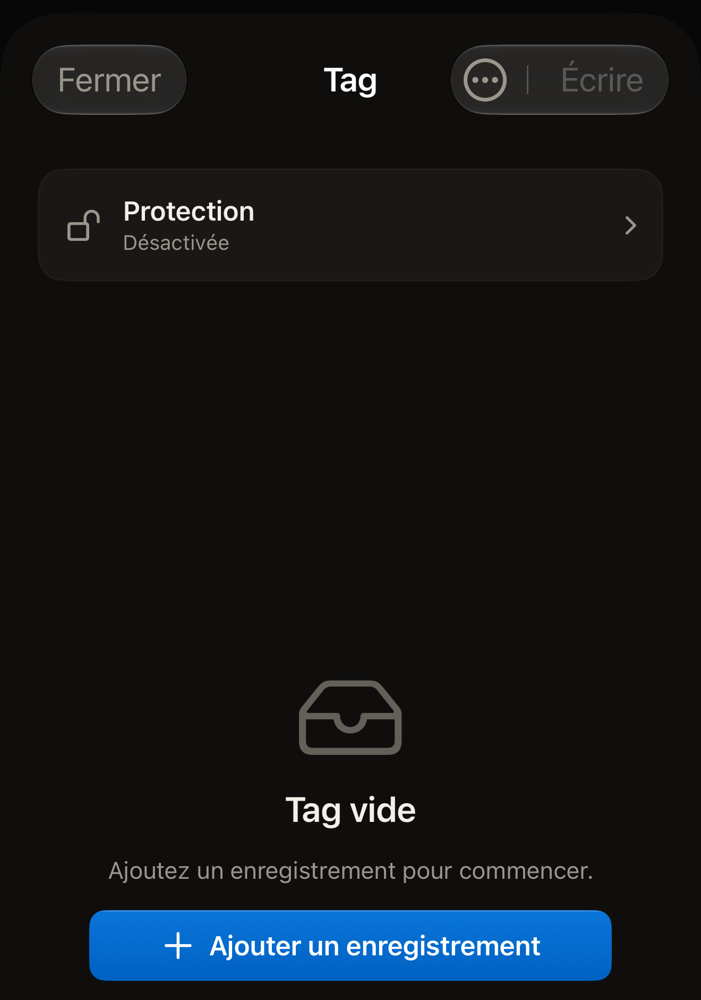
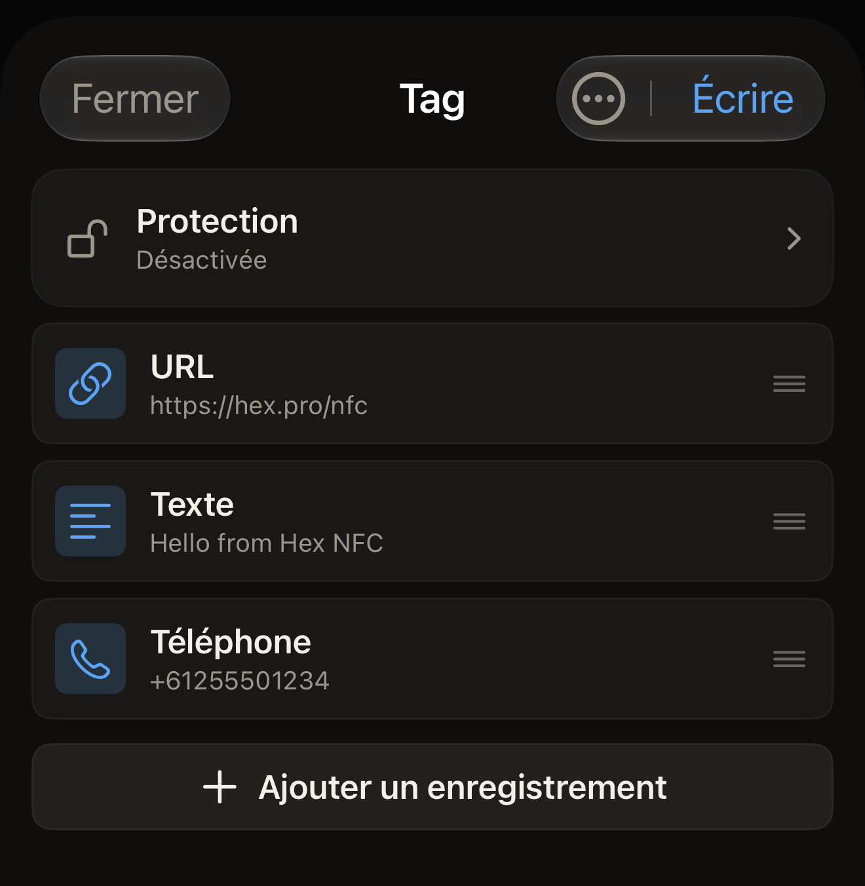

Un tag contient une liste d'enregistrements, et Hex NFC affiche cette liste
sur l'écran « Tag ». Ajoutez-en un, modifiez-en un, faites-en remonter un
dans la liste ou supprimez-en un, puis écrivez sur le tag depuis l'iPhone
une fois que la liste vous convient.

## Ouvrir la liste des enregistrements

Procédez de l'une des façons suivantes :

- Pour travailler sur un tag que vous avez en main, scannez-le. Ses
  enregistrements apparaissent sur l'écran « Tag ». Consultez [Scanner un
  tag](scan-a-tag.md).
- Pour composer un ensemble d'enregistrements sans avoir de tag devant vous,
  touchez **Composer** sur l'écran d'accueil de Hex NFC.

Un tag ou une composition qui ne contient encore rien affiche « Tag vide »,
avec « Ajoutez un enregistrement pour commencer. » en dessous.

:::figure[Une composition sans enregistrement affiche « Tag vide », et **Ajouter un enregistrement** se trouve sous le message.]

:::

## Ajouter un enregistrement

::::steps
:::step[Ouvrir le sélecteur d'enregistrements]
Sur l'écran « Tag », touchez **Ajouter un enregistrement**. Ce bouton se
trouve à la fin de la liste des enregistrements, ou sous « Tag vide » quand
le tag ne contient rien. L'écran « Ajouter un enregistrement » s'ouvre, avec
une tuile pour chaque type que vous pouvez ajouter.
:::

:::step[Choisir un type]
Touchez la tuile voulue, par exemple **Texte**, **URL**, **Contact** ou
**Wi-Fi**. L'app ajoute un enregistrement de ce type et l'ouvre pour que
vous le remplissiez.
:::

:::step[Remplir l'enregistrement]
Saisissez les informations dont l'enregistrement a besoin, puis touchez
**Enregistrer**. L'enregistrement apparaît à la fin de la liste sur l'écran
« Tag ».
:::
::::

Vous avez le choix entre 13 types. [Types d'enregistrement](record-types.md)
décrit ce que contient chacun d'eux et ce qu'en fait un téléphone quand il
lit le tag.

## Ajouter un enregistrement à partir d'un code QR

::::steps
:::step[Ouvrir le lecteur de codes QR]
Sur l'écran « Ajouter un enregistrement », touchez **Scanner un QR**.
L'écran « Scanner un code QR » s'ouvre.
:::

:::step[Autoriser la caméra]
La première fois, l'écran affiche « Autoriser la caméra à scanner un QR » et
« L'image est traitée sur l'appareil. Rien n'est envoyé. » Touchez
**Autoriser la caméra**, puis accordez l'accès quand iOS le demande. Si vous
avez refusé l'accès à la caméra auparavant, l'écran affiche plutôt « Accès à
la caméra requis ». Touchez **Ouvrir Réglages** et réactivez l'accès à la
caméra pour Hex NFC.
:::

:::step[Pointer la caméra vers le code]
Placez le code dans le cadre. L'app lit le premier code qu'elle voit, le
convertit en enregistrement et ouvre celui-ci pour que vous le vérifiiez.
:::
::::

Le type choisi correspond au contenu du code : un réseau Wi-Fi, un contact,
un e-mail, un SMS, un numéro de téléphone ou un lieu. Une adresse web
devient un enregistrement URL. Tout le reste devient un enregistrement
texte.

## Modifier, déplacer ou supprimer un enregistrement

Sur l'écran « Tag », effectuez l'une des actions suivantes :

- Pour modifier un enregistrement, touchez sa ligne, modifiez les champs,
  puis touchez **Enregistrer**.
- Pour déplacer un enregistrement, faites glisser sa ligne vers le haut ou
  vers le bas. L'ordre de la liste est l'ordre dans lequel les
  enregistrements sont écrits sur le tag.
- Pour supprimer un enregistrement, balayez sa ligne vers la gauche et
  touchez **Supprimer**. Si vous balayez la ligne jusqu'au bout, elle est
  supprimée sans ce second geste.

:::figure[Les enregistrements sont listés dans l'ordre où ils sont écrits, avec **Ajouter un enregistrement** à la fin de la liste.]

:::

Un enregistrement supprimé ici disparaît de la liste, pas du tag. Le tag
garde son contenu jusqu'à la prochaine écriture : une liste vidée par erreur
ne vous coûte donc rien. Pour vider réellement un tag, consultez [Effacer ou
formater un tag](erase-or-format.md).

## Terminer la modification

Rien de ce qui se trouve sur cet écran n'atteint le tag tant que vous
n'écrivez pas. Une fois la liste correcte, procédez de l'une des façons
suivantes :

- Pour placer les enregistrements sur le tag, touchez **Écrire**. Consultez
  [Écrire un lien sur un tag](write-a-link.md).
- Pour conserver l'ensemble et le réutiliser plus tard, ouvrez le menu en
  haut de l'écran « Tag » et touchez **Enregistrer comme préréglage…**.
  Consultez [Enregistrer un tag comme préréglage](presets.md).
- Pour quitter, touchez **Fermer**. Votre tag reste tel qu'il était, et les
  modifications que vous n'avez ni écrites ni enregistrées sont abandonnées.

## Voir aussi

- [Types d'enregistrement](record-types.md)
- [Écrire un lien sur un tag](write-a-link.md)
- [Enregistrer un tag comme préréglage](presets.md)
