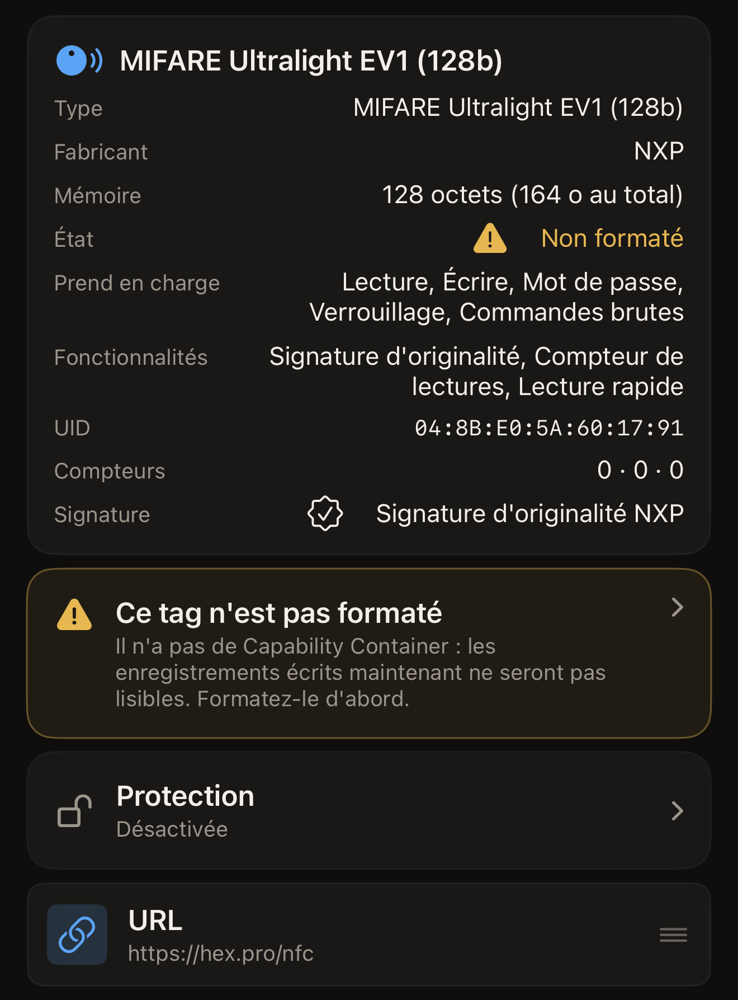
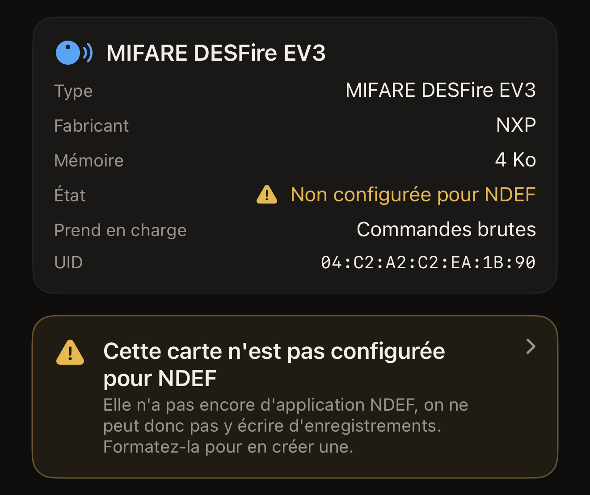
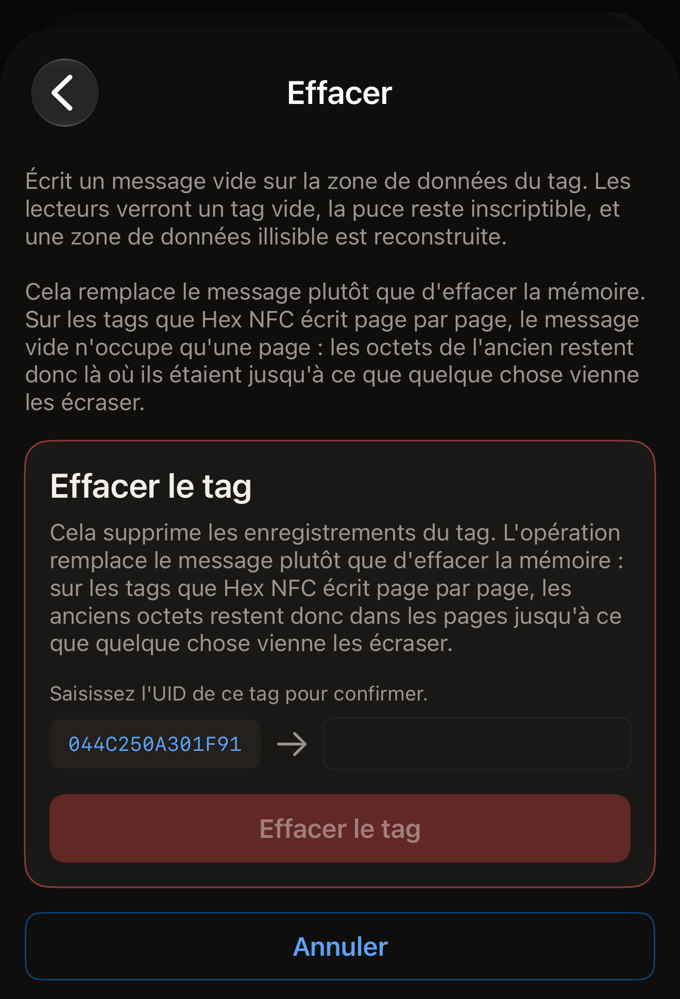
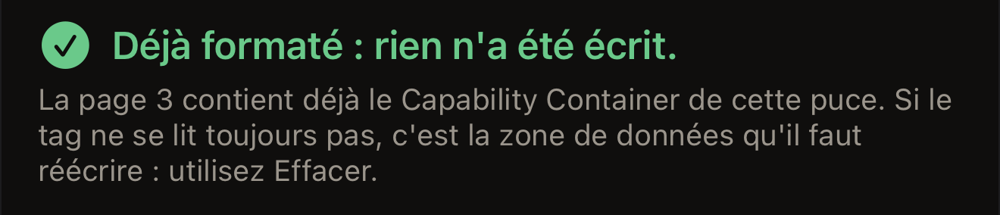
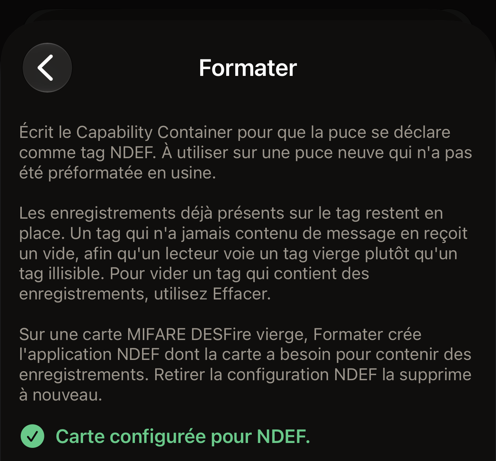
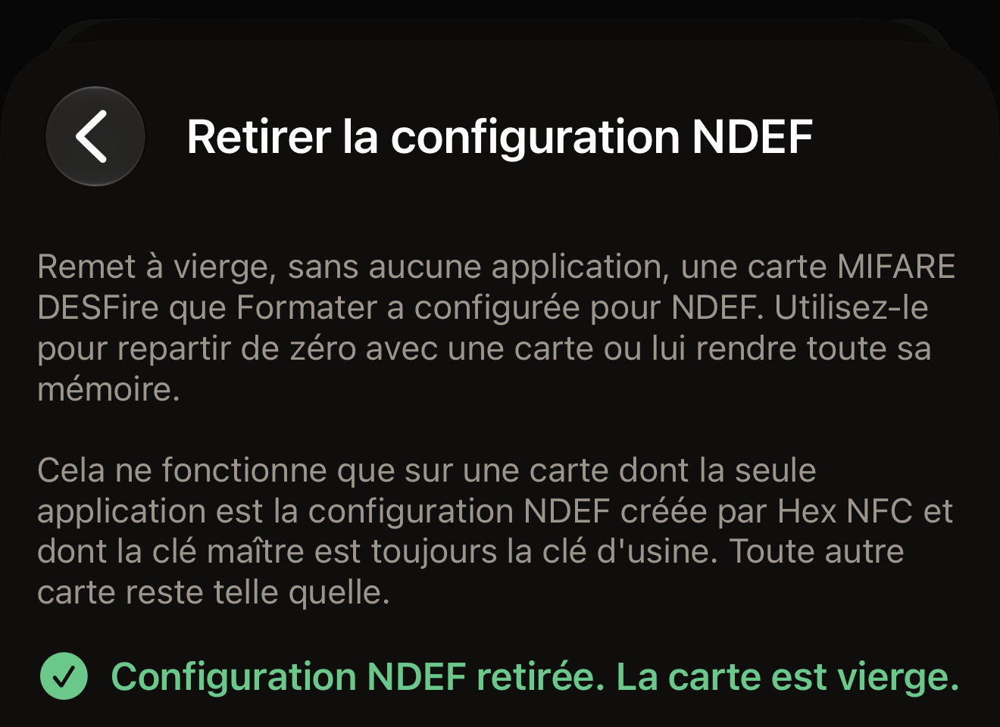

Hex NFC propose deux réparations pour un tag qui ne se lit pas, et elles ont des
rôles opposés. L'effacement écrit un message vide sur la zone de données du tag :
les lecteurs voient alors un tag vide, et la puce reste inscriptible. Le formatage
écrit le Capability Container, le court en-tête qu'un lecteur cherche avant de
lire quoi que ce soit d'autre sur le tag.

Avant de commencer, scannez le tag : sur l'écran d'accueil de Hex NFC, touchez
**Scanner**, puis tenez le tag contre le haut de l'iPhone. L'écran **Tag** s'ouvre
une fois que l'app l'a lu. Il s'ouvre aussi pour un tag non formaté, pour un tag
dont les données ne se lisent pas et pour une carte MIFARE DESFire qui n'est pas
configurée pour NDEF. Dans chacun de ces cas, il apparaît de lui-même à la suite
du scan, sans que vous ayez rien à toucher. Un avertissement sur l'écran de scan
est un diagnostic, pas une impasse. Sur l'écran **Tag**, touchez le bouton de
menu en haut à droite, à côté du bouton **Écrire**, puis touchez
**Opérations…**. Les deux réparations se trouvent sous **Actions dangereuses**,
en bas de l'écran **Opérations**. **Retirer la configuration NDEF** figure à
côté d'elles et annule le formatage d'une carte MIFARE DESFire. Chaque
opération qui s'y trouve confirme le tag avant de le modifier :

::include[two-tap-confirmation]

## Choisir la bonne réparation

L'app nomme le défaut sur l'écran où vous le rencontrez, et chaque nom
indique la réparation qui convient.

- Formatez le tag quand l'écran de scan affiche « Ce tag n'est pas encore
  formaté », ou quand l'écran **Tag** affiche « Non formaté ». Le tag n'a pas de
  Capability Container : rien de ce que vous y écrivez n'est lisible.
- Effacez le tag quand l'écran de scan affiche « Les données de ce tag ne se
  lisent pas », ou quand l'écran **Tag** affiche « Données illisibles ». Le
  Capability Container est déjà en place : un formatage n'a donc rien à y réparer.
- Formatez la carte quand l'écran de scan affiche « Cette carte n'est pas encore
  configurée pour NDEF », ou quand l'écran **Tag** affiche « Non configurée pour
  NDEF ». La carte est une MIFARE DESFire vierge, ou une carte dont un formatage
  précédent n'a pas terminé la configuration : vous ne pouvez donc pas encore y
  écrire d'enregistrements. Une carte de transport ou un badge d'accès n'affiche
  jamais ces messages.

Sur un tag qui accepte encore les écritures, l'écran **Tag** affiche aussi un
avertissement que vous pouvez toucher. Il indique « Ce tag n'est pas formaté »,
« Les données de ce tag ne se lisent pas » ou « Cette carte n'est pas configurée
pour NDEF ». Le toucher ouvre **Opérations**. Un
tag verrouillé définitivement affiche l'état, mais aucun avertissement, car les
deux réparations sont des écritures.

:::figure[Un tag sans Capability Container affiche « Non formaté » à côté de **État**, avec l'avertissement « Ce tag n'est pas formaté » sous la carte.]

:::

:::figure[Une carte MIFARE DESFire vierge affiche « Non configurée pour NDEF » à côté de **État**, et l'avertissement « Cette carte n'est pas configurée pour NDEF » apparaît sous les informations du tag.]

:::

## Effacer un tag

Un effacement supprime les enregistrements du tag et laisse la puce inscriptible.
Il reconstruit aussi une zone de données devenue illisible.

:::::steps
::::step[Ouvrir l'écran d'effacement]
Sur l'écran **Opérations**, touchez **Effacer**. L'écran qui s'ouvre indique ce
que l'effacement écrit, et vous avertit avant que quoi que ce soit n'atteigne le
tag.
::::

::::step[Lancer l'effacement]
Touchez **Effacer le tag**. L'iPhone vous invite à approcher le tag.
::::

::::step[Tenir le tag contre l'iPhone]
Posez le haut de l'iPhone sur le tag. L'écran affiche « Étape 1 sur 2. Tenez le
tag pour l'identifier. », puis l'UID du tag.
::::

::::step[Ressaisir l'UID]
L'écran affiche « Saisissez l'UID de ce tag pour confirmer. » et place l'UID à
côté d'un champ vide. Saisissez ces mêmes caractères dans le champ, sans
deux-points entre eux, en majuscules ou en minuscules, puis touchez **Effacer le
tag**. Si le mot de passe du tag couvre sa zone de données, une carte intitulée
« Le tag est protégé » apparaît au-dessus du champ et demande le mot de passe ou
la clé actuels du tag. **Effacer le tag** reste sans effet tant que ce champ n'est
pas rempli.

:::figure[Après le premier passage, l'UID du tag se trouve à gauche d'un champ vide, et **Effacer le tag** reste grisé tant que vous ne l'avez pas saisi.]

:::
::::

::::step[Présenter à nouveau le tag]
Tenez à nouveau le tag contre le haut de l'iPhone. L'écran affiche « Tag effacé. »
une fois que l'app a relu le message vide sur le tag.
::::
:::::

Un effacement se termine de l'une de deux façons. Il indique « Tag effacé. » une
fois le message vide relu. Sinon, il signale une erreur qui nomme le défaut, avec
les détails en dessous pour un rapport de bug.
[Si un tag ne peut être ni scanné ni écrit](troubleshooting.md) indique ce qu'il
faut essayer ensuite.

:::note
Un effacement remplace le message du tag plutôt que d'effacer sa mémoire. Sur les
tags NTAG et MIFARE Ultralight, les puces de la plupart des autocollants et des
cartes, le message vide n'occupe qu'une page. Les octets de l'ancien message
restent où ils étaient jusqu'à ce que quelque chose les écrase. Écrivez votre
propre message sur un tag avant de le confier à quelqu'un d'autre.
:::

## Formater un tag {#format-a-tag}

Formatez une puce neuve qui n'a pas été livrée préformatée. Un formatage écrit
le Capability Container et laisse en place les enregistrements déjà présents sur
le tag. Si un tag ISO 15693, comme l'ICODE SLIX2, n'a jamais contenu de
message, il reçoit aussi un message vide : un lecteur y voit alors un tag vide
plutôt qu'un tag défectueux. Pour vider un tag qui contient des enregistrements,
effacez-le plutôt. Sur une carte MIFARE DESFire vierge, un formatage configure la
carte pour NDEF, comme l'explique la dernière partie de cette section.

::::steps
:::step[Ouvrir l'écran de formatage]
Sur l'écran **Opérations**, touchez **Formater**.
:::

:::step[Lancer le formatage]
Touchez **Formater le tag**. L'iPhone vous invite à approcher le tag.
:::

:::step[Tenir le tag contre l'iPhone]
Posez le haut de l'iPhone sur le tag. L'écran affiche « Étape 1 sur 2. Tenez le
tag pour l'identifier. », puis l'UID du tag.
:::

:::step[Ressaisir l'UID]
L'écran affiche « Saisissez l'UID de ce tag pour confirmer. » et place l'UID à
côté d'un champ vide. Saisissez ces mêmes caractères dans le champ, sans
deux-points entre eux, en majuscules ou en minuscules, puis touchez **Formater le
tag**.
:::

:::step[Présenter à nouveau le tag]
Tenez à nouveau le tag contre le haut de l'iPhone. L'écran affiche « Tag
formaté. » une fois que l'app a relu l'en-tête. Sur une carte MIFARE DESFire, il
affiche plutôt « Carte configurée pour NDEF. »
:::
::::

Sur un tag NTAG ou MIFARE Ultralight, un formatage aboutit à l'un de ces trois
messages :

- « Tag formaté. » signifie que l'en-tête est écrit, relu et en place, et que le
  tag est prêt à recevoir un message.
- « Déjà formaté : rien n'a été écrit. » signifie que le tag portait déjà le bon
  en-tête : rien n'y a donc été écrit. L'app vous renvoie vers **Effacer**, car
  si un tag ne se lit toujours pas, le défaut se trouve dans sa zone de données.
- « Ce tag possède déjà un Capability Container différent. » signifie que
  l'en-tête présent sur le tag ne correspond pas à la puce identifiée par l'app.
  Rien n'a été écrit.

:::figure[Un formatage qui trouve l'en-tête déjà en place affiche « Déjà formaté : rien n'a été écrit. » et vous oriente plutôt vers un effacement.]

:::

Un tag ISO 15693 affiche « Tag formaté. » à chaque fois, car le bloc de son
Capability Container reste réinscriptible et l'app l'écrit à chaque formatage.

:::warning
Sur les tags NTAG et MIFARE Ultralight, le Capability Container ne s'écrit qu'une
fois dans la vie du tag et ne peut jamais être corrigé. L'app lit donc d'abord
cette page et n'écrit que si elle est vierge. Elle refuse une puce qu'elle n'a pas
pu identifier plutôt que de deviner un en-tête. Le nom de la puce lu par l'app
figure en haut de l'écran **Tag**, et
[Tags compatibles avec Hex NFC](tags-that-work.md) indique ce que l'app peut faire
avec chaque puce.
:::

### Formater une carte MIFARE DESFire

Une carte MIFARE DESFire EV1, EV2 ou EV3 vierge ne contient aucune application,
et un formatage lui donne l'application NDEF dont elle a besoin pour recevoir des
enregistrements. La marche à suivre est celle décrite plus haut, avec les deux
mêmes passages et la même saisie de l'UID. L'app dimensionne le fichier NDEF de
la carte selon sa mémoire libre, jusqu'à 4 Ko sur une carte 4K. Une fois la
carte configurée, iOS la traite comme n'importe quel autre tag NDEF, en lecture
comme en écriture.

Sur une carte MIFARE DESFire, le second passage aboutit à l'un de ces deux
messages :

- « Carte configurée pour NDEF. » signifie que l'application NDEF est en place
  sur la carte et a été relue, et que la carte est prête à recevoir des
  enregistrements.
- « Déjà configurée pour NDEF : rien n'a été écrit. » signifie que Hex NFC a
  déjà configuré cette carte : rien n'y a donc été écrit.

:::figure[Une carte MIFARE DESFire vierge que le formatage vient de configurer affiche « Carte configurée pour NDEF. »]

:::

L'app refuse les cartes suivantes et n'y écrit rien :

- « Cette carte contient déjà d'autres applications, elle ne peut donc pas être
  configurée pour NDEF ici. Rien n'a été écrit. » C'est ce message qui s'affiche
  pour une carte de transport ou un badge d'accès.
- « Cette carte exige sa clé maître avant qu'on puisse y ajouter quoi que ce
  soit, elle ne peut donc pas être configurée pour NDEF ici. Rien n'a été
  écrit. »
- « Cette carte a été configurée pour NDEF par une autre app, Hex NFC la laisse
  donc telle quelle. Rien n'a été écrit. »

Si la carte s'éloigne de l'iPhone pendant le second passage, avant que la
configuration ait écrit quoi que ce soit, l'écran affiche « Tag perdu en cours
de lecture. Maintenez-le contre le haut du téléphone et réessayez. », et rien
n'a été écrit. Une fois que la configuration a commencé à écrire, il affiche
« La carte est partiellement configurée. Touchez à nouveau Formater pour
terminer. » ou « La carte est peut-être partiellement configurée. Scannez-la
pour vérifier, ou touchez à nouveau Formater. » Un nouveau formatage reprend là
où le précédent s'est arrêté.

Sur une carte qui manque de mémoire libre, la première tentative affiche
« Cette carte n'a pas assez de mémoire libre pour un fichier NDEF. Utilisez
Retirer la configuration NDEF pour effacer ce qui a été commencé. » Une
tentative suivante sur la même carte affiche « Cette carte n'a pas assez de
mémoire libre pour un fichier NDEF. Rien n'a été écrit. » Dans les deux cas,
**Retirer la configuration NDEF** vide la carte, comme l'explique la section
suivante.

## Retirer la configuration NDEF d'une carte {#remove-ndef-setup}

**Retirer la configuration NDEF** rend vierge une carte MIFARE DESFire qu'un
formatage a configurée. L'opération supprime l'application NDEF de la carte et
tous les enregistrements qu'elle contient, et libère toute la mémoire de la
carte. Elle ne fonctionne que sur une carte dont la seule application est la
configuration NDEF que crée Hex NFC, y compris une configuration qu'un formatage
a laissée inachevée, et dont la clé maître est toujours la clé d'usine. Toute
autre carte reste telle quelle.

::::steps
:::step[Ouvrir l'écran de retrait]
Sur l'écran **Opérations**, sous **Actions dangereuses**, touchez
**Retirer la configuration NDEF**.
:::

:::step[Lancer le retrait]
Touchez **Retirer la configuration NDEF**. L'iPhone vous invite à approcher la
carte.
:::

:::step[Tenir la carte contre l'iPhone]
Posez le haut de l'iPhone sur la carte. L'écran affiche « Étape 1 sur 2. Tenez
le tag pour l'identifier. », puis l'UID de la carte.
:::

:::step[Ressaisir l'UID]
L'écran affiche « Saisissez l'UID de ce tag pour confirmer. » et place l'UID à
côté d'un champ vide. Saisissez ces mêmes caractères dans le champ, sans
deux-points entre eux, en majuscules ou en minuscules, puis touchez
**Retirer la configuration NDEF**.
:::

:::step[Présenter à nouveau la carte]
Tenez à nouveau la carte contre le haut de l'iPhone, et laissez-la en place
jusqu'à ce que le résultat s'affiche. L'écran affiche « Configuration NDEF
retirée. La carte est vierge. » une fois que Hex NFC a relu la carte et n'y
a trouvé aucune application.
:::
::::

:::figure[Une carte dont la configuration NDEF a disparu affiche « Configuration NDEF retirée. La carte est vierge. »]

:::

Une carte déjà vierge affiche « Cette carte est déjà vierge : rien n'a été
modifié. » L'app refuse les cartes suivantes et n'y modifie rien :

- « Cette carte contient d'autres applications. Retirer la configuration les
  supprimerait aussi, rien n'a donc été modifié. »
- « La configuration NDEF de cette carte a été faite par une autre app, Hex NFC
  ne la retirera donc pas. Rien n'a été modifié. »
- « La clé maître de cette carte n'est pas la clé d'usine, l'app ne peut donc
  pas retirer sa configuration. Rien n'a été modifié. »

Si la carte s'éloigne de l'iPhone pendant le second passage, avant que le
retrait ait modifié quoi que ce soit, l'écran affiche « Tag perdu en cours de
lecture. Maintenez-le contre le haut du téléphone et réessayez. », et rien n'a
changé sur la carte. Si elle s'éloigne une fois le retrait commencé, l'écran
affiche « La carte est peut-être déjà vierge. Scannez-la pour vérifier. » Si le
scan montre toujours la carte configurée pour NDEF, relancez
**Retirer la configuration NDEF** : chaque retrait commence par lire la carte,
et une carte déjà vierge affiche « Cette carte est déjà vierge : rien n'a été
modifié. »

Une fois la configuration retirée, un scan affiche de nouveau « Non configurée
pour NDEF » à côté de **État** sur l'écran **Tag**, et un formatage peut
configurer la carte une nouvelle fois.

## Vider un tag depuis la liste des enregistrements

Vous pouvez aussi vider un tag depuis l'écran **Tag**, sans passer par
**Opérations**. Une écriture qui vide le tag ne modifie pas sa protection : elle
ne demande donc qu'un passage du tag, sans saisie d'UID. Une écriture qui active
ou retire aussi un mot de passe demande deux passages du tag et l'UID. C'est la
même confirmation en deux passages que celle de toutes les opérations des
**Actions dangereuses**.

::::steps
:::step[Supprimer tous les enregistrements]
Sur l'écran **Tag**, balayez un enregistrement vers la gauche et touchez
**Supprimer**, jusqu'à ce que l'écran affiche « Plus aucun enregistrement ». Les
suppressions ne sont pas encore sur le tag.
:::

:::step[Écrire le résultat vide]
L'écran affiche maintenant « Vous avez supprimé tous les enregistrements. Écrivez
pour vider le tag, ou rajoutez-en un. » Sous cette ligne, au-dessus du bouton
**Ajouter un enregistrement**, touchez **Écrire pour vider le tag**. L'iPhone vous
invite à approcher le tag.
:::

:::step[Tenir le tag contre l'iPhone]
Posez le haut de l'iPhone sur le tag et laissez-le en place jusqu'à la fin de
l'écriture.
:::
::::

## Voir aussi

- [Scanner un tag](scan-a-tag.md)
- [Modifier les enregistrements d'un tag](edit-records.md)
- [Écrire un lien sur un tag](write-a-link.md)
- [Si un tag ne peut être ni scanné ni écrit](troubleshooting.md)
- [Tags compatibles avec Hex NFC](tags-that-work.md)
