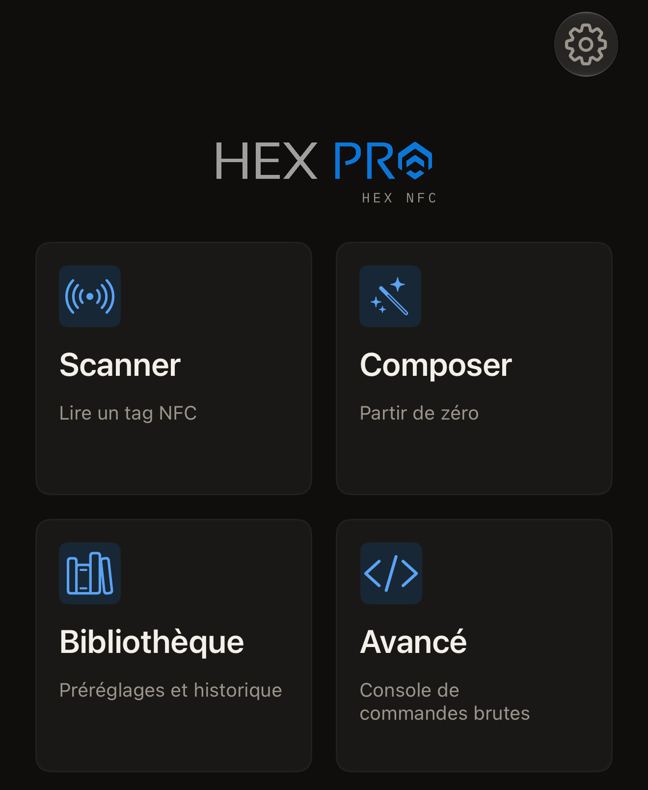

Hex NFC lit les tags NFC qui vous entourent et affiche chacun des
enregistrements qu'un tag contient. Il écrit des enregistrements sur un tag
vide et définit un mot de passe sur les puces qui en acceptent un. L'app lit
aussi une carte de transport japonaise ou la puce d'un passeport
électronique. Il n'y a aucun compte à créer, et l'app n'intègre aucun outil
d'analyse d'usage.

## Ce qu'il vous faut

- Hex NFC, installé depuis l'[App
  Store](https://apps.apple.com/app/id6801457461), sur l'iPhone.
- Un iPhone sous iOS 17 ou version ultérieure.
- Un tag NFC. La plupart des autocollants, cartes et porte-clés vierges
  contiennent une puce que l'app sait lire. La page [Tags compatibles avec
  Hex NFC](tags-that-work.md) les répertorie, et la [matrice de prise en
  charge des puces](../developer/chip-support-matrix.md) indique ce que
  chacune permet.

## Ce que vous pouvez faire

Hex NFC s'ouvre sur son écran d'accueil, qui présente quatre tuiles.

- Touchez **Scanner** pour lire un tag et voir ce qu'il contient : [Scanner
  un tag](scan-a-tag.md). Une [carte de transport](transit-cards.md) se lit
  de la même façon, et un [passeport](passports.md) demande deux passages.
- Touchez **Composer** pour assembler des enregistrements en partant de
  zéro, puis les écrire : [Écrire un lien sur un tag](write-a-link.md).
- Touchez **Bibliothèque** pour retrouver les tags que vous avez déjà
  scannés : [Retrouver un tag scanné auparavant](scan-history.md). Les
  ensembles d'enregistrements que vous avez conservés s'y trouvent aussi :
  [Enregistrer un tag comme préréglage](presets.md).
- Touchez **Avancé** pour envoyer une commande brute à une puce dont vous
  connaissez le jeu de commandes : [Envoyer une commande brute à un
  tag](advanced-console.md).

:::figure[L'écran d'accueil de Hex NFC s'ouvre sur quatre tuiles : **Scanner**, **Composer**, **Bibliothèque** et **Avancé**.]

:::

## Modifier le contenu d'un tag

Une fois un tag ouvert, vous pouvez recomposer ses enregistrements avec
[Modifier les enregistrements d'un tag](edit-records.md), en choisissant
parmi les types présentés dans [Types d'enregistrement](record-types.md).
[Protéger un tag par mot de passe](protect-a-tag.md) définit le secret que
la puce vérifie. [Retirer le mot de passe d'un tag](remove-password.md)
l'enlève. [Limiter les essais incorrects de mot de passe](attempt-limit.md)
indique combien de refus la puce accepte. Trois outils agissent sur le tag
lui-même : [Effacer ou formater un tag](erase-or-format.md), [Verrouiller un
tag définitivement](permanent-lock.md) et [Enregistrer une copie de la
mémoire d'un tag](memory-dump.md).

## Commencer

[Lire votre premier tag](quick-start.md) vous mène de l'écran d'accueil de
Hex NFC à votre premier scan en 5 minutes environ. [Protection des
tags](tag-protection.md) explique ce que protège un mot de passe, et
pourquoi un mot de passe perdu ne peut pas être récupéré. Quand un tag ne
répond pas, consultez [Si un tag ne peut être ni scanné ni
écrit](troubleshooting.md). La page [Réglages](settings.md) liste chaque
interrupteur de l'app, [Confidentialité et vos données](privacy.md) indique
ce qui reste sur l'iPhone, et [Questions fréquentes](faq.md) précise combien
coûte l'app.
