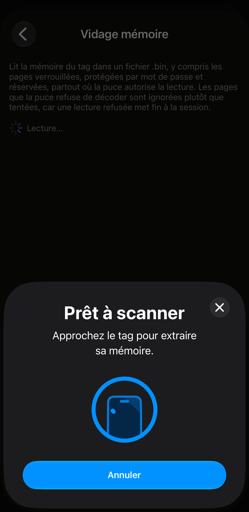
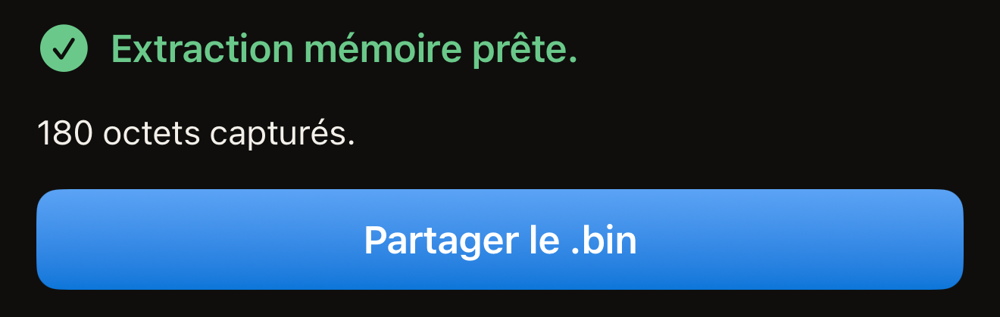
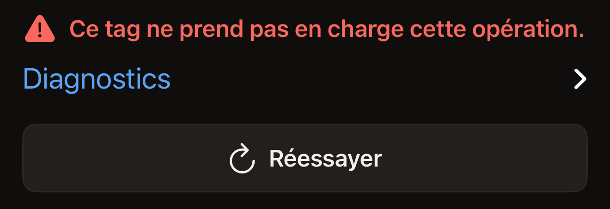

L'extraction mémoire copie les pages d'un tag dans un fichier `.bin` et transmet
ce fichier à la feuille de partage d'iOS. Elle ne fait que lire. Le tag n'est pas
modifié. L'extraction demande un passage du tag, ou deux sur un tag dont le mot
de passe protège la lecture, et ne vous demande jamais de ressaisir l'UID du tag.

Il vous faut un iPhone doté du NFC, Hex NFC installé depuis l'App Store et le tag
en main. Si vous n'avez encore jamais lu de tag avec l'app, commencez par
[Lire votre premier tag](quick-start.md). L'extraction mémoire se trouve sur
l'écran « Opérations ». Cet écran s'ouvre depuis le bouton de menu en haut à droite
de l'écran « Tag ». Les étapes ci-dessous scannent un tag pour y accéder.
[Scanner un tag](scan-a-tag.md) décrit le scan à lui seul.

Elle fonctionne avec les puces que Hex NFC adresse page par page. Ces puces sont
les NTAG 210µ, NTAG213, NTAG213 TT, NTAG215, NTAG216, MIFARE Ultralight EV1,
MIFARE Ultralight C, EM V10, EM V11 et EM V16. Sur tout autre tag, l'écran
affiche « Ce tag ne prend pas en charge cette opération. »

[Tags compatibles avec Hex NFC](tags-that-work.md) explique comment savoir quelle
puce vous avez en main.

## Extraire la mémoire d'un tag

:::warning[Envoyez le fichier avant de quitter l'écran]
L'app ne garde aucune copie de l'extraction. Si vous fermez la feuille de partage
ou quittez l'écran « Extraction mémoire » sans envoyer le fichier, celui-ci est perdu.
Il faut alors lire le tag à nouveau.
:::

:::::steps
::::step[Ouvrir l'écran de scan]
Sur l'écran d'accueil de Hex NFC, touchez **Scanner**. L'écran de scan s'ouvre et
commence à chercher un tag.
::::

::::step[Tenir le tag contre l'iPhone]
Posez le haut de l'iPhone à plat sur le tag et maintenez-le immobile pendant
environ une seconde. L'écran « Tag » s'ouvre avec le contenu du tag.
::::

::::step[Ouvrir Opérations]
Sur l'écran « Tag », touchez le bouton de menu en haut à droite, celui qui se trouve
à gauche du bouton **Écrire**. Le menu contient deux lignes,
**Enregistrer comme préréglage…** et **Opérations…**. Touchez **Opérations…**.
::::

::::step[Lancer l'extraction]
Touchez **Extraction mémoire**. L'écran s'ouvre et lance aussitôt le scan, sans
confirmation intermédiaire.
::::

::::step[Présenter à nouveau le tag]
Posez de nouveau le haut de l'iPhone sur le tag. La ligne d'état affiche
« Tenez le tag contre le haut de l'iPhone. » pendant l'attente. Elle passe à
« Lecture… » dès que le tag répond. À la fin, elle affiche « Extraction mémoire
prête. », avec en dessous le nombre d'octets capturés.

:::figure[Pendant la lecture du tag, le panneau de scan d'iOS affiche encore « Approchez le tag pour extraire sa mémoire. » et la ligne d'état derrière lui indique « Lecture… ».]

:::

Sur un tag dont le mot de passe protège aussi la lecture, l'extraction s'arrête
avant de lire quoi que ce soit. Une carte intitulée « Le tag est protégé »
demande le mot de passe ou la clé du tag. Saisissez-le, touchez
**Déverrouiller et extraire**, puis tenez à nouveau le tag contre l'iPhone.
::::

::::step[Partager le fichier]
Touchez **Partager le .bin**, puis choisissez où envoyer le fichier. Ce bouton
n'apparaît qu'après une lecture menée à son terme.

:::figure[Une lecture terminée affiche « Extraction mémoire prête. » avec le nombre d'octets en dessous, puis **Partager le .bin** plus bas.]

:::
::::
:::::

## Contenu du fichier

Le fichier est la mémoire de la puce copiée page par page à partir de la
première, à raison de 4 octets par page, sans en-tête et sans rien d'ajouté. Les
pages verrouillées, protégées par mot de passe et réservées y figurent toutes,
partout où la puce autorise leur lecture. Les pages que la puce refuse de décoder
sont laissées de côté plutôt que demandées. Une seule lecture refusée met fin à
la session et vous coûterait le reste de l'extraction. Sur un
MIFARE Ultralight C, la copie s'arrête avant les quatre dernières pages, qui
contiennent la clé de la puce et ne répondent à aucune lecture.

Une extraction complète a une taille fixe pour chaque puce : le nombre affiché
sous « Extraction mémoire prête. » vous indique donc si vous avez tout obtenu.
L'écran « Tag » nomme la puce en haut de la carte d'informations du tag. Il emploie
les mêmes mots que la première colonne ci-dessous. Un MIFARE Ultralight EV1 y
indique laquelle de ses deux tailles il a.

:::table[Octets d'une extraction complète]
| Puce | Extraction complète |
| :--- | ---: |
| NTAG 210µ, EM V10, EM V11, EM V16 | 64 octets |
| NTAG213, NTAG213 TT | 180 octets |
| NTAG215 | 540 octets |
| NTAG216 | 924 octets |
| MIFARE Ultralight EV1 (48b) | 80 octets |
| MIFARE Ultralight EV1 (128b) | 164 octets |
| MIFARE Ultralight C | 176 octets |
:::

Hex NFC écrit le fichier dans un stockage temporaire, sous un nom qui porte la
date et l'heure de la lecture. C'est en le partageant que vous le conservez.
L'app ne tient aucune liste des extractions. Rien sur l'écran « Tag » ne renvoie au
fichier. Envoyez-le quelque part avant de quitter l'écran.

## Si l'extraction n'aboutit pas

Une extraction qui échoue laisse le tag exactement tel qu'il était : le lire à
nouveau ne coûte donc rien.

- Pour lire à nouveau le même tag, touchez **Réessayer**. L'écran lance un
  nouveau scan.
- Pour voir ce que le tag a répondu, ouvrez **Diagnostics** sous le message
  d'échec. Le texte qu'il contient peut être sélectionné et copié dans un rapport
  de bug.

Si vous touchez Annuler sur le panneau de scan d'iOS avant la lecture d'un tag, vous
revenez à l'écran « Opérations ». Sans tag contre l'iPhone, le panneau se ferme de
lui-même et l'écran affiche « Aucun tag trouvé », avec **Réessayer** en dessous.

« Ce tag ne prend pas en charge cette opération. » signifie que la puce ne fait
pas partie de celles listées en haut de cette page. C'est la réponse du NTAG424 DNA, de l'ICODE SLIX, de l'ICODE SLIX2, des puces
MIFARE DESFire et des puces FeliCa. La
[matrice de prise en charge des puces](../developer/chip-support-matrix.md)
indique ce que chaque puce sait faire.

:::figure[Sur une puce que l'extraction ne peut pas lire, l'écran affiche « Ce tag ne prend pas en charge cette opération. », avec **Diagnostics** et **Réessayer** en dessous.]

:::

Pour un tag qui décroche en cours de lecture, consultez
[Si un tag ne peut être ni scanné ni écrit](troubleshooting.md). Consultez-la aussi pour tout message que cette page ne traite pas.

## Voir aussi

- [Scanner un tag](scan-a-tag.md)
- [Tags compatibles avec Hex NFC](tags-that-work.md)
- [Envoyer une commande brute à un tag](advanced-console.md)
