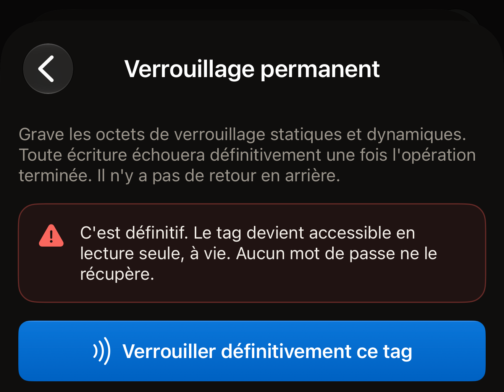
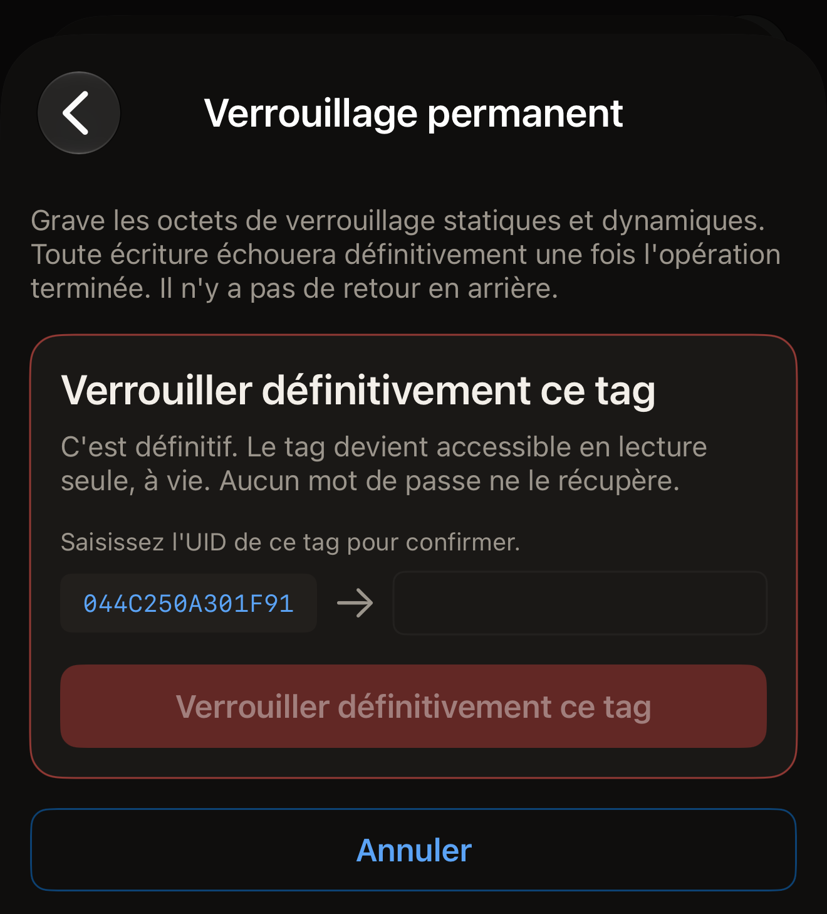
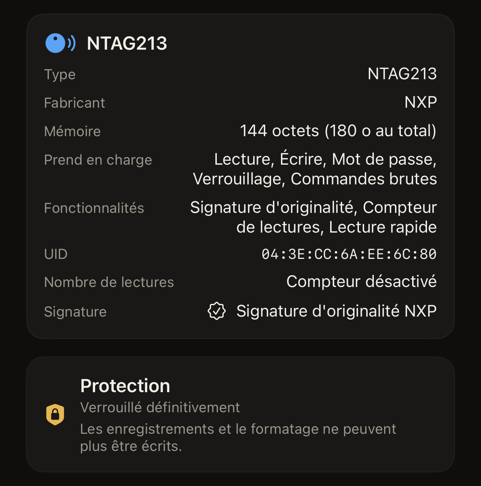

Hex NFC peut verrouiller un tag définitivement depuis l'iPhone en activant les
bits de verrouillage de la puce elle-même. Le tag conserve les enregistrements
qu'il contient, et plus aucun enregistrement ni formatage ne pourra jamais y
être écrit. La lecture n'est pas affectée : n'importe quel téléphone peut
toujours lire le tag.

Deux éléments déterminent si un tag peut être verrouillé, et un scan vous montre
les deux. Sur l'écran **Tag**, la carte du haut porte le nom de la puce en
titre. Elle comporte une ligne **Prend en charge**. « Verrouillage » n'apparaît
dans cette ligne que sur une puce que cette app peut verrouiller. En dessous, la
carte **Protection** indique ce qui protège actuellement le tag. « Désactivée »
signifie que rien ne le protège, et que le verrouillage peut avoir lieu. Une
puce qui n'accepte pas de mot de passe n'a pas de carte **Protection** du tout,
et rien sur elle ne peut bloquer un verrouillage.

Un résumé qui mentionne un mot de passe ou une clé, comme « Mot de passe ·
écriture seule », signifie que la protection est activée. Un tag dans cet état
ne sera pas verrouillé. La façon dont l'app l'indique dépend de la puce.

Sur un NTAG ou un MIFARE Ultralight EV1, Hex NFC vérifie avant d'écrire quoi que
ce soit. Il répond « Ce tag est protégé par mot de passe : il ne peut donc pas
être verrouillé définitivement. Retirez d'abord le mot de passe, puis
verrouillez-le. » Sur un MIFARE Ultralight C ou un ICODE SLIX2, l'app lance le
verrouillage. Sur ces deux puces, le résumé mentionne une clé 3DES ou un mot de
passe. La protection du tag lui-même refuse la première écriture. Ce refus se
traduit par « Rien n'a été verrouillé. » Dans les deux cas, rien n'est gravé :
le passage ne coûte rien au tag. Retirez d'abord le mot de passe ou la clé,
comme l'explique [Retirer le mot de passe d'un tag](remove-password.md).

Ce qui bloque le verrouillage, c'est l'activation de la protection, pas le mot
de passe lui-même. Un mot de passe enregistré sur un tag mais qui ne protège
plus rien apparaît comme « Désactivée » sur la carte **Protection** lors d'un
nouveau scan. Un tag dans cet état peut être verrouillé.

:::warning[Un tag verrouillé ne peut pas être déverrouillé]
Aucun mot de passe, aucune autre app et aucun passage ultérieur n'annule un
verrouillage permanent. Ne verrouillez un tag qu'une fois son contenu définitif.
:::

## Verrouiller un tag définitivement

::include[two-tap-confirmation]

:::::steps
::::step[Scanner le tag à verrouiller]
Sur l'écran d'accueil de Hex NFC, touchez **Scanner**, puis tenez le tag contre
le haut de l'iPhone. L'écran **Tag** s'ouvre et affiche le contenu du tag.
Consultez [Scanner un tag](scan-a-tag.md).
::::

::::step[Vérifier que le tag peut être verrouillé]
Sur l'écran « Tag », cherchez « Verrouillage » dans la ligne **Prend en charge**
de la carte d'informations du tag, et vérifiez que la carte **Protection**
indique « Désactivée ». Une puce qui n'accepte pas de mot de passe n'affiche pas
de carte **Protection**, ce qui convient aussi.
::::

::::step[Ouvrir l'écran « Opérations »]
Sur l'écran « Tag », touchez le bouton de menu en haut à droite, à côté du
bouton **Écrire**, puis touchez **Opérations…**.
::::

::::step[Choisir Verrouillage permanent]
Faites défiler jusqu'à **Actions dangereuses**, puis touchez **Verrouillage
permanent**. L'écran qui s'ouvre indique ce que coûte le verrouillage et
qu'il ne peut pas être annulé. Cette entrée est proposée pour tous les tags, y
compris les puces sans bits de verrouillage. L'app vérifie la puce au premier
passage. Sur une puce qui ne peut pas être verrouillée, elle répond « Ce tag ne
prend pas en charge cette opération. » après ce passage, avant que vous
saisissiez l'UID. Rien n'est écrit.

:::figure[L'écran **Verrouillage permanent** s'ouvre sur son avertissement, et rien n'est envoyé au tag tant que vous n'avez pas touché **Verrouiller définitivement ce tag**.]

:::
::::

::::step[Présenter le tag pour le premier passage]
Lisez l'avertissement, puis touchez **Verrouiller définitivement ce tag**.
L'écran affiche « Étape 1 sur 2. Tenez le tag pour l'identifier. » Tenez alors
le tag contre le haut de l'iPhone jusqu'à ce que le panneau de scan d'iOS se
ferme.
::::

::::step[Saisir l'UID du tag]
L'UID du tag apparaît à côté d'un champ vide, sous la mention « Saisissez l'UID
de ce tag pour confirmer. » Il est affiché en majuscules, sans deux-points ni
espaces, et il doit être saisi en entier. Un UID que la carte d'informations du
tag affiche sous la forme `04:BA:4A:92:1B:21:90` apparaît ici sous la forme
`04BA4A921B2190`. Majuscules et minuscules sont acceptées, et un espace avant ou
après votre saisie est ignoré. Le bouton reste grisé tant que votre saisie ne
correspond pas.

:::figure[Entre les deux passages, l'UID du tag se trouve à gauche d'un champ vide, et **Verrouiller définitivement ce tag** reste grisé tant que vous ne l'avez pas saisi.]

:::
::::

::::step[Présenter le tag pour le second passage]
Touchez à nouveau **Verrouiller définitivement ce tag**, puis tenez le tag
contre le haut de l'iPhone. Pendant l'attente, l'écran affiche « Étape 2 sur 2.
Présentez à nouveau le même tag. », puis il indique le résultat quand vous
éloignez le tag.
::::
:::::

## Ce qu'indique l'app quand le verrouillage aboutit

« Tag verrouillé définitivement. » est le résultat attendu. Après avoir activé
les bits, l'app a demandé au tag d'accepter une écriture de plus, le tag a
refusé, et ce refus en est la preuve.

« Verrouillage écrit. » signifie que les bits ont été activés, mais que ce
passage n'a pas pu le constater. Certaines puces n'appliquent leurs bits de
verrouillage qu'au prochain réveil du tag. L'app ajoute « Sur cette puce, les
bits de verrouillage ne prennent effet qu'au prochain passage : impossible de le
vérifier dans cette session. Scannez à nouveau le tag pour confirmer qu'il
refuse désormais l'écriture. » Scannez à nouveau le tag et lisez le verdict sur
la carte **Protection**.

Sur l'écran **Tag**, **Protection** indique « Verrouillé définitivement » pour
un tag que l'app a relu comme verrouillé. En dessous figure « Les
enregistrements et le formatage ne peuvent plus être écrits. » Tant que ce scan
de confirmation n'a pas eu lieu, la carte indique plutôt « Verrouillage écrit ·
scannez à nouveau pour confirmer ». **Écrire** n'est pas disponible sur un tag
relu comme verrouillé.

:::figure[Après un scan de confirmation, la carte **Protection** indique « Verrouillé définitivement », avec « Les enregistrements et le formatage ne peuvent plus être écrits. » en dessous.]

:::

Un mot de passe enregistré sur le tag survit au verrouillage, et la carte
indique alors « Verrouillé définitivement · mot de passe toujours défini ». La
ligne en dessous précise si ce mot de passe peut encore être retiré. Les puces
qui peuvent être verrouillées sont présentées dans [Tags compatibles avec Hex
NFC](tags-that-work.md).

## Si le verrouillage ne s'est pas terminé

Un verrouillage se déroule en plusieurs phases. Une opération interrompue en
cours de route laisse le tag dans un état que l'app nomme, au lieu de parler
d'échec.

- « Rien n'a été verrouillé. » La puce a refusé chaque phase et l'a signalé.
  Rien n'a été gravé, et le tag est exactement tel qu'il était : relancer
  l'opération ne lui coûte rien. Scannez à nouveau le tag et vérifiez les deux
  conditions d'un verrouillage. La carte **Protection** indique « Désactivée »,
  ou une puce qui n'accepte pas de mot de passe n'affiche aucune carte
  **Protection**. « Verrouillage » apparaît dans la ligne **Prend en charge** de
  la carte d'informations du tag. Sur un MIFARE Ultralight C ou un ICODE SLIX2,
  c'est sous cette forme que la protection se manifeste. Retirez la clé ou le
  mot de passe, puis relancez le verrouillage.
- « Ce tag est maintenant partiellement verrouillé, et cela ne peut pas être
  annulé. Une partie de sa mémoire est en lecture seule définitivement ; le
  reste a été refusé et reste inscriptible. » Une partie de la puce est
  consommée. Aucune nouvelle opération ne complète le reste. De retour sur
  l'écran « Tag », la carte **Protection** indique « Partiellement verrouillé ·
  une partie de ce tag est en lecture seule définitivement ». Pour un tag qui
  contient encore un mot de passe, elle indique plutôt « Partiellement
  verrouillé · mot de passe toujours défini ». Sur un NTAG21x ou un MIFARE
  Ultralight, un nouveau scan affiche la même chose, car l'app relit ces octets
  de verrouillage. Elle ne relit pas les verrouillages par bloc d'un ICODE SLIX2
  lors du scan : un nouveau scan de cette puce ne dit donc rien du verrouillage
  partiel. Sur cette puce, le résultat affiché à la fin de l'opération est la
  seule trace dont vous disposez.
- « Le tag a cessé de répondre pendant un verrouillage irréversible : cette app
  ne peut donc pas dire si une partie de sa mémoire est désormais en lecture
  seule. Considérez ce tag comme peut-être verrouillé. » Le tag s'est éloigné en
  pleine écriture. Scannez-le à nouveau et lisez la carte **Protection** avant
  d'utiliser le tag pour quoi que ce soit.
- « Une partie de ce tag est désormais en lecture seule définitivement, et cela
  ne peut pas être annulé. Le tag a cessé de répondre avant que le reste puisse
  être confirmé : le reste est peut-être verrouillé lui aussi. » Une phase est
  confirmée. L'autre reste inconnue. Scannez à nouveau le tag, et considérez-le
  comme verrouillé.

## Voir aussi

- [Protection des tags](tag-protection.md)
- [Effacer ou formater un tag](erase-or-format.md)
- [Si un tag ne peut être ni scanné ni écrit](troubleshooting.md)
