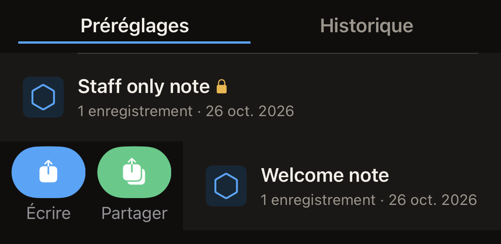
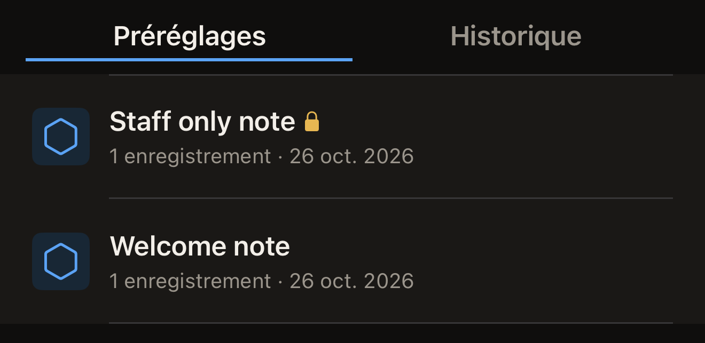

Un préréglage est un ensemble nommé d'enregistrements conservé sur l'iPhone.
Enregistrez-en un à partir du tag que vous modifiez, puis écrivez ces mêmes
enregistrements sur autant de tags que vous le souhaitez, sans avoir à les
composer de nouveau.

Avant de commencer, placez un ensemble d'enregistrements sur l'écran « Tag », pour
avoir quelque chose à enregistrer. Sur l'écran d'accueil de Hex NFC, touchez
**Scanner**, puis approchez le tag que vous voulez copier. Pour partir de zéro
sans tag sous la main, touchez **Composer**. Dans les deux cas, l'écran « Tag »
s'ouvre. Consultez [Scanner un tag](scan-a-tag.md) et
[Modifier les enregistrements d'un tag](edit-records.md).

## Sauvegarder les enregistrements que vous modifiez

::::steps
:::step[Ouvrir le panneau d'enregistrement]
Sur l'écran « Tag », touchez le bouton de menu en haut à droite, puis
**Enregistrer comme préréglage…**. Cette ligne du menu reste grisée tant que le
tag ne contient pas au moins un enregistrement ou un réglage de protection.
:::

:::step[Nommer le préréglage]
Dans **Nom**, saisissez un nom que vous reconnaîtrez plus tard, par exemple
l'endroit où iront les tags. **Enregistrer** reste grisé tant que le nom n'est
pas renseigné.
:::

:::step[Ajouter une note]
Facultatif : dans **Notes**, indiquez à quoi sert le préréglage. Le champ
accepte jusqu'à quatre lignes.
:::

:::step[Choisir une icône]
Sous **Icône**, touchez l'un des trois segments, désignés par des mots plutôt
que dessinés : **Cadre extérieur**, **Chevron haut** ou **Chevron bas**. Celui
que vous touchez détermine le badge hexagonal affiché à côté du préréglage dans
la **Bibliothèque**.
:::

:::step[Vérifier ce que contiendra le préréglage]
**Enregistrements** indique le nombre d'enregistrements qui seront conservés.
Pour un préréglage qui ne contient qu'une protection, la section affiche à la
place « Aucun enregistrement. Ce préréglage applique uniquement une protection. »

Si la liste contient un enregistrement **Lieu** sans coordonnées ni URL de
carte, **Enregistrements** affiche aussi “Un enregistrement de lieu n'a ni
coordonnées ni URL de carte : ce préréglage ne pourrait jamais être écrit sur
un tag. Complétez-le ou supprimez-le sur l'écran « Tag », puis enregistrez.”
**Enregistrer** reste grisé tant que ce message est affiché. Touchez
**Annuler**, complétez ou supprimez l'enregistrement, puis rouvrez le panneau
d'enregistrement. Consultez [Types d'enregistrement](record-types.md).
:::

:::step[Enregistrer le préréglage]
Touchez **Enregistrer**. Le panneau se ferme et le préréglage apparaît en haut
de l'onglet **Préréglages** de la **Bibliothèque**.
:::
::::

Un préréglage ne contient une protection que si vous avez défini un mot de
passe ou une clé sur le tag avant de l'enregistrer. Cela se fait sur l'écran
« Tag », qui affiche **Protection** pour les tags pouvant être protégés. Touchez
**Protection** et activez **Protéger ce tag par mot de passe**. Saisissez le
secret dans le champ affiché par le panneau, par exemple
**Mot de passe (4 octets)**, puis touchez **Terminé**. Consultez
[Protéger un tag par mot de passe](protect-a-tag.md).

Une fois cela fait, le panneau d'enregistrement ajoute une section
**Protection** qui indique ce que contient le préréglage, par exemple
« Protection par mot de passe (écriture seule) ». Le secret lui-même n'entre
pas dans le préréglage. L'app le précise dans la même section : « Le secret est
stocké uniquement sur cet appareil (trousseau). Il n'est jamais synchronisé ni
inclus dans un export. » Un préréglage n'active la protection d'un tag que tant
que ce secret se trouve sur cet iPhone. Un préréglage enregistré sans saisie
d'un secret n'active rien.

Si l'iPhone refuse l'enregistrement, une ligne rouge apparaît en bas du
formulaire. Elle commence par « Impossible d'enregistrer : », suivi de la
raison donnée par l'iPhone. Le panneau reste ouvert et vos enregistrements
restent sur l'écran « Tag » : rien de ce que vous avez saisi n'est perdu. Touchez
de nouveau **Enregistrer**. Si la même raison revient, touchez **Annuler**. Les
enregistrements sont toujours sur l'écran « Tag ». Vous pouvez les écrire
directement sur un tag au lieu de les conserver comme préréglage.

## Écrire un préréglage sur un tag {#write-a-preset-to-a-tag}

Un cadenas à côté du nom d'un préréglage signifie qu'il contient des réglages
de protection. La ligne n'en dit pas plus. Elle n'indique pas si l'écriture
activera la protection du tag, car cela dépend du secret conservé avec le
préréglage. Ce secret n'est pas affiché. Un préréglage enregistré sur cet
iPhone après la saisie de votre propre mot de passe ou de votre propre clé
contient ce secret et active la protection du tag. Un préréglage enregistré à
partir d'un tag déjà protégé, dont vous n'avez jamais saisi le mot de passe,
n'en contient aucun. Il écrit ses enregistrements et ne protège rien. Si vous
ne savez pas lequel des deux vous avez sous les yeux, considérez qu'il active
la protection.

:::::steps
::::step[Ouvrir la bibliothèque]
Sur l'écran d'accueil de Hex NFC, touchez **Bibliothèque**. L'écran
« Bibliothèque » s'ouvre sur **Préréglages**, avec en haut le préréglage modifié le
plus récemment.
::::

::::step[Lancer l'écriture]
Balayez légèrement le préréglage depuis son bord gauche, puis touchez
**Écrire**. La **Bibliothèque** se ferme et l'écran d'écriture s'ouvre.

:::figure[Un court balayage depuis le bord gauche d'un préréglage fait apparaître **Écrire** et **Partager**.]

:::
::::

::::step[Tenir le tag contre l'iPhone]
Tenez le tag contre le haut de l'iPhone pendant que l'écran affiche
« Tenez le tag près du haut de l'iPhone ». Il affiche « Écriture terminée » une
fois les enregistrements écrits sur le tag.
::::
:::::

:::warning[Un préréglage qui applique une protection ne vous demande pas de confirmer le tag]
Un préréglage qui contient des réglages de protection, et dont le secret se
trouve encore sur cet iPhone, définit ce secret sur n'importe quel tag que vous
approchez. C'est le seul endroit de l'app où la protection est activée sans un
premier passage pour lire le tag. Il n'y a aucun UID à ressaisir. N'approchez
que le tag que vous comptiez protéger. Conservez le préréglage tant que ces
tags sont en service. C'est en l'écrivant de nouveau que vous pourrez rouvrir
un tag qu'il a protégé. Le supprimer supprime cette copie du secret.
:::

## Gérer vos préréglages

Tant que vous n'en avez enregistré aucun, l'onglet **Préréglages** affiche
« Aucun préréglage enregistré ». Ensuite, chaque ligne porte le nom et l'icône
du préréglage. En dessous, une ligne indique le nombre d'enregistrements et la
date de la dernière modification du préréglage.

Un cadenas à côté du nom signale un préréglage qui contient des réglages de
protection, et VoiceOver l'annonce par « Applique une protection ». Ce que ce
cadenas garantit, et ce qu'il ne garantit pas, est expliqué plus haut, dans
[Écrire un préréglage sur un tag](#write-a-preset-to-a-tag).

:::figure[Un cadenas après le nom d'un préréglage signale qu'il contient des réglages de protection.]

:::

Balayer un préréglage depuis son bord gauche fait apparaître **Écrire** et
**Partager**. Le balayer depuis son bord droit fait apparaître **Supprimer** et
**Dupliquer**. Balayez légèrement, puis touchez le bouton voulu. Un balayage
mené jusqu'au bout depuis le bord droit supprime le préréglage directement.

Un préréglage enregistré ne peut pas être modifié. Pour changer le contenu d'un
préréglage sans cadenas, composez de nouveau les enregistrements sur l'écran
« Tag ». Enregistrez-les comme nouveau préréglage, puis supprimez l'ancien.

Laissez tel quel un préréglage muni d'un cadenas. Le recomposer depuis l'écran
« Tag » vous donne les enregistrements sans le secret, sauf si vous définissez
d'abord de nouveau le mot de passe ou la clé. Supprimer l'ancien préréglage
efface la seule copie du secret qui ouvre les tags qu'il a protégés. Pour
obtenir une deuxième copie d'un tel préréglage, utilisez **Dupliquer**, qui
reprend le secret stocké.

Depuis l'onglet **Préréglages**, vous pouvez effectuer les actions suivantes :

- Pour conserver une copie d'un préréglage en dehors de l'app, balayez-le
  depuis son bord gauche et touchez **Partager**. L'app écrit un fichier
  `.hexnfc` qui porte le nom du préréglage et le transmet à la feuille de
  partage. Les enregistrements et les réglages de protection voyagent dans ce
  fichier ; le mot de passe ou la clé, jamais. Hex NFC n'a aucun moyen d'ouvrir
  un fichier `.hexnfc`. Ce que vous envoyez à quelqu'un est une copie des
  enregistrements à conserver, et non un préréglage qu'il pourrait ajouter à sa
  propre app.
- Pour créer une deuxième copie d'un préréglage, balayez-le depuis son bord
  droit et touchez **Dupliquer**. La copie contient les mêmes enregistrements,
  les mêmes réglages de protection et le même secret stocké.
- Pour retirer un préréglage, balayez-le depuis son bord droit et touchez
  **Supprimer**. Aucune confirmation n'est demandée, et le secret stocké du
  préréglage disparaît avec lui.

## Voir aussi

- [Modifier les enregistrements d'un tag](edit-records.md)
- [Écrire un lien sur un tag](write-a-link.md)
- [Protection des tags](tag-protection.md)
- [Retrouver un tag scanné auparavant](scan-history.md)
