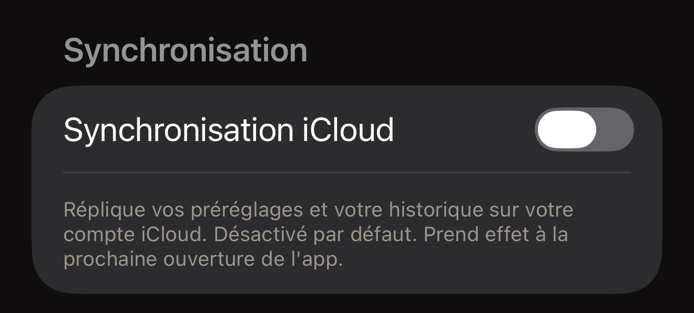

Vous tenez un tag contre l'iPhone et son contenu s'affiche à l'écran. Cette
lecture se fait sur l'iPhone, et le résultat y reste. Hex NFC n'a ni compte ni
analyse d'usage. Il envoie quatre types de requêtes aux serveurs de Hex Pro.
Trois ne transmettent rien qui vous concerne, et le quatrième, un commentaire,
ne contient que ce que vous choisissez d'envoyer. Le texte complet de la
politique se trouve dans l'app. Sur l'écran d'accueil de Hex NFC, touchez le
bouton en forme d'engrenage en haut à droite. Puis, sous **Mentions légales**,
touchez **Politique de confidentialité**.

## Ce qui reste sur l'iPhone

Votre historique de scan et vos préréglages enregistrés se trouvent dans une
base de données locale sur cet iPhone, et vos réglages sont eux aussi stockés
localement. Il en va de même pour tout ce qui fait fonctionner la carte qui
demande de temps en temps **Vous aimez Hex NFC ?** : si elle a déjà posé la
question, ce que vous avez répondu, et le nombre d'écritures et de lectures
récentes qui décide quand elle peut la poser à nouveau.
[Réglages](settings.md#feedback-and-ratings) décrit cette carte. Supprimer un
élément le retire de cette base de données. Supprimer
l'app efface avec elle ses données locales.

Les mots de passe des tags sont conservés à part, dans le trousseau d'iOS, sur
le seul iPhone qui les a définis. Un mot de passe n'est jamais synchronisé,
jamais écrit dans un fichier que vous exportez et jamais envoyé nulle part.
L'app range deux types d'éléments. Le premier concerne un tag dont la
protection a été appliquée par une écriture ; il est rangé sous l'UID de ce
tag. Cette écriture part de la carte **Protection** de l'écran « Tag », ou d'un
préréglage qui applique une protection. Le second concerne un préréglage qui
applique une protection ; il est rangé sous ce préréglage. Aucun des deux ne
contient d'information vous concernant. Un mot de passe saisi dans
**Opérations…** > **Protéger par mot de passe** n'est rangé dans aucun des
deux : gardez-en donc votre propre copie. Supprimer l'app n'efface pas les mots
de passe rangés, car iOS conserve les éléments du trousseau après la
suppression d'une app. La lecture d'un passeport n'est conservée nulle part. Ce
que renvoie la puce reste à l'écran pendant la session et disparaît à sa fin.
[Lire un passeport](passports.md) l'explique en détail.

Deux actions effacent un mot de passe stocké. Supprimer un préréglage efface le
mot de passe enregistré avec lui. Cela se produit que le tag sur lequel il a
été écrit soit encore protégé ou non. Un tag peut alors rester protégé par un
mot de passe que l'app n'a plus. L'autre action consiste à désactiver la
protection sur la carte **Protection** du tag, puis à écrire sur le tag, comme
l'explique [Retirer le mot de passe d'un tag](remove-password.md). Même dans ce
cas, l'app n'efface le mot de passe qu'après avoir relu le tag. Cette relecture
doit constater les deux points suivants :

- La protection a disparu.
- Le mot de passe du tag est de nouveau le mot de passe d'usine de la puce.

Une suppression qui établit le premier point mais pas le second conserve le mot de
passe stocké. Un tag ouvert qui contient encore votre mot de passe ne peut pas
être protégé de nouveau sans lui. Une suppression lancée depuis **Opérations**
n'efface rien du trousseau. Tout élément déjà rangé pour ce tag reste en place.

Rien dans Hex NFC ne dresse la liste des tags pour lesquels il conserve un mot
de passe. Pour un tag que vous ne pouvez plus présenter à l'iPhone, le mot de
passe stocké ne peut pas être effacé depuis l'app. Cet élément du trousseau
reste sur cet iPhone, sauf si une suppression ultérieure l'efface ou si vous effacez
l'iPhone.

L'option **Synchronisation iCloud** est désactivée au départ, et l'interrupteur
prend effet à la prochaine ouverture de l'app. Lorsqu'elle est activée, vos
préréglages et votre historique de scan sont répliqués dans votre base de
données iCloud privée, gérée par Apple et protégée par votre Apple ID. Hex Pro
ne peut pas la lire. Les mots de passe des tags n'y figurent jamais, dans un
cas comme dans l'autre. L'interrupteur se trouve dans les
[Réglages](settings.md) de Hex NFC.

:::figure[L'option **Synchronisation iCloud** reste désactivée tant que vous ne l'activez pas, et le texte en dessous précise que le changement attend la prochaine ouverture de l'app.]

:::

Désactiver la synchronisation n'arrête la réplication qu'une fois Hex NFC fermé
puis rouvert, comme l'explique
[Fermer et rouvrir l'app](settings.md#close-and-reopen-the-app). Revenir à
l'écran d'accueil de l'iPhone laisse l'app en cours d'exécution, et la
réplication avec elle.

Arrêter la réplication ne revient pas à supprimer ce qu'iCloud contient déjà,
et supprimer l'app ne le supprime pas non plus. Pour retirer cette copie,
ouvrez l'app Réglages de l'iPhone. Touchez votre nom en haut, puis la ligne
iCloud. Parcourez le stockage qui y est détaillé : c'est là que les données
conservées par chaque app peuvent être supprimées.

:::note[Un tag n'est pas un espace de stockage privé]
Tout ce que vous écrivez sur un tag se trouve sur un matériel extérieur à
l'iPhone, et n'importe qui muni d'un lecteur peut lire un tag non protégé.
Considérez le contenu d'un tag comme public, sauf si vous le protégez, comme
l'explique [Protection des tags](tag-protection.md).
:::

## Les quatre cas où l'app contacte Hex Pro {#when-the-app-reaches-hex-pro}

Aucune de ces requêtes ne s'exécute en arrière-plan. Les trois premières ne
transmettent rien qui permette de vous identifier.

- L'écran d'accueil de l'app récupère auprès de api.apps.hex.pro un chiffre
  public sur les coûts de développement du projet. La requête ne contient
  aucune donnée personnelle.
- Une suggestion de nom de station part lorsque vous touchez **Envoyer** sur un
  arrêt inconnu d'une carte de transport. Utiliser la touche d'envoi du clavier
  pendant que le champ du nom est ouvert l'envoie aussi. Elle transmet les
  codes de ligne, de station et de zone, le code système de la carte et le nom
  que vous avez saisi. Le numéro de série de la carte, son solde et son
  historique de trajets n'en font pas partie : n'indiquez donc aucune
  information personnelle dans le champ du nom.
- La carte **Plus d'apps Hex Pro** récupère auprès de api.p.hex.pro une
  bannière pour une autre app Hex Pro. La requête envoie l'identifiant de
  bundle de cette app, la plateforme et un nom d'emplacement. La réponse
  désigne une image ou une vidéo, que l'app télécharge depuis une seconde
  adresse et conserve sur l'iPhone. Tout le monde voit la même bannière. Aucune
  régie publicitaire, aucun identifiant de suivi et aucune personnalisation ne
  se cachent derrière.
- Un commentaire part lorsque vous touchez **Envoyer** dans le formulaire
  **Envoyer un commentaire**. Il contient votre message, l'adresse e-mail que
  vous avez saisie si vous en avez donné une, et les quatre informations que le
  formulaire liste sous **Envoyé avec votre message** : la version de l'app, la
  version d'iOS, le modèle de l'appareil et la langue. Il est envoyé à
  api.hex.pro puis à la boîte de réception des commentaires de Hex Pro, il est
  conservé jusqu'à 24 mois et il n'est jamais utilisé à des fins de marketing.
  Il ne contient rien de vos tags, de vos scans ni de votre historique de scan.

La synchronisation iCloud est l'autre fonction qui utilise le réseau, et
l'exception au paragraphe ci-dessus. Lorsqu'elle est activée, vos préréglages
et votre historique de scan circulent en arrière-plan entre l'iPhone et Apple.
Rien de tout cela ne parvient à Hex Pro.

Toute requête sur Internet révèle votre adresse IP au serveur qui y répond. Hex
Pro conserve des journaux techniques de courte durée et n'utilise pas les
adresses IP pour identifier ou profiler qui que ce soit. Un commentaire est
stocké avec une forme brouillée de votre adresse IP, qui sert uniquement à
empêcher une même connexion d'envoyer trop de messages, et qui est effacée sous
sept jours.

## À quoi sert chaque autorisation

Hex NFC vous demande deux autorisations. Le NFC est celle sans laquelle il ne
peut pas fonctionner, et iOS ne propose aucun interrupteur pour elle. La caméra
est facultative, et iOS la demande la première fois que vous scannez un code
QR ou la page photo d'un passeport. Ce que l'une ou l'autre capte reste sur l'iPhone.

La politique de confidentialité intégrée à l'app en décrit trois autres, pour
les contacts, la localisation et le Bluetooth. Rien dans l'app ne demande ces
trois-là : iOS ne vous pose donc jamais la question.

:::table[Les autorisations demandées par Hex NFC]
| Autorisation | Utilisation |
| :--- | :--- |
| NFC | Lire et écrire des tags, uniquement lorsqu'un écran de scan ou d'écriture est ouvert. |
| Caméra | Scanner un code QR que vous choisissez de transformer en enregistrement, et lire la page photo d'un passeport lorsque vous choisissez de la scanner. Les images ne sont jamais enregistrées ni envoyées. |
:::

## Ce que Hex Pro ne fait jamais

Hex NFC n'intègre aucun SDK d'analyse d'usage ou de télémétrie ni aucune
publicité tierce, et rien en lui ne cherche à identifier l'iPhone à partir de
ses caractéristiques. Hex Pro ne vend, ne loue ni ne partage aucune information
personnelle. Il n'y a pas de compte : aucun serveur de Hex Pro ne détient donc
de profil vous concernant. Un fichier que vous exportez contient les
enregistrements et les préréglages que vous avez choisis, et jamais le mot de
passe d'un tag.

## Voir aussi

- [Réglages](settings.md)
- [Lire une carte de transport](transit-cards.md)
- [Lire un passeport](passports.md)
- [Protection des tags](tag-protection.md)
