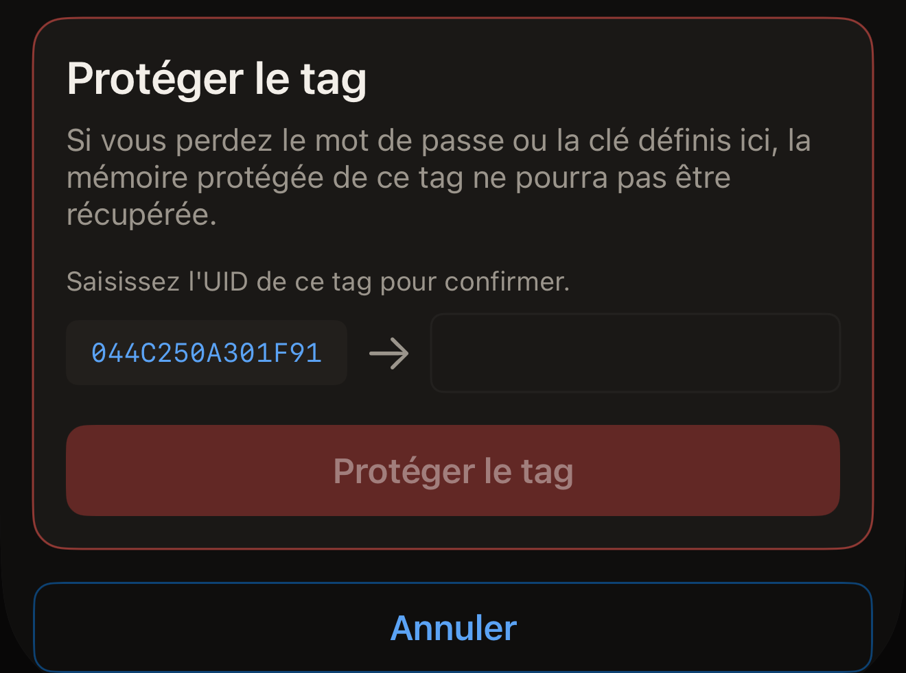
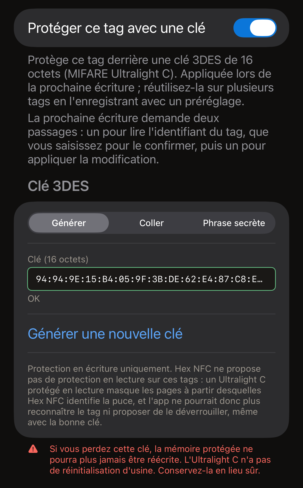
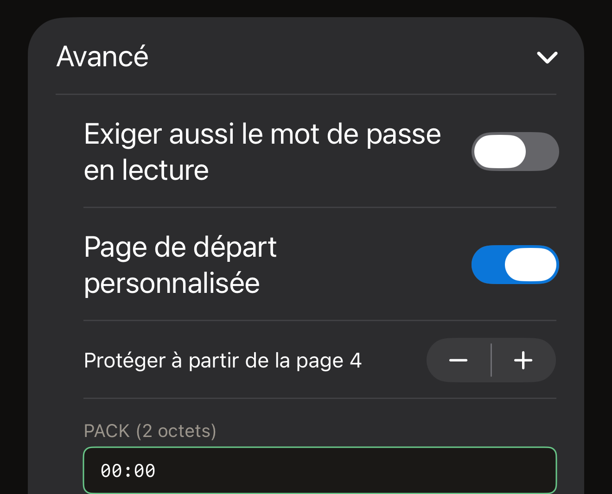

Un mot de passe sur un tag protège l'écriture. Les enregistrements restent
lisibles par n'importe qui, sauf si vous protégez aussi la lecture. Toute
écriture est refusée tant que le mot de passe n'a pas été présenté. Hex NFC en
définit un depuis l'iPhone de deux façons, qui couvrent les mêmes puces.
**Protéger par mot de passe**, dans **Opérations…**, protège un tag sans autre
opération. La carte **Protection** de l'écran « Tag » place le secret sur le tag
lors de la prochaine écriture. Passez par Opérations pour protéger un tag sans
rien modifier d'autre, et par la carte Protection si vous comptiez de toute
façon écrire sur le tag.

Avant de commencer, scannez le tag à protéger pour qu'il soit ouvert sur l'écran
« Tag ». Consultez [Scanner un tag](scan-a-tag.md). La carte en haut de cet
écran indique la puce sur sa première ligne. Ce nom détermine le type de secret
que le tag accepte.

L'app peut protéger sept puces : NTAG213, NTAG215, NTAG216, MIFARE Ultralight
EV1, MIFARE Ultralight C, NTAG424 DNA et ICODE SLIX2. Pour savoir si le tag que
vous avez en main peut être protégé, consultez la [matrice de prise en charge
des puces](../developer/chip-support-matrix.md). Sur toute autre puce,
**Protéger par mot de passe** se termine par « Ce tag ne prend pas en charge
cette opération. » L'écran « Tag » n'affiche pas non plus de carte
**Protection** pour ces puces, sauf si le tag signale un verrouillage.

::include[two-tap-confirmation]

## Protéger un tag depuis Opérations

Ce parcours ne demande rien avant le premier passage. Ce passage identifie la
puce du tag, puis l'écran demande le type de secret qu'accepte cette puce : un
mot de passe de 4 octets sur un NTAG213, NTAG215, NTAG216, MIFARE Ultralight EV1
ou ICODE SLIX2, et une clé de 16 octets sur un NTAG424 DNA ou un MIFARE
Ultralight C. Pour savoir ce que porte chaque puce, consultez la [matrice de
prise en charge des puces](../developer/chip-support-matrix.md).

:::::steps
::::step[Ouvrir Protéger par mot de passe]
Sur l'écran « Tag », touchez le bouton de menu en haut à droite, à côté du
bouton **Écrire**, puis allez dans **Opérations…** > **Protéger par mot de
passe**.
::::

::::step[Approcher le tag pour que l'app l'identifie]
Touchez **Protéger le tag**. Le panneau de scan d'iOS s'ouvre et l'écran affiche
« Étape 1 sur 2. Tenez le tag pour l'identifier. » Tenez le tag contre le haut
de l'iPhone jusqu'à ce que le panneau se ferme.
::::

::::step[Saisir le nouveau mot de passe ou la nouvelle clé]
L'écran indique la puce qu'il a lue, après « Tag identifié : », et affiche les
champs propres à cette puce. Saisissez le secret en hexadécimal, avec ou sans
deux-points entre les octets.

- Sur un NTAG213, un NTAG215, un NTAG216 ou un MIFARE Ultralight EV1, saisissez
  le mot de passe dans **Mot de passe (4 octets)**. Sur un tag lu comme non
  protégé, le champ s'ouvre sur la valeur d'usine, `FF FF FF FF`. Remplacez-la
  par votre propre mot de passe. Le PACK, ce sont les 2 octets que le tag
  renvoie quand il accepte le mot de passe. Un lecteur le vérifie pour s'assurer
  qu'il communique bien avec le tag attendu. **PACK (2 octets)** s'ouvre sur
  deux octets à zéro, et mieux vaut les laisser ainsi, sauf si un système que
  vous utilisez exige une valeur particulière.
- Sur un NTAG424 DNA, saisissez la clé dans **Clé (16 octets)**.
- Sur un ICODE SLIX2, saisissez le mot de passe d'écriture dans **Mot de passe
  (4 octets)**. La lecture reste libre.
- Sur un MIFARE Ultralight C, la clé se saisit dans **Clé (16 octets)**. Sur un
  tag lu comme non protégé, le champ s'ouvre sur une clé générée aléatoirement.
  Cette puce ne reçoit qu'une protection en écriture.

Sur un NTAG21x, un MIFARE Ultralight EV1 ou un NTAG424 DNA, un interrupteur sous
le champ protège aussi la lecture. Il s'intitule **Exiger aussi le mot de passe
en lecture**, ou **Exiger aussi la clé en lecture** sur un NTAG424 DNA.
Laissez-le désactivé, et n'importe quel lecteur peut toujours lire le tag.
Activez-le, et plus rien ne sort du tag sans le secret : lors d'un scan
ultérieur, Hex NFC vous le demandera d'abord. L'opération elle-même se termine
quand même par « Mot de passe défini. », car l'app présente le secret qu'elle
vient d'écrire pour effectuer sa propre relecture.
::::

::::step[Saisir l'UID du tag]
Sous les champs, la carte intitulée **Protéger le tag** vous demande :
« Saisissez l'UID de ce tag pour confirmer. » À côté d'un champ vide, elle
affiche l'UID que l'app a lu lors de ce passage. Si le tag contient déjà un mot
de passe ou une clé, une carte intitulée « Le tag est protégé » apparaît
au-dessus et demande le secret que le tag contient actuellement. Saisissez cet
UID dans le champ, caractère par caractère, puis touchez **Protéger le tag**.

:::figure[L'UID à recopier se trouve à gauche de la carte **Protéger le tag**, et le champ où le saisir, à droite.]

:::
::::

::::step[Présenter à nouveau le même tag]
L'écran affiche « Étape 2 sur 2. Présentez à nouveau le même tag. » Tenez à
nouveau le tag contre l'iPhone. « Mot de passe défini. » s'affiche quand l'app a
relu la configuration du tag et constaté que la protection est activée.
::::
:::::

:::warning[Conserver le mot de passe]
Rien dans l'app ne permet de relire un mot de passe sur un tag : la copie que
vous conservez est donc la seule. L'avertissement à l'écran en donne la raison :
« Si vous perdez le mot de passe ou la clé définis ici, la mémoire protégée de
ce tag ne pourra pas être récupérée. »
:::

Si l'opération échoue, l'écran propose **Réessayer**, qui le ramène à son état
initial pour que vous puissiez recommencer depuis le premier passage. Tant que
la carte de l'UID est affichée, **Annuler** ramène l'écran à son état initial.
Le tag reste tel quel, et un panneau de scan d'iOS encore ouvert se ferme en affichant
« Annulé. »

Sur un tag déjà protégé, ce parcours demande deux secrets : le nouveau dans les
champs, et celui que le tag contient actuellement dans la carte « Le tag est
protégé ». Le secret actuel ouvre le tag, et le nouveau le remplace.

## Définir une clé depuis la carte Protection {#protection-card}

Un NTAG424 DNA et un MIFARE Ultralight C acceptent une clé de 16 octets au lieu
d'un mot de passe. Un ICODE SLIX2 accepte son propre mot de passe d'écriture.
Ces trois secrets peuvent être définis depuis la carte **Protection** de l'écran
« Tag », et le secret est appliqué lors de la prochaine écriture. Le mot de
passe Type 2 figure aussi sur cette carte.

:::::steps
::::step[Ouvrir la carte Protection]
Sur l'écran « Tag », touchez la carte **Protection**, sous la carte qui indique
la puce.
::::

::::step[Activer la protection]
Activez l'interrupteur en haut de la carte. Il s'intitule **Protéger ce tag avec
une clé** sur un NTAG424 DNA ou un MIFARE Ultralight C, et **Protéger ce tag par
mot de passe** sur les puces qui acceptent un mot de passe.
::::

::::step[Saisir la clé ou le mot de passe]
Remplissez le champ que la carte affiche pour cette puce.

- Sur un NTAG424 DNA, saisissez 16 octets dans **Clé (16 octets)**, ou touchez
  **Générer une clé aléatoire**. Pour protéger aussi la lecture, activez
  **Exiger aussi la clé en lecture**.
- Sur un MIFARE Ultralight C, choisissez comment la clé est créée dans le
  sélecteur sous **Clé 3DES**. Sur un tag qui n'a pas encore de clé, la carte
  s'ouvre sur **Générer**, avec 16 octets aléatoires déjà dans **Clé (16
  octets)**, et **Générer une nouvelle clé** les remplace. **Coller** accepte 16
  octets de votre choix dans **Clé (16 octets)**. Une **Phrase secrète** produit
  la même clé à chaque utilisation.
- Sur un ICODE SLIX2, un NTAG213, un NTAG215, un NTAG216 ou un MIFARE Ultralight
  EV1, saisissez 4 octets dans **Mot de passe (4 octets)**.

Sur un NTAG213, un NTAG215, un NTAG216 ou un MIFARE Ultralight EV1, la section
**Avancé**, sous le champ, regroupe la protection en lecture, la plage de pages
et le PACK. Ouvrez-la avant l'étape suivante si vous souhaitez régler l'un
d'eux. Consultez [Choisir les pages couvertes par un mot de passe Type
2](#pages-a-type-2-password-covers).

Dès que le champ contient une clé ou un mot de passe complet, la note sous
l'interrupteur, en haut, indique ce que demandera la prochaine écriture. On y
lit : « La prochaine écriture demande deux passages : un pour lire l'identifiant
du tag, que vous saisissez pour le confirmer, puis un pour appliquer la
modification. »

:::figure[Sur un MIFARE Ultralight C non protégé, le sélecteur sous **Clé 3DES** est réglé d'emblée sur **Générer** : **Clé (16 octets)** contient donc déjà une clé aléatoire.]

:::
::::

::::step[Enregistrer les réglages]
Touchez **Terminé** en haut à droite. Rien n'a encore été envoyé au tag.
::::

::::step[Lancer l'écriture]
Touchez **Écrire** en haut à droite de l'écran « Tag ». Tenez le tag contre le
haut de l'iPhone pour le passage qui lit son UID.
::::

::::step[Confirmer le tag et le présenter à nouveau]
La carte intitulée **Protéger le tag** affiche, à côté d'un champ vide, l'UID
que l'app a lu lors de ce passage. Saisissez cet UID dans le champ, touchez
**Protéger le tag**, puis présentez à nouveau le même tag. La carte
**Protection** résume alors ce qui protège le tag.
::::
:::::

L'avertissement de cette carte dépend de la puce. Une clé NTAG424 DNA
s'accompagne de « Si vous perdez cette clé, vous ne pourrez plus jamais réécrire
ce tag. Il n'existe pas de réinitialisation d'usine pour un NTAG424.
Conservez-la en lieu sûr. » Une clé MIFARE Ultralight C, de « Si vous perdez
cette clé, la mémoire protégée ne pourra plus jamais être réécrite. L'Ultralight
C n'a pas de réinitialisation d'usine. Conservez-la en lieu sûr. » Un mot de
passe, de « Si vous perdez ce mot de passe, la mémoire protégée de ce tag est
irrécupérable. »

Un tag qui contient déjà un mot de passe est ouvert avec le mot de passe
enregistré sur la carte. Saisissez le mot de passe actuel du tag dans la carte :
le premier passage déverrouille le tag, sans autre question.

Si la carte ne contient aucun mot de passe capable d'ouvrir le tag, le premier
passage se heurte à la protection. L'écriture s'interrompt pour demander ce mot
de passe, sous l'intitulé « Le tag est protégé ». La note au-dessus du champ
indique ce qui reste à faire. On y lit : « Modifier la protection demande deux
passages : le premier lit l'identifiant du tag pour que vous le confirmiez, le
second applique la modification. »

Saisir le mot de passe à cet endroit ne demande aucun passage supplémentaire,
car l'UID du tag est déjà connu. Le bouton s'intitule **Déverrouiller et
continuer**, et la carte de l'UID vient ensuite.

## Choisir les pages couvertes par un mot de passe Type 2 {#pages-a-type-2-password-covers}

Avant de toucher **Terminé** sur la carte Protection, ouvrez **Avancé**. Sur un
NTAG213, NTAG215, NTAG216 ou MIFARE Ultralight EV1, cette section contient trois
réglages supplémentaires :

- Pour protéger la lecture en plus de l'écriture, activez **Exiger aussi le mot
  de passe en lecture**. La carte précise : « Les tags protégés en lecture ne
  peuvent pas être relus, vérification comprise, sans le mot de passe. »
- Pour ne couvrir qu'une partie du tag, activez **Page de départ
  personnalisée**, puis réglez **Protéger à partir de la page 4** sur la
  première page à couvrir. Une page est un bloc de 4 octets de la mémoire du
  tag. Le réglage va de 3 à 254. Cette plage est celle de l'ensemble des puces
  concernées, pas celle du tag que vous avez en main. L'app ne la réduit pas
  pour l'adapter. Une page de départ située au-delà de la fin de la mémoire de
  votre puce écrit le mot de passe mais ne protège rien. L'écriture se termine
  malgré tout sur son écran de réussite, si bien que rien n'y indique que le tag
  reste ouvert. C'est un nouveau scan qui montre que le tag ne protège rien.
  Choisissez une page comprise dans la mémoire de la puce ; la [matrice de prise
  en charge des puces](../developer/chip-support-matrix.md) indique la capacité
  de chacune. Désactivé, le réglage affiche « Protège toute la zone de données (à partir
  de la première page de données de la puce). »
- Pour choisir les 2 octets enregistrés avec le mot de passe, saisissez-les dans
  **PACK (2 octets)**.

:::figure[Quand le réglage **Page de départ personnalisée** est activé, **Avancé** affiche la page de départ et ses boutons plus et moins au-dessus de **PACK (2 octets)**.]

:::

Le nombre de mots de passe incorrects qu'accepte la puce se règle ailleurs.
Consultez [Limiter les essais incorrects de mot de passe](attempt-limit.md).

## Si l'app ne peut pas confirmer le résultat

Une opération de protection se termine par une relecture de la configuration du
tag : elle n'est donc jamais déclarée réussie sur la seule foi de l'accusé de
réception du tag. Quand une seule moitié du résultat peut être établie, le
message indique laquelle.

Le tag est protégé quand l'écran affiche l'un de ces messages :

- « Mot de passe défini. »
- « La protection est activée, mais cette app n'a pas pu confirmer que le mot de
  passe a bien été appliqué. Conservez le mot de passe que vous avez saisi :
  c'est très probablement celui qui se trouve maintenant sur le tag. »

Le tag n'est pas protégé quand l'écran affiche l'un de ces messages :

- « Le tag n'est toujours pas protégé et le mot de passe que vous avez saisi n'y
  a pas été enregistré. Approchez à nouveau le tag du téléphone pour
  réessayer. »
- « Mot de passe enregistré sur le tag. La protection est toujours désactivée. »
- « Le mot de passe a été enregistré sur le tag, mais la protection ne s'est pas
  activée. Approchez à nouveau le tag du téléphone pour terminer. »
- « Le tag n'est toujours pas protégé et cette app n'a pas pu confirmer quel mot
  de passe il contient désormais. Conservez à la fois le mot de passe que vous
  avez saisi et le précédent, puis approchez à nouveau le tag du téléphone. »

Rien n'est établi dans un sens ni dans l'autre quand l'écran affiche l'un de ces
messages :

- « Impossible de confirmer que la protection s'est activée. Approchez à nouveau
  le tag du téléphone pour vérifier. »
- « Impossible de confirmer que la protection s'est activée, ni quel mot de
  passe le tag contient désormais. Conservez à la fois le mot de passe que vous
  avez saisi et le précédent, puis approchez à nouveau le tag du téléphone. »

Quand le message demande un nouveau passage, présentez à nouveau le tag, et
conservez les deux mots de passe jusqu'à ce que l'un d'eux ait ouvert le tag.
Deux des messages ne demandent rien, et chacun appelle sa propre suite.

- Après « Mot de passe enregistré sur le tag. La protection est toujours
  désactivée. », le tag contient le mot de passe que vous avez saisi mais ne
  protège rien. Aucun mot de passe n'est à présenter pour corriger la situation.
  Relancez la procédure avec le même mot de passe. Pour retirer plutôt du tag le
  mot de passe enregistré, consultez [Retirer le mot de passe d'un
  tag](remove-password.md).
- Après « La protection est activée, mais cette app n'a pas pu confirmer que le
  mot de passe a bien été appliqué. Conservez le mot de passe que vous avez
  saisi : c'est très probablement celui qui se trouve maintenant sur le tag. »,
  le tag est protégé. Conservez ce mot de passe : la prochaine écriture sur ce
  tag vous le demandera.

## Voir aussi

- [Protection des tags](tag-protection.md)
- [Retirer le mot de passe d'un tag](remove-password.md)
- [Limiter les essais incorrects de mot de passe](attempt-limit.md)
- [Matrice de prise en charge des puces](../developer/chip-support-matrix.md)
